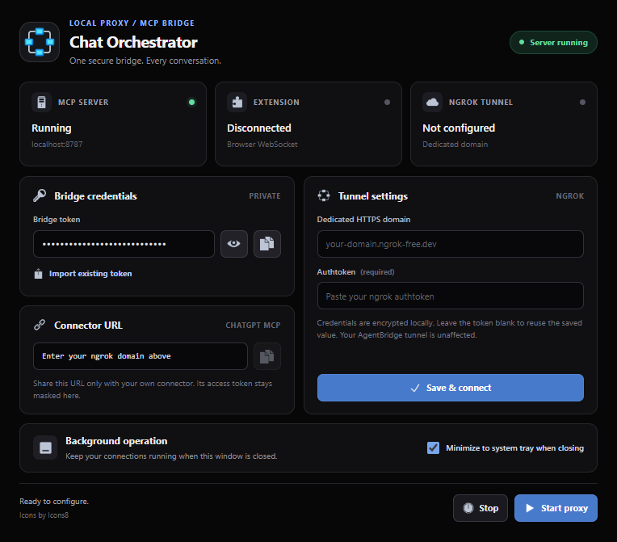

# Chat Orchestrator (MCP + browser extension)

## Manual extension tester

On Windows, stop the proxy listening on port 8787 and double-click
[Launch tester.cmd](extention-proxy/manual/Launch%20tester.cmd). The launcher
opens the web UI at `http://127.0.0.1:8787`. It requires Node.js and installs
the proxy package's dependencies if needed. Choose **Q** for the complete
catalog (default) or **S** to test with private coordination disabled.
On other platforms, run `node manual/server.mjs` from `extention-proxy`
after installing its dependencies, then open the same URL.

In your test browser profile, set the extension popup's WebSocket URL to
`ws://127.0.0.1:8787/bridge` and choose **Save and reconnect**. Open a
supported chat tab, then use **Get tab list**. The expandable workflow guide
in the tester walks through spawning, follow-ups, review, queue receipts,
recovery, and reconnects. Each operation uses the actual proxy handlers.

Every launch uses a new temporary proxy profile. Switching proxy sessions
resets the extension's session state, so use a test browser profile. Real commands can send
messages and close tabs in the connected browser. The activity panel keeps
the latest 500 entries, including full message contents. Close the tester
with Ctrl+C in its window to stop it and remove its temporary journal.

## Local 0.1.3 redesigned UI + modular-instructions candidate (November 6, 2026)

This is a local development candidate, not yet a published GitHub Release. It includes
four-page desktop navigation and a URL-only extension popup; proxy bridge tokens and
manual scoped agent pairing have been removed.

- Desktop EXE: `extention-proxy/dist/Chat-Orchestrator-0.1.3-no-bridge-auth.exe`
- Browser extension ZIP: `extention-proxy/dist/Chat-Orchestrator-0.1.3-no-bridge-auth-extension.zip`

To update an existing installation, exit the old desktop program using its **system tray > Exit**
command (window X may only hide it), then run the new portable EXE using the **same profile**.
Settings and the Ngrok authtoken live in the Windows profile data folder, not in the EXE.
To update the extension, replace the files in its existing unpacked folder, choose **Reload**
in Edge/Chrome extensions, then refresh chat tabs. Enter only the local WebSocket URL
in the extension popup; no bridge credential is required.

Verified after bridge-auth removal: `npm test` 70 PASS / 0 FAIL, tokenless MCP smoke,
real Electron four-page UI smoke, and isolated packaged EXE settings WebSocket smoke.
The new portable EXE and extension ZIP were built locally; GitHub release publication,
P0 crash recovery, independent QA and live-browser end-to-end approval remain outstanding.


An orchestrator chat (Claude or ChatGPT) calls MCP tools; a local server forwards them to a
browser extension, which opens/drives worker chat tabs and returns their replies.

**Windows desktop + Chrome extension release:** Download both packages from
[GitHub Releases](https://github.com/EmpRider/Chat-Orchestrator/releases) and follow
[the desktop setup guide](extention-proxy/DESKTOP.md). The desktop app manages its own
ngrok tunnel and gives you the ChatGPT connector URL.



The Windows desktop app includes a compact dark interface and a system tray
icon. **Minimize to system tray when closing** is checked by default: closing
the window keeps the proxy and ngrok alive. Uncheck it to exit when closing,
or use **Exit** from the tray context menu at any time. The choice persists
across restarts. Worker runtime state resets; worker chat tabs stay open.
Desktop icon artwork is by [Icons8](https://icons8.com/).

```
Orchestrator chat --MCP/HTTPS (tunnel)--> extention-proxy (server.js)
                                              | WebSocket (localhost)
                                              v
                                   extention (MV3 service worker)
                                              | tabs + content scripts
                                              v
                                   worker tab (ChatGPT / Claude)
```

## Tools exposed to the orchestrator

| Tool | Purpose |
| --- | --- |
| `list_tabs` | Open Claude/ChatGPT tabs with `tab_id`, site, role |
| `spawn_worker(site, task, share_context_from?, wait_seconds?)` | New chat in a separate window = sub-agent |
| `send_to_tab(tab_id, text, wait_seconds?)` | Follow-up message to an existing worker |
| `get_result(task_id, wait_seconds?)` | Poll/wait for a worker's reply (max 50s per call) |
| `read_chat(tab_id?, last_n?)` | Read a tab's transcript (default: orchestrator tab) |
| `close_worker(tab_id)` | Close a worker window |

## Setup (Windows desktop app)

1. Download the **Windows portable EXE** and **Chrome extension ZIP** from
   [the latest release](https://github.com/EmpRider/Chat-Orchestrator/releases/latest).
   Install the [ngrok CLI](https://ngrok.com/download/windows) separately and make sure `ngrok`
   is available on your `PATH`.
2. Double-click the EXE. In its UI, enter your **dedicated ngrok domain** and the
   **matching ngrok authtoken**, then click **Save & Connect**. The app manages the tunnel
   automatically; you do not need to start a tunnel manually. Your existing AgentBridge
   domain and tunnel remain separate.
3. Extract the extension ZIP. Open `chrome://extensions`, enable **Developer mode**,
   select **Load unpacked**, and choose the extracted folder containing `manifest.json`.
   In the extension popup, set `ws://127.0.0.1:8787/bridge` (or the configured profile port)
   and choose **Save and reconnect**. Proxy-managed settings synchronize automatically.
4. In desktop **Extension settings & system prompts**, select **Advanced browser actions**
   and enter the chat tab ID (from `list_tabs`) to set the legacy orchestrator.
   Log in to your worker-chat sites in that browser profile.
5. Once the app shows the ngrok route as verified, click **Copy Connector URL**.
   Add that URL as the ChatGPT connector endpoint. It uses your dedicated domain and
   has the form `https://YOUR-DOMAIN/mcp`, with no bridge token in the URL.
6. In the orchestrator chat, try:
   *"Use spawn_worker on chatgpt to review this plan, wait up to 45 seconds, then summarise."*

For more detail, see the [desktop setup guide](extention-proxy/DESKTOP.md).

## Develop from source

```powershell
cd extention-proxy
npm ci
npm test
npm run desktop
```

The default profile uses port `8787`. For a separate independent local proxy, launch
 the EXE with `--profile=work` and choose an unused port in **Tunnel settings**.
 Each profile keeps separate Ngrok authentication, prompts, configuration and settings.
 Never run two apps with the same profile and port.

## Verify the pieces

- `cd extention-proxy; npm test` runs MCP smoke tests and synthetic extraction
  regression tests for ChatGPT, Claude and Gemini. Live site verification is separate.
- `read_chat` prefers structured conversation data (using the same-site private
  web APIs adapted from Liksu/llm-chat-exporter-extension), then falls back to
  visible DOM messages. If both readers fail, it returns an extraction error
  instead of falsely reporting an empty successful chat.
- Optional `read_chat` flags: `last_n`, `include_reasoning` (default false),
  `include_attachments` (default true, returns names/placeholders only).
- **Do not run the legacy "Diagnose this tab" control on private conversations:**
  that older diagnostic response can include page text. Use synthetic tests instead.

## Safety knobs

- Proxy Tool **Extension settings & system prompts** controls the automation kill switch, worker limits,
  task timeout, and editable **operation-specific MCP/agent communication instructions** (task,
  workspace, delegation, queue receipt/ACK, child result, status request, tab loss, and failures).
  BA/PM/TL/Council/Watchdog role policies belong in SKILL.md, never in these proxy prompts.
  The extension popup owns only its local WebSocket URL and read-only connection status;
  settings synchronize over that WebSocket without a proxy-generated token.
- Neither `/mcp` nor `/bridge` uses a Chat Orchestrator bridge token; the proxy binds locally to `127.0.0.1`.
- `send_to_tab` refuses the orchestrator tab; `close_worker` only closes tabs it spawned.

## Known limits

- The structured reader depends on private web APIs that may change. ChatGPT
  and Gemini use browser-local session-token hooks; credentials are not sent to
  the MCP server. Reload the extension **and** refresh existing conversation tabs
  so hooks can initialize at document start.
- Gemini is supported for `read_chat`; automated Gemini worker prompting is not
  enabled. Legacy DOM-only reads can still lose formatting and older virtualized turns.
- Automating the web UIs may conflict with each site's terms; keep it to personal use.
- Ngrok tunnel authentication is preserved, but there is no separate MCP access token.
  Anyone who can reach your Ngrok `/mcp` URL may control your logged-in browser tabs.

## Modular proxy instructions (development)
Operation-specific prompt modules: core, task, workspace, delegation, queue, child_result,
status_request, child_tab_lost and failure. The proxy selects modules by operation/event;
roles remain defined by SKILL.md. A recovered worker tab gets a new ID; reconcile its
original task using read_chat and get_result. Bridge tokens and per-agent pairing are removed;
private FIFO queue still holds uncertain events for manual reconciliation. Packaged release
verification is still outstanding.
