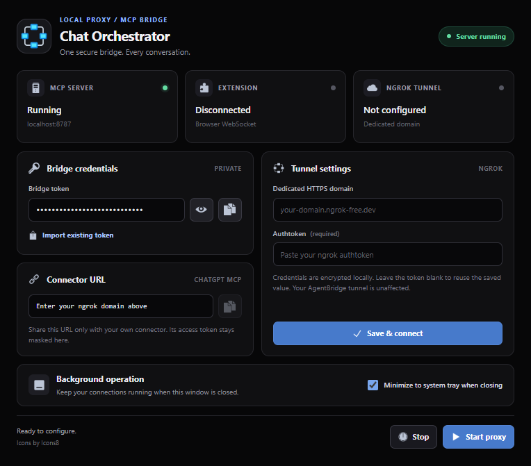

# Chat Orchestrator (MCP + browser extension)

## Manual extension tester

On Windows, stop the proxy listening on port 8787 and double-click
[Launch tester.cmd](extention-proxy/manual/Launch%20tester.cmd). The launcher
opens the web UI at `http://127.0.0.1:8787`. It requires Node.js and installs
the proxy package's dependencies if needed. Choose **Q** for the complete
catalog (default) or **S** to test with private coordination disabled.
On other platforms, run `node manual/server.mjs` from `extention-proxy`
after installing its dependencies, then open the same URL.

In your test browser profile, set the extension popup's WebSocket URL to
`ws://127.0.0.1:8787/bridge` and choose **Save and reconnect**. Open a
supported chat tab, then use **Get tab list**. The expandable workflow guide
in the tester walks through spawning, follow-ups, review, queue receipts,
recovery, and reconnects. Each operation uses the actual proxy handlers.

Every launch uses a new temporary proxy profile. Switching proxy sessions
resets the extension's session state, so use a test browser profile. Real commands can send
messages and close tabs in the connected browser. The activity panel keeps
the latest 500 entries, including full message contents. Close the tester
with Ctrl+C in its window to stop it and remove its temporary journal.

## Current Windows candidate (November 15, 2026)

This is an **unreleased development candidate**, not a production-certified build.
Current installer: `extention-proxy/dist/Chat Orchestrator Setup 0.1.3.exe`.
The NSIS installer is **unsigned**. It uses installed **Chrome or Edge** with a
dedicated browser profile, not the user's ordinary personal browser profile.
The extension is bundled but requires user-consented installation in that profile.

Three independent authorization boundaries are implemented: a **local extension
profile key** for loopback WebSocket, a **public MCP HTTP transport key** for
ngrok ingress (Bearer header or dedicated URL-token route), and **per-Agent credentials**
issued only after explicit Parent/Child pairing. Keep Agent credentials out of
URLs, prompts and logs; the dedicated HTTPS URL itself is sensitive. None of these keys alone
cryptographically proves the physical browser tab making a remote MCP call.

**Authentication policy:** The Product Owner chose one static transport
token for public MCP, **not OAuth**. ChatGPT's custom MCP UI does not allow custom
Authorization headers, so the same token can be supplied in the dedicated
`/mcp/agent/<transport-key>` URL path, following AgentBridge's route-token pattern.
The original `/mcp` continues to require a Bearer header.
No OAuth login endpoints are implemented. Real ChatGPT connector E2E remains unverified.

**Multiple PCs, one ChatGPT account:** Register a separate ChatGPT MCP
connector for each computer's distinct ngrok URL (for example `PC1` and
`PC2`). On each Windows app's **Connections → One-time browser setup** panel,
save the exact connector name displayed in ChatGPT. New Parent/Child setup
and task/queue instructions then direct the AI to that named connector
instead of similarly named tools on another PC. This is an instruction,
not an authentication guarantee or automatic connector registration.
See the [two-PC setup](extention-proxy/DESKTOP.md#two-or-more-pcs-using-the-same-chatgpt-account).


An approved ChatGPT Agent calls scoped MCP tools; a local server authenticates and
forwards them to the browser extension, which manages Child tabs and results.

**Windows Setup candidate:** The installer bundles the extension resources;
there is no separate ZIP requirement for this candidate. See the
[desktop setup guide](extention-proxy/DESKTOP.md). The desktop manages an ngrok
tunnel but its current static HTTP transport-key flow has not completed
ChatGPT OAuth compatibility verification.



The Windows desktop app includes a compact dark interface and a system tray
icon. **Minimize to system tray when closing** is checked by default: X keeps
the proxy and ngrok alive. Uncheck it to request an explicit Exit confirmation,
or use **Exit** from the tray context menu. Exit asks Keep Browser Open,
Close Managed Browser or Cancel. The setting persists
across restarts. Worker runtime state resets; worker chat tabs stay open.
Desktop icon artwork is by [Icons8](https://icons8.com/).

```
Orchestrator chat --MCP/HTTPS (tunnel)--> extention-proxy (server.js)
                                              | WebSocket (localhost)
                                              v
                                   extention (MV3 service worker)
                                              | tabs + content scripts
                                              v
                                   worker tab (ChatGPT v1)
```

## Tools available to approved Agents

| Tool | Purpose |
| --- | --- |
| `pair_conversation` | Pair an explicitly user-approved Parent or owned Child |
| `list_tabs` | Inspect eligible browser tabs |
| `spawn_worker` / `send_to_tab` | Assign work to directly owned Children |
| `get_result` / `read_chat` | Inspect task outcome or live conversation |
| `complete_task` / `review_task` | Child completion and direct Parent review |
| `close_worker` | Close an eligible Child after review |

All tools require a UUID `idempotency_key`. Except `pair_conversation`,
tools also require the scoped `agent_credential` from explicit pairing.

## Setup (Windows desktop app)

1. Obtain a trusted Windows installer and install [ngrok CLI](https://ngrok.com/download/windows)
   on `PATH`.
2. In **Connections**, choose installed Chrome or Edge. Chat Orchestrator launches
   a dedicated, persistent browser profile, separate from your personal profile.
3. In that browser, open its Extensions page and install the bundled extension
   using **Developer mode > Load unpacked**. Set the extension popup's local
   WebSocket URL and **profile connection key** from Connections.
4. Confirm this extension is in the selected dedicated browser, click
   **Verify connected browser profile**, then **Finish setup**.
5. Configure your dedicated ngrok domain and authtoken. In Desktop, click
   **Copy Connector URL**. It copies
   `https://YOUR-DOMAIN/mcp/agent/<transport-key>` for ChatGPT's
   **No authentication** option. The Desktop UI only displays the non-secret
   `/mcp/agent` path. This complete URL is a secret: avoid chat messages,
   browser history, screenshots and shared logs. Tunnel operators may record it.
   Header-capable MCP clients can still use `https://YOUR-DOMAIN/mcp`
   with `Authorization: Bearer <transport-key>`.
6. Explicitly approve the ChatGPT Parent tab in the extension, which sends a
   one-time `pair_conversation` initialization prompt.

**Live ChatGPT connector compatibility still needs verification.** Offline
MCP SDK tests confirm successful no-custom-header access at the URL-token
endpoint; a real ChatGPT connection, UI and tool call have not yet been tested.
Never paste the token-bearing URL into a chat or disable authentication.

For more detail, see the [desktop setup guide](extention-proxy/DESKTOP.md).

## Develop from source

```powershell
cd extention-proxy
npm ci
npm test
npm run desktop
```

The default profile uses port `8787`. For a separate independent local proxy, launch
 the EXE with `--profile=work` and choose an unused port in **Tunnel settings**.
 Each profile keeps separate Ngrok authentication, prompts, configuration and settings.
 Never run two apps with the same profile and port.

## Verify the pieces

- `cd extention-proxy; npm test` runs MCP smoke tests and synthetic extraction
  regression tests for ChatGPT, Claude and Gemini. Live site verification is separate.
- `read_chat` prefers structured conversation data (using the same-site private
  web APIs adapted from Liksu/llm-chat-exporter-extension), then falls back to
  visible DOM messages. If both readers fail, it returns an extraction error
  instead of falsely reporting an empty successful chat.
- Optional `read_chat` flags: `last_n`, `include_reasoning` (default false),
  `include_attachments` (default true, returns names/placeholders only).
- **Do not run the legacy "Diagnose this tab" control on private conversations:**
  that older diagnostic response can include page text. Use synthetic tests instead.

## Safety knobs

- Proxy Tool **Extension settings & system prompts** controls the automation kill switch, worker limits,
  task timeout, and editable **operation-specific MCP/agent communication instructions** (task,
  workspace, delegation, queue receipt/ACK, child result, status request, tab loss, and failures).
  BA/PM/TL/Council/Watchdog role policies belong in SKILL.md, never in these proxy prompts.
  The extension popup configures its local WebSocket URL and profile connection key.
  Settings synchronize over that authenticated local connection.
- Public `/mcp` requires a Bearer header and `/mcp/agent/<transport-key>`
  requires the same key in an exact URL path (not a query parameter). Both run on an
  HTTP-only listener without the extension bridge. Local `/bridge` uses a
  different, profile-scoped key.
- `send_to_tab` requires direct Parent ownership; `close_worker` is gated by
  ownership, task completion, descendant state and Parent review.

## Known limits

- The structured reader depends on private web APIs that may change. ChatGPT
  and Gemini use browser-local session-token hooks; credentials are not sent to
  the MCP server. Reload the extension **and** refresh existing conversation tabs
  so hooks can initialize at document start.
- Gemini is supported for `read_chat`; automated Gemini worker prompting is not
  enabled. Legacy DOM-only reads can still lose formatting and older virtualized turns.
- Automating the web UIs may conflict with each site's terms; keep it to personal use.
- Ngrok provider credentials alone do not authenticate MCP clients. Public HTTP
  authentication and a separately paired Agent credential both remain mandatory.

## Modular proxy instructions (development)
Operation-specific prompt modules: core, task, workspace, delegation, queue, child_result,
status_request, child_tab_lost and failure. The proxy selects modules by operation/event;
roles remain defined by SKILL.md. A recovered worker tab gets a new ID; reconcile its
original task using read_chat and get_result. Profile transport credentials and
per-Agent pairing remain mandatory; private FIFO queue holds uncertain events
for manual reconciliation. Live browser acceptance and signed distribution remain pending.
