# Chat Orchestrator — Living Requirements & Decision Log

**Version:** 1.77 (modern ChatGPT message DOM selectors from captured page, 2026-11-16)
**Last updated:** 2026-11-16 (Asia/Colombo)
**Status:** Discovery and implementation verification in progress; latest source edits explicitly requested by Product Owner
**Working language for requirements questions:** Sinhala

> **Purpose of this file:** Record the user's decisions as the authoritative, evolving requirements baseline. Record the exact decision, rationale/context, unresolved details, and when superseded. Do not silently turn suggested solutions or observations about existing code into confirmed requirements.

## Decision protocol

1. Ask **one simple question at a time**, **in Sinhala**, with **at least three choices and a fourth custom-answer option**.
2. A requirement becomes **CONFIRMED** only after the user directly selects or explains it. If a statement has multiple interpretations, record the agreed portion and keep the rest **OPEN**.
3. After the user finalizes each decision, update this Library file in place; increment its version and add a timestamped entry to the change history. Do not create a new document for every answer.
4. Keep **CONFIRMED**, **OPEN**, **PROPOSED**, **SUPERSEDED**, and **CODE OBSERVATION** distinct. A code observation is not a design decision.
5. If the user's new answer contradicts an old design, keep the older entry with **SUPERSEDED** status and a reference to the newer decision.
6. Do not change the codebase just because a requirement has been documented; coding requires a separate implementation request.
7. **Business analyst challenge protocol:** Do not blindly accept a proposed workflow as technically safe or unambiguous. Identify contradictions, edge cases, responsibility boundaries, and missing failure-state decisions. Ask clarification **one focused question at a time before moving to the next topic**. Treat the user as the product decision-maker, and explicitly distinguish confirmed user intent from analyst recommendations.
8. **Mandatory technical feasibility gate (D-027):** For every new or changed decision, evaluate **browser/platform API support**, **current implementation support**, **required implementation changes**, **security/identity limitations**, **failure modes**, and **test evidence** BEFORE marking an approach implementable. Record a verdict: `FEASIBLE VERIFIED`, `FEASIBLE WITH REDESIGN`, `BLOCKED`, or `NOT YET VERIFIED`. A chosen business outcome is not proof the implementation is possible.
9. When the proposed method is technically blocked, **do not keep treating it as the accepted design**. Preserve the user's business goal, identify the obstacle, propose the simplest feasible alternative, and ask **one** decision question to approve the revised approach. Update the Mermaid diagrams/mockups in **this same `.md` file**. Never claim source tests or live behavior were verified when the workspace was inaccessible.
10. **High-impact questions only (user correction, 2026-11-14):** The analyst/technical architect **decides routine technical mechanics** without bothering the Product Owner (e.g., UUID key creation, conventional idempotency scopes, schema requirements, retry key reuse, implementation wiring). Ask one Sinhala question at a time **only** if the answer materially changes business outcome, UX, ownership/security, cost/operational tradeoff, or if a true technology blocker forces a business-level alternative. Avoid repetitive micro-questions and long chains of adjacent technical edge cases. State and document ordinary engineering defaults, evidence, and caveats directly. Do not treat the user as responsible for low-level API design.

## Current confirmed requirements

### D-001 — Product purpose [CONFIRMED]
Chat Orchestrator is a **lightweight, self-contained agent orchestration harness**, *not* another AI coding tool or editor. It coordinates AI agents through existing supported web interfaces. Its responsibility covers browser-backed agent identification/registration, parent-child lifecycle, worker spawning, task delegation, results, notifications, and reliable communication. New features must justify their direct orchestration role; avoid unnecessary dependencies and complexity.

**Source/context:** User's “Chat Orchestrator — Core Vision and Browser-Based Agent Management Architecture” specification, 2026-11-13.

### D-002 — Installed browser and dedicated runtime profile [CONFIRMED AT PRODUCT LEVEL]
Use a compatible browser **already installed on the user's computer** rather than building or bundling another browser. The user chooses the browser during the installed application's first-run setup (D-063); Chat Orchestrator operates using its own dedicated browser profile/user-data directory, separate from the ordinary personal profile, and retains the configuration between restarts. Users sign in to supported AI sites normally.

**Clarification D-058 (Q-018 Option B):** The first release officially supports **installed Google Chrome and Microsoft Edge**. The user selects one; Chat Orchestrator launches the selected browser with its dedicated profile. D-043 confirms one-time guided extension onboarding; the exact browser-specific provisioning mechanism remains an implementation/testing concern, not an open business selection. Other browsers remain outside this decision. D-059 independently confirms Windows-only first-release OS scope, with macOS/Linux later.

### D-003 — Browser startup behavior [CONFIRMED; Question 01 — CUSTOM]
When Chat Orchestrator starts, it should **automatically launch the browser that the user selected**, using the Chat Orchestrator environment. The user should **not need to navigate to a prescribed website during startup**. The user may navigate to any website **supported by Chat Orchestrator**. The extension detects such a tab and injects the code needed for the potential parent-agent experience.

**Exact user intent:** “The application should start automatically in a browser that the user selected. The user should not need to navigate to any site. When the user navigates to any site, we support it, and it should detect it, and the extension injects the code ... to enable that tab as the parent agent.”

**Interpretation boundary:** Opening a supported site is detection and preparation, **not** automatic parent-agent approval.

**Clarification D-060 (Q-020 Option B):** Automatic **browser** launch is still mandatory whenever Chat Orchestrator itself starts. Automatic **application** launch at Windows user sign-in is an independent, optional Proxy Settings toggle, initially **OFF**, and never a substitute for user-approved Parent enrollment.

### D-004 — Mandatory extension; normal runtime uses extension APIs [CONFIRMED AT PRODUCT LEVEL]
The dedicated browser profile requires the Chat Orchestrator extension. Use supported browser-extension APIs/content scripts for tab management, website observation, response reading, and prompt submission; do not rely on CDP, Chrome remote debugging, or `chrome.debugger` for normal runtime interaction. Browser-specific installation approvals and website restrictions must be respected; the extension is not a guarantee against bot detection.

**Clarification D-043/D-058/D-063/D-066:** The installed Windows application is distributed by `Setup.exe`; guided extension installation is approved, and its release channels are browser stores for ordinary users plus unpacked mode for development/testing; the v1 supported installed browser set is **Google Chrome + Microsoft Edge**. Browser-specific provisioning mechanism, permissions, injection strategy and actual compatibility tests remain implementation/E2E work.

### D-005 — Parent registration requires explicit user choice [CONFIRMED]
A detected supported tab is **UNREGISTERED** by default. Ask the user whether to make it a parent agent. **Only Yes** authorizes parent registration; No leaves it unregistered and usable as a normal tab. Never silently register all open tabs, infer a parent from browser focus, or establish parent status merely because the AI called an MCP tool. **Clarification D-051:** If a tab is already managed as a Child/descendant Agent, suppress `Make this tab a Parent`; no promotion to a root Parent during its managed Child role.

### D-006 — A chosen parent tab keeps its role until it closes [CONFIRMED; Question 01 — CUSTOM]
Once the user selects a tab as a **Parent Agent**, that *tab* remains a parent **until the tab is closed**. The system must not silently reassign or switch its parent role while it stays open.

**Clarified by D-053 (Q-015a user custom answer):** The human may freely switch between browser tabs and navigate within an already managed Parent tab. Navigation **does not reset, promote, reparent, or delete the tab-based Agent hierarchy**. An approved Parent retains the same logical Parent ownership until a separately defined closure/detachment rule applies, and its existing Child tasks remain running. Browser focus/conversation URL is not an Agent-role selector. The current webpage is not cryptographic proof of a privileged MCP caller: D-037 scoped pairing, role/ACL, supported-site checks, and D-008 no-guessed-authentication still apply. **D-055 Q-016 CONFIRMED Option C:** The Proxy must navigate the original Parent tab back to the *delegation-origin conversation* before submitting the Child completion notification; do not deliver it into an unrelated currently visible chat. D-056 confirms **immediate navigation** even if the currently shown conversation is generating or has an unsent draft; this can interrupt work or discard an unsent draft (Q-016a Option A). Earlier explicit live-parent unregistration behavior remains open; do not infer a new permission to deregister a live root.

### D-007 — Parent status visibility [CONFIRMED AT PRODUCT LEVEL]
A registered parent tab should clearly display its identity and state through a lightweight extension-provided in-page indicator, without disrupting normal web functionality. Useful status fields include agent ID, connection, idle/busy state, and active worker count. Exact UI placement and content are not finalized.

### D-008 — No guessed Agent identity [CONFIRMED TRUST PRINCIPLE; STRICT PHYSICAL-TAB PROOF PARTIALLY SUPERSEDED BY D-037]
Extension detection of a tab ID and receipt of an MCP request are **different trust boundaries**. Browser tab existence does not authenticate the origin of an MCP request. Do not guess a Parent from browser focus, timing, URL equality, or caller-supplied `caller_tab_id`. A request without a valid scoped Agent pairing/credential and current authorization must still be refused. **D-037 supersedes the earlier interpretation that privileged requests must be denied unless the Proxy can cryptographically prove which physical browser tab originated the MCP call.** The user explicitly selected a practical bearer-credential / logical-Agent association rather than strict tab-origin proof; a copied credential remains an impersonation risk.

**Still mandatory:** Only previously user-approved Parent records may be paired; no auto-registration of other tabs; verify current Agent role, ownership, revocation, and permitted operation; do not treat UUID or tab ID alone as proof of authorization. Do not claim that credential possession proves physical-tab provenance. Exact integration and provider compatibility remain unverified.

### D-009 — Parent-tab closure is a user-mediated decision [CONFIRMED; Question 02 — CUSTOM]

Closing a registered parent tab may be accidental or intentional. **The extension detects the actual parent tab closure** using its tab lifecycle event, and provides the proxy with the closed tab's last known supported **URL**, **tab ID**, and helpful description/identifying details (e.g., site/title; captured before the tab is removed). The **Chat Orchestrator proxy desktop/tool UI**, not the closed web tab, displays a user-facing prompt identifying which parent was closed and that it owns children.

The **final button labels** requested by the user are **Accident / Yes / Cancel** (superseding the initial Yes / No / Cancel wording within the same user answer):

- **Accident** — Treat closure as accidental. Orchestrator opens a **new browser tab with the captured parent URL**, registers that new tab as the restored Parent, and **updates the existing parent-child relationship registry/bindings** so the children remain associated with the restored parent. This is the user's explicit authorization of restoration. The replacement receives a *new tab ID*; the old numeric tab ID must never be reused as if still open. Preserve the existing logical parent/worker relationships rather than inventing an unrelated new owner. Technical identity validation and recovery failure handling are **OPEN**.
- **Yes** — The closure was intentional; explicitly **close the child-agent tabs** of the closed Parent. Do not close them merely because the parent closed; this action only starts after the user chooses Yes.
- **Cancel** — Dismiss the popup and **leave child tabs exactly as they are**; user can close them manually later. No automatic reassignment, closure, or restoration upon Cancel.

**Countdown and no-default-action rule:** Popup's three action buttons start **disabled for 5 seconds**. The countdown **only enables them after five seconds**; it must not select any option, initiate any action, close the popup, or expire into a default. **Wait indefinitely for user selection**, unless the user eventually chooses Cancel (which explicitly dismisses the popup). No child or parent action is taken during countdown or merely when countdown reaches zero.

**Context:** The user explicitly said the popup must be triggered by the proxy tool, and the extension should send the closed parent URL to the proxy from tab-closing detection. The popup must identify the closed parent by tab ID plus a useful description.

**Interpretation boundary:** Do not assume that generic browser Ctrl+Shift+T can deterministically recover the same logical tab ID. The user initially described Ctrl+Shift+T as an option for accidental closure, then gave a more specific final requirement: **Accident button restores a new tab from the captured URL and rewires the registry**. Final requirement takes precedence. Exact treatment of browser quit, popup persistence across proxy restart, in-flight child tasks, and worker notifications during a missing parent are **OPEN**. Do not assume the restoration operation succeeds merely because the new tab opens.

**Extension to managed Child tab disappearance:** D-068 (Q-027 CUSTOM) applies the same user-mediated Accident/Yes/Cancel decision when the closed tab itself is a managed Child; target and notify its *own* original Parent, not a fictitious root closure. User choices apply only to the closed Child subtree.

### D-010 — Cancel leaves child tabs and in-progress work untouched; show orphan notice [PARTIALLY CONFIRMED; Question 03 — A]

When the user selects **Cancel** on the Parent-closed popup, existing child browser tabs **remain open** and **in-progress work continues without intervention**. The system must not automatically close, interrupt, reparent, or replay their activity solely due to the missing parent. The **user will manage and close the tabs manually if desired**.

The system shows a contextual notice in its UI identifying the affected child as orphaned, with language matching the user's intent, such as: **“This tab does not have a parent agent because you selected Cancel in the popup. You can close this tab when you want.”** This is informational, not a command and not a reason to interrupt in-progress generation.

**Clarification (D-011/D-012):** On **Cancel**, child tabs remain open and website generation is not intentionally stopped, but Orchestrator access is revoked and future MCP tool calls by those detached agents must be denied with a forbidden outcome. New automated work/child spawning is not allowed. Exact representation of denial (HTTP 403 versus MCP-level authorization error) and any previously queued receipts are **OPEN**. Notice placement and dismissibility are also **OPEN**.

**Exact context:** User: “the answer fro the current qection is A, leave the chiled tab alone user will handle those and, we should show the notification in UI, like `this tab dont have a parent agent you select cancel in popup. you can close this tab as you need`.”

### D-011 — Cancel converts orphaned child into ordinary unmanaged browser tab [CONFIRMED; Q-003a — Option C]

After a Parent tab is closed and the user explicitly chooses **Cancel**, its affected Child tab(s) are **released from Chat Orchestrator agent management** and become **ordinary, user-controlled browser chat tabs**. Their tabs stay open, and the extension/proxy should show the previously agreed notice indicating that they no longer have a Parent Agent and can be closed manually. The Orchestrator must **not deliver further automated prompts/tasks, spawn new descendant agents on their behalf, treat them as managed children, or implicitly promote them to Parent Agents**. This clarifies and limits the scope of D-010's "leave them alone" behavior.

**Boundary clarified in D-012:** On **Cancel**, the live website generation stays in its tab, but the Orchestrator cuts off the tab's MCP authorization immediately. Do not infer permission to cancel website generation, delete history, or automatically replay a submitted request. Whether a final result can be collected after deliberate loss of management is **not promised**; represent its tracked outcome honestly as detached/inaccessible if applicable.

**Nested descendants resolved by D-018:** The chosen closure action applies recursively to the entire descendant tree. **Still OPEN:** historical task/results retention, notices and UI placement, and later voluntary re-enrollment. Record these before implementation.

**Exact user answer:** “ප්‍රශ්න 03-A — Option C”.

### D-012 — Parent-close with active children: explicit warning and three outcomes [CONFIRMED BUSINESS INTENT; Q-003b — CUSTOM]

If a **Parent Agent tab** closes while any descendant **Child Agent tab is still actively doing work**, the proxy UI must show an explicit, understandable warning that **work is still in progress**, asking whether the closure was really intended. Show a **list of the currently working child tabs** (use identifying names/sites/tab IDs as available), not merely a generic confirmation. This enriches the D-009 parent-close popup; do not create an unrelated hidden auto-action. The previously selected **five-second button-enable countdown and indefinite wait for a user choice** still apply unless the user changes them.

The popup actions remain **Accident / Yes / Cancel**:

- **Accident:** User says closing the Parent was accidental. Reopen the last captured Parent URL in a **new** browser tab, recover the Parent identity/ownership and descendant relationships, and let the running child AI tasks **continue without intentional interruption**. Restoring parent ownership should not silently replay submissions or drop reports; technical failure may need explicit handling.
- **Yes:** User intentionally confirms closing the Parent **and every affected child tab immediately**, including currently working children. This is explicit authorization to interrupt/stop their active browser tasks by closing those tabs. The operation does not wait for those tasks to complete.
- **Cancel:** Keep the child browser tabs **open exactly as they are**, and allow any currently generating webpage answer to continue without interruption. Show the agreed **no-parent / user-may-close-this-tab** notice. Immediately **detach** these tabs from Orchestrator management; subsequent MCP tool calls made on behalf of those detached/orphaned agents **must be denied as forbidden (user-requested `403`)**. The AI chat may react to a denied tool call as it sees fit, but Orchestrator must not proactively send further work, reparent children or close tabs.

**Do not overclaim technical behavior:** HTTP status `403 Forbidden` is the user's expressed policy/desired observable denial. Some MCP transports represent tool authorization failure as a structured tool error rather than HTTP status, and a single shared MCP endpoint might service unrelated authorized agents. **Scope the refusal to the detached agent**, never indiscriminately block all agents. Select precise transport/error behavior later after reviewing actual client and protocol compatibility; do not silently replace the user's `403` requirement.

**Clarified by D-013 (Q-003c, Option A):** While the parent-closure popup awaits a human choice, already managed descendant agents may continue making their normal authorized MCP tool calls. The pending popup and five-second countdown do not themselves block MCP access or trigger an automatic lifecycle action. Only the user’s eventual choice changes their authorization and tab lifecycle. Security checks and caller authorization unrelated to this pending closure still apply.

**Nested descendants resolved by D-018:** Yes/Cancel affect the entire affected subtree, never an unrelated Parent root. **Other OPEN cases:** An interrupted task's persisted status/receipts, a proxy restart while the popup is pending, and no-child/inactive-child warning wording remain to be resolved. Explicitly record these, not assumptions.

**Exact user context:** “if user cloased the tab if it has inprogeres chiled then we should notify that inprogeres tabs to user ... 'this tabs are still working, and do you really sure this was not an accident, and tab list' ... accident ... continue the task without interuption ... yes cloass all tabs right away ... cancel leave tabs as it is and show the notificaton and cutoff all mcp tool calls as 403, then agent hwill handle that as its want.”

### D-013 — MCP calls while parent-closure popup is awaiting a choice [CONFIRMED; Q-003c — Option A]

The user selected **Option A**: Once a Parent tab closes and the proxy shows the pending **Accident / Yes / Cancel** decision dialog, **existing Child Agents' MCP tool calls continue normally, including new calls**, for as long as the user has not chosen an action. The popup's five-second countdown only disables/enables the popup buttons; it is **not** a timeout for MCP access, permission to auto-choose, or a default denial. If the user leaves the popup unanswered indefinitely, the already-authorized Child Agents retain normal MCP access (subject to other usual security/authorization policies) until the user decides.

The eventual choice determines the transition:

- **Accident:** attempt to restore the Parent and rebind descendants without deliberately interrupting their work. The concrete repair/verification mechanics are still open.
- **Yes:** close the affected Child tabs immediately after explicit selection.
- **Cancel:** detach the affected Child tabs and deny any **subsequent** MCP calls on their behalf as forbidden, while leaving the webpage/tab and in-page generation alone.

**BA-identified unresolved race (ask next):** An MCP tool call may already have been accepted and **started executing** before the user clicks **Cancel**. The user's choice settles the admission policy for calls **after** Cancel, not whether to let such previously admitted in-flight calls finish, abort them, or handle them case-by-case. This can be consequential for side-effecting tools (e.g., opening tabs), so do not infer an answer. Also separately clarify requests that arrive concurrently with a Cancel click via a defined atomic ordering rule; no unrequested replay or automatic duplicate action.

**User answer:** “ප්‍රශ්න 03-C — Option A”.

### D-014 — Allow already-started MCP calls to finish after Cancel [CONFIRMED; Q-003d — CUSTOM / A]

If an affected Child Agent's MCP operation was **accepted and started executing before** the user chose **Cancel**, **leave that operation alone and allow it to finish naturally**, including work already initiated by that operation. Do not try to abort or roll back an admitted call solely because the user subsequently selected Cancel. For **new MCP requests after Cancel**, the revoked Child Agent is forbidden access under D-012 and D-013.

**BA qualification:** The user's reasoning that this is "not a harm" is an expectation, **not a guarantee**. Already admitted side-effecting calls such as `spawn_agent` may still open new tabs after Cancel, send actions, or change state. Never promise rollback of side effects. The proxy must use a well-defined authorization-decision boundary to classify requests as admitted-before versus denied-after Cancel; concurrent/racing requests must not be guessed about or replayed.

**Resolved by D-017:** A new tab created by such an already-admitted spawn is left open but unmanaged after Cancel. Still unresolved: whether already-running completion receipts are retained in historical logs after detachment.

**User answer:** "my answer is A, leve it alone its not a harm to us".

### D-015 — Maintain a visual living requirements document [CONFIRMED]

The decision log is **not just a text-based record**. Maintain an **illustrated, living Product Requirements / Decision document** that includes useful **process diagrams, Parent/Child relationship diagrams, and UI mockups** in addition to decisions, open BA questions, code observations, and change history. Whenever a decision changes a workflow or UI behavior, update the corresponding diagrams/mockups too; retain document continuity rather than creating a separate version for every answer.

**Document convention (UPDATED BY D-016):** Maintain one `.md` file only, with Mermaid diagrams and text-based UI wireframes **embedded directly in Markdown**. Visual proposals are `DRAFT / NOT APPROVED` until explicitly finalized; approved behavior does not itself approve the visual design. The previously introduced DOCX companion is discontinued.

**User answer:** "that `Decision Log` file we maintaine should contains diagarames and mokeups too, not just only test base log, that wel help us to finalized UI designe too".

### D-016 — Single Markdown file for all decisions and visuals [CONFIRMED; SUPERSEDES DOCX CONVENTION IN D-015]

**One authoritative Library artifact only:** `/Chat Orchestrator Decisions/chat_orchestrator_decision_log.md`. Do not create companion Word, PDF, image, or numbered Markdown files for future updates. Update/overwrite this **same file** in place whenever a decision is finalized or a previously recorded rule is corrected. All relevant materials belong inside it, including:

- Approved decisions, exact user context, business rules, exceptions and known risks.
- Unanswered BA questions and rejected/superseded alternatives.
- Embedded **Mermaid** flowcharts, relationship/state diagrams and sequence diagrams whenever useful.
- Embedded **Markdown tables and fenced-text/UI mockups**, marked `DRAFT` until approved.
- Historical change entries showing what changed and why.

When a decision changes a flow or screen, update the corresponding inline Mermaid/mockup in the same edit. Diagrams and mockups must remain readable as source text even in a Markdown viewer that cannot render Mermaid. No actual UI design is accepted merely because a mockup exists.

**Exact user correction:** "why do you guggle with pdfs, maintain single `.md` file. dont create multiple files use single `.md` file and update that file wit all details".

### D-017 — New tab created after Cancel by an already-admitted spawn is unmanaged [CONFIRMED; Q-003e — Option A]

If an affected Child Agent initiated and the proxy **accepted/started** a `spawn_agent` MCP call **before** the user pressed **Cancel**, that call may finish after the cancellation under D-014. If it creates a **new browser tab** after the cancellation:

- **Keep the new tab open; do not close it automatically.** The new tab is immediately **UNMANAGED**, just like other tabs detached by Cancel, and is available for normal manual user interaction.
- Show the **missing Parent Agent / user-managed tab notification** on that new tab (the exact notice placement/design remains draft).
- Deny **new** Chat Orchestrator MCP operations on behalf of that newly unmanaged tab using the same forbidden-access behavior as other detached children. A newly created tab is not silently promoted to a Parent or reattached to another Parent.
- Do **not** interrupt any webpage response already generating or claim that a previously admitted browser-side submission can always be rolled back. Whether an initial task was actually submitted before/during the spawn, or merely a tab opened, is an observed runtime fact and must not be guessed.

**Boundary of approval:** This addresses the tab created from a previously admitted call after **Cancel**; it does not authorize *new* spawns after Cancel. The system needs to apply cancellation/revocation state to the result of an in-flight spawn **before** treating the tab as manageable or allowing another MCP request. Preserve enough operation history to explain what occurred; exact result/report persistence policy is still open.

**User answer:** “ප්‍රශ්න 03-E — Option A”.

**Resolved by D-018:** A Parent closure decision applies to its entire descendant subtree, including children, grandchildren and deeper levels. Separate unrelated root trees are out of scope.

### D-018 — Parent-close decision applies to the entire descendant subtree [CONFIRMED; Q-003f — Option A]

The user selected **Option A**: If registered Parent A closes, and A owns Child B which owns Grandchild C (and potentially further levels), the proxy **Accident / Yes / Cancel** decision applies to **every descendant of A, recursively**, rather than only direct children. The proxy warning should identify affected descendants and visibly distinguish any still-working tabs. This does not authorize action on agents belonging to other, unrelated Parent roots.

- **Accident:** Restore/rebind the *closed Parent A* in a new tab after validation. Maintain the existing nested structure (e.g., replacement A → B → C), rather than automatically promoting B or arbitrarily rebuilding C as a direct child of A. Leave running descendant work uninterrupted. Exact recovery failure behavior is **OPEN**.
- **Yes:** Explicitly close all descendant browser tabs in the affected subtree, including grandchildren and deeper levels, without waiting for their generation to finish. Do not assume merely closing A had already closed them.
- **Cancel:** Leave all descendant browser tabs open (and let in-page generations proceed), but detach **the whole affected subtree** from Orchestrator management. Inform affected tabs that the Parent was closed. Deny *new* orchestrator MCP calls from those detached descendants as forbidden; accepted calls started before Cancel are still permitted to complete under D-014. A tab opened later by a previously admitted call is also unmanaged under D-017.
- **Undecided dialog:** Until the user explicitly chooses, existing managed descendants may continue their normally authorized MCP calls under D-013. The five-second countdown only enables the three buttons.

**Do not infer:** Whether a child agent may also be an independently user-approved Parent Agent, how to reconcile a partially restored hierarchy, or what UI/error is appropriate when restoring A fails. These are separate BA questions. The next priority is the **Accident recovery failure** case.

**User answer:** “ප්‍රශ්න 03-F — Option A”.

## BA assumptions and unresolved recovery conditions

### A-001 — Reopening saved URL always restores the Parent [USER ASSUMPTION; NOT CONFIRMED AS TECHNICAL GUARANTEE; Q-003g]

**User’s exact intent, 2026-11-13:** “Since we have the closed parent tab url we can re open it. it cant be failed that not happaning, so dont worry about it.”

**Confirmed requirement retained:** When **Accident** is selected, try opening the closed Parent's saved URL in a new tab and rebind its original descendant tree **only after confirming the new tab is the intended supported chat, the browser identity is valid, and the Parent/Child ownership can be restored**. Do not require the old numeric tab ID to reappear.

**BA clarification:** Having the URL allows *attempted navigation*, not guaranteed restoration. The site may require sign-in, the conversation may be deleted/inaccessible, the page may be blocked or have changed, or the extension/pairing may be unavailable. Even a successfully loaded URL does not by itself prove the originally approved MCP Parent identity or that reattaching descendants is safe. Treat “cannot fail” as an **unverified assumption**, not a confirmed system guarantee or a license to skip error handling.

**Unresolved:** What should the tool do in the specific case that the saved URL opens a **Sign in** page instead of the original chat? Keep existing child tabs and their pending work untouched until the user clarifies; do not silently close or reparent them. This safe non-destructive recommendation is not an accepted final recovery policy.

### D-019 — Website session and provider-side chat recovery are outside Orchestrator scope [CONFIRMED SCOPE; Q-003g.1 — CUSTOM]

**User decision (2026-11-13):** For an accidental Parent closure, use the captured conversation URL to reopen the chat in a new browser tab. Do **not** design an Orchestrator-specific sign-in/session-expiration support workflow, account recovery, or special retry UI for provider-side login issues. A login-session problem is the user's responsibility, not a feature that Chat Orchestrator needs to solve. Continue focusing BA elicitation on Orchestrator-specific lifecycle behavior rather than revisiting this same provider-account question.

**User's rationale:** The user expects supported websites to retain active chat work server-side after the browser tab closes and regards the original URL as sufficient to reopen the conversation. This is the user's **product assumption**, not a guaranteed capability of every provider or every kind of client-side task: some sites may not preserve an incomplete generation, and browser-side work does not universally survive tab closure.

**Boundary to preserve engineering integrity:** The orchestrator can initiate URL navigation without promising that it restored a live authenticated conversation. It must not falsely mark the logical Parent as rebound to a new tab if the extension cannot establish the intended supported conversation and valid agent identity. This is a basic identity-integrity constraint under D-008, **not** a request to build login/session support. Exact handling of an unverified rebind remains an internal implementation/fail-closed consideration, not a new user-requested UI decision.

**Original user answer:** “This can't happen. Don't worry, since all websites offer background work, so the chat is always working on the server even if we close the browser tab, so we only need the correct URL that will give us the page without any issue. The login session, if it expires, will be a user issue; we don't need to address that kind of issue.”

**Q-003h answered — see D-020.** A whole-window close must still present a **separate confirmation for each affected Parent**, not one consolidated confirmation. Restoration scope when its descendants were closed together is the next open question.

### D-020 — Whole-browser-window close prompts separately for each Parent [CONFIRMED; Q-003h — Option B]

If the user closes the **entire browser window** containing more than one registered Parent Agent, the **Proxy UI must show an independent `Accident / Yes / Cancel` confirmation for EACH affected Parent**. Closing the window is **not** an implicit Yes, Cancel, session shutdown, or authorization to reassign agents. Each Parent must be identifiable by its captured tab ID, site/title/URL and its *own recursive descendant tree*. The previously approved **5-second buttons-disabled gate and no automatic user choice** apply to every such confirmation. Each Parent's outcome is scoped only to its own descendant tree; unrelated parents must not be affected.

**Clarification from D-021 (Q-003h.1):** For `Accident` after whole-window closure, restore the Parent **and all previously closed descendant tabs** from their saved URLs, then reconstruct their original logical parent-child hierarchy (including grandchildren and deeper levels). `Yes` or `Cancel` cannot reopen already-closed tabs and must not pretend that they remain live. A descendant in another still-open window may remain live. The Proxy must retain an accurate snapshot of live versus closed tabs. Already-open descendants in other browser windows must be **reused and rebound in place**, not duplicated; see D-022 (Q-003h.2).

**Technical feasibility risk (OPEN; not an approved new feature):** A browser-wide or browser-process shutdown can terminate the extension before every `tabs.onRemoved` event or final WebSocket message reaches the Proxy. A robust implementation needs to consider independently persisted or Proxy-known Parent/tab metadata plus reconnect/liveness reconciliation; do not assume an extension close event will always arrive. The user selected per-Parent confirmation *semantics*, not a verified low-level event-delivery mechanism. Avoid automatically replaying tasks or silently restoring relationships.

**Exact selection:** `ප්‍රශ්න 03-H — Option B` (2026-11-13).

### D-021 — Whole-window Accident restores Parent and all closed descendants [CONFIRMED; Q-003h.1 — Option A]

When the user closes an entire browser window and chooses **Accident** for a particular Parent Agent, Chat Orchestrator shall:

1. Have the **Proxy command the extension to open a new Parent tab from the saved URL**, then open all **descendant tabs that were closed with the window** using each descendant's last captured URL; **reuse already-live descendants** under D-022. Include direct children, grandchildren, and further descendants at every depth, not just direct children.
2. Reconstruct the **original logical Parent → Child → Grandchild hierarchy** in the registry, binding each restored logical agent to its **new live browser tab ID/incarnation**. Never treat an old numeric tab ID as if it were still open. Verify tab/site/agent identities before considering those bindings restored (D-008); do not automatically replay previously dispatched prompts or duplicate tasks.
3. Apply the decision **only to this Parent's tree**; each other Parent from the closed window has its own independent dialog (D-020).
4. Use the last-known captured URLs and hierarchy snapshot. An already-closed tab cannot be left "running" and cannot receive new calls until actually restored and verified. Provider-side login/recovery remains out of scope (D-019).

**Exact user selection:** `ප්‍රශ්න 03-H.1 — Option A` (2026-11-13).

**Clarified by D-022 (Q-003h.2):** Some descendants may be **still open in other browser windows**. Reuse the existing live tab and rebind it to its original logical position in the restored hierarchy, while reopening only closed tabs. Never duplicate an already-live descendant.

**Engineering observation:** Opening tabs and restoring their bindings does not guarantee that the website's in-progress generation continues or that MCP calls can be blindly replayed. Preserve accurate observed task status, and treat external provider execution as outside the user-defined Orchestrator recovery scope.

### D-022 — Whole-window Accident reuses still-open descendants [CONFIRMED; Q-003h.2 — Option A]

When a Parent Agent's browser window closes, some descendants may remain **open and working** in different windows. If the user chooses **Accident** for that Parent:

1. **Restore only the tabs actually closed**, using each saved URL and newly observed tab ID. A still-open descendant (for example Grandchild C in Window 2) **must not be reopened or duplicated**.
2. **Preserve each still-open descendant's current browser tab, its identity and any ongoing website work**. Rebind it in the registry to its original logical parent after closed ancestors have been restored. Example: restore Parent A and direct Child B with new browser tab IDs; keep the *existing* Grandchild C tab in Window 2 and reattach its `A → B → C` ancestry.
3. Apply the rule recursively at any descendant depth and only within the selected Parent's subtree. Do not issue duplicate prompts or restart tasks merely because bindings changed.
4. Treat tab liveness and identity verification as prerequisites for **safe** registry reattachment; never equate an old numeric tab ID with proof that the same agent remains open (D-008). The user approved the end-state and continuity, not a specific implementation technique.

**Exact user selection:** `ප්‍රශ්න 03-H.2 — Option A` (2026-11-13).

**Clarified by D-023 (Q-003h.3):** Parent restoration must be **Proxy-controlled**. Manual `Ctrl+Shift+T` / user tab reopening is not part of the supported Parent recovery workflow. The Proxy initiates creation via the extension and captures/verifies the **new tab ID**; do not depend on discovering a user-manually reopened Parent to recover its previous identity. The still-open descendant reuse rule in D-022 is unchanged.

### D-023 — Parent recovery must be initiated by the Proxy [CONFIRMED; Q-003h.3 — CUSTOM]

The user explicitly **rejects manual Parent reopening as a required or supported recovery path**. After the Proxy displays the closed-Parent popup, the user chooses **Accident in the Proxy UI**. The Proxy then commands the installed browser extension to create the replacement Parent tab from the **saved Parent conversation URL**. The resulting new browser tab ID and other inspection/identity fields are received and verified through the extension; the Proxy registers/binds the restored Parent and updates the original descendant relationships accordingly. Do not make the user press `Ctrl+Shift+T` or manually navigate to the saved URL to resume Parent management.

**Distinguish:** Reusing **still-open descendant tabs** (D-022) remains required; these tabs are not manually reopened replacement Parent tabs. The user did not request proactive scanning/adoption of a manually reopened Parent tab. Also, Proxy control of tab creation does not by itself prove MCP caller origin or successful page recovery; the identity verification principle D-008 still applies.

**Source:** User: “the user should not reopen the tab manually ... we should reopen that accidently closed parent tab via proxy tool.”

**Resolved by D-024 (Q-003h.4):** Pending Parent-close confirmations must survive a Proxy crash/restart and be displayed again afterward. A restart is not a user choice and cannot silently apply Accident, Yes, or Cancel.

### D-024 — Unanswered Parent-close decisions survive Proxy restart [CONFIRMED; Q-003h.4 — Option A]

If the Proxy application stops/crashes or is restarted while a Parent-close popup is **awaiting a user decision**, the Proxy must preserve the pending closure-decision record across process restarts. After the Proxy is operational again, it must **re-display the previous unanswered Parent-specific confirmation**, including the closed Parent identity (old tab ID, saved URL, identifying description) and affected descendant list based on the persisted record and current observations. For multiple Parents, preserve each pending decision separately (D-020). The same **Accident / Yes / Cancel** actions and explicit user confirmation rule apply.

**No default action:** Never interpret Proxy restart, the five-second button-enabling countdown, or a temporarily missing browser connection as the user's decision. Before the user chooses, do not intentionally close/reparent/unmanage existing children merely because the process restarted. Pending records must not be silently lost or duplicated across restart. An eventual `Accident` remains Proxy-driven (D-023); identity and live/closed tab state must be reverified before applying it, and work must not be blindly replayed. This decision implies **durable local storage** for unfinished parent-closure decisions, not a guarantee that the website or MCP connection remains available while the Proxy is down.

**Still OPEN technical/interaction details:** Revalidation if tabs changed while Proxy was stopped; exactly when the five-second enabling timer restarts; persistent storage format; handling an explicit Proxy shutdown versus process crash. These are not user-approved extra behaviors.

**Source:** User directly selected `ප්‍රශ්න 03-H.4 — Option A` (2026-11-13).

**Resolved by D-025 (Q-003h.5):** Previously approved Parents that are still open are automatically reverified and rebound after Proxy restart, with no second user approval. Missing or changed tabs require a separate policy; see Q-003h.6.

### D-025 — Automatically restore previously approved live Parent and Child relationships after Proxy restart [CONFIRMED; Q-003h.5 — Option A]

When the Chat Orchestrator Proxy stops unexpectedly or restarts **while the browser remains open**, and previously approved Parent/Child/descendant tabs are **still live**, restore those existing managed relationships **automatically after verifying the actual tabs**. **Do not ask the user to approve the same Parent again** simply because the Proxy process restarted. Reuse each existing browser tab rather than creating duplicate browser tabs or replacement conversations.

**Business behavior:** Recover previously granted Parent status, descendant ownership and nested ancestry from saved orchestration state; consult current extension/browser observations to verify that each tab still corresponds to the recorded identity. Parent status must not be assigned to unrelated, newly created, reused-ID, unknown or intentionally unmanaged tabs. Do not infer Agent identity from active/focused tab alone. Preserve existing website work where possible, without automatically resubmitting tasks, replaying uncertain MCP side effects, or acknowledging unprocessed results.

**Distinguish from D-024:** If a Parent was already known to be **closed** and its `Accident / Yes / Cancel` confirmation was still unanswered before restart, **restore that pending popup**, not the closed Parent. This D-025 automatic reattachment rule applies only to **verified, still-open previously approved Parent tabs**.

**Engineering impact (not an implementation order):** Restart-safe persisted logical Agent records and relationships will be required; the current code observation that `createSessionTabRegistry()` starts fresh is insufficient as-is. Implementation must verify tab/browser-session identity before restoring management. Website login handling remains outside scope (D-019).

**Still OPEN — Q-003h.6:** What to do when a previously approved Parent tab is *not open* when Proxy reconnects and no already-pending closure prompt exists (e.g. it closed while the Proxy was offline). Do not silently adopt a replacement or close workers before the user decides the rule.

**Source:** User selected `ප්‍රශ්න 03-H.5 — Option A` on 2026-11-13.

### D-026 — Reconstruct missing Parent closure after Proxy outage [CONFIRMED; Q-003h.6 — Option A]

If the Proxy was offline when a previously approved Parent tab closed, the Proxy may have missed the extension's normal closure event. Upon restarting and reconnecting, it must **compare previously approved Parent records and saved identity/URL/descendant information with verified, currently live browser tabs**. If a Parent previously registered as live is **confirmed absent**, and no pending closure confirmation already exists for the same closure, the Proxy must create and show the **normal Parent-closed `Accident / Yes / Cancel` popup** for that Parent. Include its former tab ID and identifying description, the saved Parent URL, and the affected recursive descendant list (distinguishing still-open and already-closed descendants where known).

**No implicit action:** A missing closure event does not authorize closing children, automatic restoration, or detaching their management. While the popup awaits an explicit decision, honor D-013: children with live managed sessions continue normal MCP access, subject to actual connectivity. The existing five-second enable-only button gate and no-default-choice rule remain. Each affected Parent receives its own decision (D-020). Persist the reconstructed pending decision for future restart (D-024) and avoid duplicates. `Accident` is Proxy-driven (D-023) with restoration of affected closed tabs and reuse of verified still-open descendants (D-021/D-022).

**Important evidence boundary:** Lack of current information is not proof of closure. If the extension/browser is disconnected or cannot provide a trustworthy live-tab inventory, the Proxy **must not assert Parent closed or open merely from absence of telemetry**. D-028 requires automatic reconnection; treat presence as **UNKNOWN until a verified live inventory is available**. No silent role changes. The disconnected UX and browser-dependent MCP request behavior are not yet user-finalized.

**Source:** User selected `ප්‍රශ්න 03-H.6 — Option A` on 2026-11-13.

### D-027 — Mandatory feasibility assessment for every decision [CONFIRMED PROCESS; 2026-11-14]

The user requires a **technical reality check whenever the BA records or revises a decision**, with an explicit change of approach if the selected mechanism cannot work in the current browser/platform technology. This requirement is **not** authorization to change code. Keep user intent separate from the feasibility of a particular implementation technique.

A decision entry now includes these fields, even if briefly:

- **Business outcome:** What behavior was actually requested/approved.
- **Technology evidence:** Browser API / protocol docs and code observation; note which source was actually checked.
- **Feasibility verdict:** `FEASIBLE VERIFIED` (documented APIs and live E2E checked), `FEASIBLE WITH REDESIGN` (platform supports goal but current code needs work), `BLOCKED` (proposed method prohibited/unavailable), or `NOT YET VERIFIED` (insufficient proof).
- **Necessary adaptation:** Minimum viable adjustment that preserves user intent, with explicit tradeoffs.
- **Verification needed:** Specific test or code review before implementation is declared complete.
- **Pending BA decision:** Only if a material business behavior or constraint has to change; ask one question at a time.

Do not silently promote a technology assumption to a confirmed decision. Reevaluate previously logged decisions when a contradiction or technical barrier is discovered.

### D-028 — Extension automatically reconnects to Proxy [CONFIRMED BUSINESS GOAL; Q-003h.7 CUSTOM, 2026-11-14]

If the browser extension loses its connection to the Chat Orchestrator Proxy, the **extension must retry connecting automatically**, without requiring the user to reconnect manually or choose an action. Once reconnected, the system should inspect and reconcile previously approved Parent/Child tabs as described in D-025/D-026; **lack of a connection does not imply the Parent was closed**. Preserve Parent approvals, known relationships, and outstanding closure decisions across a transient disconnect.

**Scope:** The user's response was *“if the extension gets disconnected, the extension needs to retry to connect again by it self, no need to worry about that.”* The business goal is automatic recovery; the user did **not** select any specific disconnected-status UI, retry interval, retry duration, or behavior for browser-dependent MCP requests arriving during the outage. Do **not** treat earlier UI options as approved. Avoid additional manual-reconnection UX unless it solves an explicitly approved need.

**Technical feasibility: FEASIBLE WITH REDESIGN / existing implementation NOT YET VERIFIED.** Chrome MV3 permits WebSocket in a service worker (Chrome 116+) and WebSocket traffic can keep its worker alive. However the worker can still be suspended/terminated; its JS timers and in-memory state are not durable. A robust mechanism should use WebSocket `close/error` handling, bounded exponential-backoff with jitter, reconnect on service-worker/startup events, and `chrome.alarms`-based wake/retry where needed; persist relevant connection metadata separately from JS globals. On a new authenticated connection, revalidate Browser Session and approved tab identities; do not reassign ownership or replay already-submitted commands blindly. This proposal is **not tested against live Edge/Chrome extension in current workspace**; AgentBridge connectivity was unavailable during this review.

**Physical limitation:** If the browser or extension is disabled/fully stopped, the extension cannot execute retries at that moment. It can resume when the browser/extension runs again. If the Proxy remains offline, retries may continue but a successful connection is not guaranteed. The promise is *automatic attempts and recovery where possible*, not zero downtime.

**Resolved Q-003h.7a:** User chose Option B: while Extension↔Proxy is disconnected, a newly admitted browser-dependent MCP request should **wait for extension reconnection** rather than immediately fail or be persisted for future unsolicited replay. The **MCP client/network timeout is an external limit**, so a request cannot be held indefinitely. See D-029 and pending Q-003h.7b.

### D-029 — Hold browser-dependent MCP calls during transient extension disconnect [CONFIRMED BUSINESS GOAL; Q-003h.7a — Option B, 2026-11-14]

If a browser-dependent MCP tool call arrives while Extension↔Proxy connectivity is unavailable, the Proxy **should await a reconnected, authenticated, reconciled extension** and proceed with the original call if the request is **still live and authorized**. Do not immediately return a transient-disconnect error merely because the first connection attempt failed. Do not transform this choice into a durable offline job queue or blindly replay a timed-out call; those are separate business policies not yet authorized.

**Admission and execution guardrails (necessary to preserve other confirmed requirements):**
- Recognize the existing caller's Agent identity and authorization at admission. When the connection is restored, revalidate browser session / live binding and final current permission before first side-effectful execution. Do not bypass a later `Cancel` decision, lost/replaced Agent binding, or missing Parent; no wrong-tab execution.
- Keep **one logical attempt** per admitted request. A disconnected bridge must not cause blind duplicate `spawn_agent`, prompt sends, or other side effects. For uncertain previously submitted operations, don't retry without idempotency evidence.
- Distinguish MCP requests that **need the extension** from Proxy-local reads/diagnostics that can succeed while disconnected; do not block the latter unnecessarily.
- If reconnection occurs within the request's actual time budget, continue and respond normally. If the client abandons the call, times out, or the HTTP transport breaks, **an indefinite hold is not guaranteed**. What the user wants to happen after that is **OPEN Q-003h.7b**. Do not assume a background queue, automatic execution after timeout, or an arbitrary fixed retry duration.

**Feasibility verdict: FEASIBLE WITH REDESIGN, CONDITIONAL ON TIME BUDGET.** This is feasible while the MCP client's request remains active and network intermediaries allow the pending response. The MCP TypeScript SDK documents a 60-second default request timeout (`DEFAULT_REQUEST_TIMEOUT_MSEC = 60000`), with per-request customization; different MCP clients use different defaults. Transport/proxy settings and end-to-end request deadlines also matter. Proxy cannot force all clients to wait indefinitely; therefore interpreting Option B as *unbounded hold* would be `BLOCKED`.

**Implementation sketch (proposal, NOT live verified):** Keep a bounded in-memory waiting promise/waiter keyed to authenticated request + abort/deadline; re-check authorization and extension session on reconnection; execute at most once; clean up on timeout/disconnect/client cancellation. No persistent queue without explicit user decision. The existing Chat Orchestrator implementation has **not been inspected live in this turn**, so client/transport timeouts and any current bridge wait behavior remain `NOT YET VERIFIED`.

**Evidence references:** [MCP TypeScript SDK request timeout and options](https://ts.sdk.modelcontextprotocol.io/v2/api/index/%40modelcontextprotocol/client/) and [MCP SDK timeout behavior discussion](https://github.com/modelcontextprotocol/typescript-sdk/issues/2250).

### D-030 — MCP timeout while awaiting Extension reconnect [CONFIRMED; Q-003h.7b — Option A, 2026-11-14]

**Approved business outcome:** If the MCP client reaches its deadline while the Proxy is holding a browser-dependent request **that has NOT yet been sent for execution**, discard the waiting attempt. Do not execute it on a later Extension reconnect. Do not add a persistent replay queue. The Agent may initiate a **new** MCP call if it decides to retry; every new attempt must pass current authorization/Parent binding checks.

**Technical feasibility: FEASIBLE WITH REDESIGN; runtime implementation NOT YET VERIFIED.** Use a per-request deadline and cancellation/abort signal on the Proxy-side waiter, atomically transition the attempt from `WAITING_FOR_EXTENSION` to `CANCELLED_BEFORE_DISPATCH`, and remove its registered waiter. On Extension reconnect, execute only requests still live and authorized; cancelled request IDs are not eligible. The timeout will normally be reported by the **MCP client itself**. If the client has already closed/abandoned the request, the Proxy **cannot guarantee delivery of an additional timeout error** over that dead connection. Do not fabricate a successfully returned error from the Proxy.

**Important distinction:** A timeout after an operation has already been dispatched to the Extension is NOT proof the action was undone, nor that the operation did not run. Cancellation is best-effort for already-started work; mark the outcome `UNCERTAIN` if verification is unavailable, and never blindly retry effectful actions. This is a separate gray area: **Q-003h.7c**, pending user decision. The user's Option A covers **unexecuted, held requests**, not automatic rollback of side effects already started.

**Technology evidence:** [MCP cancellation and timeout rules](https://github.com/modelcontextprotocol/modelcontextprotocol/blob/main/docs/specification/2026-07-28/basic/patterns/cancellation.mdx) explain that clients should cancel and stop waiting after timeout, with transport-dependent cancellation signals and races. [MCP Python SDK migration notes](https://github.com/modelcontextprotocol/python-sdk/blob/main/docs/migration.md) state cancelled requests may yield **no further response**, so the phrase “send a timeout error” must be interpreted as **caller observes its timeout**, not a guaranteed post-timeout server response.

**Verification to perform once AgentBridge is accessible:** Confirm request cancellation signaling through actual MCP host/transport; hold request while Extension disconnected; force client timeout; reconnect Extension; assert no delayed browser action, no tab spawn and no automatic replay; repeat at dispatch boundary to record ambiguous `UNCERTAIN` outcomes honestly.

### D-031 — Keep already-dispatched browser operation running after MCP client timeout [CONFIRMED BUSINESS BEHAVIOR; Q-003h.7c — Option A, 2026-11-14]

**Approved business outcome:** Once a browser action has actually been dispatched to the Extension and execution has started, **do not cancel that action merely because the MCP client times out**. Let it finish where possible. Record its observed final result/status even if the original MCP caller is no longer waiting. Do **not** automatically retry the operation. This is deliberately distinct from D-030: **unexecuted waiting requests are cancelled on timeout**.

**Technical feasibility: FEASIBLE WITH REDESIGN; PROTOCOL / LIVE IMPLEMENTATION NOT YET VERIFIED.** Decouple the already-accepted browser operation from the lifetime of the original HTTP response. Use an internal operation record keyed by an authenticated caller/Agent and a stable execution/operation identifier, with state such as `ACCEPTED`, `DISPATCHED`, `RUNNING`, `COMPLETED`, `FAILED`, `UNKNOWN`. Browser actions should be registered before side effects, and results can be recorded after client disconnect; **do not attempt to send a successful MCP result on an expired/closed response**. Keep the original caller-visible outcome as `TIMED_OUT`, which **does not prove the browser action failed**. `UNKNOWN` is appropriate if no trustworthy completion evidence is received. Do not conflate ongoing work with resubmitting a prompt or creating additional tabs.

**Protocol caveat, not yet resolved at code level:** [MCP cancellation spec](https://github.com/modelcontextprotocol/modelcontextprotocol/blob/main/docs/specification/2026-07-28/basic/patterns/cancellation.mdx) says the client SHOULD cancel on timeout, and servers receiving cancellation SHOULD stop processing, but MAY ignore requests which have completed or **cannot be cancelled**. Streamable HTTP treats closing the response stream as a cancellation signal. Therefore **do not claim a universal exemption** for every tool call. For a committed / non-reversible browser side effect, complete/reconcile the internal operation rather than falsely claim it was undone; for operations that have not actually started, honor D-030. Implementations should be checked for protocol compatibility, resource cleanup, and limits, and avoid discarding authenticated operation history when the transport closes.

**Important BA risk:** If the Agent sees a timeout and manually repeats `spawn_agent`, the first operation may already have created a tab. That new request is not an **automatic retry by Proxy**, but can still produce **two workers**. Deduplication policy and what constitutes the *same intended operation* are **OPEN** as Q-003h.7d.

**Verification before release:** Simulate client timeout after extension accepted spawn, verify that exactly one operation completes and is recorded without trying to return through the closed transport; simulate uncertain delivery / late results; ensure proxy never auto-replays; validate cancellation semantics for the actual MCP transport and agent client. Connected workspace code and live E2E **have not been reverified**.

### D-032 — Deduplicate manual retries of the same intended `spawn_agent` operation [CONFIRMED BUSINESS OUTCOME; Q-003h.7d — Option A, 2026-11-14]

**Confirmed business requirement:** If an Agent retries **the same intended** `spawn_agent` action after a timeout, and the first attempt already created or started creating the Worker, the Orchestrator must **reuse the original worker/operation** instead of making a duplicate Worker Tab. A genuinely new independent spawn must still be possible. No duplicate worker is allowed merely because the response was lost.

**Technical feasibility: FEASIBLE WITH REDESIGN; NOT YET VERIFIED IN CURRENT CODE.** The MCP JSON-RPC `id` is a **request/response correlation identifier**, not a durable business operation ID; it can differ on retry. Identical prompt text or URL is also **not evidence** that the two calls represent the same intended spawn. Thus deduplication **cannot be guaranteed with existing request IDs or inferred prompt equivalence alone**. A stable idempotency key, known **before the first side effect** and **reused on retry**, must identify one intended spawn, scoped by authenticated Agent/owner (and, where needed, session and tool). Exact method for obtaining/reusing that key remains **OPEN Q-003h.7e**; do not silently decide it for the user.

**Required behavior once a suitable key strategy is approved:**
- Atomically create a durable key → operation/worker reservation **before** opening a tab. Two simultaneous retries with the same owner/key must share the same reservation.
- On a repeat request with matching owner/key and normalized task parameters: return the **existing worker identity and task/status**, or the existing `PENDING` / `UNKNOWN` operation for inspection; never spawn a second worker.
- If a repeated key is supplied with conflicting task/provider/parameters, **reject as a key conflict** instead of reusing the wrong worker or creating a duplicate.
- Do not treat every matching prompt as a duplicate: two intentional, separate spawns with the same instructions must have **different operation keys**.
- Persist the idempotency registry across Proxy restart. When extension-side creation occurred but the receipt was lost, record `UNKNOWN`, reconcile by actual created-tab/operation evidence, and **do not blindly spawn again**. Do not assume a stored key alone proves a browser tab was created.
- Recheck the current caller authorization, parent/descendant permission state, and browser identity on retry. Reusing an operation result must not bypass Parent `Cancel` or other ACL decisions.
- Do not automatically redo an operation merely because its MCP response timed out. The Agent makes an explicit retry; only then may the existing operation result/status be reused.

**Protocol and technology evidence:** The [MCP message specification](https://github.com/modelcontextprotocol/modelcontextprotocol/blob/main/docs/specification/2026-07-28/basic/index.mdx) defines JSON-RPC `id` as the response-matching identifier; the [multi-round-trip request clarification](https://github.com/modelcontextprotocol/modelcontextprotocol/blob/main/docs/specification/2026-07-28/basic/patterns/mrtr.mdx) explicitly requires a new JSON-RPC `id` when retrying a particular class of request. An [independent gateway implementation's idempotency ADR](https://docs.mcpruntime.org/internals/gateway-idempotency/) illustrates the use of a separate scoped idempotency key; this is *not* evidence that Chat Orchestrator already supports one.

**Verification gate:** No new code was changed or live tested when this document was updated. Before implementation approval: inspect actual MCP tool schema and caller environment; test concurrent duplicate retries, timeout before and after tab creation, lost extension receipt, Proxy restart, conflicting payload with reused key, two intentional identical prompts, and authorization revocation between attempts. Do not label D-032 `FEASIBLE VERIFIED` until these pass.

### D-033 — Mandatory `idempotency_key` argument on every Chat Orchestrator MCP tool [CONFIRMED SCOPE; Q-003h.7e CUSTOM, 2026-11-14]

**User's exact intended policy:** Add an `idempotency_key` as a **required tool argument on every MCP tool**. Repeated requests for the same intended operation should not run the same side effect twice; when that operation is already finished, return the previously stored result to the authorized caller. This broadens D-032 from `spawn_agent` to the full Chat Orchestrator MCP tool surface. Key generation and reuse are now settled by **client-generated stable per-operation values (D-035)**; read-only/status behavior was later **CONFIRMED as first-response replay (D-034)**. Do not silently replace the requested universal required field with a mutation-only optional header.

**Technical feasibility: FEASIBLE WITH REDESIGN — CURRENT IMPLEMENTATION NOT VERIFIED.** MCP tools expose `inputSchema` as JSON Schema, so a tool may include a required string field. This is a per-tool contract, not an automatic built-in exactly-once guarantee. A typical argument payload may be:

```json
{
  "idempotency_key": "opaque-id-for-one-intended-operation",
  "site": "chatgpt",
  "task": "review the code"
}
```

**Minimum safety rules proposed for implementation (not evidence of implemented code):**

1. **Scope:** index by `(authenticated caller/Agent identity, tool name, idempotency_key)` and bind to a **canonical payload fingerprint** excluding the idempotency key itself; a retry by another Agent cannot access another Agent's stored result.
2. **Authorization first:** check active Parent/Agent capability and revocations **before** looking up or returning cached data; Cancel means no further MCP tools even if a historical key exists.
3. **Mutating tools:** atomically reserve the key durably **before** the first side effect; duplicate requests with the same matching fingerprint return the already-finished result, or the original pending/unknown operation. Never make a second worker or duplicate browser action.
4. **Conflicting reuse:** same caller/tool/key but different arguments is a **key conflict**; reject rather than silently execute or return the wrong result.
5. **Concurrent attempts / crash:** two simultaneous matching calls share one operation record; `IN_PROGRESS`, `COMPLETED`, `FAILED`, and `UNKNOWN` must be distinct. Crash after a browser side effect but before receipt may remain `UNKNOWN`; do not claim exactly-once delivery without extension-side reconciliation.
6. **Read-only and status tools:** **ANSWERED B (D-034)**. Same Agent + tool + key + args returns the **first cached response**, even if it is stale (`RUNNING`, outdated tab list). To poll for fresh data, the Agent must use a **new key**. Authorization and key conflicts are still enforced.
7. **Key creation (D-035):** the MCP caller/client generates a high-entropy unique key **once per logical request** (e.g., UUIDv4) and supplies it in `idempotency_key`; it **reuses exactly that key** for a retry of the same request. New independent operations and fresh status polls use new keys. The caller must retain the key long enough to retry. Do not infer duplicates from prompts or JSON-RPC `id`. Generic AI/MCP hosts may not automatically supply or retain keys; that client-integration reliability remains an implementation test, not another routine product-choice question.

**References:** [MCP tool `inputSchema`](https://github.com/modelcontextprotocol/modelcontextprotocol/blob/main/docs/specification/2026-07-28/server/tools.mdx); [MCP JSON-RPC IDs](https://github.com/modelcontextprotocol/modelcontextprotocol/blob/main/docs/specification/2026-07-28/basic/index.mdx); [MCP tool hints (readOnly/idempotent)](https://github.com/modelcontextprotocol/modelcontextprotocol/blob/main/docs/specification/2025-06-18/schema.mdx).

**Implementation verification:** Refresh actual workspace when AgentBridge is available. Verify every tool's schema, model ability to provide and retain the key, ACL checking before result replay, read-only polling progress, concurrent duplicates, duplicate failed requests, conflicting arguments, proxy restart, extension-side uncertain browser action, and two intentionally identical but distinct tasks. No code changed and no live E2E was run while logging this choice.

### D-034 — Same idempotency key replays the first response on ALL MCP tools [CONFIRMED; Q-003h.7f — Option B, 2026-11-14]

**User-confirmed outcome:** The exact same `idempotency_key`, when used again by the **same authorized caller** for the **same MCP tool and same arguments**, returns the **first recorded tool response**, even for read-only/status tools like `get_result` or `list_tabs`. To obtain updated/live data, the Agent **must use a new key**. This is deliberate snapshot/replay behavior, not live polling on the old key. It supersedes the OPEN read-only freshness branch of D-033. It **does not** permit returning cached results to an unauthorized Agent or after Parent Cancel; access control takes precedence.

**Example:**

```text
get_result(task_id=T, idempotency_key=K1)  => RUNNING  [stored]
get_result(task_id=T, idempotency_key=K1)  => RUNNING  [replayed even when now DONE]
get_result(task_id=T, idempotency_key=K2)  => DONE     [new read, new response stored]
```

**Technical feasibility: FEASIBLE WITH REDESIGN; NOT LIVE E2E VERIFIED.** MCP Tool `inputSchema` permits the required field and the Proxy can persist a per-caller/tool/key+argument response snapshot. The MCP protocol does **not** provide this caching automatically; it must be coded server-side. Tool behavior hints such as `readOnlyHint` and `idempotentHint` are **annotations**, not caching/replay enforcement. [MCP tool definition and error model](https://github.com/modelcontextprotocol/modelcontextprotocol/blob/main/docs/specification/2026-07-28/server/tools.mdx); [MCP schema annotations](https://github.com/modelcontextprotocol/modelcontextprotocol/blob/main/schema/2026-07-28/schema.ts).

**Guardrails and implementation considerations:**

- Perform current owner/Parent authorization before retrieving any saved response. Scope keys to authenticated Agent identity and tool, with canonicalized argument fingerprint; same key + changed arguments is a **conflict**, never silent replay.
- Persist the first **actual tool response** (including `RUNNING` snapshots for polling), and for concurrent identical invocations share the same in-flight operation/response. Do not execute the same side-effect twice.
- The user-selected policy intentionally permits **stale snapshots**. Tool descriptions should tell Agent callers to create a fresh key for each independent read/poll, while reusing a key only to retry the same logical call after missing its response.
- Recording all tool responses can consume storage and retain sensitive content. Retention duration, cleanup and response size limits require later design review; **no TTL or eviction rule has been approved**. Do not evict a key and then silently reexecute an ambiguous side effect as if it were new.
- A failed request and a success are distinguishable records; semantics of replaying transient failures need separate confirmation if necessary. The required field is not itself proof that a language model can generate and retain the correct key on retry.

**Resolved implementation convention (D-035):** The **MCP client/caller generates** the idempotency key and retains/reuses it for retries. This is no longer an open Product Owner question. A generic ChatGPT/Claude browser MCP caller might not have a programmable request wrapper; do not claim that host will always generate and remember the value until experimentally verified. The declared `inputSchema` required field and tool instructions should make the convention explicit.

### D-035 — Client-generated idempotency key; engineering details are analyst-owned [CONFIRMED; Q-003h.7g CUSTOM, 2026-11-14]

**User clarification:** “An idempotency key is a unique value generated by a client and sent with an API request to ensure that repeating the exact same request multiple times has the same effect as sending it just once.” This clarifies **key origin and semantics** without needing another low-level choice from the Product Owner.

**Engineering decision:** The **caller/client**, not the Proxy, generates an opaque unique `idempotency_key` **once per logical MCP operation** (e.g. UUIDv4) and includes it in the existing required tool parameter. It retains/reuses **the same key** for any retry of that **same** operation. A distinct operation, even with identical arguments, gets a **new** key. Each fresh read/status poll also gets a new key to comply with D-034. On the server, enforce a durable atomic `(verified Agent/owner, tool name, key, canonical arguments)` record, check permissions before replay, and use a key-conflict error when arguments differ. Never infer identity from request ID, prompt or URL similarity.

**Technical feasibility: FEASIBLE WITH REDESIGN; generic host behavior NOT YET VERIFIED.** JSON Schema tool parameters can require the key. A language-model caller may be able to supply one, but a conventional hosted MCP client does not necessarily expose a programmable interceptor or persist keys across model retries. A missing/changed key means automatic duplicate suppression **cannot be guaranteed**, even if the Proxy is correctly implemented. This is an engineering integration risk to test with real ChatGPT/Claude MCP flows rather than making the user decide the ordinary key generation method again. Do not misrepresent deduplication as a universal exactly-once guarantee.

**BA interaction rule:** Take ownership of small, well-understood technical choices. Ask the Product Owner only when choices materially alter business behavior, product UX, security authority, resource/cost constraints, or feasibility. Avoid breaking one concept into many trivial follow-up questions. Keep the selected one-question-at-a-time Sinhala interview format for **material** decisions.

**Verification:** Inspect the actual MCP host's tool-call behavior; enforce `idempotency_key` required on every tool; test caller can generate unique keys for fresh calls, reuse the same key on retry after timeout, avoid accidental collisions for identical prompts, and preserve durable per-owner deduplication across Proxy restart. No current-workspace/live E2E assertion is made.

### D-036 — Automatic Parent Agent initialization after user approval [CONFIRMED UX; Q-004a — Option A, 2026-11-14]

**User selection:** `ප්‍රශ්න 04-A — Option A` (automatic initialization). After the user explicitly clicks **Yes** to register a supported browser tab as a Parent Agent (D-005), the Orchestrator's extension should **automatically submit the initialization/pairing message in that same approved chat tab** when it is ready; the user should **not** have to copy/paste or manually send that message. The approval is the intentional UX trigger. A merely detected tab, a declined tab, or an unrelated tab must not receive this message. This is approval of **automated message delivery UX**, **not by itself** approval of a particular trust/credential protocol (subsequently resolved at the product-risk level by D-037) or evidence that an MCP call originated from that tab.

**Earlier Q-004 custom idea — PROPOSED identity association, not yet proven authorization:** The user suggested assigning each managed Agent a unique logical UUID, placing the UUID in the Child Agent's injected initial/system-prompt attachment, recording a mapping from logical Agent UUID to browser tab ID, and including that UUID as an MCP tool argument. Because the extension manages spawned children, it can deliver this identity context in their initial task. For Parent Agents that originate as user-selected pre-existing chats, D-036 authorizes sending an automatic **ordinary chat initialization message**. The Parent's real provider-controlled system instructions are **not** thereby modified. An Agent UUID and browser tab ID are identifiers, **not authentication proof**; a model-supplied UUID or credential does not independently prove physical originating-tab identity (D-008).

**Engineering defaults (not new Product Owner requirements):** Generate the logical UUID within Orchestrator before association, record the approved Parent and current tab binding, and send a one-time initialization message tied to a specific approval/initialization attempt. Do not send repeatedly on page refresh, Proxy restart, extension reconnect, or unchanged Parent status; persist delivery state. Before submitting, check that the previously approved tab is still the intended supported conversation and is ready, so an in-progress response is not overwritten. Record `PENDING`, `SENT`, `VERIFIED` or `FAILED/UNCERTAIN` based on evidence; clicking Send alone does not prove successful agent-to-MCP pairing. If the submission outcome is ambiguous, avoid blind automatic retries/duplicate chat messages. Parent-MCP authorization stays fail-closed until the scoped Agent credential has been validated; the later D-037 security selection accepts credential-based logical association instead of physical-tab proof.

**Security caveat:** Any UUID or one-time pairing value placed in the visible chat can be exposed in that conversation and does not provide cryptographic evidence of the actual MCP caller's tab. Do **not** treat plain UUID equality or a long-lived secret embedded in a model-visible prompt as sufficient secure caller authentication. D-037 now selects practical one-use proof and scoped credential pairing as the preferred logical-authorization approach; host support and live behavior remain **NOT YET VERIFIED**. Platform-specific MCP identity limitations remain a major feasibility risk. D-033/D-035 idempotency keys are separate **per-operation** identifiers, not Agent IDs or pairing credentials.

**Technical feasibility verdict: FEASIBLE WITH REDESIGN; provider/host E2E NOT YET VERIFIED.** Browser content scripts and `chrome.scripting` support reading/interacting with permitted page DOMs, but they cannot rewrite the provider's real system prompt, guarantee every site's composer/Send behavior, guarantee that a hosted AI model calls MCP after receiving a chat message, or prove originating-tab identity. Correct implementation requires supported-host adapter checks and an explicit authenticated pairing/authorization design. Source evidence: [Chrome scripting API](https://developer.chrome.com/docs/extensions/reference/api/scripting), [Chrome content scripts](https://developer.chrome.com/docs/extensions/reference/manifest/content-scripts), [Chrome extension security guidance](https://developer.chrome.com/docs/extensions/develop/security-privacy/stay-secure). Current Chat Orchestrator repository and real ChatGPT/Claude parent-host workflows **have not been live tested** for D-036.

**Release verification:** (1) Yes triggers a single initialization in only the selected tab; No triggers none; (2) chat busy/page reload/restart does not create duplicate auto-messages; (3) Send receipt is distinguished from actual model/MCP pairing; (4) changed tab/navigation/failed pairing remains unverified and cannot spawn; (5) stale/cross-tab UUID or leaked prompt cannot authorize another Agent; (6) check at least one supported real site end to end. No coding/implementation authorization is implied.


### D-037 — Practical Agent Pairing for Parents and Children [CONFIRMED SECURITY POSTURE; Q-004b — Option A, 2026-11-14]

**User selection:** `ප්‍රශ්න 04-B — Option A`. The Product Owner accepts **Practical Agent Pairing** for Agent-to-MCP association instead of requiring strong cryptographic evidence of the originating physical browser tab. This is an explicit **security/compatibility tradeoff**: use logical Agent UUID, an approved-tab registry association, and scoped pairing credentials to enable Agent-specific authorization on supported web AI clients. The previously required **strict physical tab-origin verification** aspect of D-008 is therefore **SUPERSEDED only to this extent**. D-005 explicit Parent approval, D-008 no guessing / reject missing or invalid credentials, D-012 revocation and D-025 verified liveness remain applicable.

**Approved business outcome:**
- User clicks **Yes** on an eligible Parent tab; Proxy registers an approved logical Parent UUID and current browser-tab association; extension automatically submits the one-time initialization message **only** to that tab (D-036). This is a chat message, **not** a modification of the provider's actual system prompt.
- Child Agents are created/managed by Orchestrator and may receive their UUID and pairing instructions in the initial task/prompt attachment. Parent and Child use the same logical Agent authentication/authorization policy after pairing; their onboarding mechanism differs.
- For subsequent MCP calls the Agent supplies its identity plus a scoped credential as supported by the MCP client/tool schema. Proxy checks that the credential maps to an approved, non-revoked logical Agent and current permissions/ancestry before acting. It **must not** infer Agent identity from a bare UUID, browser focus, a recycled tab ID, prompt resemblance, or an absent credential.
- A valid credential is a **bearer capability**: another party possessing a copied credential could impersonate the Agent. The user accepts this limitation to favor practical cross-website compatibility. **Never describe this as a proof of originating physical tab.**

**Recommended minimum engineering design — defaults, not separately approved user choices:** Maintain `agent_id` as durable logical UUID, separately store `browser_session_id + tab_id + incarnation` binding and current role/permissions. Mint an unpredictable, short-lived, one-use *pairing proof* bound to the explicitly approved Agent enrollment record; on the relevant MCP pairing call verify freshness, single use, Agent existence and role, then issue/activate a scoped revocable Agent credential. Do not use Agent UUID itself as a secret. Do not put persistent high-privilege Proxy/server credentials into prompts. Limit credential privilege and lifetime, protect it in storage/logging, and support revocation on Parent `Cancel`, role detach, or invalidated association. An MCP client may require model-visible tool arguments; if credentials must be exposed to the model/provider, treat them as **exposed bearer secrets**, not a confidential hardware/browser binding. Avoid sending credentials in URLs. Re-pair/rekey should not silently promote unrelated tabs. Agent credential and `idempotency_key` (D-033–D-035) serve **different purposes**.

**Transport security distinction:** MCP HTTP/OAuth authorization, where applicable, authenticates the MCP client/connection and must not be bypassed or replaced by a model-provided `agent_id`/credential tool argument. Agent-scoped authorization is an *additional* logical ownership gate for requests arriving via a possibly shared MCP host. A typical generic MCP host may not supply reliable per-chat identity or retain a separate model-visible secret safely; strict physical-tab provenance remains **unavailable without extra host cooperation**. Do not claim this choice makes the system immune to credential theft or prompt injection.

**Feasibility: FEASIBLE WITH REDESIGN; HOST/WORKSPACE LIVE E2E NOT YET VERIFIED.** Browser extension scripting and MCP tool input schemas can support enrollment messaging, UUID/credential arguments and Proxy-side permission checks. However, whether a given ChatGPT/Claude or other AI host can consistently invoke pairing tools, preserve/use the credential across turns, and avoid leaking it is provider-specific. An initialization message submission is not proof pairing succeeded. Existing Chat Orchestrator implementation has not been live checked in this decision update. This selection resolves the **product security threshold**, not the verified technical implementation.

**Failure, abuse and recovery semantics:** No credentials/missing/expired/mismatched credentials => reject Agent-scoped action. Invalid/uncertain pairing => remain `APPROVED_UNPAIRED`, no privileged calls. Credential reuse on another tab may be accepted as logical-Agent possession by the selected risk posture, but it does *not* justify rewriting the trusted browser-tab binding or owner registry. On Parent `Cancel`, revoke permissions immediately for new requests, preserve previously admitted in-flight calls per D-014, and leave website tabs unmanaged per D-011/D-017. On Proxy restart, recover approved logical agents without silently re-sending initialization (D-025/D-036); validate current role and credential status before executing. If credentials leak, revoke and re-pair; provider-side account issues remain out of scope.

**Release verification:** Test selected Parent Yes -> one initialization -> pairing completion -> permitted scoped tool call; No -> no initialization; Child initial task pairing; bad/missing/expired/revoked credential; copied credential and cross-Agent isolation; simultaneous different Parent chat tabs on the same MCP connection; Parent Cancel / Proxy restart / tab closure; injected prompt attacks; real supported-site tool-call retention. Document the accepted inability to prove the physical originating tab. **No source changes or live E2E testing were performed merely by recording this decision.**

**Evidence:** [MCP authorization specification](https://github.com/modelcontextprotocol/modelcontextprotocol/blob/main/docs/specification/2026-07-28/basic/authorization/index.mdx); [MCP authorization security considerations](https://github.com/modelcontextprotocol/modelcontextprotocol/blob/main/docs/specification/2026-07-28/basic/authorization/security-considerations.mdx); [Chromium extension isolated-world security explanation](https://chromium.googlesource.com/chromium/src/+/main/extensions/docs/security_faq.md). Reviewed: 2026-11-14 21:10 +0530.

### D-038 — Minimal Local Security + Secure ngrok MCP Boundary [CONFIRMED SECURITY POSTURE; Q-004c — Option A, 2026-11-14]

**Latest Product Owner clarification (2026-11-16, overrides the earlier header-only assumption, then refined by an explicit AgentBridge source comparison):** The ChatGPT Add custom MCP server UI offers **No authentication**, but not arbitrary custom HTTP headers, and reports denied access with the existing Bearer-only `/mcp` endpoint. Implement a **dedicated `/mcp/agent/<256-bit-transport-key>` endpoint, following the route-token-in-path pattern used by https://github.com/5258MF/AgentBridge**, not an appended `?token=` query. The token remains the existing independent static MCP transport key and is compared against the exact authorized path using fixed-length hashes and constant-time comparison. Desktop **Copy Connector URL** should copy the complete authenticated URL; never expose the token in the dashboard/status. Preserve `/mcp` with its existing Bearer-header authentication for other MCP clients. A URL token is a transport secret, **not** an Agent credential and not an unauthenticated bypass; invalid/missing/wrong-length paths and query bypasses must fail closed, and public extension/administration routes remain private. Treat complete token-bearing URLs as passwords, with the explicit caveat that tunnel/request logs may expose entire paths. **No OAuth or heavier security system.** A simulated MCP-client E2E cannot substitute for real ChatGPT plugin registration verification.

**Earlier clarification (2026-11-15, supersedes OAuth implementation proposals):** “No need to add oauth sec to mcp, use static brare token ... use minimum.” **Public MCP authentication uses a single static transport secret, without OAuth.** The original `/mcp` route uses a Bearer header; the 2026-11-16 clarification also permits the same secret in the dedicated URL-token route. Do not implement OAuth authorization-code flows, OAuth server endpoints, client registration, JWT access-token infrastructure, or extra login UI. Preserve the separate extension-profile key and D-037 per-Agent pairing/ownership safeguards; they protect different trust boundaries.

**User selection:** `ප්‍රශ්න 04-C — Option A`. The Product Owner confirmed **Minimal Local Security + Secure ngrok** for the intended **single-user, localhost-hosted** Chat Orchestrator. This confirms a **proportional security posture**, **not** a request to remove all authentication or override D-037 Agent authorization. The user's preceding suggestion to ignore localhost security entirely was explicitly *not final*; their actual decision chose the minimal-local-authentication option.

**Confirmed business boundaries:**
1. **Local control plane remains private:** Proxy administration, local extension WebSocket/control messages, browser tab-management commands and local state/registry interfaces must **not** be made available through the public ngrok MCP URL. Treat local browser extension ↔ Proxy traffic as one trusted installation after lightweight connection authentication. No repeated user approval or heavy per-tab cryptographic attestation for routine actions.
2. **Public MCP endpoint is authenticated:** Any publicly reachable route that accepts MCP calls through ngrok must reject unauthorized remote clients **before** they can invoke orchestration functionality. An HTTPS URL or an unguessable ngrok hostname does not itself authenticate a client. Keep the exposed MCP route surface as small as practical; no blanket public forwarding of admin/extension APIs.
3. **Logical Agent authorization remains:** Approved Parent enrollment (D-005), D-037 UUID + scoped/revocable credential pairing, owner/ancestry checks, revoked or detached-Agent refusal (D-011–D-014), and universal `idempotency_key` policy (D-033–D-035) are still enforced. A local connection or a valid public tunnel credential is **not** by itself permission to act as an arbitrary Agent.
4. **No enterprise security subsystem by default:** Do not introduce a general user-account platform, per-tab OAuth/JWT infrastructure, certificate per Worker, user prompts before ordinary Agent operations, or elaborate role management solely because more security is theoretically possible. A focused set of authenticated boundaries is sufficient for this single-user product goal.

**Recommended architecture defaults — engineering selection rather than separate Product Owner decisions:**
- Bind the private Proxy/extension management listener to loopback (`127.0.0.1` and/or `::1` as correctly configured). Use a randomly generated installation/session secret or equivalent lightweight challenge for extension ↔ Proxy WebSocket/control-plane authentication; do not put that secret inside page scripts or model-visible prompts. Validate HTTP `Origin` / WebSocket handshake origin where applicable; reject unauthorized control endpoints and enforce extension permissions. A malicious website can attempt cross-origin requests to localhost; localhost is **not** inherently an authenticated origin.
- Create a **separate, narrowly exposed MCP listener or a strict gateway/path allowlist**, so an ngrok tunnel to the MCP endpoint cannot accidentally expose the local admin UI or extension WebSocket just because those share the same backend process/port. The fact that both upstream services run on localhost is not a public isolation mechanism.
- At the **public ngrok edge and/or Proxy MCP ingress**, validate a connection-level credential using a mechanism actually supported by the target MCP hosts (e.g., compatible OAuth or bearer/JWT verification). Never assume that interactive ngrok OAuth redirects are compatible with a non-browser MCP host. Keep the transport credential separate from D-037's logical Agent credential. Deny unauthenticated access, avoid leaking tokens in URLs/logs, rotate/revoke credentials and apply basic request-size/rate controls as appropriate.
- Authenticate once per extension session and use the approved local registry to authorize subsequent actions. Keep local authorization checks minimal but effective; do **not** bypass `Cancel`, lost Parent binding, or an `APPROVED_UNPAIRED` state. Do not claim immunity from prompt injection, malicious browser extensions, local malware, or leaked bearer credentials.

**Feasibility verdict: FEASIBLE WITH REDESIGN; NGROK/HOST/CODE E2E NOT YET VERIFIED.** Loopback listener isolation, extension-controlled WebSockets with a lightweight secret and Proxy authorization gates are implementable with conventional APIs. ngrok supports HTTPS endpoints and Traffic Policy authentication, but a **public endpoint is reachable without access restrictions unless configured**; see [ngrok HTTP/S Agent Endpoints](https://ngrok.com/docs/gateway/endpoints/http) and [ngrok Authentication options](https://ngrok.com/docs/gateway/traffic-policy/examples/add-authentication). MCP [security best practices](https://github.com/modelcontextprotocol/modelcontextprotocol/blob/main/docs/docs/2026-07-28/tutorials/security/security_best_practices.mdx) discuss localhost/DNS rebinding and HTTP/OAuth exposure risks. Choosing an auth scheme without verifying ChatGPT/Claude MCP client compatibility would be premature. The currently connected Chat Orchestrator source and live ngrok tunnel were **not inspected or tested** while recording this decision. D-037's known model-visible bearer credential limitations remain in force.

**Required verification before implementation can be considered complete:** (a) unauthorized remote HTTP/MCP request denied, authorized client accepted; (b) ngrok path cannot reach private WebSocket, admin UI or tab-control routes, including via alternate paths/upgrades; (c) a random website cannot impersonate the extension by sending localhost or WebSocket requests; (d) the extension reconnects with session reauthentication; (e) paired Agent can operate but wrong/revoked/orphaned Agent cannot despite a valid MCP tunnel connection; (f) multiple Parents remain isolated; (g) representative real MCP hosts successfully authenticate through ngrok without an unsupported redirect/login flow; (h) test secret redaction, credential expiry/revocation and operational recovery. This is a documentation decision, **not** an authorization to modify code.

**Discovery state:** Security posture is finalized at the business level. Routine token formats, listener layout, origin checks and gateway routing are engineering choices. Return to the previously opened **Question 05 — how Child Agent completion/results reach the Parent**; do not ask follow-up micro-questions about local security mechanisms unless a verified technical blocker changes product behavior.

### D-039 — Automatic Child completion notification; Parent pulls full chat using `read_chat` [CONFIRMED BUSINESS OUTCOME; Q-005 CUSTOM / A, 2026-11-14]

**Exact user answer:** “The answer is A—Automatic Delivery. The parent can use `read_chat` MCP tool with tab ID; that tool will read the chat and sent it to the parent.”

**Confirmed result-delivery behavior:**
1. When an authorized managed Child Agent's task **is recognized as completed**, Chat Orchestrator **automatically notifies its owning Parent Agent**; the Parent need not poll continuously to discover completion and the user need not manually approve ordinary delivery. The automated message is a **completion notification**, not a mandatory full-chat dump.
2. The notification gives the Parent enough information to identify and retrieve the relevant Child: **Child/Agent identity, current child tab ID, task identifier and completion/status information**. These identifiers and status are sensible delivery metadata; the exact user-facing wording/UI presentation is not finalized. If Parent is busy, hold pending notifications and deliver when ready without interrupting an existing generation; the earlier H-001 batched delivery approach is compatible with this new selection and is now confirmed for this workflow at the business level. Do not interpret an undelivered notification as a permission to rewrite or replay a previous conversation submission.
3. The **Parent Agent decides when it wants the actual Child conversation**, invoking the existing conceptual MCP `read_chat` tool with the **Child's tab ID**. The tool reads the **live, authorized Child browser tab** through the local Extension and returns the obtained chat content **as the MCP tool response to the Parent**. It is **not** a separate unsolicited full-chat injection into the Parent's webpage. Chat text obtained from an AI website is untrusted data, not policy/authority. If the current chat cannot be read fully, return an accurate partial/error status rather than invent missing content.
4. The tab ID is a **locator, never a permission or caller-authentication credential**. Authenticate the calling Agent using D-037 and verify this tab is currently the intended managed descendant permitted to be read, using current browser session/tab incarnation and ancestry records. Refuse unrelated Parent trees, ordinary unmanaged tabs, or revoked/detached Agents (D-011/D-012/D-038). The selected practical local security posture does not relax Agent ownership checks.
5. `read_chat` is an MCP tool and therefore must include the **required client-generated `idempotency_key`** (D-033/D-035). Under D-034, repeating the same key and arguments returns the **first cached chat snapshot**, even if the Child continued chatting; a **new key** is needed for a fresh read. A tab's numeric ID may change after reopening, so notification metadata and registry must reflect its current binding.
6. D-045 now confirms that the completion notification **also includes Parent-facing review/reassign/close guidance**. The completed Child stays open and managed; Parent may reassign work to the **same** Child, or explicitly close its tab via `close_tab`. A completion event is **not** a command to close that tab. Automatic delivery applies to **completion events only** as far as this decision establishes. Recognition is now **CONFIRMED as hybrid explicit MCP + conservative browser UI fallback under D-042**; merely idle UI is not a completion verdict. This decision still does not guarantee 100% successful browser prompt submission. The full transcript need not be sent proactively. The explicit user answer does not settle result-retention duration, tab-close-before-read behavior, or fallback transcript archiving; do not silently invent those features.

**Clarified by D-054 (Q-015a additional user requirement):** The Parent does **not** repeatedly poll Child status while waiting. After successful delegation, it finishes its **current webpage answer** with a brief acknowledgement that work was delegated, then becomes event-driven/awaiting notification. The Parent's **overall task must not be marked `COMPLETED`** under D-046 while its Child task is pending. When the Proxy recognizes the Child's genuine completion, D-039 **automatically** queues/delivers one notification to its direct Parent (subject to D-049 safe idle delivery); the Parent can reactivate, call `read_chat(tab_id)` and review/reassign/close. A delegated acknowledgement/idle Parent UI is not completion proof. The D-044 configurable 5-minute UI/MCP timer is the Proxy's **Child-task detection schedule**, not a parent-agent active polling loop. D-055 now targets the original delegation conversation; D-056 confirms immediate navigation without waiting for a busy conversation to finish or protecting unsent drafts.

**Feasibility: FEASIBLE WITH REDESIGN; current implementation/E2E NOT YET VERIFIED.** MCP tool inputs support a tab-ID argument and structured/text tool output, and an allowed browser extension can inspect supported pages with content scripts; however, browser page extraction, chat-length limits, detection of real completion, legitimate read authorization, busy/idle safe notification submission and parent host behavior need provider/connector tests. MCP tool response delivery returns to the caller through its active protocol call; the Proxy should not claim the Parent received text unless the tool returned successfully. Existing 2026-11-13 source observations include a `read_chat` path but do not prove it currently enforces D-039 ancestry or returns full provider chats. See [MCP tool result specification](https://github.com/modelcontextprotocol/modelcontextprotocol/blob/main/docs/specification/2026-07-28/server/tools.mdx) and [Chrome extension content scripts](https://developer.chrome.com/docs/extensions/reference/manifest/content-scripts).

**Release checks:** Complete Child → one notification to correct Parent; busy Parent → queued delivery after idle without duplicate injection; notification includes current Child tab ID; Parent `read_chat` returns that Child conversation via MCP; retry same key replays original snapshot and new key refreshes; unrelated Parent and Cancel-orphan reads are denied; stale/reused tab IDs are rejected or resolved only through verified registry; provider extraction and large/partial conversation behavior are represented truthfully. No code change or live E2E success is claimed by documenting this decision.

### D-040 — Child Agents may autonomously spawn descendants [CONFIRMED BUSINESS OUTCOME; Q-006 Option A, 2026-11-14]

**Direct user selection:** `ප්‍රශ්න 06 — Option A` — **Recursive Agent Delegation**. A managed Child Agent may invoke the supported orchestration MCP spawn tool to create its own Child Agent (a Grandchild relative to the root Parent). Every newly created agent remains inside the original, explicitly approved Parent's descendant tree. This is not limited to one extra generation; the same delegation rule applies recursively to deeper managed descendants. Do not silently promote a delegated Child to an independently user-approved root Parent (D-005/D-006).

**Confirmed product behavior:**
1. Any **currently managed, validly paired, authorized** Agent in an approved Parent tree may delegate work by spawning a Child, without a new user approval for every nested spawn. The original root's prior approval and ordinary permission checks remain necessary; selecting Option A does **not** give a detached/orphaned or unauthorized agent a new right to spawn.
2. Link each new worker to the Agent that **actually invoked** the spawn: `Root Parent A → Child B → Grandchild C → ...`. Persist the full ancestry and distinct logical Agent UUIDs. A Grandchild is neither a sibling of B nor a new root. Browser tab IDs are ephemeral locators, not ownership proofs (D-008/D-037).
3. D-039 automatic **completion notice and `read_chat(tab_id)`** apply to nested workers. Under the straightforward owning-parent interpretation, a Grandchild's completion is notified to its **direct owning parent** (B), which may read C's conversation and continue its own assigned work. A higher ancestor may be allowed to read descendant work only within existing authorized ancestry; do not automatically inject every descendant's full transcript into the root conversation. The *exact* root-wide roll-up/notification UX, if any, is not newly decided by Q-006.
4. D-018/D-020 through D-026 already establish **recursive subtree lifecycle**. Parent close Accident/Yes/Cancel, restoring only closed tabs, retaining live descendants and scoped access revocation apply at every depth. Pre-Cancel admitted operations follow D-014/D-017. A child spawn after Cancel must not be admitted even if its caller once belonged to the tree.
5. Continue existing D-032/D-033/D-034/D-035 safeguards: authenticated scoped caller, `idempotency_key`, durable idempotent spawn reservation, same-key retry reuse, and no blind replay after timeout. A new recursive spawn represents a new logical operation, not a retry solely because instructions match.

**Engineering defaults, not extra Product Owner decisions:** Parent linkage comes from authenticated caller identity/registry rather than a caller-selected arbitrary `parent_tab_id`; verify current caller role and lineage before creating a managed child. Child initial task/UUID pairing follows D-037. After spawning, record immutable parent-agent ownership for the new worker, current tab binding, task status and notification target; retain only required state. The existing approved local/security posture D-038 continues to apply. Avoid an unnecessary generic delegation-policy engine.

**Cost / resource policy (resolved by D-041):** Recursive spawning remains allowed but is subject to a **user-configurable global concurrent sub-agent limit**. On exhaustion, return an explanatory `SUB_AGENT_LIMIT_REACHED` tool result with an instruction to complete the task inline; do not create a new tab. No separate depth limit, budget feature, or per-parent quota is inferred.

**Technology evidence:** MCP supports model-invoked `tools/call` requests with per-tool JSON Schema, so the same spawn tool can be invoked by any compatible paired Agent when the Proxy permits it; Chrome extension `tabs.create()` can open tabs and report browser-assigned IDs. These APIs do **not** enforce hierarchy, idempotency, available subscriptions, or recursive-task correctness. References: [MCP Tools specification](https://github.com/modelcontextprotocol/modelcontextprotocol/blob/main/docs/specification/2026-07-28/server/tools.mdx), [Chrome Tabs API](https://developer.chrome.com/docs/extensions/reference/api/tabs).

**Feasibility verdict: FEASIBLE WITH REDESIGN; LIVE IMPLEMENTATION NOT YET VERIFIED.** Hierarchical registry and per-Agent authorization can implement arbitrary-depth nested ownership. The last code inspection (2026-11-13) showed tab-registry/ancestry checks but does not establish that nested spawn callers, descendant notification targets or propagation in the current workspace already work correctly. Verify Parent → Child → Grandchild spawn from real supported AI chats, a 3-level hierarchy, direct owning-parent result notification plus `read_chat`, independent unrelated roots, Parent closure at multiple levels, proxy restart/reconnect, revoked child attempts, duplicate spawn retry, and resource exhaustion. No code modifications or E2E testing are authorized merely by documenting this decision.

### D-041 — Configurable global sub-agent limit with actionable limit-reached response [CONFIRMED BUSINESS OUTCOME; Q-007 CUSTOM / A, 2026-11-14]

**Exact user answer:** “answer : A — Configurable Global Limit (නිර්දේශිත), dont sent brutal reject like `not allowed`,insted send explanable massge as response, like `Current sub agent count limit hits, do the task inline`.”

**Confirmed business behavior:**
1. The user can configure **one global ceiling for concurrently managed sub-agents**, shared across all approved Parent hierarchies and all nested levels. A deeply nested Child does not escape the limit by spawning from a different ancestor. User-registered root Parents themselves are distinct from spawned sub-agent slots. The exact numeric default is a routine product configuration/engineering detail, **not selected here**.
2. When a legitimate paired Agent calls `spawn_agent` after the ceiling is already reached, **do not create a new Child tab or queued spawn**. Return a **clear, non-hostile, actionable MCP tool response** saying the current sub-agent limit has been reached and advising the Agent to **perform the task inline** with its existing capabilities, rather than issuing an unhelpful “not allowed” refusal. The caller may also reuse an already available managed agent if the existing allowed workflow supports it; do not silently reassign a task.
3. The response must clearly signal **spawn was not performed**; a natural-language explanation by itself must not falsely look like a successful creation. Provide a structured status/code such as `SUB_AGENT_LIMIT_REACHED`, optional current_count/limit fields, and the readable message. This is a resource-capacity outcome, **not** an authentication failure or a generic HTTP 403. Do not confuse it with missing permissions, revoked Parent access, or detached Agent revocation under D-012.
4. The **agent decides** how to carry out the assignment inline. The Orchestrator can recommend inline execution but cannot guarantee that a hosted model obeys this recommendation, has enough context, or completes it successfully. Do not automatically execute the assignment on behalf of the Agent.
5. The configurable limit must remain effective during simultaneous spawn attempts, repeated idempotency-key retries (D-032–D-035), and after Proxy restart (D-025). Capacity checking and reservation must be atomic enough that simultaneous spawns cannot exceed the limit; distinguish an exact retry of an already-reserved spawn from a genuinely new spawn. Avoid blindly rerunning an accepted operation when a later retry occurs at the limit.
6. Counting/release engineering convention for implementation: count **currently managed live spawned child-agent tabs**, including nested descendants, across all roots, rather than every model message or historical completed task. Release a slot when a tab is verified closed or genuinely detached from management; never release on mere extension disconnect or uncertain tab status. Historical work logs do not use active agent slots. This is a recommended practical definition tied to browser resource usage, subject to implementation verification. Do not imply merely receiving a completion message frees an open browser tab's memory.
7. This resource policy does **not** alter D-040 recursive delegation or D-039 parent-result delivery when a worker actually exists. It also does not require a new user confirmation for each spawn, add a separate per-parent/depth policy, silently close existing agents to make room, or authorize unauthorized Agents.

**Suggested caller-facing MCP result (contract illustration; exact schema/UI not approved):**

```json
{
  "status": "SUB_AGENT_LIMIT_REACHED",
  "spawned": false,
  "message": "Current sub-agent limit reached (8/8). No new worker was created. Complete the task inline using your current context."
}
```

**Technical feasibility verdict: FEASIBLE WITH REDESIGN; current code and live E2E NOT YET VERIFIED.** MCP tool results can express a resource-capacity outcome as readable content and, where supported by the actual tool contract, structured output. The Proxy can enforce a persisted configurable global cap and an atomic creation reservation before extension tab creation; however, tab-creation uncertainty, multi-request concurrency and final tab reconciliation require implementation tests. Agent may ignore the recommendation, and a tool result cannot force an AI model to perform the task inline. See [MCP Tools specification](https://github.com/modelcontextprotocol/modelcontextprotocol/blob/main/docs/specification/2026-07-28/server/tools.mdx) and [Chrome Tabs API](https://developer.chrome.com/docs/extensions/reference/api/tabs). Actual host error-vs-result parsing must be E2E verified.

**Verification before release:** Configure small limit; spawn across multiple roots and nested depths; race simultaneous spawns at capacity boundary; confirm no excess browser tabs; confirm limit response has `spawned: false` and inline instruction; ensure authorized caller sees a resource message but unauthorized caller still gets proper access denial; verify exact-key retries preserve prior outcome and do not duplicate spawn; close/detach worker and reclaim capacity only after verified state; restart Proxy without undercounting live tabs. No implementation is authorized by recording this decision.

### D-042 — Hybrid Child task-completion recognition [CONFIRMED BUSINESS BEHAVIOR; Q-008 Option B, 2026-11-14]

**Direct user answer:** `ප්‍රශ්න 08 — Option B`. The Product Owner approves **hybrid completion detection**, rather than requiring only an explicit MCP completion call or relying only on browser-idle status.

**Confirmed business outcome:**
1. A managed Child Agent **can explicitly claim its own task is ready for completion** using an orchestration MCP completion tool (conceptual name `complete_task`), associated with its active task and authenticated Agent identity. **D-046 adds a mandatory unfinished-delegated-task dependency gate before this claim can become final `COMPLETED`.** Only after valid completion recognition and passing that gate does the Parent receive D-039's automatic completion notification. The Parent may use the Child's current tab ID with `read_chat` to inspect the conversation. Explicit reporting is preferred own-work evidence but does not prove the task's substantive answer is correct.
2. **If an explicit completion signal is absent**, the Extension/Proxy should attempt automatic recognition by observing relevant supported website UI behavior — whether generation has stopped and whether the conversation contains a final task response/strong completion cues. This is the accepted fallback, **not** proof that an idle page by itself means the assigned task succeeded. Provider-specific signals and their reliability must be verified.
3. **Do not automatically mark a task completed solely from a temporary idle indicator, a stopped animation, navigation, a network disconnect, or an incomplete response**. If evidence is inconclusive, retain an honest `RUNNING`, `WAITING`, or `UNKNOWN/UNVERIFIED` state as supported by observations, without inventing completion. Distinguish verified explicit completion from inferred UI completion in status metadata; explanatory Parent notices can convey that status as appropriate. A site/UI-derived completion is **inferred**, not a correctness guarantee.
4. **One completion event per logical task outcome**: if an explicit tool call and a UI observation arrive close together, coalesce them using Agent/task identity and generation/operation evidence. Do not duplicate Parent notifications or overwrite a more authoritative completion status with stale UI evidence. D-039's immediate owning-Parent routing and busy-Parent queue apply unchanged, including nested descendants under D-040.
5. Do not intentionally stop webpage generation as a completion signal, fabricate completion on Proxy/Extension restart, assume that `read_chat` returns a task verdict, or bypass user-selected Cancel/revocation rules. **D-044 explicitly authorizes refreshing the Child chat tab during completion monitoring**; this may affect provider-side or client-side activity and must be provider-tested (A-002), not falsely described as guaranteed non-disruptive.

**Engineering approach (not a further Product Owner decision):** Agent initialization instructions can request an explicit `complete_task` call. The Proxy validates current task ownership/authorization (`agent_id`, `task_id`, current binding and required `idempotency_key` under D-033–D-035), then records the outcome and schedules the notification once. On missing explicit signal, a small **provider-specific UI adapter** watches generation-state transitions and examines task-specific final-response evidence. Use a conservative classification rather than a generic `isIdle => completed` rule. Persist per-task evidence, provenance (`EXPLICIT_MCP` or `UI_INFERRED`) and notification deduplication state. UI changes and sites that hide partial work are real reliability limitations, not triggers for complicated new frameworks or manual approvals.

**Technical feasibility verdict: FEASIBLE WITH REDESIGN; existing source and real supported AI-host E2E NOT YET VERIFIED.** MCP tool calls and extension content scripts/DOM observation can carry explicit and heuristic completion evidence, but hosted-model compliance with `complete_task` is not guaranteed, and no universal website UI event certifies that a multi-step task is semantically finished. The browser can become idle after a partial intermediate answer. A correct implementation must treat such ambiguity honestly; do not label this `FEASIBLE VERIFIED` without real host traces. Browser API references: [Chrome content scripts](https://developer.chrome.com/docs/extensions/reference/manifest/content-scripts), [Chrome scripting API](https://developer.chrome.com/docs/extensions/reference/api/scripting); [MCP tools specification](https://github.com/modelcontextprotocol/modelcontextprotocol/blob/main/docs/specification/2026-07-28/server/tools.mdx).

**Verification before release:** (a) explicit `complete_task` finishes the correct authorized Child task and produces one direct-Parent notification; (b) omitted explicit call with a recognizable final response triggers the UI fallback; (c) temporary idle, partial/multi-step response, interrupted output and reconnect do **not** generate false `COMPLETED`; (d) late explicit call after inferred detection does not create a second notification; (e) two different Child tasks and concurrent nested trees remain isolated; (f) Provider A/B UI changes are observed and missing evidence is reported honestly; (g) Parent `read_chat(tab_id, new idempotency_key)` remains an independent, authorized retrieval after notification; (h) no code change or E2E result is claimed by this log update alone.

**Open technical limitation, not an additional business questionnaire:** Since the AI provider's page generally does not expose a definitive semantic task-completion signal, some UI-only cases will remain indeterminate or can be misclassified. Tune adapter evidence based on real E2E tests instead of promising perfect detection.

### D-043 — One-time guided browser extension installation [CONFIRMED; Q-009 CUSTOM / A, 2026-11-14]

**Exact Product Owner selection:** `ප්‍රශ්න 09 — මගේ අදහස: answer : A — One-Time Guided Installation (නිර්දේශිත)`.

**Business outcome:** On the first run of the Chat Orchestrator dedicated browser profile, guide the user through installing/approving its required extension for the selected **already-installed browser**. Detect/verify extension readiness and connection before offering managed Parent/Child orchestration. Keep the selected browser/profile and completed onboarding settings for subsequent launches; on normal restarts automatically launch the selected browser/profile and **do not repeatedly require installation**. If extension is missing/disabled or a new profile is chosen, offer a targeted setup/repair prompt rather than silently assuming it exists. Preserve D-002 and D-004: no bundled browser, separate profile, and no normal-runtime CDP/remote-debugging dependency.

**Distribution detail confirmed later as D-066 (Q-025 Option C):** Chrome Web Store and Edge Add-ons are the standard user-facing first-run paths, with Developer Mode / `Load unpacked` also available for development/testing. The user approved both distribution channels, not silent force-install. The wizard still verifies installation and authentication in the selected dedicated browser profile.

**Technology and feasibility:** `FEASIBLE WITH REDESIGN; BROWSER-SPECIFIC TESTING NOT YET VERIFIED`. Chromium extension installation and permissions are subject to browser-specific user-consent rules. A normal consumer application cannot assume silent force-install in branded Chrome/Edge on all platforms. Chrome-branded builds removed the traditional `--load-extension` developer convenience in newer releases; enterprise Edge extension policy is not an assumed consumer-app privilege. Guide user through a supported installation mechanism and verify that it is usable in the **dedicated profile**, not merely a personal profile. References: [Chrome extension documentation](https://developer.chrome.com/docs/extensions/), [Microsoft Edge extension developer docs](https://learn.microsoft.com/en-us/microsoft-edge/extensions-chromium/), [Chrome extension policy](https://developer.chrome.com/docs/extensions/develop/security-privacy/stay-secure).

**Verification before implementation is considered complete:** select browser; launch dedicated profile; guided install and user permission approval; extension-to-Proxy authentication; later restart with no new prompt; handle removed/disabled extension gracefully; verify actual Chrome/Edge platform support. The user approved first-run UX, not a specific installer/provisioning trick. No code was changed by this decision.

### D-044 — Configurable completion monitoring with reload, retries and manual status fallback [CONFIRMED WORKFLOW; Q-009 ADDITIONAL CUSTOM REQUIREMENT, 2026-11-14]

**User intent:** After a Child Agent task is dispatched, rely first on a `complete_task` MCP signal, but do not wait indefinitely. If it has not arrived, refresh the managed Child chat tab and inspect the post-reload UI for completion. Use decreasing retry intervals; if still unresolved, notify the user to mark the task `Completed` or `In Progress` manually, **while continuing periodic UI checks** afterward. The user has expressly said not to delay this architecture decision over potential browser refresh effects and believes AI websites generally process tasks on the server. Preserve that premise as a **user assumption**, not an independently verified universal fact (see A-002).

**Selected schedule, with all values editable in the Proxy Settings UI:**

1. Start an **initial `complete_task` wait timer of 5 minutes** from task dispatch (engineering default anchor; actual signal may arrive earlier). The timer schedules inspection, **not task completion**. On valid explicit own-work completion evidence, **first enforce D-046 pending descendant-task dependency checks**; only when dependencies are resolved may final completion and one D-039 immediate-Parent notification occur. Do not reload unnecessarily after a definitively resolved task.
2. If no explicit completion signal has arrived after the initial wait, use the extension's browser tab API to **reload that specific, verified managed Child tab**, wait for page load and then an additional **4–5 seconds** (configurable) for chat UI hydration, and inspect the fresh rendered chat for task/generation status. This is a browser-dependent operation, not permission to reload any tab merely because its numeric ID matches.
3. If still `IN_PROGRESS` or completion cannot be confirmed, retry with **decreasing configured gaps, initially 5 minutes, then 3 minutes, then 1 minute**, reloading and checking the UI at each attempt. The **retry step count and schedule are editable** through the Proxy Settings page. The user referred to these as “exponential backoff,” but the specified 5→3→1-minute schedule is a *decreasing retry interval*, not conventional exponential backoff; implement the **specified behavior**, not an increasing-delay exponential algorithm.
4. When the configured retry sequence is exhausted without conclusive own-work completion, **notify the user** with the affected Child/Task and allow manual `Completed` or `In Progress` status selection. Do not automatically fail, close or detach the Child. A user-selected `Completed` records `USER_CONFIRMED` own-work evidence but **must still pass D-046’s unfinished descendant-task gate** before a final Parent completion notification; display any pending delegated tasks instead of silently overriding them. `In Progress` preserves the active state. A manual status choice does not prove the provider successfully produced an answer.
5. **Keep checking even after the manual-intervention notice**: default **every 2 minutes**, configurable in Proxy Settings. At each check, reload the still-valid managed Child tab, wait for the configured post-load grace interval and inspect again. A late explicit MCP completion or valid UI evidence may resolve the task; do not send duplicates or override a final human-completed record with weaker/incomplete UI evidence. End monitoring normally when the task is definitively completed or the Agent is legitimately closed/detached/revoked according to the existing lifecycle rules; no unapproved auto-stop timeout is introduced.
6. A UI check can yield `COMPLETED_UI_INFERRED`, `IN_PROGRESS`, or `UNKNOWN/UNVERIFIED`, based on actual supported-provider signals; mere website idle is never definitive task completion (D-042). If a page fails to load or the extension is temporarily offline, record unknown and use ordinary reconnect/reconciliation rules rather than assuming completion or closure. Continue respecting D-011/D-012 `Cancel` access revocation and D-033–D-035 idempotency for MCP calls.
7. No new chat prompt or `complete_task` call is automatically replayed by a UI reload. Prevent overlapping retries or parallel reloads for the same task; persist task phase, next check and reminder state across Proxy restart, and avoid duplicated prompts/notifications. Child tab and conversation identity must be reverified after reload. Keep provider adapters small and specific rather than building an elaborate general automation framework.

**Important explicit boundary:** Page reload is a browser operation on the **Child Agent's chat UI**, not a guarantee the remote AI computation continues. Reloading may reset client-side generation/submission state even when some provider work runs on a remote server. The Product Owner chooses the reload-first checking workflow and asks not to treat this as a new business-level blocker; engineering must still test effects for each supported AI provider and must not report a false completion. Do not infer a universal guarantee from provider-independent claims.

**Technical feasibility verdict: `FEASIBLE WITH REDESIGN; provider generation continuity and live source E2E NOT YET VERIFIED`.** Chrome/Edge extensions support `chrome.tabs.reload(tabId)`/`browser.tabs.reload`, and the Proxy can schedule persisted status checks and user-facing reminders. DOM inspection after reload and model background execution are not universally guaranteed. The `tabs.reload` promise alone is **not proof** that the SPA's chat content has hydrated; use load/adapter readiness plus a configurable grace period. Sources: [Chrome tabs.reload](https://developer.chrome.com/docs/extensions/reference/api/tabs), [MDN tabs.reload](https://developer.mozilla.org/en-US/docs/Mozilla/Add-ons/WebExtensions/API/tabs/reload), [OpenAI troubleshooting: refresh may resolve stuck generation](https://help.openai.com/en/articles/7996703-troubleshooting-chatgpt-error-messages).

**Verification before release:** Inspect real supported-site refresh behavior while a task is generating, after a completed task and with a stuck/spinner UI; ensure correct tab/conversation identity, no lost/duplicated work/submissions, no false completion, 5min/5-3-1min/2min schedule and settings edits, no duplicate overlapping reloads across restarts, explicit MCP completion racing with inferred/manual status, user manual Completed/In Progress action, manual-notice once and continued monitoring, and Parent notification exactly once. No source code or live provider E2E was changed/tested in this requirements update.

### A-002 — Server-side task continuation across browser refresh [USER ASSUMPTION; NOT UNIVERSALLY VERIFIED, 2026-11-14]

**User clarification:** “no need to worry about this, all the chat work bragroundly in server, so browser refresh will not affect to the process”. This expresses the Product Owner's desire to **proceed with automatic UI refresh checks without further business debate**. It is not evidence of every supported provider's implementation. Background jobs in some products continue independently of a tab; ordinary streaming chat generation and client-side tasks may not. Log and test supported providers; do **not** silently promise no interruption or invent substitute recovery workflows.

### D-045 — Parent reviews, may reassign, and explicitly closes no-longer-needed Child [CONFIRMED BUSINESS BEHAVIOR; Q-010 CUSTOM / B, 2026-11-14]

**Exact user answer:** “Answer: B—Close After Parent Review, because the sub-agent will do things incorrectly, so the parent agent can use the read chat tool and check what the child agent has done and review it. After that, the parent can reassign another task to the child, like fixing an issue or another task that can be done by the same agent, if the parent agent no longer requires the sub-agent. The parent agent must call the close tab tool and close it. That instruction we will send with the system prompt when we sent the task complete notification to the parent agent.”

**Interpretation boundary:** The user's custom explanation **supersedes the automatic-close interpretation** of the earlier offered option “Close After Parent Review.” Parent review does **NOT** automatically close the tab, and a completion notification does **NOT** close it. The **owning Parent Agent must explicitly invoke the existing conceptual `close_tab` MCP tool** when no further work is needed. Do not auto-close from task-completion, read_chat, review acknowledgement, timeouts, or a fixed grace period.

**Confirmed workflow:**
1. A Child Agent finishes a particular task; its own work completion is detected under D-042/D-044, and **final completion additionally requires D-046 to find no unfinished delegated descendant tasks**. Only then does Proxy send D-039 **automatic completion notice** to the Child's **direct managing Parent** (queue safely while Parent is busy), referencing Child logical Agent, current tab ID, task ID and status. No whole transcript is auto-pushed.
2. **Along with this completion notice**, the orchestrator supplies a clear **Parent-facing instruction attachment**: retrieve/review the Child's work using the authorized `read_chat(tab_id, idempotency_key)` tool; if work needs correction or more work is useful, delegate the next instruction to the **same Child tab/Agent** using the already supported message/task delegation capability; when that Child is no longer needed, explicitly call the `close_tab` MCP tool. This is prompt/message *content* delivered to the parent AI, **not** the ability to overwrite a provider-controlled true system prompt. Instruction text alone does not guarantee that an LLM obeys it.
3. The Parent may review, identify errors, **assign a fixing task or a distinct new task to the same logical Child**, and then review the next completion notification. Reuse the same browser tab and persistent logical Child identity; do not spawn a duplicate Child merely because the previous task was marked completed. Each assigned new logical task still has its own task lifecycle/identifier and the usual D-033–D-035 idempotency key rules.
4. The Child remains managed and available between tasks, and continues occupying **one** D-041 global sub-agent slot for as long as its tab is actually open/managed. **Task completion or review does not release the slot.** When a legitimate authorized Parent invokes `close_tab` for that Child, verify ownership, target tab identity, and current permissions before sending the close command to the extension. Release the slot only after verified closure/detachment and persisted state reconciliation; a requested but uncertain close is not proof that the tab disappeared.
5. The original Parent→Child and recursive ancestry must remain intact across review and reuse (D-040). Explicit close by a Parent must not authorize closing arbitrary unmanaged, unrelated, or revoked Agent tabs. The ordinary D-009–D-018 Parent-tab closure decisions (including user-initiated root Parent closure) remain independently applicable; D-045 does not silently override the approved Accident / Yes / Cancel path.
6. **D-046 / D-047 CONFIRMED:** A Child with unfinished delegated tasks cannot legitimately reach task-`COMPLETED` (D-046). Separately, **even if the Child's tasks are finished**, it cannot be closed through routine MCP `close_tab` while it still owns **any managed descendant tabs**. D-047 confirms the defensive `DESCENDANTS_STILL_MANAGED` response and leaf-to-root closure guidance; no silent cascade close or reparenting. The human-mediated root Parent closure flow under D-009–D-018 remains distinct.

**Draft completion notification instruction (wording/design not finally approved):**

```text
Child task completed: Worker B | Tab 205 | Task T-123
Review: Call read_chat(tab_id=205, idempotency_key=<new key>).
If corrections/additional work are required: send the next task to this same Child Agent/tab.
If you no longer need this Child: explicitly call close_tab(tab_id=205, idempotency_key=<new key>).
Do not close the Child merely because its task was marked Completed.
```

**Feasibility verdict: FEASIBLE WITH REDESIGN; SOURCE/PROVIDER LIVE E2E NOT YET VERIFIED.** The browser-extension Tabs API exposes `tabs.remove(tabId)` for tab closing, MCP tools can accept caller-scoped arguments and return outcomes, and the existing orchestration message path can in principle deliver a Parent-facing instruction. But tool names/availability, exact site chat-message behavior, hosted-model compliance, safe in-tab task reassignment and verified capacity-release logic must be inspected and tested in the actual workspace. Do not claim completion notification can mutate a platform system prompt; send the instruction as the documented task/prompt attachment or delivered chat message. Technical references: [Chrome Tabs API](https://developer.chrome.com/docs/extensions/reference/api/tabs), [MCP tool invocation and results](https://github.com/modelcontextprotocol/modelcontextprotocol/blob/main/docs/specification/2026-07-28/server/tools.mdx).

**Release checks:** Completed Child stays open and counted; Parent receives one completion notice with review/reassign/close instructions; `read_chat` authorized and fresh-key behavior works; Parent resends correction/new task to the *same* tab without incrementing spawned-agent count; later completion yields new task notification; explicit `close_tab` closes the correct authorized tab and frees one counted slot only after verified closure; unauthorized/mismatched or stale tab IDs cannot close another Agent; concurrent closure/reassignment is ordered safely and ambiguous side effects are not blindly retried. Test the confirmed D-047 descendant close guard, including the case where descendant tasks completed but descendant tabs remain managed. This decision documents desired behavior only; no code changes or live E2E are claimed.

### D-046 — Hierarchical task completion must await unfinished delegated child tasks [CONFIRMED INVARIANT; Q-011 USER CORRECTION, 2026-11-14]

**User's correction:** “This will never happen. If it happens, that was the no. 1 incorrect flow, because the parent never finished the task until their own children were still working. That child's progress means the parent has not completed it yet. I think you misunderstand this with that 5-minute time-out thing. We decided early. Yes, your concern is valid. We should handle it somehow, give me your idea about it, we should address parent completion and chiled complete process correctly.”

**Confirmed business invariant:** A delegated task **cannot reach final `COMPLETED` while work delegated under that task is still actively running, pending or unverified**, at any depth. This applies to an Agent acting as a Parent of other Workers, not only to the user-approved root Parent. Grandchild work is part of the owning Child's unresolved task obligations. Completion is **not equivalent** to webpage response idle, an Agent's own local text generation ending, browser-tab closure, or the passage of the configurable five-minute monitoring timer. This corrects the invalid assumption underlying the earlier proposed Q-011 example that B could be legitimately marked `COMPLETED` while C was still working on B's delegated task.

**Separation of concerns (engineering model, proposed unless explicitly confirmed elsewhere):**

- `agent_id` identifies a reusable logical AI Agent; `tab_id` identifies its current verified browser instance; `task_id` identifies one unit of assigned work. An Agent can finish task T1 and later receive T2 without closing its tab (D-045). Do not confuse open managed tabs with unfinished tasks.
- Each `task_id` records `assigned_agent_id`, `parent_task_id` for delegated work, own-work evidence (`complete_task`, UI inference, human), child task dependencies and task lifecycle. Attach new spawns to the active delegating task, not simply to the browser tab's lineage. Descendant tasks can be tracked recursively using ordinary parent-task edges; no new general workflow engine is justified.
- A `complete_task` call is an explicit **claim** of the Agent's own readiness, **not** authority to override unresolved descendant tasks. If the task has unfinished delegated children, return an actionable `WAITING_FOR_CHILD_TASKS` status with those task/Agent identifiers. Do not mark `COMPLETED` or send the Agent's completed-task notice to its own Parent. A UI-inferred/USER_CONFIRMED verdict for that Agent is subject to the same dependency gate; the user can inspect unfinished dependencies, but routine manual completion must not silently bypass them.
- The D-044 first **5 minutes** and subsequent 5→3→1 minute retries / 2-minute later polls are **detection/inspection schedules**, never deadlines forcing completion. Observe own-work evidence on schedule; if a task is waiting on descendants, keep it `WAITING_FOR_CHILD_TASKS` and react to descendant task events rather than misclassifying it as UI-done or issuing a false manual-completion request. Parent may continue monitoring/instructing children. The existing configurable timing requirements remain unchanged.
- Completion notices continue to flow **from direct Child to owning Parent** (D-039). The Parent uses `read_chat(tab_id)` to review the returned work, can reassign correction tasks to the same Child (D-045), and finalizes its own task only after relevant delegated work is resolved. Whether every Child's review must be **explicitly acknowledged** before final Parent completion remains an **OPEN review-acknowledgement design detail**; do not silently label a parent complete merely because its Child tabs are idle.
- `COMPLETED` is task-level; Child tabs remain managed and occupy D-041 active-agent capacity until their tab is explicitly closed and closure verified. A completed descendant task does not automatically close its Agent/tab or free a slot. Root-user-initiated Parent closure (`Accident / Yes / Cancel`) remains governed by D-009–D-018 and is not reinterpreted as routine task completion.

**CONFIRMED by D-047 / Q-011a Option A:** Routine `close_tab` MUST NOT close a managed Child Agent when it still owns **any managed descendants**, regardless of whether those descendants are actively working or have already completed tasks but their tabs remain open. Return an actionable `DESCENDANTS_STILL_MANAGED` tool response (include affected descendant identities/status and advise reviewing and closing leaf descendants first); leave the target and its descendants unchanged. Do not silently cascade-close or reparent; do not mistake a close request for evidence of task completion. The separate human-mediated root Parent closure policy remains under D-009–D-018. An authenticated caller can close the target normally once the verified managed descendant subtree is empty.

**Feasibility: FEASIBLE WITH REDESIGN; implementation and hosted-client live E2E NOT YET VERIFIED.** This is principally a Proxy task-graph/dependency check and distinct task/Agent states, not a browser API feature. MCP tools can return explanatory structured outputs or tool execution errors that an AI caller can interpret, but no protocol feature guarantees that a model will obey the result. Must maintain an atomic admission/completion/close check to account for simultaneous `spawn_agent`, task reassignment and `complete_task`, prevent duplicate Parent notifications, and persist unfinished dependencies across Proxy restart. Existing code state was not reviewed live for this decision. Supporting protocol reference: [MCP tools and structured results](https://github.com/modelcontextprotocol/modelcontextprotocol/blob/main/docs/specification/2026-07-28/server/tools.mdx).

**Required verification:** Parent B spawns C, B sends `complete_task` before C completes -> B stays not-completed and receives actionable dependency status; C completes -> B receives notice, reviews C using current tab ID and optionally reassigns fixes; B finalizes only after the delegated work is resolved; unrelated open-but-idle worker tabs do not spuriously count as in-progress tasks; five-minute timer only triggers inspection; manual completion does not silently override an active dependency; concurrent `spawn_agent`/`complete_task` cannot bypass gate; per-task reassignment and Proxy restart preserve dependencies; invalid nested `close_tab` returns the chosen policy's correct outcome. No source code was changed by documenting this requirement.

### D-047 — Prevent routine nested `close_tab` when managed descendants remain [CONFIRMED; Q-011a — Option A, 2026-11-14]

**Exact user selection:** `ප්‍රශ්න 11-A — Option A` (Protect Descendants).

**Approved business outcome:** A Parent/manager may explicitly close an unwanted managed Child Agent tab (D-045), **but only after every managed descendant tab beneath that Child has been handled and closed/detached from management**. Any ordinary MCP `close_tab` call targeting a Child that still owns managed descendants **must be blocked without closing or reassigning any tab**. This is a protective safeguard even if a model calls `close_tab` mistakenly or a timing race occurs; it is not an assertion that a Parent would normally complete its own task before its children (D-046 forbids premature task completion).

**Response and operator guidance:** Give the authenticated Agent a helpful, non-hostile MCP tool result such as `DESCENDANTS_STILL_MANAGED`, `closed: false`, with a short description of still-managed descendants, their known task state and current tab identifiers, and an instruction to review or finish the remaining work, then **close descendant tabs leaf-first** before retrying `close_tab` on the ancestor. Include only descendants the caller is entitled to inspect; do not leak another Parent tree's information. A failed close must not free a D-041 global Agent slot. Distinguish `COMPLETED` task state from still-open managed tabs: **both completed-but-open and actively working descendants block ancestor closure**.

**Policy boundaries:** This guard applies to **ordinary Agent-initiated nested `close_tab`**, not to the user's explicit root Parent-close **Accident / Yes / Cancel** workflow. A human selecting Yes in that pre-agreed root closure workflow still authorizes recursive subtree closure under D-009–D-018. The guard is also not a license to ignore an independently authorized user-initiated global shutdown flow if separately designed later. There is no automatic subtree cascade, no implicit grandchild promotion, no parent-to-grandparent reassignment, and no automatic new user approval during a routine close.

**Implementation defaults (architect-owned):** Authenticate and authorize the caller first (D-037/D-038); resolve the target via a current verified logical-agent/tab binding; evaluate the **complete transitive descendant set** from the managed registry and check/removal in the same safe state transition so concurrent `spawn_agent`, `close_tab`, tab-removed events and Proxy reconciliation cannot bypass the guard. Keep an existing in-progress `close_tab` operation idempotent under D-033–D-035. If a child tab is merely disconnected/uncertain, do not incorrectly treat it as a verified closed/released descendant. Once the subtree is genuinely empty, close only the specified Child; verify actual tab closure and then release that one Agent slot. A `close_tab` result is never equivalent to `complete_task`.

**Example tool result (contract illustration, not approved exact schema):**

```json
{
  "status": "DESCENDANTS_STILL_MANAGED",
  "closed": false,
  "message": "Child B still has managed descendants (e.g. Grandchild C). Review/finish their work and close descendant tabs first, then retry close_tab for B."
}
```

**Technical feasibility: FEASIBLE WITH REDESIGN; workspace and real hosted-client E2E NOT YET VERIFIED.** This depends on a reliable Proxy-managed ancestor/descendant graph and atomic guard, not on a special new browser API. The [Chrome Tabs API](https://developer.chrome.com/docs/extensions/reference/api/tabs) supports closing an identified tab; [MCP tool results](https://modelcontextprotocol.io/specification/2025-06-18/server/tools) can return explanatory text/structured status. This decision does **not** mean the current code already performs the guard. Verify behavior on the actual browser/extension/MCP stack before claiming runtime support.

**Verification cases:** B owns active C → closing B refused; C task completed but C tab still open → closing B still refused; B owns C→D → all recursive descendants detected; correct leaf-to-root closes succeed; concurrent C spawn / B close cannot orphan a managed Child; wrong/stale tab IDs, expired credentials and unauthorized caller are denied independently of capacity/descendant status; restart, extension disconnect and uncertain removed tabs do not incorrectly clear the guard; idempotent retry does not repeat a close side effect; root Parent human Yes still follows its separately approved recursive closure behavior.

**D-068 exception for observed, already-closed Child tabs:** This pre-close MCP `close_tab` guard does not suppress the explicit Accident/Yes/Cancel dialog after an unexpected physical/browser Child tab removal. A human Yes in that dialog may close descendants recursively; no Agent-initiated cascade-close permission is created. Deliberate authorized MCP close and D-062 deliberate managed-browser Exit must not be misclassified as accidents.

### D-048 — Default AI provider with per-spawn override [CONFIRMED PRODUCT POLICY; Q-012 — Option A, 2026-11-14]

**Exact user answer:** `ප්‍රශ්න 12 — Option A` (Default Provider + Override).

**Approved business outcome:** The Chat Orchestrator Proxy Settings page provides a **user-configurable default AI provider** for managed Child/descendant agents. A Parent or any authorized nested Child may specify a **different supported provider** in its `spawn_agent` MCP call for that one new Child. Therefore an existing ChatGPT Parent may create a Claude Child (or vice versa) where each provider is actually supported and usable through the configured browser profile. This decision does not require the Child's provider to match the immediate Parent's provider, and does not require the caller to specify a provider on every spawn.

**Selection rule:**
1. If `spawn_agent` specifies a supported provider, **use that explicit provider** for that operation.
2. Otherwise **use the configured global default provider**, regardless of which provider currently hosts the caller. If the user changes the default, it applies to subsequent new spawns, **not existing agents/tabs or already-admitted operations**.
3. An unknown, disabled, incompatible, unavailable, or not-yet-configured requested/default provider is not permission to change provider automatically. Return an actionable `PROVIDER_UNAVAILABLE` / `PROVIDER_NOT_SUPPORTED` result, say no worker was created, and indicate the provider/settings problem. **Automatic failover to a different provider and a per-parent default hierarchy are NOT approved**.
4. Each successful Child gets a new logical Agent UUID, a verified browser-tab binding and its selected provider/site adapter; it remains linked to the **calling Agent as immediate Parent**, with the originally approved root ancestry unchanged (D-040). The same Parent/Child completion, direct-Parent notification, `read_chat`, explicit close, managed-descendant guard, credential checks and global concurrency limit apply across providers (D-037–D-047). A provider change is not a different ownership tree.
5. Provider choice is part of the canonical parameters/fingerprint for D-033–D-035 idempotency. Normalize the **resolved provider at operation admission** so retries of the same intended spawn do not silently switch to a newly configured default or create another tab. A deliberate different provider/new child uses a fresh idempotency key. Capacity exhaustion still yields D-041's `SUB_AGENT_LIMIT_REACHED` and inline-work advice, not a provider error.

**Engineering defaults (not extra user-selected UX):** Keep a small registry of supported provider adapters, their explicit IDs and supported capabilities. Validate the selected provider and its permitted browser site before side effects; read the default setting atomically with the new-spawn reservation; create a tab only when provider and capacity checks pass. Provider-specific account/session readiness or prompt submission may fail; report actual `FAILED`/`UNKNOWN` instead of claiming the worker is ready. The already-approved guided browser extension installation (D-043) is not new permission to silently install provider extensions, switch to another browser profile or obtain provider accounts.

**Technical feasibility verdict: FEASIBLE WITH REDESIGN; provider adapters and actual ChatGPT/Claude browser/MCP E2E NOT YET VERIFIED.** The browser extension can create and inspect supported tabs (e.g., [Chrome tabs API](https://developer.chrome.com/docs/extensions/reference/api/tabs)); ordinary MCP tool JSON schemas can expose optional provider selection (e.g., [MCP tools](https://modelcontextprotocol.io/specification/2025-06-18/server/tools)). These capabilities allow selecting a URL/site adapter; **they do not prove that cross-provider prompt submission, task execution, agent pairing, chat reading or completion detection works** in any specific provider without implementation and live tests. The current repository was not inspected during this decision update.

**Verification before release:** (1) configured default is used when override absent, even when caller uses another provider; (2) explicit supported override selects the requested provider; (3) unsupported/disabled/default-not-ready choice returns explanation and spawns no tab, without silent fallback; (4) each Child retains correct calling Agent and root lineage; (5) nested cross-provider delegation, direct-owner result notification and `read_chat` across providers; (6) default setting changes do not affect existing children or an in-flight/retried spawn; (7) valid idempotency retries reuse the correct provider and worker; (8) global spawn limit and authorization still apply; (9) actual provider sites tested individually. This requirement does not authorize code changes.

**Initial-release scope clarification (D-057; Q-017 Option A):** The *first officially tested/released* website adapter is **ChatGPT only**. The general default-provider/per-spawn-override contract in this D-048 remains an approved *future-capable policy*, not an instruction to implement/test Claude or Gemini for the first release. For the first release, the effective supported-provider set is `{ChatGPT}`; configure default to ChatGPT and reject any explicit unimplemented provider with a clear `PROVIDER_NOT_SUPPORTED` non-spawn result. Cross-provider compatibility tests become applicable only once corresponding adapters are deliberately included in a later release; never label Claude/Gemini as tested/supported in v1.

### D-049 — Queue Parent-to-Child messages while the Child is busy [CONFIRMED BUSINESS BEHAVIOR; Q-013 — Option A, 2026-11-14]

**Direct user answer:** `ප්‍රශ්න 13 — Option A` (Queue Until Idle).

**Approved business outcome:** When a currently authorized Parent/ancestor sends an instruction, correction or another task to an **existing managed Child Agent** through `send_to_tab` while that Child's AI website is **busy generating a response**, Chat Orchestrator **must not interrupt the ongoing generation**. Instead the Proxy accepts the message into an ordered **per-recipient FIFO queue**, returns an explanatory `QUEUED` MCP tool response, and delivers messages to the correct Child when it is genuinely safe/idle. A recipient that is already safely idle can receive its message without unnecessary waiting. This governs **ordinary Parent→Child task/message delivery**, not Child→Parent automatic task-completion notifications (D-039/H-001), which have their own busy-Parent queue.

**Essential observable semantics:**
1. A `QUEUED` result means **stored for later delivery**, **NOT** sent, seen, processed, or completed by the Child. Example: `{"status":"QUEUED","delivered":false,"message":"Child is busy; instruction queued and will be sent when ready."}`. Once actually submitted and verified, record a distinct `DELIVERED` or equivalent submission state; delivery does not imply the Child accepted, followed, or completed the task.
2. Respect FIFO **within each Child tab/Agent recipient**. Do not reorder or silently drop queued messages and do not interrupt current generation. No global serial queue across unrelated Agents is required. Keep distinct task instructions separate unless a future user decision explicitly authorizes merging; previous Parent-notification batching H-001 does **not** imply combining delegated messages.
3. When Child transitions from busy to credibly idle, check site readiness with the provider adapter, verify the exact live tab/Agent binding and current caller/recipient authorization and ownership, then submit queued instructions in their original order **one safe submission at a time**. If the site's submission state is uncertain, stop rather than submit the same prompt twice; reconcile before continuing. Do not invent guaranteed completion from a momentary idle signal (D-042/D-046).
4. Preserve existing D-033–D-035 required `idempotency_key`: retry of the **same intended message** must map to the original queue item/result rather than enqueue a second copy. A genuinely new instruction gets a new idempotency key. Rechecking `get_result`/queue status for fresh information needs a new key under D-034; the same key replays the first response, possibly `QUEUED`.
5. Respect D-011–D-014 authorization/revocation and in-flight work: queued but **not-yet-dispatched** instructions must not be sent to tabs that have subsequently become unmanaged, been closed, lost valid identity, or are no longer authorized. Previously **started** delivery actions follow the separately confirmed D-014/D-031 uncertain-in-flight rules. Never route to a reused numeric tab ID or silently reparent. The previous receipt remains a historical queued operation; the eventual non-delivery must be observable rather than falsely reported as delivered.
6. Keep instructions addressed to an existing Child **separate from `spawn_agent`**. Enqueuing a message does not open a tab, consume an additional D-041 global agent slot, make a completed task appear active by itself, or override D-046 outstanding-child completion rules. Existing Child tab reuse remains supported by D-045.

**Normal engineering defaults, not additional approved product behavior:** Maintain a persistent FIFO queue keyed to stable recipient logical UUID and message/operation ID (not only ephemeral `tab_id`), with monotonic per-recipient sequence and explicit `QUEUED → DISPATCHING → DELIVERED/UNKNOWN/FAILED` states. Persist unsent entries across Proxy restarts and reconcile after extension reconnect, consistent with the confirmed recovery goals; never replay an **uncertain already-submitted** prompt. Check both sender and receiver permissions at admission and again at dispatch, and preserve task-level correlation. Queue size limits/backpressure and provider-specific idle heuristics are implementation matters requiring verification, not new Product Owner micro-decisions.

**Technical feasibility verdict: FEASIBLE WITH REDESIGN; actual code and browser/host E2E NOT YET VERIFIED.** The Proxy can durably queue authenticated messages and the browser extension can inspect supported tab UI and submit a prompt with a provider-specific adapter. However, extension API support does not guarantee a website's idle signal is reliable or that a send was accepted. `chrome.tabs` and `chrome.scripting` APIs permit tab access with proper permissions; they do not provide a universal AI-provider busy flag. [Chrome tabs API](https://developer.chrome.com/docs/extensions/reference/api/tabs), [Chrome scripting API](https://developer.chrome.com/docs/extensions/reference/api/scripting), [MCP tools specification](https://modelcontextprotocol.io/specification/2025-06-18/server/tools). These are technology-level references, not live evidence from the current Chat Orchestrator workspace.

**Verification before release:** busy Child stays generating while queue receives message; MCP returns `QUEUED` and `delivered:false`; deliver in FIFO order after safe idle; two different Parents/Agents do not steal each other's queue; new tasks to the same Child do not spawn another tab; same-key retries do not enqueue duplicates; close/detach/revoke or tab-ID replacement blocks pending delivery; Proxy restart/reconnect restores pending messages but does not replay uncertain sends; real supported websites verify edit/Send/receipt behavior; completion monitoring and Parent notifications remain separate. No implementation was requested or performed by this decision.

### D-050 — Proxy UI: Monitoring and Essential Manual Controls [CONFIRMED PRODUCT UX; Q-014 — Option A, 2026-11-14]

**User's direct selection:** `ප්‍රශ්න 14 — Option A` — Monitoring + Essential Manual Controls. This confirms the Proxy UI's scope, **not** the precise screen design, colors or layout.

**Confirmed business behavior:** Chat Orchestrator remains a **lightweight browser-backed orchestration harness** (D-001). The Proxy application provides a user-facing dashboard for **monitoring** existing approved Parent/Child/Grandchild Agents, task status, browser-tab association, and recursive ownership hierarchy, with a small set of **essential manual controls**. Ordinary Agent spawning, delegated task assignment/reassignment, and inter-Agent instructions continue through authenticated Agent MCP tools. The dashboard **is not** a full alternative Agent-task management console, IDE, or coding application.

**In-scope human controls:**
1. Inspect managed Agent hierarchy and meaningful status (e.g., live/unknown connection, busy/idle, task running/waiting/review-pending/completed/uncertain, affected descendants). Distinguish a confirmed state from a disconnected or inferred state; UI display itself is not authority to invent completion.
2. Open/focus an existing managed browser tab to inspect it manually. This is a navigation/UI convenience, **not** authorization to silently adopt an unrelated tab, create new Parent Agents, or reassign ownership.
3. Request closure of an existing Agent tab from the dashboard **subject to the already confirmed lifecycle policies**. For managed nested Child tabs, honor D-047 (block close when any recursive managed descendants remain, including completed-but-open descendants); for a registered root Parent, preserve the D-009/D-020 explicit `Accident / Yes / Cancel` decision semantics and their recursive scope. This choice does **not** authorize an extra bypass/force-close path that evades existing protections.
4. Where completion monitoring is inconclusive, allow the user to manually update the status through the existing D-044 review flow (e.g. `Completed` or `In Progress`), showing relevant evidence and outstanding dependencies. A manual `Completed` selection cannot incorrectly override D-046's active delegated task dependency rule; record that it was **user-confirmed**, not an MCP completion signal.
5. Provide the previously approved recovery/decision UI (Parent close confirmation, accidental restoration, orphan notice, reconnection observation) and necessary configuration pages (global Agent limit D-041; completion monitoring D-044; default provider D-048; browser setup D-043; basic connection state).

**Explicitly out of scope for this UI choice:** building a full dashboard to spawn Agents, submit/reassign arbitrary task instructions, manage multi-step task conversations, or act as a second AI client. Those regular delegation and messaging operations remain available to authorized Agents via MCP (D-040/D-045/D-049). This scope selection is **not** a decision to remove existing MCP capabilities or the user-approved Parent enrollment interaction (D-005).

**Engineering defaults / safety constraints:** Dashboard actions use the same Proxy authorization and state machine as MCP operations, not a duplicate uncontrolled path; do not show a successful close/completion/recovery until verified; explicitly label `UNKNOWN` during extension disconnect and avoid wrong-tab actions due to recycled numeric tab IDs. Show a clear explanation instead of harsh/generic denials when a user action is blocked by a known dependency. Maintain minimal UI state synchronized from one authoritative Proxy registry and task ledger; preserve existing decision/popup persistence across restart. Accurate statuses for nested Child tasks are required before claiming completion. The user has not approved any particular UI wireframe, tab placement, color palette, or additional operator roles.

**Technical feasibility verdict: FEASIBLE WITH REDESIGN; current code and real browser-host E2E NOT YET VERIFIED.** The Proxy can expose an authenticated local status/control UI and use the existing browser extension's tab APIs (e.g., [Chrome Tabs API](https://developer.chrome.com/docs/extensions/reference/api/tabs)) for verified tab activation/close. There is no browser API blocker to the core outcome. The main implementation work is consistent task/agent state projection, respecting D-009/D-047 before manual closing, protecting private control routes under D-038, and avoiding separate duplicated lifecycle logic. Existing actual dashboard behavior was not inspected for this decision and must not be claimed implemented.

**Release verification:** Show multiple Parent trees with nested children, connection interruptions and pending alerts; compare dashboard status to true Proxy/task state; open existing tab without adopting strangers; user completion update preserves active-descendant invariant; nested tab close is blocked per D-047; root Parent close continues established explicit decision workflow; restart restores pending human prompts and previously approved Agents; no silent reassignments/duplicate tabs; dashboard does not expose public admin routes through ngrok. No code changes are authorized by this decision.

### D-051 — Managed Child tabs cannot be promoted; agents remain manageable without focus; explicit Focus Tab [PARTIALLY CONFIRMED; Q-015 USER CUSTOM, 2026-11-14]

**User's exact answer:** “If `ChatGPT conversation B` is already a child tab, then it can never be a parent, and that `make this tab as parent` option should not appear. If `ChatGPT conversation B` is also a parent, then there is no need to worry, because all agents can work backgroundedly, so there is no need to worry. But the extension should work on the page even its out of focus, so the extension should add an option to focus the browser tab, even if the tab is not focused.”

**Confirmed product outcomes:**
1. A browser tab already **managed as a Child Agent** (including any Grandchild/deeper descendant) **must not be offered `Make this tab a Parent`**. It cannot simultaneously become another independent root Parent while it occupies that managed Child role. Do not silently change ancestry or assign a second logical Agent identity by changing focus or navigating. This strengthens D-005/D-006/D-040; **whether a formerly detached/unmanaged tab can later be newly enrolled remains outside this specific answer**.
2. Existing separately approved Parent Agents remain registered and may work simultaneously regardless of which browser tab or window is focused. Switching focus does **not** imply role change, Agent closure, or renewed Parent registration. A conversation already approved as another Parent elsewhere should not cause duplicate registration or arbitrary transfer of that Parent identity when encountered from a different tab.
3. Chat Orchestrator's extension should **operate on supported managed tabs while they are not focused**, for background monitoring, permitted message/command delivery and Agent lifecycle handling when browser/platform conditions allow it. **Do not make foreground focus a universal prerequisite to normal operations.** **Clarification by D-052:** The intended background capability includes *attempted in-page visibility/focus anti-freeze emulation* for supported managed AI websites; merely leaving the extension active in the background does not resolve sites that pause UI rendering when hidden.
4. Add an explicit user-accessible **Focus Tab** action for a known managed Agent tab. When selected, activate the target tab and bring its owning window to the foreground, after verifying current tab binding. This is a user-directed navigation convenience, **not** permission to open a new conversation, reassign the Agent, or force focus on every automated action. The specific extension UI placement is DRAFT. This is consistent with the `Open/focus existing tab` capability already in D-050.

**Clarified by D-053 (Q-015a ANSWERED):** User navigation across browser tabs and conversations must not mutate the fixed managed tab hierarchy; a managed Parent remains the same logical Parent and a Child remains a Child. Do not promote another managed Child, create a second Parent root, or infer a transferred role from page URL/focus. A newly loaded website document still requires provider-specific injection and valid D-037 binding/authorization before its content is used for privileged MCP operations. **D-055/D-056 resolve Q-016 and Q-016a:** Restore the original conversation immediately on Child completion, even if the currently displayed chat is generating or contains an unsent draft.

**Feasibility: FEASIBLE WITH REDESIGN; ACTUAL PROVIDER/BROWSER E2E NOT YET VERIFIED.** Official Chrome extension APIs support tab activation (`chrome.tabs.update(tabId, {active:true})`), window focus (`chrome.windows.update(windowId, {focused:true})`) and observing/updating tabs without user focus. Background extension service workers can receive events independently of active tabs; however Manifest V3 workers may be terminated/suspended, background page timers/throttling and provider UI behavior vary, and some operations cannot be guaranteed without a ready document and correct permissions. Use extension event-driven messaging/reconnection rather than relying on a permanently running foreground page. The user chose a **capability and UX goal**, not a guarantee that every third-party site's page behaves identically while hidden. Existing code was not inspected or tested anew.

**Evidence:** [Chrome official Focus a tab tutorial](https://developer.chrome.com/docs/extensions/get-started/tutorial/popup-tabs-manager), [Tabs API](https://developer.chrome.com/docs/extensions/reference/api/tabs), [Extensions background service workers](https://developer.chrome.com/docs/extensions/develop/migrate/to-service-workers).

**Release verification:** Confirm Child/Grandchild never displays a Parent-enrollment offer; already-approved Parents do not require reapproval on focus changes **or navigation**, and their ancestry survives a different supported conversation URL on the same tab; operate against two supported background Parent/Child tabs without stealing focus; Focus Tab activates the intended tab and window without opening duplicates; inactive page lifecycle and extension reconnection are safe. Validate that navigation does not grant the new webpage an unrelated Agent's privileges and completion notifications are routed to the verified saved origin conversation under D-055, with D-056 immediate-navigation policy confirmed. Maintain D-037 agent permissions and D-008 no-guessed-binding rules.

### D-052 — Anti-freeze visibility emulation for unfocused managed AI tabs [CONFIRMED PRODUCT GOAL; IMPLEMENTATION PROVIDER-SPECIFIC / NOT VERIFIED, 2026-11-14]

**User source and precise request:** Attached `AlwaysFocused.js` (126 lines), plus: “i needd this type of forcus, becose som web page detect focus out even and paused the UI element updation so, some times we cant check the UI correctly even its in browser becouse its not focused.” The requested **focus** is *not* just bringing a browser tab/window to the foreground. The actual goal is for background managed AI tabs to **continue exposing sufficiently fresh page UI state for reliable extension inspection**, even when a supported site normally pauses UI updates on visibility/focus loss. This **clarifies D-051** rather than repealing its separate user-operated `Focus Tab` control.

**Confirmed business outcome:**
- On supported, managed Parent and Child tabs, make a best-effort **Always Focused / Anti-Freeze** mode available as part of the normal extension operation, to counter website-side hidden-tab UI-pausing behavior while preserving the user's current active tab/window. Do not automatically steal focus just to run routine monitoring/read_chat/completion detection.
- Keep the existing explicit **Focus Tab** manual action: this actually activates the tab/window when a human wants to inspect it; it is distinct from simulated website visibility. Agent role, pairing, task completion and hierarchy must never change merely because visibility/focus is emulated.
- Anti-freeze must work with the existing D-044 reload-based completion checks and D-042/D-046 completion safeguards. Extension should re-establish its page-side functionality when a managed conversation document reloads, then read genuinely observed UI content. Never claim `COMPLETED` merely because the emulated `visibilityState` says `visible`, a timer fired, or the tab was activated; preserve uncertain outcomes and manual intervention.
- Scope injections to supported sites and **already managed tabs**; avoid interfering with arbitrary normal tabs, and do not silently enroll new Parents. Do not require CDP, remote debugging or `chrome.debugger` (D-004).

**Source-file review (CODE OBSERVATION, not proof of production fitness):**
1. `enableAlwaysFocused()` uses a `Symbol.for('erc.alwaysFocused.enabled')` flag for idempotence and overrides `document.hidden` to return `false` and `document.visibilityState` to return `visible`.
2. It wraps `EventTarget.prototype.addEventListener` but still calls the original unconditionally: this **logs visibility listeners but does not block their registration**.
3. It intercepts `window.blur` with `stopImmediatePropagation()` and maintains a background flag. This may prevent some later page blur listeners but cannot change actual browser focus or guarantee interception of listeners registered earlier; `document.hasFocus()` and other focus signals are not overridden.
4. It monkey-patches `requestAnimationFrame` / `cancelAnimationFrame`, using a `MessageChannel` and nominal `BACKGROUND_FRAME_MS = 100` fallback while blurred. That can mitigate some site-specific callback stalls but is **not an OS/browser guarantee of unthrottled work**. It changes the page's scheduling API and can break assumptions in a framework. Other timers, provider network/app logic, browser tab discard, suspension or frozen document states are outside this spoof's control.
5. It exports a function; the supplied file alone does **not** prove it is injected into or already running in Chat Orchestrator. Do not claim this file has been integrated or E2E tested.

**Minimum technical approach (ENGINEERING PROPOSAL, not approval of exact JS implementation):**
- For supported sites with demonstrated UI-freeze behavior, inject a small, idempotent **page-world (`MAIN`)** anti-freeze module, ideally early (`document_start` on new documents) where browser permissions support it. Ordinary isolated extension content scripts share DOM but **do not share page JavaScript globals**; placing the override only in the isolated world typically won't affect site code. On already-loaded approvals, injection timing is not guaranteed and cannot undo listeners/values the page captured earlier. Test lifecycle across real reloads, SPA route changes, service-worker reconnect and multiple managed tabs.
- Prefer narrow, reversible/provider-specific patches over unconditionally replacing global `EventTarget.prototype` and `requestAnimationFrame` on every supported site. Page scripts can interfere with `MAIN`-world code, and the extension should avoid exposing privileged secrets to page-world JS. Keep paired Agent secrets in extension/proxy-controlled locations, not in injected anti-freeze code.
- Keep **actual** tab/window focus, runtime/connection, agent ownership, and completion evidence sourced from trusted extension/Proxy records and live DOM observation, not the spoofed `document.visibilityState`. Validate DOM freshness, status, and newly arrived content after D-044 reload and configurable settling delay; flag `UNKNOWN` if visibility emulation cannot restore meaningful UI.
- Actual browser foreground activation should remain **user-initiated** via D-051's Focus Tab button; do not silently switch user context to defeat background throttling. If website freezes despite anti-freeze, follow existing monitoring and manual-status intervention rules (D-044), rather than falsely reporting completion.

**Feasibility: FEASIBLE WITH REDESIGN / PROVIDER EFFECT NOT YET VERIFIED.** Chrome supports extension script execution in the page `MAIN` world and injection at `document_start` on supported pages. The Page Visibility API documents normal `hidden/visible` signals; modern browsers independently throttle/suspend background animation frames and timers, so **no general-purpose script can guarantee continued UI updates on every website**. The referenced `AlwaysFocused.js` has not been run against current ChatGPT/Claude sites in this discovery session, and current extension code has not been modified.

**Evidence (official browser references):** [Chrome content-script execution worlds and injection timing](https://developer.chrome.com/docs/extensions/reference/manifest/content-scripts), [Chrome scripting API and MAIN world](https://developer.chrome.com/docs/extensions/reference/api/scripting), [MDN Page Visibility and independent background throttling](https://developer.mozilla.org/en-US/docs/Web/API/Page_Visibility_API).

**Verification before implementation approval:** Inspect actual extension injection architecture; test focused and background tabs on each supported AI provider with long-generating tasks; compare DOM text/status freshness before and after anti-freeze; test blur/visibilitychange/RAF and timer throttling, reload reinjection, multiple tabs, SPA navigation, `read_chat` and D-044 monitoring, no focus stealing, CPU/RAM impact, failures on strict CSP/host changes, and restoration after extension restart. Confirm page-world script cannot access Proxy credentials. Distinguish observed fresh UI from false positive completion. No codebase edits or successful E2E tests claimed.

### D-053 — Tab-stable Parent/Child identity under user navigation [CONFIRMED PRODUCT OUTCOME; Q-015a CUSTOM, 2026-11-14]

**Exact new user input:** “User can freely navigate between the browser tab that action not chanhing the tab highrachy. its was solid and hndled by the its own parent agent”. This is in direct answer to Q-015a. The user's wording mentions navigating *between browser tabs*; apply the confirmed rule that **tab navigation/focus must never change an existing registered Parent/Child hierarchy**. A root Parent's role is bound to its approved logical Agent and managed browser tab, not whatever tab happens to be foreground or whichever URL is opened. A Child remains a Child, and each Parent manages its own descendants. Child tasks can run while the user browses elsewhere.

**Approved business behavior:**
1. Switching foreground tabs or navigating a managed tab to another conversation does **not** automatically unregister/reparent/promote agents, terminate tasks, or migrate an unrelated Parent role. Preserve D-006/D-051 fixed role and D-040/D-046 ownership/task dependency graph until explicit approved lifecycle actions.
2. Parent response and child work must not depend on continuous foreground focus. D-052 Anti-Freeze is a best-effort aid for browser DOM freshness, not a new role-binding mechanism.
3. Under D-037/D-008, **tab role persistence is not proof that a newly loaded page is the same authenticated AI conversation or MCP caller**. Existing scoped Agent credentials, role/ownership checks, and site-specific permission/DOM readiness still govern every privileged operation; no silent Child-to-Parent promotion.
4. **Q-016 CONFIRMED by D-055 (Option C):** If a registered Parent tab changes from AI Conversation A to B while waiting on a Child delegated from A, the Proxy must automatically navigate the **same original Parent tab** back to Conversation A and send the completion notice there after verifying site/conversation readiness. Do not deliver to B, clone the Parent tab, transfer its role, or activate/focus it just to navigate. D-056 confirms immediate navigation even when B is generating or has an unsent draft; there is no wait/consent gate for B.

**Feasibility: FEASIBLE WITH REDESIGN, current implementation/real provider E2E NOT VERIFIED.** `tabs.onUpdated`, webNavigation and content-script lifecycle events support observing URLs/documents while Proxy stores immutable logical Agent ownership. Navigation destroys/recreates page-side script state and may change what chat history the AI sees; an unchanged numeric `tabId` alone cannot preserve past provider conversation context or establish MCP authentication. Keep Proxy Agent/Task Registry independent of page DOM and re-check current page adapter readiness. [Chrome Tabs API](https://developer.chrome.com/docs/extensions/reference/api/tabs), [Chrome service worker events](https://developer.chrome.com/docs/extensions/develop/concepts/service-workers/events).

**Release checks:** Switch among existing managed Parent/Child tabs; navigate a Parent's physical tab among supported conversations; no hierarchy/role/Agent UUID changes, Child continues normally, no duplicate Parent or child promotion; incoming completion event remains queued without loss; navigation to unsupported site prevents unsafe page submission but does not delete ownership; re-enter supported site and verify injection/binding, no cross-tree credential leakage. D-055 resolves the intended notification destination as the saved delegation-origin conversation. Successful restoration, live provider context and safe behavior during a busy Conversation B remain unverified; D-056 confirms immediate interruption policy; outcome and side-effects still need live tests.

### D-054 — Parent finishes the delegation answer, then passively awaits Child completion [CONFIRMED PRODUCT OUTCOME; Q-015a ADDITIONAL USER REQUIREMENT, 2026-11-14]

**Exact user input:** “parent not activeley check chiled agent status, when parent delegate the task to chiled the parent repose complet with informing the task was delegated and wait fo chiled agent complete notification”.

**Approved business behavior:**
1. Once the `spawn_agent`/delegation operation has actually **succeeded** (or been accepted with clearly distinguished pending state), Parent emits a concise ordinary chat answer acknowledging the delegation, **finishes that answer**, and waits rather than repeatedly invoking `get_result`/`read_chat`/status polling. A failed spawn (including D-041 limit reached) must not be described as successful delegation; handle it using existing tool outcome rules.
2. Proxy owns the asynchronous detection and notification path, honoring D-042 explicit-complete + UI fallback and D-044 inspection intervals. Parent's passive wait is event-driven **in product behavior**, not a promise that the underlying webpage or MCP request stays active indefinitely.
3. Important **state distinction**: `PARENT_CHAT_TURN_FINISHED` (finished acknowledgement response) **is not** `PARENT_TASK_COMPLETED`. Under D-046 the parent task remains `WAITING_FOR_CHILD_TASKS` while delegated task obligations are unresolved. A response ending must never be mistaken for `complete_task` or completion evidence, even after the first five-minute timer.
4. Child truly completes -> Proxy generates **one** completion notification for its **direct Parent** under D-039, keeps the notice pending if the restored original target conversation A is unverified/not ready, and delivers after D-055 restores and verifies the original delegating Parent conversation (Q-016 Option C). D-056 requires immediate navigation away from unrelated B regardless of active generation/draft, with no wait gate or user permission. Parent then calls `read_chat(tab_id)` with a fresh idempotency key, reviews, reassigns corrections to same Child or explicitly closes unnecessary Child (D-045/D-047), then finalizes the Parent's own dependent task as appropriate.
5. Do **not** invent active Parent-driven polling, constant browser foreground focus, a permanent MCP call held open for minutes, or automatic completion of Parent's entire task. Parent may handle other authorized user interactions while awaiting event notification; on Child completion, D-055 requires returning to the original conversation, potentially disrupting the current page. D-056 explicitly chooses immediate navigation even when the other conversation is busy or has an unsent draft.

**Feasibility: FEASIBLE WITH REDESIGN; actual AI host/page wake-up and E2E UNVERIFIED.** Finite MCP `spawn_agent` and `read_chat` calls can complete normally while Proxy persists pending task dependencies and queued notifications. A ChatGPT/Claude webpage finishing its visible answer does not mean the hosted model remains live and listening; Proxy/Extension must **send a new chat message** to reactivate it when Child finishes, respecting browser/provider readiness, FIFO/authorization, D-055 original-conversation routing, and D-056 immediate-navigation policy. Chrome MV3 workers are event-based and should not be used as never-ending polling loops; persist task/notification state in Proxy. [Chrome MV3 service-worker migration guidance](https://developer.chrome.com/docs/extensions/develop/migrate/to-service-workers).

**Release checks:** Parent delegates to Child and ends response with delegation acknowledgment, no repeated Parent polling; Parent task stays waiting with active Child; Child completes via MCP or confirmed UI, exactly one completion notice gets queued even while Parent tab background/inactive, reactivates Parent via new message after original-conversation restoration and validation (with D-056 immediate interruption policy CONFIRMED); Parent reads full Child chat via MCP, reviews/reassigns/explicitly closes; multiple nested levels notify their direct Parent in order; Proxy restarts/delayed delivery do not lose/duplicate notices; no fabricated completion due to Parent's ordinary finished chat answer.

### D-055 — Return to the original Parent conversation for a Child completion notification [CONFIRMED PRODUCT OUTCOME; Q-016 Option C, 2026-11-14]

**Exact user choice:** `ප්‍රශ්න 16 — Option C`. The selected choice was: when Child B completes but the registered Parent A tab now displays Conversation 2 rather than the delegation-origin Conversation 1, **automatically navigate that same Parent tab back to the original Conversation 1 and deliver the Child completion notification there**. This explicitly supersedes the open Q-016 destination choices; the user accepts that navigation may change the page they were viewing.

**Approved business behavior:**
1. At successful delegation, the Proxy records the **delegation-origin Parent chat target** (validated provider, saved conversation URL or equivalent provider-specific stable route, Parent logical Agent UUID/tab binding, task ID, and direct Parent ownership) in the *task/notification* record. This is ordinary implementation data needed to honor the decision, not an extra product preference.
2. When the Child's task is genuinely complete under D-042/D-046, queue **one** notification per task for its **direct Parent** per D-039/D-054. If the Parent tab currently shows another conversation, instruct the Extension to **navigate the existing registered Parent tab** to that task's saved original conversation; do **not** inject into the new/unrelated conversation, create a replacement Parent tab, close Child tabs, change ancestry or steal OS/browser focus. Merely switching tabs is irrelevant; the notification target is task-specific.
3. Before submitting the notification, re-check that the original managed Parent tab still exists and is authorized (D-008/D-037/D-038); that the provider and actual hydrated chat match the **saved origin conversation**; and that the provider-specific composer is ready. Browser `tabs.update(tabId,{url})` supports navigation while preserving the tab's identity; `webNavigation`/page adapters can observe navigation state. This is **not proof** of correct provider chat restoration by itself.
4. If the original conversation cannot be restored (deleted, expired, changed UI, redirected to login, unavailable or ambiguous), **retain a pending/error delivery state and expose an actionable manual recovery path**. Never claim notification `DELIVERED` merely because navigation was requested; do not send into a potentially unrelated conversation. Respect existing queue/idempotency and uncertain-submission handling; no blind duplicate message injection.
5. Parent's response to delegation remains finished while its task waits; successful restoration and notification re-activates it for `read_chat(tab_id)` and review/reassignment/explicit-close per D-045/D-047. If several delegated tasks came from different origin conversations, route each completion notice to **its own recorded origin** without silently rewriting identity or losing queued events.
6. **Q-016a now CONFIRMED by D-056 — Option A:** Navigate **immediately** to the recorded delegation-origin Parent conversation when a genuine Child completion event is ready for Parent delivery, even when the presently shown other conversation is actively generating or has an unsent draft. Do not wait for idle, protect a draft, or ask the user for navigation permission. The Product Owner accepts possible interruption and loss of that in-page draft. Still verify the original destination and security/notification submission before marking notice `DELIVERED`; do not infer the previous conversation’s server-side work survived navigation.

**Feasibility: FEASIBLE WITH REDESIGN; provider-conversation restoration and real delivery E2E NOT VERIFIED.** Chrome's official [Tabs API](https://developer.chrome.com/docs/extensions/reference/api/tabs) allows updating the `url` of a particular tab without setting `active`; the [webNavigation API](https://developer.chrome.com/docs/extensions/reference/api/webNavigation) supplies navigation observation. The Extension/Proxy still requires provider-specific identification of the *actual original conversation*, safe URL validation, readiness detection, timeout/retry handling, prompt delivery outcome, and security/authorization checks. Browser URL restoration is not universal restoration of server-side chat state or guarantee of a completed AI response. Do not confuse D-052 visibility emulation with page foreground focus, or D-044 status-inspection reload with D-055 **navigation to another conversation**.

**Release checks:** Record original Parent conversation at Child delegation; navigate same Parent tab to B while Child works; on Child completion return to original A without foreground focus and verify actual conversation identity before message submission; never notify unrelated B; preserve same root/child hierarchy and task metadata; handle many outstanding tasks from different original conversations, busy/idle state and queue order, unavailable original URL/login redirect, restart/reconnect, manually navigated tabs, superseded or revoked bindings, duplicate notification evidence, and uncertain submission. **Q-016a is APPROVED D-056:** cover immediate navigation while B is generating and while B has unsent text; explicitly observe possible disruption/draft loss. No live E2E success is claimed.

### D-056 — Immediate return to delegation-origin conversation despite active page work [CONFIRMED PRODUCT UX; Q-016a Option A, 2026-11-14]

**User selection:** `ප්‍රශ්න 16-A — Option A`. The Parent tab may be showing another conversation B that is actively generating, or the human may have typed an unsent draft. The user intentionally chooses **Navigate Immediately** for the Child completion notification rather than waiting for B to become idle or requesting approval.

**Confirmed behavior:**
1. On the legitimate, dependency-checked completion event of a managed Child task, D-039/D-055 queue the direct Parent notice and **immediately direct the Extension to navigate the *same existing Parent tab* to the task's recorded delegation-origin conversation A**. Do not block navigation just because B is generating, has an unsent draft, or displays a different supported conversation.
2. The user accepts that navigating away can interrupt local website UI work and **may permanently discard an unsent message**. Do not automatically preserve drafts, silently clone the busy conversation, add user permission prompts, or run an idle-wait timer as hidden policy. This is a conscious priority decision, **not** proof that every provider preserves running generation on its server.
3. D-055 still requires a valid currently managed Parent tab and scoped authority, exact original conversation verification, provider composer readiness **in A after navigation**, and honest `QUEUED` / `PENDING` / `DELIVERED` / `UNCERTAIN` tracking. Immediate *navigation* does not authorize immediate blind prompt submission; if A is not ready, keep delivery pending and follow existing recovery/uncertain-submission rules.
4. Preserve D-053 stable Parent/Child hierarchy and task-scoped origin mapping; do not focus the OS/browser window, create another Parent, change agent ownership, or send the notice into B. Existing single-notice/idempotency/FIFO safeguards still apply for genuine delivery attempts and multiple queued Child completions.
5. Distinguish an **already-running** response in current B (which does *not* delay departure) from an **original target A** that is not yet hydrated or whose composer is actively sending/generating after restoration (for which safe submission/readiness and FIFO still apply). No guarantee that reloading or navigating preserves website-side drafts, playback or generation.

**Feasibility: FEASIBLE WITH REDESIGN; actual provider and loss/continuity behavior NOT VERIFIED.** Browser-extension Tabs API can navigate a tab by ID, including in the background. Detecting B's draft is not required as a *blocking condition*, but for UX observability the Proxy may record a nonblocking `NAVIGATED_WHILE_BUSY` / `POTENTIAL_DRAFT_LOSS` warning if the adapter can reliably observe it. Do not promise zero interruption or test success. Keep the automated navigation itself independent of the Parent's passive waiting (D-054) and the Proxy's Child completion check timer (D-044).

**Release evidence required:** Verify same-tab return from B while B is generating; while B has a nonempty unsent draft; and while B is idle. Confirm no idle/draft gates, no popup, no duplicate/incorrect destination, no role change, no unrequested foreground activation; verify the *actual* restored conversation A before posting exactly one notification; record any discarded draft or interrupted stream; test unavailable origin, reconnect/restart, and multiple simultaneous notices with per-task routing. E2E has not been run.

### D-057 — Initial officially tested AI website scope: ChatGPT only [CONFIRMED RELEASE SCOPE; Q-017 — Option A, 2026-11-15]

**Exact user decision:** `ප්‍රශ්න 17 — Option A` (ChatGPT Only).

**Product Owner implementation clarification (2026-11-16):** **Preserve anything already implemented for Claude, Gemini or other providers for future releases.** ChatGPT-only describes the **v1 officially supported/tested functionality**, not an instruction to delete, disable, strip permissions, remove existing content-script injection, or rewrite the currently present multi-provider implementation. Leave existing adapters, extension manifest entries, scripts, and already-built UI/provider-related functionality as they are. Do not spend effort undoing completed future-facing work solely to make the repository appear ChatGPT-only. The v1 acceptance/testing commitment remains ChatGPT; preserving old code is **not** a claim that Claude/Gemini are production-ready or officially supported in v1. Existing explicit unsupported-provider spawn behavior may remain until a later release validates and enables additional providers. Reclassify the earlier P1 finding about preserving Claude/Gemini manifest injections/UI references as **accepted retained future functionality, not a code mismatch requiring removal**.

**Confirmed product outcome:** The **first release** of Chat Orchestrator officially supports and tests the **ChatGPT web experience only**. It must deliver the already-approved browser-backed Parent/Child orchestration, recursive delegation, pairing, task completion, message queue, review, explicit close, and recovery workflows *on ChatGPT* before being described as a supported first release. Claude, Gemini and other AI websites are **out of initial-release support/testing scope**; their absence is not a defect in v1 and does not silently prohibit adding them in later releases.

**Compatibility with D-048 (do not mistakenly supersede it):** Maintain a provider-adapter boundary and a configurable default-provider/per-spawn-override contract, but **the first-release officially available provider set is ChatGPT only**. `ChatGPT` is the only officially supported v1 default and only successful `provider` override for a first-release spawn. Explicit `Claude`, `Gemini` or any unsupported provider currently returns `PROVIDER_NOT_SUPPORTED` (or equivalent actionable provider-unavailable outcome) with `spawned:false`; never silently swap to ChatGPT or create a different provider's tab. Do not introduce *new* unsupported-provider choices as v1-supported features. However, as expressly clarified above, **existing UI references, manifest permissions/injections and previously implemented adapter functionality are grandfathered in and must not be removed or disabled merely for scope cleanup**. Do not expand the committed v1 acceptance scope to an omnibus web-site automation system.

**Implementation/UX bounds:** Browser choice and extension installation remain governed by D-002/D-004/D-043, with **Chrome + Microsoft Edge now confirmed for v1 under D-058**; ChatGPT-only website scope and two-browser compatibility are separate dimensions. Supported ChatGPT hosts/routes, sign-in/session availability, robust selectors and browser-profile compatibility must be verified against the *actual* ChatGPT site. A session/login recovery feature is not approved (D-019). Multi-tab ChatGPT Parent/Child flows, background visibility emulation, prompt delivery, `read_chat`, UI completion inference and notification return require real provider integration tests. Retain implemented adapters without undertaking speculative *new* Claude/Gemini functionality as part of the v1 release.

**Technical feasibility verdict: FEASIBLE WITH REDESIGN; live source-code/ChatGPT E2E NOT YET VERIFIED.** Restricting the provider registry and UI to a single ChatGPT adapter is a standard Proxy configuration/design choice; browser tabs/scripting APIs can access allowed pages when permissioned, but site authentication, UI changes, chat readiness, prompt submission, task completion, model-side task instruction reception and MCP pairing need real tests. **No current source-code verification or working ChatGPT integration is claimed.** Scope narrowing reduces risk, not the need for a provider-specific E2E proof.

**First-release acceptance tests:** ChatGPT Parent onboarding + tab-stable identity; one or more ChatGPT Child/Grandchild spawns and global capacity enforcement; authorized Parent→Child FIFO messages; delegated Parent response ends while task waits; explicit/credible completion inference without false positive; Child result notification returns to the saved ChatGPT origin and Parent can `read_chat`; Parent review, Child reuse and explicit `close_tab`; nested descendant guard; background anti-freeze attempt and honest UI freshness evidence; proxy/browser restart and close recovery; invalid provider override returns non-spawn without fallback; all according to their separately confirmed constraints. Actual E2E status: **NOT VERIFIED**.

### D-058 — Official first-release installed browsers: Google Chrome and Microsoft Edge [CONFIRMED RELEASE SCOPE; Q-018 — Option B, 2026-11-15]

**Exact Product Owner selection:** `ප්‍රශ්න 18 — Option B` — **Google Chrome + Microsoft Edge**.

**Confirmed business outcome:** The first Chat Orchestrator release must support **both Google Chrome and Microsoft Edge**, chosen by the user from *already installed* compatible browsers. On startup automatically launch the **selected browser** using a dedicated Chat Orchestrator browser profile/user-data directory (D-002/D-003); the user is not required to have both browsers installed or run both at the same time. D-043's **One-Time Guided Installation** applies to the extension in that selected browser's dedicated profile. Persistent selected-browser/profile settings and extension readiness checks apply at subsequent startups. Do not silently switch browser when a selected executable/profile/extension is unavailable: report the problem and guide repair/reselection without losing managed Agent identity records.

**First-release test boundary:** The *only officially supported AI web experience* remains **ChatGPT** (D-057). The v1 compatibility matrix therefore comprises **ChatGPT on Chrome** and **ChatGPT on Edge**, both with extension + Proxy integration. Both must pass real end-to-end Parent approval/pairing, recursive Child spawning and close safeguards, in-page prompt/`read_chat` operation, queued delivery, reload-based completion checks, background Anti-Freeze compatibility, original-conversation return, window/tab focus control and dedicated-profile restart/reconnect. Support for other browsers (Brave, Opera, Firefox, Chromium derivatives, etc.), simultaneous cross-browser multi-agent runtime, and OS release targets were **not decided by Option B**; D-059 now separately confirms Windows-only v1 and later macOS/Linux.

**Technical feasibility: FEASIBLE WITH REDESIGN; both-browser extension/profile E2E NOT YET VERIFIED.** D-066 now confirms official Chrome/Edge browser store distribution for ordinary users and unpacked Developer Mode for tests; store approval and successful installed-profile onboarding remain unverified. Chrome and Edge are Chromium-based and have substantial Manifest V3 extension API overlap, so a shared core extension and site adapter with minimal browser-specific packaging is plausible. Microsoft documents differences/unsupported APIs; do not assume exact parity, extension identifier sameness, permission/onboarding equivalence or background timing parity. Chrome branded builds removed command-line `--load-extension` starting with Chrome 137: a selected installed Chrome cannot be provisioned via that legacy shortcut. User-approved browser-supported extension installation (potentially Chrome Web Store, Edge Add-ons, or a permitted development/sideload path during testing) must be verified in the **dedicated profile**; do not claim silent enterprise-style force-install for ordinary users. Keep `chrome.debugger`/CDP/remote-debugging out of normal runtime per D-004. Choose only practical implementation mechanisms after checking real selected-browser versions and distribution requirements.

**Identity/security and failure boundaries:** Browser executable path and profile directory must be bound to the selected configuration; multiple browser instances/tabs cannot be accepted as authenticated Parents on focus/URL similarity. Use existing per-Agent scoped credential + live binding checks D-005/D-008/D-037 and Proxy/extension connection security D-038. Missing/disabled extension, unsupported browser version, absent Chrome or Edge executable, incompatible profile lock, expired login or inaccessible ChatGPT UI must be observable as setup/connection/UNKNOWN conditions, not false task completion or silently created Agents. No codebase modification or live platform/provider E2E is claimed here.

**References for platform evidence (not tests):** [Chrome's removal of `--load-extension` in Chrome 137](https://developer.chrome.com/blog/extension-news-june-2025); [Microsoft Edge Chromium extension overview and compatibility caveats](https://learn.microsoft.com/en-us/microsoft-edge/extensions/); [Microsoft Edge supported extension APIs](https://learn.microsoft.com/en-us/microsoft-edge/extensions/developer-guide/api-support).

**Release acceptance:** User selects Chrome → guided install → ChatGPT lifecycle E2E; user selects Edge → equivalent independently passing E2E. Re-launch selected profile without repeated onboarding, handle missing extensions with a guided repair prompt, verify selectors and Anti-Freeze separately, confirm no accidental mixed-browser tab/agent ownership, and do not claim compatibility with untested browser versions. **Current actual E2E status: NOT VERIFIED.**

### D-059 — Windows-only first release; macOS/Linux on future roadmap [CONFIRMED PRODUCT SCOPE; Q-019 USER CUSTOM, 2026-11-15]

**Exact user answer:** `ප්‍රශ්න 19 — මගේ අදහස: for now windows only in future mac linux will be add`.

**Confirmed outcome:** Build, package, operate, and officially test the **initial Chat Orchestrator desktop application on Microsoft Windows only**. **macOS and Linux are deferred to future releases** and must not add current-release browser/OS-specific engineering and E2E scope. The first-release combination remains **ChatGPT (D-057)** inside an already installed **Google Chrome or Microsoft Edge (D-058)** chosen by the user, with a dedicated profile, guided extension setup, Windows-local Proxy UI/runtime, MCP integration, and all agreed Agent lifecycle safeguards. The product remains an agent-orchestration harness, not a new browser.

**Do not overinterpret the custom answer:** The Product Owner did **not** explicitly select `Windows 11 only` or `Windows 10 + Windows 11`, nor minimum Windows builds/CPU architectures. Record **Windows-only** as CONFIRMED and exact Windows version/architecture support as **NOT SPECIFIED / RELEASE ACCEPTANCE DETAIL OPEN**. Windows 11 is a sensible currently supported validation baseline, while Windows 10 compatibility is a candidate that must be explicitly assessed, not silently promised as tested or excluded.

**Feasibility: FEASIBLE WITH REDESIGN; NO WINDOWS END-TO-END BUILD VERIFIED.** Windows can launch installed Chrome/Edge with a separate `--user-data-dir` and host a local Proxy, UI and authenticated extension connection; installer/portable distribution, executable discovery, profile permission/locking, install/uninstall and startup behavior require implementation and live tests. Avoid hardcoding platform-specific logic into provider-independent Agent/task contracts so macOS/Linux can be added later **without implementing or testing them now**. This future-extensibility boundary is architectural restraint, not a requirement for cross-platform frameworks, macOS installers or Linux daemons in v1. Retain D-043 guided install and D-004 no-normal-runtime-CDP constraints.

**Windows 10 lifecycle caveat (2026-11-15):** Microsoft ended standard Windows 10 support on **2025-10-14**, although eligible devices may receive Extended Security Updates (ESU); unprotected Windows 10 deployment increases security risk. Google currently lists Chrome support on Windows 10+ for Intel/AMD-compatible requirements but Windows 11+ for Windows ARM. Browser support does not by itself establish security suitability, compatible packaging, tested extension behavior or a committed Windows 10 support promise. See [Microsoft Windows 10 support lifecycle](https://support.microsoft.com/en-us/windows/deployment/updates-lifecycle/windows-10-support-has-ended-on-october-14-2025), [Microsoft Windows ESU](https://www.microsoft.com/en-us/windows/end-of-support) and [Google Chrome Windows requirements](https://support.google.com/chrome/answer/95346?co=GENIE.Platform%3DDesktop&ctx=plusone&hl=en).

**Security and failure cases:** Only the selected installed browser, authorized dedicated profile and verified extension connection may manage Agents. If browser/profile/extension cannot launch or authenticate on a Windows machine, show a guided setup or recoverable error; do not start background Agents silently. Keep existing loopback control plane + authenticated MCP exposure (D-038), and do not mistake `Windows-only` for a permission to use unrestricted system-level installation or browser policy modifications. Actual codebase state and Windows 10/11 native packaging/E2E remain NOT VERIFIED.

**Release acceptance outline:** Produce and run a Windows build; launch an existing Chrome profile-isolated ChatGPT session and repeat with Edge; verify extension onboarding, reconnect, Parent identification/approval, nested worker execution, notifications, anti-freeze behavior, queueing, root-close recovery, and lifecycle on an explicitly documented Windows test matrix. macOS/Linux are out of release gate. **Follow-on decision D-060:** The Windows app has `Start with Windows` enabled only if the user turns on the default-OFF Settings toggle; this does not alter D-003 automatic browser launch whenever the app is manually or automatically started.

### D-060 — Optional automatic Chat Orchestrator startup at Windows sign-in [CONFIRMED PRODUCT UX; Q-020 Option B, 2026-11-15]

**Exact Product Owner selection:** `ප්‍රශ්න 20 — Option B` — **Optional Auto-Start**, `Start with Windows` setting, **OFF by default**.

**Confirmed user outcome:** The Windows Proxy Settings page has an explicit `Start with Windows` toggle. Fresh installations start with the toggle **OFF**, so Chat Orchestrator does **not** launch solely because the user signs into Windows until the user opts in. When the toggle is **ON**, launching at the user's Windows sign-in starts the Chat Orchestrator local Proxy/runtime and then launches the **previously selected installed Chrome or Edge** with the **dedicated Orchestrator profile** according to D-002/D-003/D-058. When the user manually starts the application, the selected browser still launches automatically **regardless of the toggle**. Disabling the toggle removes future Windows sign-in automatic launch; it must not terminate the already running Proxy or close browser tabs immediately.

**Scope and interaction with prior approved rules:** This is a **per-user Windows logon startup preference**, not a Windows background service, an always-running daemon, a requirement to launch before Windows sign-in, or authorization to register Parents without consent. The app must honor D-043 guided extension onboarding, D-005 user-approved Parent registration, D-025 verified session restoration, D-024 pending Parent-close prompts, D-028 extension reconnection, D-038 authenticated loopback separation, and D-059 Windows-only first release. Relaunch must not create duplicate Proxy instances, duplicate managed Agent registrations, or repeated browser windows merely because Windows repeats a start attempt. On automatic startup, detect and report unavailable browser/profile/extension as a recoverable setup issue rather than inventing successful agent readiness. **D-061 resolves Q-021:** Clicking the Proxy UI window X minimizes/hides UI to System Tray and keeps Proxy/Agent orchestration running; explicit `Exit` is a separate action governed by D-062: show Keep Browser Open / Close Managed Browser selection before shutdown.

**Recommended engineering defaults, not separately user-approved product policies:** Register/unregister a per-user Windows startup entry through supported Windows logon mechanisms (for example a user-scoped Run entry or Startup shortcut) without requesting administrator elevation by default. Persist preference with the regular Proxy settings. Launch the same installed app/launcher path that a manual startup uses and avoid a second Proxy process by checking active runtime identity/lock. Ensure toggling OFF removes only the startup entry owned by Chat Orchestrator; preserve other unrelated Windows startup entries. Choose packaging/installer mechanism by Windows deployment testing, not as a hidden requirement to run privileged service/policy modifications. Treat sign-in startup failures as observable, not as completion of a browser session.

**Technical feasibility: FEASIBLE WITH REDESIGN; WINDOWS RUNTIME / STARTUP E2E NOT VERIFIED.** Windows supports conventional per-user logon startup registration and local desktop-process/browser launching. Required work: Proxy Settings toggle, persist/reflect startup preference, create/remove its per-user registration, session-safe single-instance startup, browser selection and profile launch, extension readiness and recovery UI. Platform/browser capability is plausible; current workspace source was not inspected for this change, so actual launcher/installer/startup registration or Windows sign-in E2E cannot be claimed. Privilege, startup ordering, login-context UI readiness, profile locks, executable moves after update, stale shortcut and duplicate windows are test cases. Standard Windows 10 post-EOL caution under D-059 remains unchanged.

**Acceptance criteria:** On fresh Windows install verify no auto-launch at sign-in (OFF); toggle ON, sign out/in and verify exactly one app/Proxy process and selected Chrome or Edge dedicated-profile launch; toggle OFF then sign out/in and verify no automatic app start; verify manual app startup always starts selected browser even when OFF; verify existing Agent/Parent hierarchy is not silently re-registered after restart, and missing extension/browser leads to actionable error; test both supported browsers independently. No live Windows E2E has been conducted.

### D-061 — X-button behavior follows an explicit persisted Minimize to Tray setting [CONFIRMED UX; USER CORRECTION]

**Product Owner's exact selection:** `ප්‍රශ්න 21 — මගේ අදහස: A — Minimize to System Tray (නිර්දේශිත), this was already in the code`.

**Confirmed business behavior, incorporating Product Owner's later correction:** The app **already had a separate Settings UI checkbox** named **Minimize to system tray when closing**. That persisted, user-controllable enable/disable choice **must remain**. When enabled (the default), Windows Proxy X hides the UI to System Tray and leaves the Proxy, browser, tasks and Agent hierarchy running. When disabled, X **requests explicit Exit confirmation** with D-062's Keep Browser Open / Close Managed Browser / Cancel choices; Cancel leaves the runtime active. It never silently exits or closes tabs. The user can restore the running UI from the tray. Closing a **browser Parent tab** remains a different operation under D-009 through D-026. D-060 Start with Windows is independent.

**Code observation (2026-11-15):** The persisted checkbox and its two X outcomes were confirmed in `extention-proxy/desktop/tray-lifecycle.mjs`, `desktop/main.mjs`, `desktop/renderer.js` and regression tests. Live Windows tray E2E remains separate. The older unconditional X-to-tray interpretation is **SUPERSEDED by the user's correction**, not authorization to remove the setting.

**Minimal engineering/UX guardrails (routine details, not new product approvals):** Maintain one local Proxy process and one tray-icon instance; on X hide the UI only while the authenticated Proxy, browser extension connection/reconnect, managed tab state, queued delivery and UI-completion monitoring remain governed by existing D-028/D-039/D-044/D-046/D-049. Opening from the tray should show the **same running session**, not launch a duplicate Proxy/browser. Distinguish X (`Minimize to Tray`) from a deliberate `Exit/Quit` command, and provide a reachable tray affordance to reopen the UI. Do not treat the tray click as a browser tab close; do not invoke root `Accident/Yes/Cancel` merely because UI was hidden. No blanket promise of task execution across Windows logoff/shutdown or app process termination.

**Technical feasibility: FEASIBLE WITH REDESIGN; USER-REPORTED CODE EXISTS, VERIFICATION PENDING.** Windows desktop shells can keep an app/tray icon active while its window is hidden, but the exact framework-specific implementation, Windows packaging, UI restoration and real Proxy/extension continuity require inspection/testing. This is not a guarantee that ChatGPT website processing continues during PC sleep, browser exit or network loss. Required validation: start active Parent/Child task, X the Proxy window, confirm tray icon/process and live Proxy/extension messages, receive/queue completion notice, restore from tray without duplicate runtime, verify state; compare explicit Exit and OS sign-out separately after their policies are resolved.

**Resolved by D-062 (Q-022 Option C):** Explicit `Exit / Quit` opens a choice of **Keep Browser Open** or **Close Managed Browser** before the Proxy stops. Clicking UI X still only minimizes to tray. Unlike a user accidentally closing a Parent tab, this is an intentional app-exit action with an explicit browser disposition, so do not spawn accidental-closure prompts merely because the selected managed browser is being deliberately shut down.

### D-062 — Explicit Exit asks whether to keep or close dedicated managed browser [CONFIRMED PRODUCT UX; Q-022 Option C, 2026-11-15]

**Exact Product Owner selection:** `ප්‍රශ්න 22 — Option C` — **Ask Before Exit**. The application must present a user-facing decision between **Keep Browser Open** and **Close Managed Browser** when the user intentionally selects `Exit / Quit Chat Orchestrator` from the Windows System Tray or equivalent app menu. Do not interpret a click on the Proxy UI window `X` as Exit: D-061 continues to minimize to the tray with orchestration running. An Exit dialog can be dismissed/cancelled without shutting down; **do not invent a default shutdown choice or silently pick a browser disposition**.

**User-visible outcomes:**

- **Keep Browser Open:** Exit the Chat Orchestrator **Proxy/application runtime**, stopping Proxy-hosted MCP execution, extension command processing, completion monitors and Agent delivery for that shutdown period. **Leave the selected dedicated Chrome/Edge browser session, all its tabs and provider web pages open**. Some web-provider processing may continue on its own, but that is not proof of continuous orchestration or delivery. When the app is next started, apply pre-existing D-024/D-025/D-026/D-028 rules for verifying still-live tabs, restoring authorized managed relationships and unresolved decisions; do not silently promote or duplicate tabs, and do not replay uncertain MCP side effects.
- **Close Managed Browser:** Exit the Proxy and **deliberately close only the user-selected, dedicated Chat Orchestrator browser session/profile**, including tabs currently open within that dedicated session. Warn that active ChatGPT page generations or unsent drafts may be interrupted or lost. Do **not** close ordinary Chrome/Edge profile windows or unrelated browser instances. This explicit application-level shutdown choice is distinct from the accidental user closure of one Parent tab/window (D-009 through D-026); no new per-Parent `Accident / Yes / Cancel` prompts should be spawned as a result of the app's deliberate, authorized browser shutdown. Previously recorded unrelated pending recovery decisions are not silently transformed into Yes/Cancel.

**Scope/guardrails:** The two labels are **one deliberate Exit dialog**, not two separate automatic startup modes. Do not claim ongoing Orchestrator Agent status, background checks, a running MCP connection, queued notifications being delivered, or in-flight browser task completion after the Proxy has actually quit. Before shutdown, accurately report known running Agents and the browser disposition. If the browser refuses to close, is already gone, or a shutdown step fails, reflect the observed result rather than claiming `Closed`; avoid killing arbitrary Chrome/Edge processes by image name. Existing per-Parent closure policy still applies to ordinary tab/window close events **while the orchestrator is running**. If closed intentionally, stale historical Agent tabs must not be automatically revived as if the user had chosen `Accident`; post-restart reconciliation must honor deliberate-exit intent.

**Technical feasibility: FEASIBLE WITH REDESIGN; EXISTING SOURCE/EXIT E2E NOT VERIFIED.** Windows app/tray UI can present a choice and terminate the local Proxy; an extension or a profile-scoped browser-process owner can request closure of managed tabs/windows with supported APIs/process handles. Implementation must reliably discriminate the **dedicated browser profile** from unrelated user profiles, coordinate exit state with extension disconnection, preserve the distinction between explicit Exit versus unforeseen browser closure, and handle partial failure honestly. Do not rely on `tabs.onRemoved` completion after process shutdown. Relevant acceptance checks: keep-open option leaves browser running but Proxy stopped; close-browser option closes only the managed profile; cancel keeps everything running; next app start verifies surviving tab identities and does not duplicate sessions; active/pending tasks are not falsely declared completed. No live codebase inspection or Windows E2E test was performed to confirm these flows.

### D-063 — Windows Setup.exe installer for first release [CONFIRMED RELEASE/DISTRIBUTION UX; Q-023 Option A, 2026-11-15]

**Exact Product Owner selection:** `ප්‍රශ්න 23 — Option A` — **Windows Installer** (the recommended option). This is a deliberate choice of an installed Windows desktop application instead of a portable-only distribution or a requirement to ship both installer and portable packages for the first release.

**Confirmed product outcome:** Distribute the initial Windows release through a user-run **`Setup.exe` installer** for the Chat Orchestrator application. After installation, a **first-run setup wizard** guides the user through choosing an already-installed supported browser (**Google Chrome or Microsoft Edge**) and the previously approved **one-time guided extension installation** in the dedicated Chat Orchestrator browser profile (D-002/D-043/D-058). Provide standard application installation/uninstallation and a Start Menu launch entry; preserve the existing installed-browser approach rather than bundling a browser. Subsequent normal launches retain the selected browser/profile and do not repeat initial setup unnecessarily. Windows-only first-release scope remains D-059; macOS/Linux remain roadmap items.

**Interaction with existing confirmed rules:** When the installed app is launched, D-003 starts the user-selected browser with the dedicated profile. D-060 `Start with Windows` is still **OFF by default** and user-configurable; the installer must not silently enable it. D-061 `X` hides the installed Proxy UI to tray, and D-062 explicit Exit offers **Keep Browser Open / Close Managed Browser**. The first-run wizard does **not** grant automatic Parent registration; D-005 still requires a separate user's Yes on a supported tab. Browser extension permissions and user approval under D-043 cannot be bypassed by the installer.

**Implementation expectations / boundaries (ordinary engineering, not additional product approvals):** Prefer least-privilege, per-user installation if compatible with chosen packaging technology. Do not claim administrator elevation, service installation, enterprise browser policy or silently force-installed extensions are necessary or approved. Detect existing app version and preserve user config/dedicated browser profile across routine in-place reinstall/upgrade; uninstall behavior for locally saved user data must be explicit and non-destructive by default (precise data-retention prompt/policy remains implementation design, not a separate chosen product rule). Start Menu shortcuts and uninstall entry should point to the actual installed launcher and avoid duplicate Proxy processes. The build system, installer framework (e.g. WiX/Inno/NSIS), digital signing certificate, installation scope, auto-update policy, release hosting, CPU architecture and minimum Windows version **were not selected by this answer**; decide or verify those separately before claiming a supported build.

**Technical feasibility: FEASIBLE WITH REDESIGN — INSTALLED APPLICATION BUILD AND LIVE WINDOWS E2E NOT VERIFIED.** Native Windows installers and desktop shortcuts/uninstall mechanisms are conventional; they can package the app and first-run wizard, while user-consented extension onboarding is a separate Chrome/Edge step. The source implementation, packaging pipeline and actual `Setup.exe` were not inspected or built in this decision turn. Required acceptance checks: clean Windows install; first-run browser choice and profile isolation; consent-based guided extension install plus verified proxy connection; later app restart without re-onboarding; Start Menu and uninstallation; D-060 default OFF; X-to-tray and explicit Exit; existing-install upgrade preserving settings; no destructive modifications to unrelated Chrome/Edge profiles. Test each supported browser; OS/version matrix remains unconfirmed.

### D-064 — Notify and ask before updating the installed Windows application [CONFIRMED PRODUCT UX; Q-024 Option A, 2026-11-15]

**Exact Product Owner selection:** `ප්‍රශ්න 24 — Option A` — **Notify and Ask Before Update** (recommended). This decision applies to **the Windows Chat Orchestrator desktop application**, **not to browser-extension updates**, browser auto-updates, AI-provider website releases, or supported-provider scope.

**Confirmed user outcome:** When a newer application release is available, show a visible notification in the Proxy UI. Do **not** automatically install a new version, restart the Proxy, or interrupt Agent workflows merely because a release was detected. Initiate the user-approved update workflow **only when the user explicitly chooses `Update Now`**. The update workflow must take currently active Parent/Child Agent tasks into account. Q-024a is now **ANSWERED Option A by D-065**: after explicit `Update Now`, if Agent tasks or Parent review remain active, hold the approved update pending until they finish; do not interrupt Agent work merely to upgrade the app.

**Interaction with existing requirements:** D-063 Windows `Setup.exe` installer is the first-release distribution path. Preserve D-060 `Start with Windows` preference, D-002 selected installed browser/dedicated profile, D-043 guided extension installation, D-061 X-to-tray semantics, D-062 explicit Exit disposition, D-024/D-025/D-026 verified Proxy-restart recovery/reconciliation and D-030/D-031 no-late-dispatch/no-blind-replay rules. Update notification UI must not convert the user's `Update Now` into consent to close managed browser tabs. A routine app update must not silently re-register all AI tabs as new Parents, erase Agent/queue records, or reset user configuration. Prefer a verified, rollback-aware updater design; D-065 requires waiting for active task and review completion and verifying a safe quiescent handoff before any app shutdown/restart. Preserve uncertain MCP-operation outcomes without replaying side effects.

**Proposed engineering defaults (NOT additional business approvals):** Check a trusted publisher release feed over authenticated TLS, verify installer signature/checksums and version ordering, present the target version/release notes where available, and never execute a downloaded update from an untrusted source. The update mechanism (in-app helper/installer launch, publisher signing, feed URL/hosting, downloading in advance, exact cadence, package manager, restart coordination) has not been selected or implemented by this decision. Ensure a failed or cancelled download/verification does not stop the currently running Proxy or claim an upgrade succeeded; communicate the actual result to the user. `Update Now` authorizes beginning the workflow, not an unsafe forced termination of tasks.

**Technical feasibility: FEASIBLE WITH REDESIGN — NO UPDATER IMPLEMENTATION OR LIVE WINDOWS TEST VERIFIED.** Installed Windows applications can check published version metadata and invoke a consent-driven upgrade process, but the exact packaging/updater architecture, reliable restart-and-state restoration, access to installed files, signing/trust chain, and real host/Chrome/Edge behavior require implementation and E2E checks. The choice of Q-024 Option A alone is not proof that the current codebase already updates itself. Mandatory acceptance checks: new-release notice; no automatic installer/restart; explicit Update Now gate; no inadvertent Agent shutdown while D-065 task/review waiting gate remains unsatisfied; package authenticity failure and network outage; preserved settings/dedicated profile/extension setup; correct restart/reconciliation where supported, without duplicate MCP effects. Browser-extension updates remain a separate unselected policy.

### D-065 — Defer an approved Windows app update until active Agent work is finished [CONFIRMED PRODUCT UX; Q-024a Option A, 2026-11-15]

**Exact Product Owner selection:** User responded `ප්‍රශ්න 24 — Option A` directly after the focused **Q-024a** question. Interpret the contextual answer as **Q-024a Option A — Wait Until Active Tasks Finish**, *not* as a second answer that changes D-064. This extends D-064's already confirmed consent-first update behavior.

**Confirmed behavior:** When the user clicks **`Update Now`** while one or more managed Agent tasks are still active, **record the update as PENDING and wait**. Do **not** stop the Proxy, interrupt browser generation, close managed Agent tabs, or install/restart simply because the update was requested. Only proceed after the relevant active work has actually finished, including **delegated descendants completing and Parent review/finalization finishing**. D-046 hierarchical task semantics govern completion; ending a Parent chat turn after delegating is **not** completion of the Parent task (D-054). A Child task may be complete while its tab remains open for reuse (D-045); an idle/reusable open tab alone **does not block** the update. Unknown or unverified task states do not count as reliably completed.

**Proxy responsibility / workflow:** After `Update Now`, Proxy displays a visible **`UPDATE_PENDING — waiting for Agent tasks/reviews`** state and tracks registered task/review state; it does not require Parent Agents to poll. As work naturally reaches a verified safe state, Proxy re-checks the gate and may then perform the **user-approved** Windows app update. Preserve Agent hierarchy, original conversations, settings, dedicated browser profile and any recoverable queue or notification state across restart; do not blindly replay previously accepted MCP operations. Provide clear status when the update is still pending or fails. The user's consent to update is **not** consent to close managed browser tabs or to mark any task completed.

**Implementation design guidance — not an additional user decision:** The safe-update gate should require **no RUNNING / WAITING_FOR_CHILD_TASKS / REVIEW_PENDING or unresolved UNKNOWN work**, and either completed/recorded or safely recoverable in-flight browser/MCP deliveries; eliminate a race in which new tasks begin between checking the gate and stopping Proxy. The exact atomic drain/restart mechanism and pending-update cancellation controls are engineering decisions subject to testing. Long-running work can delay an update indefinitely; do not impose a new deadline or forcibly cancel tasks as a substitute. Do not infer a policy for browser-extension updates (still separate).

**Technical feasibility: FEASIBLE WITH REDESIGN; CURRENT UPDATER/STATE REGISTRY CODE AND LIVE WINDOWS E2E NOT VERIFIED.** A locally running Proxy can track Agent task statuses and a pending-install flag, then coordinate a safe application upgrade only after a quiescent task/review boundary. Challenges: durable task/review accounting across recursive Parent/Child flows, queues and acknowledgements, uncategorized/unknown AI status, race-free handoff, browser/session retention and crash/restart reconciliation. Acceptance checks: `Update Now` during active Child task returns PENDING; Parent waiting for Child/review keeps PENDING; completed reusable tabs alone do not block; no forced interruption or premature COMPLETED; quiescent update starts only after approval; failure preserves current executable/configuration and reports accurately; no duplicate agent registrations or uncertain MCP replays. **No real updater build or E2E pass has been demonstrated.**

### D-066 — Browser extension distribution: official stores plus unpacked development/testing path [CONFIRMED RELEASE/DISTRIBUTION UX; Q-025 Option C, 2026-11-15]

**Exact Product Owner selection:** `ප්‍රශ්න 25 — Option C` — **Both Methods**. This is a selected distribution policy, not permission to force-install a browser extension or to make a development extension the standard consumer installer.

**Confirmed business outcome:**
1. **Normal Chrome consumer path:** Publish the compatible Chat Orchestrator extension in the **Chrome Web Store**; the Windows first-run wizard (D-063/D-043) guides the user to install/approve it **in the separately selected dedicated Chat Orchestrator Chrome profile**.
2. **Normal Microsoft Edge consumer path:** Publish the compatible extension through **Microsoft Edge Add-ons**; the same first-run wizard directs the user to the correct Edge store listing/profile. Publishing and certification/store review are external prerequisites; do not claim that the product is already approved or published.
3. **Development/testing alternative:** The developer/tester may use Chromium browser **Developer Mode → Load unpacked** from the local extension directory, on either officially selected browser, to iterate and test before store publication. This mode is not silently enabled or installed on another person's machine.
4. **Shared orchestration behavior:** Both installation paths must use the *same authorized Proxy/extension protocol*, selected browser dedicated-profile ownership, Parent opt-in, security boundaries, browser Agent workflows and E2E criteria. Only the provisioning/update mechanics differ. No separate, incompatible Agent architecture or requirement that both Chrome and Edge run simultaneously.
5. **Wizard repair:** After first-run installation, verify extension permissions, actual selected profile, authenticated Proxy connection and expected installed build. If absent/disabled, guide setup/repair without pretending the feature is ready. No blanket `--load-extension`/CDP/`chrome.debugger` reliance in the normal consumer runtime (D-004).

**Important update/packaging boundary:** Store-installed extensions and unpacked development extensions have different installation identities and update/reload behavior. The browser/store may update a published extension using its own update mechanism, while a tester commonly reloads an unpacked extension (and, as needed, the host webpage) after code changes. **D-064/D-065 consent and defer-update decisions apply to the Windows desktop app only**, and do not establish that browser-managed extension updates can be blocked until every Agent finishes. The user has **not** selected a separate extension-update approval/scheduling policy; use D-028–D-031 connection-loss and honest in-flight/restart recovery rules. To avoid unnecessary new complexity, retain one shared source/core with browser-targeted store packages and a development load path; publishing, signing and extension ID compatibility are engineering details to verify.

**Technical feasibility verdict: FEASIBLE WITH REDESIGN; STORE APPROVAL AND REAL CHROME/EDGE INSTALLATION E2E NOT VERIFIED.** Chrome and Edge officially document local `Load unpacked` for developers; Edge separately documents submitting/publishing packages in the Add-ons store. Chrome and Edge may enforce browser-specific Manifest V3 rules, store policies, listed permissions, update/reload behavior and review requirements. The dedicated profile must be tested separately from the personal default profile. Chrome-branded browser versions do not uniformly accept old command-line force-install shortcuts; store review can reject content/permissions, and target site injection/anti-freeze might raise policy/compatibility issues. References: [Chrome Load unpacked guide](https://developer.chrome.com/docs/extensions/get-started/tutorial/hello-world), [Microsoft Edge sideload instructions](https://learn.microsoft.com/en-us/microsoft-edge/extensions-chromium/getting-started/extension-sideloading), [Edge publication](https://learn.microsoft.com/en-us/microsoft-edge/extensions/publish/publish-extension), [Edge extension hosting](https://learn.microsoft.com/en-us/microsoft-edge/extensions/publish/hosting-and-updating).

**Required E2E acceptance:** Store-approved Chrome install in dedicated Chrome profile; Edge Add-ons install in dedicated Edge profile; Chrome and Edge unpacked developer/test path; extension connect/auth and actual ChatGPT Parent/Child lifecycle for all supported release paths; browser restart reconnect; missing/disabled extension recovery; source edit/reload and service-worker/content-script reinitialization; browser/store updates or reloads during Agent tasks without inventing delivery results; verify that an independently installed dev build cannot impersonate a managed production Agent/credential. Actual installations, source build, store publication and live E2E were not performed by documenting this decision.

### D-067 — No local Agent-conversation archiving feature [CONFIRMED OUT OF SCOPE; Q-026 USER CUSTOM, 2026-11-15]

**Exact Product Owner direction:** “this is not a planed feature, not requred” in response to Q-026 asking whether the Proxy should locally save complete Agent conversations. **No conversation-archival or chat-history persistence feature is approved.** Do not implement options A/B/C from Q-026 as independent product features, including an optional `Save Agent Conversations` toggle, automatic full transcript backup, a chat transcript database, or a post-tab-close transcript viewer.

**Preserve already-approved orchestration functionality:** D-039/D-045 `read_chat(tab_id)` reads the **current live managed Child conversation** from the authorized browser tab when requested; D-049 delivery queue, D-033/D-035 idempotency handling, D-046 task dependencies, D-050 Proxy monitoring and D-025 restart reconciliation still require only their independently approved *operational* state, receipts, bounded payloads and metadata. This does **not** authorize adding a generalized conversation archive. Existing provider-side chat history belongs to the AI website; Orchestrator does not promise to recover full transcripts after a managed tab is closed.

**Engineering boundary (not an extra Product Owner decision):** Store strictly necessary task IDs, ownership, statuses, queue entries, security/idempotency receipts and routing metadata according to existing requirements, with bounded retention appropriate to their purpose. Never reframe such necessary operational state as a `Metadata Only` conversation-storage product feature. If a future design genuinely needs automatic transcript retention, request a **new explicit** scope decision first.

**Technical feasibility: FEASIBLE AS A SCOPE EXCLUSION; CURRENT CODE COMPLIANCE NOT YET VERIFIED.** No new browser API, archival database, privacy UI, disk-retention scheme or data migration is needed for this decision. Current code has not been inspected to determine whether any legacy conversation-persistence components should be removed; do not claim code was changed.

### D-068 — A managed Child tab closing unexpectedly uses the existing Accident / Yes / Cancel recovery workflow [CONFIRMED; Q-027 USER CUSTOM, 2026-11-15]

**Exact Product Owner answer:** “show the accident/yes/cancel prompt whith chnaged notify massage, act as what user selected as we deside early”. This **reuses** the already-confirmed Parent tab closure policy D-009 through D-026, including its nested-subtree scope, rather than inventing a separate Child-specific mechanism.

**Trigger and presentation:** When a **managed Child/descendant tab** actually closes by browser/user interaction, the extension reports the closed Child's *last captured URL, old tab ID, logical Agent identity, its still-live owning Parent, identifying title/site, descendants and their observed statuses*. The Proxy desktop UI shows the familiar **Accident / Yes / Cancel** dialog with wording changed to identify the **closed Child** rather than incorrectly claiming its own Parent has closed. Show active descendants and clearly explain that the **ancestor Parent remains open**, and that the Child's task must not be marked `COMPLETED` from tab closure. Apply the existing **five-second enable-only** button gate and **wait indefinitely** for explicit user selection. While pending, apply D-013: already-admitted and still-authorized operations on live descendants may continue, subject to actual liveness/permission checks; do not silently close or detach them.

**Exactly the same three choices, scoped to the *closed Child and its descendant subtree*: **

- **Accident:** User says closing the Child tab was accidental. Proxy commands extension to **open the saved Child conversation URL** in a new tab, verify the chat/Agent identity, rebind the **same logical Child** under its original still-managed Parent, and reattach descendants at their original positions. **Reuse verified, still-open descendants**; reopen only descendants actually closed if applicable. A replacement tab has a **new browser tab ID**; keep the already-existing logical Agent/task ancestry. Do **not** automatically replay the Child's task prompt, duplicate work, or claim provider-side generation continuity. If restoration cannot be verified, keep the outcome unresolved and surface actual failure, not a fabricated successful restore.
- **Yes:** User affirms the Child closure was intentional. The Child is already closed; explicitly **close all remaining managed descendants** recursively, including active ones, under the **closed Child**, and terminate/revoke that subtree's management and active work where applicable. **Do not close the live ancestor Parent, its siblings or unrelated Agent trees.** Report to the owning Parent that its delegated Child/subtree was intentionally closed and any unfinished task was interrupted/cancelled, **not successfully completed**; Parent decides if fresh delegation is needed.
- **Cancel:** Dismiss the dialog and **leave all currently open descendant browser tabs and in-page generation untouched**, but detach the **closed Child's entire remaining descendant subtree** from Orchestrator management, show the existing missing-parent/unmanaged notice as applicable, deny new scoped MCP operations, and allow already accepted calls to finish as D-014/D-017 specify. **Do not detach the original living ancestor Parent or sibling Agent trees.** Report to that Parent that the delegated Child is closed/detached and its work is not verified complete; do not automatically replace/reassign the Child.

**Compatibility and conflict resolution:** D-047's `DESCENDANTS_STILL_MANAGED` safeguard blocks **ordinary Agent-initiated `close_tab` before tab closure**. It is **not applicable retroactively** to a Child tab that the browser/user has already closed: this D-068 user-mediated recovery dialog takes precedence for that observed event, just as the pre-existing **root Parent** `Accident/Yes/Cancel` flow has its own explicit authorization. Do not apply the recovery popup to a **confirmed successful, authorized `close_tab`** or to D-062's deliberate **Close Managed Browser** global shutdown; those are intentional control paths, not accidental tab disappearance. Only ask about genuinely ambiguous closures. Never create duplicate popup records for one closed logical Child.

**Recovery continuity:** The D-024 pending-dialog persistence and D-025/D-026 restart reconciliation principles apply to missing previously managed Children as well: if the Proxy was disconnected and a Child is later **verified absent without an existing explicit intentional close record**, reconstruct **one pending Child-specific decision** without automatically restoring, closing or detaching descendants. Treat temporary extension disconnection/unknown tab liveness as `UNKNOWN`, not evidence of closure. Each decision operates only on that Child's currently verified subtree, with verified original owning Parent; if the Parent has also closed, avoid contradictory simultaneous actions and respect its higher-level subtree dialog (engineering-level dedupe/ordering, not another user-facing policy).

**Task/reporting rule:** Closure is not a success signal under D-042/D-046. Proxy records the abnormal closure and pending resolution; the original Parent does **not** actively poll (D-054). Relevant Parent notification must distinguish `CLOSED_PENDING_DECISION`, `RESTORED`, `INTENTIONALLY_CLOSED`, `DETACHED`, or unresolved/failed restoration from normal `CHILD_TASK_COMPLETED`. Do not invent completion messages, a finished task report, or a locally archived chat transcript (D-067). Preserve task provenance and one-notification/delivery authorization guarantees already approved.

**Technical feasibility:** **FEASIBLE WITH REDESIGN; CURRENT SOURCE AND CHROME/EDGE E2E NOT VERIFIED.** The Chrome/Edge extension tab-lifecycle API can observe tab removal, and the Proxy can identify an existing managed Child via its saved graph, show its closure dialog, reopen captured URL through extension tab creation, and verify/rebind the new tab. This needs a single generalized tab-closure decision engine parameterized by **closed logical Agent + ancestor/subtree**, consistent atomic/authorization state transitions, persistence/restart reconciliation, and E2E coverage. API support alone is not proof the provider resumes its generation or the current code correctly routes and de-duplicates these events.

**Required acceptance cases:** Leaf Child unexpectedly closed → popup with no descendants and same buttons; nested Child B unexpectedly closed while Grandchild C continues → show C and preserve it under Accident, close it only on Yes, leave open but detach on Cancel; child closes while parent idle → parent notification after accurate outcome, no success event; wrong/stale closed-tab IDs/extension outage → no wrong tab adoption; simultaneous Parent/Child closure → no double recovery; known authorized Agent `close_tab` and deliberate browser Exit → no surprise accidental-closure popups; five-second gate is enable-only; deferred popup survives Proxy restart; no automatic task replay; Chrome and Edge actual E2E remain pending.

### D-069 — Automatically start the configured ngrok MCP tunnel with the Proxy [CONFIRMED PRODUCT UX; Q-028 Option A, 2026-11-15]

**Product Owner answer:** `ප්‍රශ්න 28 — Option A`. Whenever the Chat Orchestrator Windows application/Proxy starts (whether manually or via the separately approved optional `Start with Windows` setting D-060), it **automatically attempts to start its configured ngrok tunnel** for ChatGPT Web MCP connectivity. Do not require a routine manual `Connect MCP` click and do not add a new default-off tunnel auto-start preference. This is an application-start behavior: `X` merely minimizes UI to tray (D-061), while deliberate Proxy Exit (D-062) ends the application's managed runtime/tunnel as appropriate.

**Visible outcome and trust boundary:** Proxy UI must distinguish tunnel startup in progress, connected/ready, setup required, disconnected and failed states and show actionable reasons without revealing credentials. Report actual connection state; launching an ngrok process does **not** establish a working public MCP connection. Preserve **D-038 Minimal Local Security + Secure ngrok** without exception: public endpoint exposes **only authenticated MCP ingress**, never Proxy admin/extension WebSocket/local browser-control interfaces. Retain scoped Agent identity/permissions (D-037) and all in-flight delivery/idempotency safeguards. A missing/invalid ngrok account credential, blocked network, endpoint conflict, capacity/quota issue or authentication misconfiguration must never cause fallback to an unauthenticated public listener or a false `CONNECTED` status. The local UI/Proxy can report the issue without silently changing browser tab hierarchy or sending duplicate tasks.

**Engineering defaults / scope (not independently approved new product features):** Start after the local authorized MCP ingress is ready; use the existing configured tunnel/account credentials and a stable account dev domain when available, preserving URL across ordinary restarts; validate/monitor actual endpoint reachability and auth separately from process state. Official ngrok docs describe account-associated static dev domains, including on free accounts; exact endpoint ownership, upstream configuration and real ChatGPT connector connectivity require live validation. Sensible bounded health checks/retry after transient failures are an implementation choice, not authorization for indefinite rapid restart loops or unrequested account purchases. Do not claim the extension WebSocket, admin dashboard or other local services are public.

**Compatibility:** D-057 ChatGPT-only provider scope for first release; D-058 Chrome/Edge browser choice; D-060 Windows login preference; D-061 tray hide; D-062 deliberate Exit; D-063 first-run installer; D-064/D-065 restart-safe updates; D-038 public MCP-only security. This decision says **the tunnel starts automatically**; it does **not** imply ChatGPT's MCP connector/account is silently registered or that a user has finished the initial connector authorization. Q-029 is now **closed by D-070 as user-reported existing connector setup in code**; this is not source-verified and does not create a new onboarding feature.

**Technical feasibility: FEASIBLE WITH REDESIGN; CURRENT CODE AND END-TO-END TUNNEL NOT VERIFIED.** ngrok supports starting a local HTTPS-forwarding endpoint via its Windows-compatible agent and configured endpoint definitions. Required implementation work may include process lifecycle ownership, configuration validation, authenticated ingress isolation, startup sequencing, meaningful UI status and error/recovery handling. No code change, remote endpoint exposure or E2E test was performed by this documentation-only decision.

### D-070 — ChatGPT MCP connector first-time setup: user reports existing functionality; do not redesign [Q-029 USER CODE-STATUS REPORT; NO NEW FEATURE REQUEST, 2026-11-15]

**Product Owner's exact answer:** “this things already in the code no need to worry” in response to Question 29 (how the initial ChatGPT MCP connector should be set up). This is **not a selection of A/B/C** and **not approval of a new guided wizard, manual flow, or automatic ChatGPT UI-automation flow**. Do **not** create a new setup feature or duplicate an existing onboarding mechanism on the basis of Q-029. Treat it as **already implemented according to the Product Owner; independent code/runtime verification is outstanding**. Mark Q-029 **CLOSED — EXISTING CODE REPORTED / NO NEW REQUIREMENT**, not as implementation-verified.

**Preserve existing approved product decisions:** D-069 configured ngrok tunnel starts automatically with the Proxy, D-038 exposes only secured MCP endpoints publicly, D-037 requires scoped authorization and pre-approved Agent binding, D-043/D-066 concern guided **browser-extension** installation (not ChatGPT MCP connector installation), and D-050 keeps the Proxy as a lightweight management harness. Any existing initial MCP registration/authorization UI should be reused rather than independently recreated. Do not imply that merely starting the ngrok tunnel registers or authorizes the ChatGPT MCP connector.

**Feasibility / evidence: NOT YET VERIFIED — USER-REPORTED CURRENT CODE.** This answer introduces no novel implementation design. A future source audit or actual E2E run may confirm the reported code path, but no source inspection, connector installation, ChatGPT authorization or full flow test was performed here. If a defect is later shown, fix it under a separate explicit implementation request rather than reopen routine discovery of a feature the Product Owner says is already in the code.

### D-071 — Parent explicitly supplies Child task instructions and relevant context [CONFIRMED; Q-030 Option A, 2026-11-15]

**Product Owner's selected answer:** `ප්‍රශ්න 30 — Option A` (**Parent Provides Required Context**). When a Parent delegates work to a new Child via `spawn_agent`, **the Parent Agent is responsible for supplying the task instructions and context needed to execute that task within the spawn request**. The Proxy relays those instructions as the task payload to the target Child through the existing secure, owner-scoped delegation/delivery mechanism. The Child **does not automatically receive the Parent's entire chat history**, and the Proxy/extension **does not independently read, summarize, or package the Parent's conversation** to augment the request.

**Why:** Task-scoped context keeps the harness focused on agent management, not a content-processing service, and avoids unnecessary page scraping, token usage, privacy exposure and summarization errors. The Parent decides what task context is relevant; `spawn_agent` must not silently infer or append unseen user conversation or claim to transmit context that the Parent did not provide. Normal existing ChatGPT prompt-size/provider constraints apply; failed send and uncertain delivery continue to obey D-030/D-034/D-035/D-049 and must never be represented as a completed task.

**Compatibility and clear boundaries:** D-040 recursive spawning means any managed Agent acting as a Parent for its descendants follows the *same* rule: each delegating agent supplies that descendant's task-specific context. D-045 permits reuse/reassignment of a still-open Child tab; a follow-up task is delivered via existing `send_to_tab` and retains whatever context the Child's own browser conversation actually has—**it does not inject the upstream Parent's chat**. D-039 `read_chat` remains an explicitly invoked, authorized Parent-to-Child live review tool; it is not an automatic conversation attachment during spawning. D-067 explicitly excludes storing full Agent conversations in a local archive. D-057 limits tested v1 provider automation to ChatGPT. D-037 authorization/pairing and D-038 public MCP security remain enforced.

**Engineering boundary:** Maintain a task payload containing the Parent-provided instruction and any Parent-provided relevant context, preserving ordering/integrity and ownership; do not add a summarization model, automatic browser scraping of Parent history, a new transcript database or background context-sync service. Standard explicit input validation and existing MCP size/security constraints are implementation choices. If the Child finds the provided context insufficient, **D-072 (Q-031 Option A)** now confirms an event-driven request for clarification to its direct Parent via the Proxy, without treating the original Child task as completed.

**Technical feasibility: FEASIBLE WITH REDESIGN / CURRENT IMPLEMENTATION NOT YET VERIFIED.** MCP tools can carry the Parent's supplied text as input and the extension can submit it to an authorized ChatGPT Child tab. Exact current `spawn_agent` schema/context plumbing, prompt size compatibility, runtime identity validation, and correct delivery/acknowledgment are **not verified** in this requirements turn; verify via Chrome + Edge live E2E before treating implementation as complete. No source code, service or real agent task was changed here.

### D-072 — Child requests clarification from owning Parent; original task stays pending [CONFIRMED; Q-031 Option A, 2026-11-15]

**Direct Product Owner answer:** `ප්‍රශ්න 31 — Option A` (**Request Clarification from Parent**). If a managed Child cannot responsibly finish an assigned task because the Parent-provided instructions or context are insufficient, the **Child may request the missing information from its direct owning Parent**. Chat Orchestrator Proxy automatically routes a clarification notification to that Parent; the Parent can reply with the required context via the already-approved `send_to_tab` tool to the **same Child Agent**. There is no need to create a replacement Child or mark the current task complete. For a Grandchild, notify its *direct* Parent, not the root by default (D-040).

**Required observable behavior:**
1. Child emits a clearly typed **clarification request** for its active `task_id`, stating what information is missing and including its current managed Agent/tab locator. Exact MCP tool/event name is an **implementation design choice**, *not* an assertion that a `request_clarification` tool already exists or has been E2E tested. Authenticate the Child's scoped identity, validate task ownership and use the existing secure Proxy-to-Parent message delivery model; deduplicate retried logical requests with the established idempotency policy (D-033/D-035) so a retry does not repeatedly interrupt the Parent.
2. Proxy records that the **original task is pending clarification** (conceptual `WAITING_FOR_PARENT_CONTEXT` or equivalent non-terminal task state). It must **not** emit `COMPLETED`, a D-039 completion notice, or count the Child's website generation becoming idle as completion (D-042/D-044/D-046). The Proxy's 5-minute/reload/retry monitoring is a *detection schedule*, not a reason to mark a clarification request as successful completion or to repeatedly resend the same clarification notice. A clarification request is distinct from a failure report and distinct from a final task response.
3. The **direct Parent receives an asynchronous clarification notification** without continuously polling for status (D-054). Use approved ownership authorization, Parent-bound routing and safe delivery/queueing for messages; if Parent is generating, do not inject into that generation. Reuse the approved destination-conversation identity and notification handling safeguards (D-039, D-049, D-055/D-056) as appropriate; this does **not** change the existing completion-notification semantics or grant a Child direct access to an unrelated Parent tab.
4. Parent reviews the request, supplies only the missing information, and invokes `send_to_tab(child_tab_id, supplemental_context)` with a fresh operation idempotency key. Existing **per-recipient FIFO** behavior ensures a busy Child is not interrupted (D-049). Proxy reports `QUEUED` versus actually `DELIVERED` accurately. When delivered, the **same task resumes** in the same managed Child conversation; do not claim a new `spawn_agent` or a completed task merely because supplemental context was submitted.
5. The Parent may finish its own clarification-response chat turn and remain waiting for the Child. The Child's actual completion still requires valid task completion evidence, hierarchical dependency validation, and the ordinary final completion notification → `read_chat` → Parent review/reassignment or explicit close sequence (D-039/D-045/D-046/D-054). Unanswered clarification remains pending; do not silently default the task to success. Preserve the no-automatic-Parent-chat-transfer decision (D-071), and the no-transcript-archive scope (D-067).

**Technical feasibility: FEASIBLE WITH REDESIGN; LIVE IMPLEMENTATION/E2E NOT VERIFIED.** Secure MCP tools and existing Proxy message queues can carry a small typed clarification event and deliver Parent context to an authorized Child; a minimal task-state distinction and Parent-notification routing must be present. Actual support for Child-originated request events, correct Parent wake-up in ChatGPT, safe original-conversation routing, idempotent replay, and resumption after a queued response have **not** been checked in the current code or in Chrome/Edge E2E. No new AI summarization, transcript storage, user-facing interruption dialog or Agent tab was requested/authorized by this decision.

### D-073 — Strict Parent–Child communication; no direct sibling messaging [CONFIRMED; Q-032 Option A, 2026-11-15]

**Product Owner selected:** `ප්‍රශ්න 32 — Option A` — **Strict Parent–Child Communication**. A managed Agent may communicate directly only with (1) its own **direct registered Parent** and (2) its own **direct registered Children**. Sibling-to-sibling and unrelated-agent **direct message delivery are not approved**. An Agent does not gain direct messaging permission merely because it can enumerate another tab, shares a root ancestor or has a valid tab identifier.

**Approved operational meaning and examples:**
- Root A owns Child B and Child C; B owns Grandchild D. Allowed direct communication links are **A ↔ B, A ↔ C, and B ↔ D**. A and D are not direct Parent/Child neighbors, and B and C are siblings, so do not authorize `send_to_tab` delivery directly along those non-adjacent edges.
- When B needs information from C, **B requests coordination from A**, and A sends to C as C's direct Parent (and may relay a reply back to B). Preserve the existing owner-routed, event-driven clarification/completion behavior (D-039/D-040/D-054/D-072).
- Apply the direct-edge authorization check inside the **Proxy** to actual authenticated caller identity + active task/tab lineage; the extension enforces the chosen destination. Do not trust a supplied target `tab_id` or sibling task metadata as authorization. Direct `send_to_tab` and new agent-to-agent message/notification operations must fail with a clear authorization result when the edge is disallowed, rather than silently reparenting or auto-relaying.
- **Task ownership is unchanged.** Recursive spawning D-040 remains possible; a Grandchild's completion and clarification are delivered to its *own* direct Parent, not automatically to a root/sibling. Parent-directed result notifications already confirmed D-039 are allowed. Existing scoped idempotency/FIFO security rules D-033/D-035/D-049 and detach/revocation rules continue to apply.

**Confirmed separate read-only boundary (D-074; Q-033 Option B):** D-073 constrains **direct agent-to-agent messaging** only. Any authenticated, still-managed **ancestor** may use `read_chat` to inspect a live descendant at any depth; no sibling or unrelated-tree read permission follows. The ancestor read is a **tool result** and never a direct message to the Grandchild. Sending to non-direct descendants remains forbidden. No sibling messaging bus, cross-agent relay service, or third-party Proxy auto-forwarding was approved.

**Feasibility: FEASIBLE WITH REDESIGN; CURRENT CODE / LIVE E2E NOT VERIFIED.** This is an authorization and route-validation rule over the existing immutable Parent Agent UUID relationship (D-037/D-040). It does not require CDP, remote debugging, extra browsers, archive storage or a new messaging infrastructure. Implementation must validate the direct `parent_agent_id` edge on every send, on actual dequeued dispatch (to guard against later revocation/closure), and distinguish authorized Proxy-originated system notifications from user-agent direct messages. E2E tests: A→B allowed, B→A allowed, B→C forbidden, B→D allowed, A→D direct messaging forbidden, unrelated root denied, detached child denied, permitted Parent relay succeeds, pending queue item revalidated before delivery. No current-source inspection or passing tests are claimed.

### D-074 — Ancestor read-only access to descendant conversations at any depth [CONFIRMED; Q-033 Option B, 2026-11-15]

**Product Owner selected:** `ප්‍රශ්න 33 — Option B` — **All Ancestors Can Read**. An authorized managed Agent may call the existing `read_chat(tab_id, idempotency_key)` MCP tool to retrieve the **live conversation of any managed descendant** in its own Parent/Child hierarchy, including grandchildren and more deeply nested Agents, without first asking each intermediate Parent for permission.

**Precise permission rules:**
- Example A → B → C: **A may read C** and B may read C. A can read B as its Child. This remains **read-only**; A **cannot send directly to C** or reassign C's owning Parent. D-073 direct Parent/Child-only `send_to_tab` and owner-routed completion/clarification notifications (D-039/D-040/D-072) remain intact.
- **No lateral or cross-root reads:** B cannot read sibling Agent E under A, and an unrelated Root Parent X cannot read B/C; shared browser-window focus, visible tab IDs, or knowing a task ID do not create access. Read access is for the **caller's own current managed descendants**, not every Agent in the Proxy.
- Proxy authenticates the **actual calling Agent** (D-037), checks that it is active and not detached/revoked, resolves the target tab ID to a verified current Agent incarnation, and walks the current managed Parent lineage to establish the ancestor relationship before dispatch. Revalidate if the hierarchy/session changes. A stale/reused tab ID or a detached/closed Agent must not leak conversation content.
- Return the result **only to the authorized caller** as a `read_chat` MCP response. Chat content is untrusted external data; this permission does not let ancestors inject messages into a non-direct descendant or promote/reparent it. No local transcript archive or automatic chat synchronization (D-067).
- D-033/D-034/D-035 still apply: every tool call requires a client-created idempotency key; a retry with the same authorized key/arguments yields the original cached read, while a fresh read requires a new key. Do not treat a cached replay as the current browser state.

**Technical feasibility: FEASIBLE WITH REDESIGN; CURRENT IMPLEMENTATION / LIVE E2E NOT VERIFIED.** The existing conceptual Proxy registry with immutable Agent IDs, ancestry and live tab mapping can support a read-only transitive-ancestry authorization check and extension-mediated chat extraction. No new AI provider feature, browser API, persistent transcript store, or cross-agent chat transport is inherently required. The actual registered hierarchy/credential enforcement and ChatGPT DOM extraction need source inspection and Windows Chrome/Edge E2E tests. Acceptance checks: A→C permitted, B→C permitted; B→E sibling denied; unrelated Root X→C denied; revoked/detached tab denied; A→C direct `send_to_tab` denied; restored tab identity validated; same-key cached reads/new-key refresh correctly distinguished.

### D-075 — One active independent task per Child; queue subsequent tasks until Parent review [CONFIRMED; Q-034 Option A, 2026-11-15]

**Exact Product Owner selection:** `ප්‍රශ්න 34 — Option A` — **One Active Task Per Child + Queue Next Task**.

**Confirmed business behavior:** One managed Child Agent can have **only one active independent task** at a time. Its direct Parent may submit an additional distinct independent task for the **same Child**, but that new task is **accepted into a pending task queue rather than started concurrently**. The Child completes its currently active task, the owning Parent receives the normal event-driven completion notification and **reviews the result**, and the next pending independent task may only start **after that task/review cycle has been resolved**. The Child retains its existing managed tab, logical Agent identity, Parent ownership, and D-041 global Agent slot; no duplicate browser tab is spawned merely to run its next queued task.

**Distinction from existing approved flows (mandatory):**
1. **New independent task vs. clarification/correction on the current task:** A distinct task T2 is `QUEUED_TASK`, with its own task ID and lifecycle, while a correction, missing-context response or ordinary follow-up for still-active T1 belongs to **T1** and continues through the pre-approved D-049 `send_to_tab` message FIFO and D-072 context-clarification flow. Those corrections must not incorrectly finalize T1 or be forced to wait behind an ineligible T2. T1 may return to `RUNNING` or a non-final review state until Parent accepts the result.
2. **Review-before-next-task gate:** A Child's own completion evidence and valid D-046 recursive dependency gate allow the T1 completed-task notification, but **do not silently authorize T2 to start before Parent review/finalization**. The Parent can ask for fixes to T1 in the *same Child* first. A finished ChatGPT response is not equivalent to Parent review. No Parent polling is introduced; the already-approved completion event/notification path is reused.
3. **Queue order and delivery facts:** Multiple T2/T3 independent task submissions to the same Child preserve their pending-task **FIFO acceptance order** when those tasks later become eligible. A `QUEUED_TASK` result proves only that a task was accepted for future dispatch, **not** prompt submission, task start, task completion or an immediate additional Agent slot. Continue D-049's own ordered, safe `QUEUED → DELIVERED` messaging distinction and D-033–D-035 scoped idempotency requirements. Never double-submit a task after uncertain browser delivery or a Proxy restart.
4. **Authority and lifecycle:** Only the authorized **direct Parent** may queue a Child's new independent work under D-073; an ancestor's D-074 `read_chat` permission does not grant direct task assignment. Stale, closed, detached or revoked Child tab bindings cannot receive queued work. D-047 descendant-protection and D-068 recovery policies remain in force. A Child waiting for the next task remains managed until authorized explicit close.
5. **No unsupported automatic judgment:** Parent review is the business gate; Proxy must not invent an AI-quality verdict from UI idle, the D-044 five-minute inspection, or the mere existence of a completion signal. Implement a minimal explicit task-review disposition/hand-off signal as needed, without building a general workflow engine or another transcript archive (D-001, D-067).

**Example (confirmed intent):** Parent A delegates T1 (code quality) to Child B; while T1 is active, A queues independent T2 (security review) for B. B first finishes T1 and notifies A. A uses authorized `read_chat` to inspect the result. If A requests a correction, it is handled as **T1 follow-up** before T2 becomes eligible. After T1's review is resolved, T2 can begin in the same Child tab; its completion later produces a distinct task-correlated notification. Thus distinct tasks never run simultaneously in the same managed ChatGPT conversation.

**Implementation guidance and feasibility:** **FEASIBLE WITH REDESIGN; CURRENT CODE / LIVE E2E NOT VERIFIED.** Proxy can maintain per-Agent `active_task_id`, distinct pending task IDs and a task queue over its existing registry and D-049 message-delivery machinery. The per-task admission and review gating are additional task-state logic, **not** a requirement for a new AI provider, extension API, second browser, generic scheduling system, or conversation archiving. A separate eligibility check for independent tasks prevents premature T2 submission while preserving FIFO among deliverable messages; exactly how corrections are scheduled is an engineering detail as long as D-049 behavior and T1-before-T2 semantics both hold. Test: T2 queued while T1 running, T2 never delivered before Parent review, review requests T1 correction and blocks T2, T2/T3 remain ordered, same Child tab reused, no fake task completion, same-key retries do not create duplicates, and detached/recovered agents cannot receive stale delivery. Source implementation and Chrome/Edge ChatGPT E2E have not been inspected or run in this decision turn.

### D-076 — Recover apparent Child-task UI failures with existing refresh / monitoring, not a new failure framework [CONFIRMED CUSTOM RESPONSE; Q-035, 2026-11-15]

**Exact Product Owner answer:** “Some times refreshing the web page will do the work, no need to worry that much of deeper things.” This answers Q-035 (what to do if a Child's task appears to fail) **without selecting A/B/C's proposed dedicated failure-handling systems**. Interpret the answer narrowly: **prefer an ordinary refresh and re-evaluation of the existing ChatGPT managed page** over an elaborate standalone failure-retry workflow. Do **not** infer that every actual failed task will succeed after reload, or that the Product Owner approved automatically resubmitting task prompts.

**Confirmed minimal behavior:** If the managed Child webpage appears stuck, fails to render, or shows an apparent execution problem, reuse **D-044** extension-driven tab reload and fresh UI reinspection while retaining the current Agent, conversation, task ID and task-ownership context. D-052 anti-freeze may help keep background UI fresh; it is not proof of successful execution. A transient page symptom alone is **not** definitive task failure or completion. Apply **D-042**'s conservative UI-completion evidence and **D-046**'s outstanding-descendant task gate before announcing completion; if the UI still cannot provide reliable evidence, use the pre-approved D-044 configured checks, manual user-status prompt and ongoing monitoring instead of silently marking `FAILED` or `COMPLETED`.

**Explicit scope boundaries:** No independent `FAILED`-task automatic retry/resubmission engine, extra autonomous recovery agent, forced Child tab closure, new user-confirmation framework, general-purpose error-classification taxonomy, or new analytics screen is authorized by this answer. Actual task failures may remain unresolved and should be represented truthfully through the existing status/visibility mechanisms. **Reload is a UI action, never an authorization to repeat task-side effects.** Existing D-030/D-031 uncertain-delivery safeguards, D-033–D-035 idempotency, D-049 FIFO, D-072 Parent clarification and D-068 explicit Child tab closure recovery are unchanged. In particular, actual browser tab closure invokes the existing Accident / Yes / Cancel policy, not this stuck-page refresh rule.

**Technical feasibility: FEASIBLE BY REUSING ALREADY-APPROVED DESIGN; IMPLEMENTATION/E2E UNVERIFIED.** Supported Chrome/Edge extension tab APIs can request reload; the resulting ChatGPT page may or may not recover its state, and browser reload is not a universal guarantee that an interrupted generation continues. Recheck the intended tab's live binding and conversation before and after refresh, avoid concurrent reload loops, and use D-044's configurable grace/inspection schedule. Do not introduce a second timer policy here. The current code was **not** inspected and no live recovery test was performed. This is a product-scope simplification, not evidence of a code fix.

### D-077 — Per-PC named ChatGPT MCP connector routing [CONFIRMED CUSTOM REQUEST; 2026-11-16]

**Product Owner example and decision:** The same ChatGPT account can access two
independently installed Chat Orchestrator MCP connectors with different ngrok
URLs: PC1 has a ChatGPT connector named `PC1` and PC2 has one named `PC2`.
Each desktop app must let the user save the exact connector display name of
its own PC, and new browser-injected Parent setup instructions must
dynamically identify which named connector to use. The goal is to avoid
calling the wrong PC's identically named MCP tools. Do not create a second
agent-orchestration product, centralized multi-PC registry or shared secret.

**Implementation / feasibility verdict: FEASIBLE WITH A ROUTING-HINT LIMITATION.**
Desktop Connections now saves `agentSettings.connectorName` per app profile
and syncs it through the existing authenticated Proxy settings snapshot to
the extension. Parent and Child pairing prompts and Proxy-generated
task/queue instruction text identify the exact connector name and prohibit
substituting another computer's connector. The name is a single-line
validated display name, not a secret or authorization grant. Actual MCP
transport authentication, local browser owner attestation, per-Agent
credentials and idempotency still apply. Browser-injected instruction tags
are **chat content, not privileged model system messages**. Naming a
connector in chat cannot force platform-level tool selection: if unavailable
or ambiguous, the AI must stop and ask, never guess. Separate ngrok URLs
and connector creation remain user-managed in ChatGPT.

**Verification:** Source and unit tests exercise independent PC1/PC2 prompt
generation, authenticated settings sync, saved-name preservation and
invalid-name rejection. A real two-computer ChatGPT connector selection
and pairing E2E remains unverified. Source implementation preserves existing
unnamed single-PC configuration; when the name is absent, generated setup
text warns against guessing among multiple connectors.

**2026-11-16 product correction and source remediation:** The Product Owner
observed a live Parent setup message without the saved connector name,
despite newer source including it. The observed message matches an older
extension's prompt construction; updated source alone does not replace
already-loaded unpacked MV3 service workers. The connector-name editor now
belongs to **Connections → One-time browser setup**, visible even after
initial onboarding completes. New Parent/Child pairing messages explicitly
name the connector beside `pair_conversation`; Proxy-composed task,
workspace, delegation, queue and typed-event instructions carry the same
profile name. Legacy default delegation text referring to generic
`@Worker Tool` is migrated rather than contradicting the PC-specific
connector. When no name is configured, prompts warn against unspecified
connector selection and new Extension pairing refuses to start.

**Live extension verification contract:** A connected extension must ACK
both the Proxy's current settings revision and the **exact configured
connector name** plus `connector_name_routing_v1` capability. Bare legacy
revision ACKs are not trusted as proof that a loaded browser extension
understands named routing; Desktop displays a reload instruction instead.
With a named connector configured, the Proxy rejects unverified pairing
offers before registering them. Source tests exercise rejection of an
outdated extension, acceptance after a matching ACK, absence of premature
Parent initialization and propagation through all prompt kinds. This
is still a routing hint, not platform-enforced ChatGPT tool selection.
Do not claim that the actual user's browser extension was reloaded or
that real two-PC production E2E was completed.

## Technical feasibility audit — 2026-11-14

> **2026-11-15 evidence update (Q-036 Option A):** Real connected AgentBridge source inspection is now available and was performed; the older 2026-11-14 note immediately below is **historical**, not a claim that code inspection is still unavailable. Current observed compliance, source line evidence, offline-test outcomes and limitations are documented in **C-004**. No live browser E2E was run.

**Audit status:** Browser API and protocol availability checked against current public documentation. Previous workspace code facts are from the **2026-11-13** source review. A new **2026-11-14 live code inspection was not possible** because both connected AgentBridge endpoints returned `MCP SSE probe returned 404`. Accordingly **NO live E2E PASS or fully verified current implementation is claimed**. Any exact code-location facts below must be refreshed when the connector is working.

| Scope / decisions | Feasibility verdict | What technology really permits | Barrier and required correction |
|---|---|---|---|
| **Q-036 / C-004: Current working-tree source-code compliance audit (2026-11-15)** | **CORE DESIGN PARTIAL; multiple P0 and P1 gaps verified in source, no live E2E** | Existing source supports registry ancestry, some private FIFO coordination, live `read_chat`, Electron tray behavior and ngrok startup; 11 targeted offline tests and 3 syntax checks passed. | Public MCP/WS trust boundary, missing extension pairing offer and untracked build import, universal idempotency, explicit Parent approval, hierarchical task completion/queue/review, ancestor reads, safe original-conversation wake, closed-tab dialogs, browser launch and packaging require alignment. See C-004 detailed requirement/evidence matrix; no code touched. |
| **D-076: Apparent Child-page failure → refresh and use D-044 monitoring (Q-035 custom)** | **FEASIBLE BY REUSE; CURRENT CODE/E2E UNVERIFIED** | Existing browser-extension tab reload and conservative UI monitoring can reassess an apparently stuck ChatGPT page without introducing a new task-failure orchestrator. | Browser reload is not guaranteed recovery; never infer success/failure solely from reload, never automatically replay submitted tasks; keep original task/dependency/authorization state and use existing D-044 manual fallback for unresolved evidence. |
| **D-075: One active independent task per Child, queue next task until Parent review (Q-034 A)** | **FEASIBLE WITH REDESIGN; CODE/E2E UNVERIFIED** | Proxy can track a single active task plus pending independent task queue per managed Agent, with review as a gate and existing extension delivery for the eligible next task. | Do not confuse independent T2 with T1 correction messages; preserve D-049 FIFO for eligible instructions, D-046 hierarchy and D-045 same-tab reuse. Do not auto-start T2 from UI idle or a mere completion signal; verify review disposition, authorization, idempotency and no replay on uncertain dispatch. |
| **D-074: All ancestors can use `read_chat` for own descendants (Q-033 Option B)** | **FEASIBLE WITH REDESIGN; CODE/E2E UNVERIFIED** | Proxy can authorize a read-only MCP operation via authenticated caller + transitive ancestry from the current managed Agent registry, then ask the extension for that descendant’s live tab chat. | Deny sibling, cross-root, detached and stale-tab reads; preserve D-073 direct-edge-only **messaging**. Revalidate target binding and permissions, avoid archival, and preserve same-key cached responses. |
| **D-073: Strict direct Parent–Child communication; no sibling direct messages (Q-032 Option A)** | **FEASIBLE WITH REDESIGN; CURRENT CODE/E2E UNVERIFIED** | Proxy can authorize `send_to_tab` using authenticated Agent UUID and direct current Parent–Child edge, then route through existing extension/FIFO delivery. | Deny sibling, non-adjacent ancestor and unrelated-tree **direct messaging**; D-074 independently permits read-only transitive-ancestor `read_chat`. Re-check ACL at queue dispatch and after detachment; preserve owner-routed notifications. |
| **D-072: Child requests missing Parent context without ending task (Q-031 Option A)** | **FEASIBLE WITH REDESIGN; LIVE CODE/E2E UNVERIFIED** | An authenticated Child MCP event can notify its direct owning Parent of missing context; the Parent can return supplemental instructions to the same Child via existing `send_to_tab` and per-recipient FIFO queue. | Ensure request events are task-scoped, idempotent, non-terminal, owner-authorized, and deliverable to Parent without active polling. Prevent idle/reload monitoring from treating a clarification request as completion. Confirm actual Child-to-Parent events and chat reactivation in live Chrome/Edge. |
| **D-071: Parent-supplied context on `spawn_agent` (Q-030 Option A)** | **FEASIBLE WITH REDESIGN; LIVE CODE/E2E UNVERIFIED** | An authorized MCP request can include explicit task instruction/context text; the Proxy can route that payload to an already-paired/new managed ChatGPT Child without scraping the Parent conversation. | Confirm existing `spawn_agent` input shape, owner binding, prompt-length and delivery semantics. Do not append full Parent chat, synthesize automatic summaries, create an archive or claim E2E pass. D-072 (Q-031 Option A) now permits a non-terminal clarification request to the direct Parent via the Proxy. |
| **D-070: ChatGPT MCP connector setup reported already implemented (Q-029)** | **NOT YET VERIFIED — PRODUCT OWNER REPORT, NOT A NEW FEATURE DECISION** | An existing app can present/setup a ChatGPT MCP connection using its current code path, subject to real ChatGPT account permissions and MCP authorization; no new user-approved guided/manual/automation workflow is implied. | Do not build duplicate MCP setup, conflate ngrok tunnel startup with ChatGPT connector registration, or assert a tested current implementation. Only inspect/test existing code upon separate implementation-review request. |
| **D-069: Automatic configured ngrok tunnel startup (Q-028 Option A)** | **FEASIBLE WITH REDESIGN; CURRENT CODE, NETWORK AND CHATGPT CONNECTOR E2E NOT VERIFIED** | An app-managed ngrok agent can start an HTTP/S endpoint automatically from configured credentials; ngrok dev domains are stable per account, and Proxy can expose a bounded authenticated MCP-only listener. | Start only after secure MCP ingress is ready; distinguish process running from authenticated public reachability, report missing credentials/network/quota/endpoint conflict and never expose local admin/extension APIs. Do not assume ChatGPT MCP connector is automatically installed/authorized. |
| **D-068: Unexpected managed Child close reuses existing Accident / Yes / Cancel dialog (Q-027 custom)** | **FEASIBLE WITH REDESIGN; LIVE SOURCE/CHROME+EDGE E2E NOT VERIFIED** | Browser extension observes tab removal; Proxy identifies closed Child from saved registry, displays shared 5-second-gated dialog, restores original logical Child via new URL tab on Accident, or applies recursive Yes/Cancel only to its descendants. | Distinguish physical unexpected closure from authorized MCP close, deliberate Exit and mere disconnect; verify restored identity/URL and still-live descendants, dedupe overlapping Parent+Child dialogs, keep task non-success, never replay prompts or claim provider continuation, preserve pending decisions on restart. |
| **D-067: Agent conversation archiving explicitly OUT OF SCOPE (Q-026 user custom)** | **FEASIBLE AS SCOPE EXCLUSION; SOURCE COMPLIANCE NOT YET VERIFIED** | Authorized `read_chat` can retrieve an existing managed tab's live chat without building a transcript archive; the Proxy still needs independently required operational state for tasks, queues and security. | No automatic/optional full-chat archive, local historical transcripts, post-tab-close transcript reader or new archive settings. Inspect current code separately if implementation pruning is requested. |
| **D-066: Chrome Web Store + Edge Add-ons for normal users, plus Load unpacked for development/testing (Q-025 Option C)** | **FEASIBLE WITH REDESIGN; BROWSER STORE APPROVAL/CHROME+EDGE E2E UNVERIFIED** | Chrome/Edge support developer-mode local unpacked loading, and their respective stores support published extension distribution after applicable listing/review. Existing guided installation UI can select the matching channel and verify extension/profile/Proxy connection. | Do not assume silent force-install, `--load-extension` in branded Chrome, automatic store approval, identical browser extension IDs or update policies. Test dedicated profile, store and unpacked flows on both browsers, required permissions and manifest review, extension updates/reload and interrupted-task recovery; do not treat desktop app updater approval as approval for browser-managed extension updates. |
| **D-065: After Update Now, defer app install until active Agent tasks, delegated work and reviews finish (Q-024a Option A)** | **FEASIBLE WITH REDESIGN; LIVE TASK/UPDATER E2E NOT VERIFIED** | Proxy can track approved pending update and defer installation until task registry has reached a verified quiescent state, excluding completed-but-open reusable tabs from the block. | Preserve D-046 hierarchy, D-054 passive Parent wait and review; wait through RUNNING/WAITING_FOR_CHILD_TASKS/REVIEW_PENDING and unresolved UNKNOWN; safely drain or recover in-flight operations, prevent race during restart, preserve browser/queue/config, never force-close or auto-complete tasks; integration tests pending. |
| **D-064: Desktop application update notification requiring user `Update Now` approval (Q-024 Option A)** | **FEASIBLE WITH REDESIGN; UPDATER SOURCE/REAL WINDOWS E2E NOT VERIFIED** | The installed desktop Proxy can check a trusted release feed, show a new-version notice and start an approved installer/update flow on explicit user action. | No silent install or restart on update discovery. Protect current Agent work, user settings and dedicated profile; apply the confirmed D-065 defer-until-work-completed rule after explicit Update Now. Validate update signing/source, rollback/error handling, restart recovery and duplicate-effect prevention. Browser-extension update policy is separate. |
| **D-063: Windows Setup.exe distribution with first-run guided browser/extension onboarding (Q-023 Option A)** | **FEASIBLE WITH REDESIGN; INSTALLER BUILD/REAL WINDOWS E2E NOT VERIFIED** | Windows installers can deploy a desktop app, Start Menu shortcut and uninstall entry; an app can show first-run configuration UI and open the selected installed Chrome/Edge profile. | Preserve D-003 auto-launch, D-043 consent-based extension install, D-060 default-OFF Windows startup and D-061/D-062 tray/Exit semantics. Do not silently force extension permissions, assume admin elevation, bundle a browser, or claim an auto-update mechanism was chosen. Verify installation/upgrade/uninstall on real Windows/Chrome/Edge, profile isolation and settings retention; exact minimum Windows versions and signing remain open. |
| **D-062: Explicit Exit offers Keep Browser Open or Close Managed Browser (Q-022 Option C)** | **FEASIBLE WITH REDESIGN; CURRENT TRAY-EXIT CODE AND E2E NOT VERIFIED** | Windows app can ask for a shutdown disposition, stop the local Proxy and leave or close a specifically identified managed Chrome/Edge session. | Confirm visible user choice, avoid closing unrelated browser profiles, mark Proxy stopped even when browser stays open, do not mistake intentional shutdown for an accidental Parent close or automatically restore intentional closures on restart. Verify status on partial failure and ensure existing D-061 X-to-tray behavior remains unchanged. |
| **D-061: Proxy UI X hides to Windows System Tray while orchestration stays running (Q-021 Option A)** | **FEASIBLE WITH REDESIGN; USER REPORTS FEATURE ALREADY IN CODE, SOURCE/LIVE E2E UNVERIFIED** | Windows desktop GUI frameworks provide tray integration and window hide/restore while resident application process/Proxy continues. | Validate that closing window hides only UI, keeps actual Proxy/MCP/extension/queue/monitoring active, preserves one process/session, and restores via tray. User assertion of existing code is not evidence of a passing E2E. Deliberate Exit behavior is separate and confirmed by D-062; it always prompts before choosing whether to keep or close the dedicated browser. |
| **D-060: Optional Start with Windows, default OFF (Q-020 Option B)** | **FEASIBLE WITH REDESIGN; WINDOWS SIGN-IN E2E NOT VERIFIED** | A Windows desktop app can register per-user logon startup and use its normal local Proxy → selected installed Chrome/Edge dedicated-profile launch path. | Add settings toggle, persisted preference, safe user-scoped startup registration/unregistration, single-instance guard, extension/profile readiness and recoverable failure UI. Auto-start must not silently enroll Parent tabs or create duplicate workers; per-user Run/Startup choice and installer implications need Windows tests. |
| **D-059: Windows-only first-release OS; macOS/Linux future (Q-019 user custom)** | **FEASIBLE WITH REDESIGN; WINDOWS PACKAGING + LIVE E2E NOT VERIFIED** | A Windows-local Proxy/runtime can launch selected already-installed Chrome/Edge with dedicated profile, use MV3 extension connectivity, and expose the approved Proxy UI and MCP surface; architecture can avoid gratuitous OS-specific coupling. | Packaging, install/update/uninstall, executable/profile discovery, process lifecycle, security, Chrome and Edge integration need actual Windows tests. Exact Windows 10/11 and CPU architecture support were **not explicitly selected**. Windows 10 standard support ended 2025-10-14; ESU/security and browser-version availability must be checked before claiming that variant supported. No macOS/Linux implementations in v1. |
| **D-058: Google Chrome + Microsoft Edge first-release browser support (Q-018 Option B)** | **FEASIBLE WITH REDESIGN; BROWSER × CHATGPT E2E NOT VERIFIED** | Both Chromium-based browsers support broadly similar MV3 tab/scripting APIs and dedicated profiles; a shared extension core is feasible with browser-specific packaging/setup. | Test real installed Chrome and Edge separately with dedicated profile + one-time guided extension setup, connect/auth, content scripts/Anti-Freeze, ChatGPT prompt/read/completion, origin navigation and recovery. Chrome 137+ disallows legacy `--load-extension` in branded builds. Edge API parity and onboarding cannot be assumed; no silent force-install or concurrent-two-browser requirement. |
| **D-057: v1 officially supported AI website is ChatGPT only (Q-017 Option A)** | **FEASIBLE WITH REDESIGN; CHATGPT END-TO-END NOT VERIFIED** | Proxy can register just one allowed provider adapter and expose only that provider in the initial release; browser extension APIs can access permitted ChatGPT tabs. | Build and test real ChatGPT integration and MCP pairing end-to-end; retain D-048 extensible adapter contract without falsely claiming Claude/Gemini support. Reject unsupported provider selections before creating a tab. Initial supported browsers are Chrome and Edge (D-058); both require distinct E2E passes. |
| **D-056: Navigate immediately even if another Parent conversation is generating or holds an unsent draft (Q-016a Option A)** | **FEASIBLE WITH REDESIGN; PROVIDER E2E NOT VERIFIED** | Extension may navigate an existing background tab to the task origin without waiting for the current page to become idle or clearing a draft. | Product Owner prioritizes immediate Child completion routing over the unrelated active/draft webpage state; possible loss of draft/stream accepted. Preserve D-055 exact target validation and submission readiness, per-Agent ACL, deduplication and honest pending/uncertain outcomes; do not promise remote generation continuity. |
| **D-055: Return to delegation-origin Parent conversation before Child completion notification (Q-016 Option C)** | **FEASIBLE WITH REDESIGN; REAL PROVIDER DELIVERY E2E UNVERIFIED** | Extension `tabs.update(tabId, {url})` can navigate the same approved Parent tab to a recorded conversation URL without activating it; webNavigation/page adapters can verify the loaded destination. | Preserve task-scoped source conversation; re-authenticate live Parent binding and verify actual conversation, then submit exactly one safe notification. URL != guaranteed restored chat context. D-056 requires immediate navigation during active generation or unsent drafts, accepting possible local work loss. If unavailable, queue and report; do not misroute. |
| **D-053: Stable managed tab role/hierarchy across user navigation** | **FEASIBLE WITH REDESIGN; PROVIDER/TAB-BINDING E2E UNVERIFIED** | Browser `tabs.onUpdated`/webNavigation can observe navigation; Proxy can retain agent UUID/ownership independent of page URL. | URL changes do not prove same model conversation or authenticated caller. Keep permissions and current provider adapter readiness separate; route D-055 notification back to recorded original Parent chat, not the currently browsed conversation; D-056 immediate navigation selected. |
| **D-054: Parent acknowledgement ends; delegated task remains waiting for automatic completion notice** | **FEASIBLE WITH REDESIGN; HOST NOTIFICATION E2E UNVERIFIED** | Proxy can persist dependency/task state and queue direct-Parent notifications; completed Parent webpage answer can be followed by a new prompt. | Do not poll from Parent or equate idle answer to completed task. Proxy schedules D-044 monitoring and delivers a new message safely after D-055 restores and verifies the original conversation (D-056 immediate busy-page navigation confirmed); notify without duplicate submissions. |
| **D-052: Anti-freeze emulation for background managed tabs** | **FEASIBLE WITH REDESIGN; PROVIDER UI EFFECT UNVERIFIED** | MAIN-world content-script injection and document_start are supported; Page Visibility state can be observed/overridden in page JS, but browser throttling/frozen tabs remain independent and a script cannot guarantee all UI updates. | Test narrow provider-specific visibility/focus/RAF behavior against real supported sites, avoid global event-loop breakage, verify fresh DOM and D-044 completion status after reload; no focus stealing or secret exposure. |
| **D-051: Managed Child cannot be Parent; background operation and explicit Focus Tab** | **FEASIBLE WITH REDESIGN; PROVIDER AND EXTENSION E2E UNVERIFIED** | Browser extensions can observe managed tabs when inactive, and activate a chosen tab and its window using `tabs.update` and `windows.update`. | Background tabs/provider UIs and MV3 service workers are not guaranteed continuously active; verify actual background execution. Do not treat focus/navigation as Parent re-registration (D-053). D-055 fixes destination as original delegation conversation; busy-page switching is immediate under D-056. |
| **D-050: Proxy monitoring dashboard and essential manual Agent controls** | **FEASIBLE WITH REDESIGN; DASHBOARD/EXTENSION E2E NOT VERIFIED** | A local UI can reflect authenticated Proxy-managed Agent/Task Registry states and invoke extension tab activation/close through verified tab bindings. | Preserve D-009 human root-close workflow and D-047 descendant guard; manual task status cannot violate D-046; no public admin endpoints, no separate full task/spawn console, no unverified success claims. |
| **D-049: Queue Parent-to-busy-Child messages in per-recipient FIFO order** | **FEASIBLE WITH REDESIGN; PROVIDER/CLIENT E2E NOT VERIFIED** | Proxy can accept and persist recipient-keyed messages, while extension can inspect authorized browser UI and submit prompts when the provider appears safe/idle. | `QUEUED` is not `DELIVERED` or completed; verify busy/idle detection, correct binding, exactly-once-safe submission handling, retries, restarts, revocation and no interruption of active generation. |
| **D-048: Default AI provider and explicit per-spawn override (cross-provider delegation)** | **FEASIBLE WITH REDESIGN; PROVIDER/CLIENT E2E NOT VERIFIED** | MCP tool inputs may include optional provider IDs; Proxy can resolve a saved default or caller override; extension tabs API can open selected supported websites. | Must verify real provider adapters, pairing and browser chat behaviors. Unsupported/unavailable provider must produce actionable no-spawn response, not silent fallback. Bind resolved provider to idempotency and preserve root hierarchy, ACL and global limit. |
| **D-047: Guard nested `close_tab` while managed descendants remain** | **FEASIBLE WITH REDESIGN; CODE/PROVIDER E2E UNVERIFIED** | Proxy can check current recursive ownership registry and return a descriptive MCP `DESCENDANTS_STILL_MANAGED` outcome; Chrome tabs API can close a tab once authorized and dependency-free. | Prevent both actively working and completed-but-open descendants from being orphaned by premature close; verify atomicity against concurrent spawns/removal, permissions, restart/reconnect, and slot accounting. Root Parent human closure is explicitly separate. |
| **D-046: Hierarchical task completion awaits unfinished delegated work** | **FEASIBLE WITH REDESIGN; CODE/CLIENT E2E UNVERIFIED** | Proxy task IDs, dependency graph and validated MCP task-completion tools can enforce `no active delegated dependencies` before task-finalization; completion evidence and browser tab liveness remain separate. | Prevent early `complete_task`, UI/user inference or five-minute monitoring from finalizing Parent with working descendants; test stale/raced tasks, review flow, explicit task reuse and persistence. Safe close with still-managed descendants is CONFIRMED by D-047 but actual MCP host behavior remains unverified. |
| **D-045: Parent review, same-Child reassignment and explicit `close_tab`** | **FEASIBLE WITH REDESIGN; REAL HOST/IMPLEMENTATION E2E UNVERIFIED** | MCP tools permit authenticated `read_chat` and delegation operations; extension Tabs API supports closing the verified target tab; Parent-facing completion instructions can be carried in a delivered chat/prompt attachment. | Verify same-tab reuse, task ID separation, current tab ownership and scoped close authorization, exact supported MCP tool names, UI delivery, and release of one D-041 slot only after confirmed closure. An injected instruction is not an actual provider system-prompt mutation. Nested descendant close is blocked under D-047 until all managed descendants have been closed/detached; the invalid premature-completion premise was corrected by D-046. |
| **D-043: Guided installation of extension into selected dedicated browser profile** | **FEASIBLE WITH REDESIGN; BROWSER-SPECIFIC E2E UNVERIFIED** | Official browser extension distribution/installation and permissions allow user-approved first-run setup. | No universal silent force-install in branded consumer browsers; verify extension is present in the dedicated profile, connection works, and later launches do not repeat onboarding. |
| **D-044: Reload-based completion polling, configurable schedule and human fallback** | **FEASIBLE WITH REDESIGN; LIVE PROVIDER CONTINUITY UNVERIFIED** | `chrome.tabs.reload` permits extension-driven reloads; Proxy scheduler and UI can support 5min initial wait, 4–5s post-ready grace, 5/3/1min decreasing retries, 2min post-alert checks and manual status. | Refresh may alter browser-side generation; do not promise remote tasks survive all reloads. Confirm chat hydration, task evidence, one notification, user manual state, restart-safe timers, and no blind replay. |
| **D-042: Hybrid explicit-MCP + browser-UI completion detection** | **FEASIBLE WITH REDESIGN; PROVIDER E2E UNVERIFIED** | MCP tools can convey an explicit completion event; extension content scripts can observe supported site generation and final-response UI. | Avoid `idle = complete`; correlate Agent/task identity, classify explicit vs inferred evidence, deduplicate notifications, and test ambiguous partial generation, provider UI changes, restart and revoked Agents. |
| **D-041: Configurable global managed sub-agent ceiling and actionable inline fallback** | **FEASIBLE WITH REDESIGN; MCP HOST AND E2E UNVERIFIED** | Proxy can maintain a global active sub-agent count and atomic reservations, and return a clear structured/text MCP capacity result. | Verify cross-tree and nested concurrency, browser-tab uncertainty, idempotent retries, slot release, and that the actual hosted AI model interprets the reply without mistaking it for a successful spawn; this is not HTTP 403. |
| **D-040: Child-initiated recursive delegation under the approved Parent tree** | **FEASIBLE WITH REDESIGN; LIVE E2E NOT VERIFIED** | MCP model-controlled tools and Chrome extension tab creation permit a valid managed Child to request a Grandchild; Proxy registry can persist immediate-parent and root lineage. | Enforce current Agent pairing, D-038 local/tunnel boundary, owner/ancestor checks, D-032/D-035 duplicate suppression, D-018 subtree lifecycle and direct-owner D-039 notifications. Apply D-041 user-configurable global capacity and actionable `SUB_AGENT_LIMIT_REACHED` behavior. |
| **D-039: Automatic Child completion notices + authorized Parent `read_chat(tab_id)`** | **FEASIBLE WITH REDESIGN; HOST / IMPLEMENTATION E2E UNVERIFIED** | MCP tools can return chat text to the caller; extension content scripts can inspect supported chat DOM; Proxy can queue completion notifications for Parent. | Provider-specific read behavior, true completion detection, safe Parent idle delivery and authorization by Agent + current browser binding require testing. A numeric tab ID does not authorize reading unrelated chats; repeated read with same D-034 key intentionally returns cached snapshot. |
| **D-038: Single-user minimal local security + authenticated public ngrok MCP** | **FEASIBLE WITH REDESIGN; LIVE TUNNEL AND HOST E2E NOT VERIFIED** | Loopback-only private control listener, session-authenticated extension ↔ Proxy WebSocket, public MCP route allowlisting and ngrok gateway/OAuth/JWT/bearer security controls are technically available. | HTTPS/ngrok URL alone does not authenticate. localhost can receive attacker-origin browser requests. Ensure public forwarding excludes private extension/admin/control routes; validate extension session and MCP transport separately, retain D-037 Agent-level authorization. Hosted MCP auth compatibility and actual route isolation require tests. |
| **D-037 / D-008: Practical Agent Pairing — approved credential-possession trust model** | **FEASIBLE WITH REDESIGN; HOST E2E NOT VERIFIED** | MCP tool schemas can accept an Agent UUID and scoped bearer credential; Proxy can check current registered Agent permissions and revoke access. MCP OAuth/HTTP transport authorization, if required, is separate from per-Agent tool-level ownership. | Client-supplied UUID or credential **cannot prove which browser tab initiated the request**; stolen model-visible credential can impersonate the Agent. User explicitly accepts this tradeoff (Q-004b A). Require short-lived pairing proof, scoped/revocable credentials, current permission checks and provider-specific pairing tests. Do not reuse a tab ID as authentication. |
| D-036: Automatic initialization after explicit Parent approval | **FEASIBLE WITH REDESIGN; HOST E2E NOT VERIFIED** | Extension content scripts can interact with allowed chat-page DOM and submit a message in a supported site-specific composer. | Provider DOM/send behavior can change; an injected chat message is **not** a real system prompt, and a UUID in chat is **not** MCP caller-origin proof. Persist one-time send state, do not blindly retry uncertain submissions, and require verified authenticated binding before MCP authorization (D-008). |
| D-028: Extension reconnect to Proxy after broken WebSocket | **FEASIBLE WITH REDESIGN; LIVE IMPLEMENTATION NOT VERIFIED** | Chrome 116+ supports WebSockets in MV3 service workers; `chrome.alarms` and extension lifecycle events provide reactivation/retry mechanisms. | Implement automatic reconnect with jittered backoff, durable configuration and re-authentication/reconciliation; no guarantee during browser shutdown or disabled extension; never silently infer Parent closed. |
| D-035: Client-generated unique key per logical tool operation | **FEASIBLE WITH REDESIGN; CLIENT INTEGRATION NOT VERIFIED** | Tool argument can require a client-supplied UUID-like value; Proxy can enforce idempotency per authenticated caller. | Caller must retain/reuse same key on retry; hosted MCP clients or LLM agents may not support guaranteed retention. Test real tool-call paths; do not require Product Owner to pick common key-generation technique. |
| D-033 / D-034: Required `idempotency_key` on all tools; same key yields first response even for reads | **FEASIBLE WITH REDESIGN; E2E NOT VERIFIED** | MCP JSON Schema supports required arguments; Proxy can persist and return first response for same authorized caller/tool/key/arguments. | Returning stale `RUNNING`/tab inventories is **intentional by user decision**; new key required for fresh reads. Key generation/reuse, cache retention, security, concurrent requests need validation. |
| D-032: Manual retry of identical intended `spawn_agent` operation | **FEASIBLE WITH REDESIGN; CLIENT KEY REUSE NOT LIVE VERIFIED** | Durable scoped idempotency key and atomic reservation can make duplicate retries return the existing operation/worker; JSON-RPC request ID is not the key. | Need caller-generated key retained for retries, unique owner/key reservation before browser side effect, reconciliation of uncertain tab creation, authorization recheck; D-035 settles key origin but live reliability needs verification. |
| D-031: Client times out **after** browser operation begins | **FEASIBLE WITH REDESIGN; PROTOCOL REVIEW AND LIVE E2E REQUIRED** | A browser side effect already started may continue independently of an abandoned MCP response; cancellation cannot retroactively undo a committed side effect. | Separate internal operation lifecycle from MCP response, record results/UNKNOWN, no automatic retry, and test compatibility with protocol cancellation recommendation. Manual caller retry can duplicate side effects (Q-003h.7d). |
| D-030: Client timeout before a held request is dispatched | **FEASIBLE WITH REDESIGN / LIVE E2E NOT YET VERIFIED** | MCP supports cancellation/timeout semantics; the sender stops waiting after timeout. | Cancel/remove pending waiter before dispatch, do not run it upon reconnect, and do not assume a server-side timeout response can reach an already-disconnected client. Requests already dispatched have uncertain side effects (Q-003h.7c). |
| D-029: hold new browser-dependent MCP calls until extension reconnect | **FEASIBLE WITH REDESIGN / BOUNDED BY CLIENT TIMEOUT** | Proxy can keep a request pending on a live transport and use an in-memory waiter. MCP TypeScript SDK documents 60s default request timeout with per-call overrides; timeout depends on host/client. | Never promise endless hold; on reconnect recheck identity/authorization and execute once. Timeout/cancellation disposition remains Q-003h.7b. Current bridge/transport implementation not live verified. |
| D-025 / D-026: compare known Parents with open tabs after **Proxy restart**, while the same Browser session remains active | **FEASIBLE WITH REDESIGN** | Extension with `tabs` permission can obtain a **current tab inventory** using `chrome.tabs.query({})`. The Proxy can reconcile that with an **authoritative persistent record of previously approved Parents**. | Earlier code uses `createSessionTabRegistry()`, which is cleared on Proxy process/session restart. Introduce an on-disk Agent/parent-child registry. Recheck that each observed tab belongs to the approved Browser session and has the expected identity; do not register every open tab. |
| Browser/extension restart and reused Tab IDs | **FEASIBLE ONLY WITH STRONGER RECONCILIATION; DETAILS NOT YET VERIFIED** | Browser tab IDs are unique **only within a Browser session**; `chrome.storage.session` is cleared on Browser restart, whereas `chrome.storage.local` is persistent. | Never equate `(old tab ID == current tab ID)` across Browser sessions. Preserve logical Agent IDs and approval records separately from ephemeral tab bindings; detect changed Browser sessions and mark ambiguous identities `UNKNOWN`, not `CLOSED` or `RESTORED`. Require more evidence before reattaching. |
| D-009 / D-026: reconstruct an offline Parent closure with URL/title | **FEASIBLE WITH REDESIGN**, subject to event delivery and retained snapshot | `chrome.tabs.onRemoved` reports tab ID and whether its Window was closing; **the closure event does not supply the closed tab URL**. | Cache last known URL/title/agent binding **before closure**, and persist an event or versioned snapshot independently of Proxy uptime. During Browser shutdown or extension outage events may not reach Proxy; reconcile from last verified snapshot after reconnection. |
| D-024: unanswered Proxy popup survives Proxy restart | **FEASIBLE WITH REDESIGN** | Application can store a PendingDecision record locally. | Save transactionally before showing popup, reload on restart, deduplicate by closure/Agent ID, and never infer a default after five seconds. |
| D-005 / D-008: verify approved Agent without guessing | **FEASIBLE WITH REDESIGN; BINDING NOT LIVE VERIFIED** | Extension can attest a browser tab exists; a model-supplied scoped credential can establish a *logical Agent possession claim*, not physical caller-tab provenance. | D-037 explicitly selects practical credential-based binding, superseding strict physical-tab proof as a requirement. Never accept raw `caller_tab_id` or UUID alone; require valid scoped credential, previously approved Agent record, current permissions and revocation checks. |
| D-002 / D-004: install an extension automatically in a user-selected installed browser | **PLATFORM RESTRICTION — REVISE PROVISIONING APPROACH** | Standard branded Chrome removed `--load-extension` in Chrome 137; Edge policy-based force-install is an **enterprise-managed** deployment mechanism, not a universal consumer-app shortcut. | Do not promise silent force-install into every user-selected personal Chrome/Edge profile. Favor a supported, user-approved one-time extension onboarding/install in the dedicated profile, with browser compatibility checks. Enterprise policies only where legitimately administered. Browser selection/startup and dedicated profile remain product goals. |
| D-013 / D-014 / D-017: `Cancel` blocks **new** MCP calls but pre-Cancel calls finish | **FEASIBLE WITH AUTHORIZATION GATE; TRANSPORT DETAILS NEED TESTS** | MCP HTTP authorization semantics support `403 Forbidden` for insufficient permissions, but per-call authorization must be bound to the correct Agent/session. | Snapshot acceptance state at request admission, reject new unauthorized calls, preserve admitted in-flight calls, prevent late-spawned descendants from becoming managed. Ensure errors are returned in the relevant MCP transport/client form; do not blanket-403 other Parents. |
| D-021 / D-022 / D-023: reopen conversation URLs and restore logical hierarchy | **BROWSER TAB REOPEN FEASIBLE; PROVIDER-SIDE RESULT NOT GUARANTEED** | Extension can open specified URLs with `chrome.tabs.create()` and obtain new tab IDs. | Opening URL is not proof the intended conversation loaded/authenticated. Login recovery is explicitly out of scope (D-019); nevertheless do not mark an Agent `RESTORED` without extension observation and valid identity/binding checks. |

### Corrected technical interpretation of D-025 and D-026

**Do not implement “compare previously registered Parent Agents with live Browser tabs” by reading yesterday's numeric Tab IDs from a volatile registry.** The correct design separates durable logical identity from current browser bindings:

```text
LogicalAgent: agent_id (stable UUID), approved_parent_role, original ancestry, permission state
AgentBinding: agent_id, browser_session_id, tab_id (ephemeral), incarnation_id, site, last_verified_at
TabSnapshot: agent_id, browser_session_id, last_known_url, title, window_id, last_seen_at
ClosureDecision: decision_id, parent_agent_id, snapshot/version, pending/selected, closure_evidence
```

The **logical Agent identity** persists across Proxy restarts. A **tab binding** is only current if the extension can attest it in the relevant Browser session. On reconnection: (1) load approved Agents and unresolved decisions from durable storage; (2) ask the **connected** extension for current tab inventory; (3) validate same-session/tab-incarnation and parent-child relationships; (4) rebind verified-live Parents without re-approval; (5) show the Parent-closed popup **only if closure is verified**, ensuring one popup per Parent; (6) retain `UNKNOWN` when the extension is offline or identity changed. Do not use URL equality alone as a Parent identifier.

**Note on D-026:** If the Browser itself restarted and recreated Tabs, the old Tab ID's absence by itself is **not proof** that the user closed a Parent. This is a stricter evidence requirement, **not a change to the user's chosen Accident / Yes / Cancel workflow**. Technical mechanism subject to implementation tests.

### Source references (technology capabilities, not code E2E evidence)

- [Chrome Tabs API — query, onRemoved, tab identity and tab creation](https://developer.chrome.com/docs/extensions/reference/api/tabs)
- [Chrome Storage API — `storage.local` vs `storage.session`](https://developer.chrome.com/docs/extensions/reference/api/storage)
- [Chrome extension service worker lifetime and storage](https://developer.chrome.com/docs/extensions/develop/concepts/service-workers/lifecycle)
- [Chromium announcement — removal of `--load-extension` for Chrome-branded builds](https://groups.google.com/a/chromium.org/g/chromium-extensions/c/1-g8EFx2BBY/m/my-groups)
- [Microsoft Edge enterprise extension installation policies](https://learn.microsoft.com/en-us/deployedge/microsoft-edge-manage-extensions-policies)
- [MCP Authorization — status codes and permission handling](https://github.com/modelcontextprotocol/modelcontextprotocol/blob/main/docs/specification/2026-07-28/basic/authorization/index.mdx)


## Earlier interview outcomes — recorded, but require revalidation against new vision

These were selected in earlier Q&A, but the user explicitly asked to restart requirements discovery because existing validation and workflow design drifted from the initial idea. **Do not treat the following as newly finalized decisions without reconfirming their scope.**

- **H-001 — Worker notification dispatch:** When Parent is idle, deliver completion notification promptly; when busy, queue and deliver waiting completion notifications together after idle. [NOW ALIGNED / CONFIRMED AT OUTCOME LEVEL BY D-039; exact implementation unverified]
- **H-002 — Idle/busy detection:** Automatic UI state plus explicit state signals; one credible idle signal with a final UI safety check before submission. [EARLIER SELECTED; REVALIDATE]
- **H-003 — Worker completion notification format:** Include worker/task/status/tab details rather than the entire transcript; Parent invokes `read_chat` with authorized Child tab ID for actual conversation. [NOW CONFIRMED BY D-039; presentation details still draft]
- **H-004 — Worker completion recognition:** **REVALIDATED AND CONFIRMED by D-042 / Q-008 Option B.** Prefer explicit MCP completion, fall back to cautious provider-specific UI recognition; idle is not task success. Implementation evidence remains unverified.
- **H-005 — Recovery goal:** Automatic recovery after connectivity or process interruption where feasible, without assuming uncertain submissions may be blindly repeated. [EARLIER SELECTED; REVALIDATE]
- **H-006 — Browser control architecture:** Playwright-only and external coding-agent parent were explored in prior discussions, then superseded by the newer dedicated installed-browser + mandatory extension vision. [SUPERSEDED]

## Observations from current code — NOT user decisions

**C-001 — Parent-close behavior in current source (2026-11-13 code inspection):**
- `extention/background.js`, `chrome.tabs.onRemoved` around lines 1671–1694: clears tab-scoped manager identity/state on close. Worker-specific loss reporting is separate.
- `extention-proxy/tab-registry.mjs`, `remove` around lines 224–226: descendants of a removed record remain orphaned; no automatic reassignment to a different root.
- `extention-proxy/server.js`, `verifyLiveAncestry` around lines 328–341: delegation is blocked if a required ancestor is missing or has changed.
- This is **not** a complete agreed parent-close policy. In particular, do not assume that old behavior matches the desired system.

**C-002 — Implicit registration in current source:** `extention-proxy/server.js` currently allows some MCP methods (such as `spawn_worker` and self-`read_chat`) to create roots. This conflicts with D-005 and must be redesigned when implementation is authorized.

**C-003 — Caller identity in current source:** Caller-provided `caller_tab_id` plus extension inspection verifies a tab's presence, not that a remote MCP call genuinely originated in that tab. This does not satisfy D-008.

### C-004 — Q-036 Option A: actual working-tree code audit against D-001–D-076 [READ-ONLY REVIEW, 2026-11-15]

**Scope and evidence quality:** The Product Owner selected **Q-036 Option A — Review Existing Code Against Requirements**. This is **an assessment mandate, not authorization to edit source**. Inspected the actual connected VS Code workspace `D:\web-chat-automation`, specifically `extention-proxy/server.js`, `extention-proxy/tab-registry.mjs`, `extention-proxy/caller-identity.mjs`, `extention-proxy/desktop/main.mjs`, `extention-proxy/desktop/tray-lifecycle.mjs`, `extention-proxy/package.json`, `extention/background.js`, `extention/content.js`, `extention/manifest.json`, `extention/popup.js`, `README.md` and targeted test files. Used read/search, Git read-only status, syntax checks and **offline** tests. This is the **current working tree**, including uncommitted modifications, *not a clean release, Git HEAD behavior or live browser verification*. Source lines cited below refer to that inspected snapshot; future edits may shift them.

**Git-state qualification:** `git status --short` at review start showed `M extention-proxy/server.js`, `?? extention-proxy/caller-identity.mjs`, untracked patch utilities and index folders. Neither source nor Git was modified by this audit. `git ls-files extention-proxy/caller-identity.mjs` returned no tracked path; it is imported by the current modified `server.js:19` but omitted from Electron packaging `package.json:28–37`. This is a **likely clean-checkout/packaging failure**, requiring a build verification, not a claim that a packaged application was executed.

#### C-004.1 — Requirement compliance findings (source-evidenced, prioritized)

| Priority / status | Approved decision / topic | Source evidence (working tree, 2026-11-15) | Exact gap or behavior and smallest justified action |
|---|---|---|---|
| **P0 / SECURITY BLOCKER** | **D-038 secure ngrok + transport-authenticated MCP-only public route** | `extention-proxy/server.js:51–56,2465–2498,2509–2522`; `desktop/main.mjs:255–259`; `README.md:157–158` | `POST /mcp` has no public authentication middleware; `attachProfile` sets only a legacy context. `/bridge` upgrade is accepted without an Origin/token check, and ngrok forwards the local listener/port, not a route-restricted authenticated front door. This is not evidence of proven exploitation, but the required security boundary is **not implemented**. **Do not consider the public endpoint safe for normal use** until a minimal authenticated, route-scoped tunnel path and local bridge handshake/origin policy are verified. |
| **P0 / INTEGRATION BLOCKER** | **D-005/D-008/D-036 explicit Parent approval + actual conversation-to-tab pairing** | `server.js:151–169,2062–2080,1439–1456`; `caller-identity.mjs:15–57`; `extention/popup.js:1–58`; repository search for `pairing_offer|pair_conversation|pairing_code` | MCP operations now require a `pair_conversation` session binding, and the server accepts a `pairing_offer`, **but no extension-side pairing-offer producer or user confirmation flow was found** in the inspected extension sources. The popup only configures the WebSocket. `server.js:1987–1990` can implicitly register a root on a call. Missing matching producer is a **strong source-level blocker**; validate via isolated connector test, do not claim a live result. Add precisely the approved one-time user-Yes parent selection and pairing flow without blindly registering all tabs. |
| **P0 / BUILD BLOCKER (PROBABLE)** | **D-063 deliver reliable Windows product** | `server.js:19`; untracked `extention-proxy/caller-identity.mjs`; `extention-proxy/package.json:28–37` | New imported helper is untracked and not declared among packaged files; a clean checkout or packaged app is likely unable to resolve the import. Track the necessary file and include it in the build, then verify a *clean* installer build; do not treat current developer workstation syntax pass as packaging pass. |
| **P0 / DUPLICATE-ACTION RISK** | **D-033–D-035 per-intended-operation idempotency for all MCP calls** | `server.js:2083–2220` standard MCP input schemas; `server.js:2253–2259` one private status tool with idempotency key | Standard `spawn_worker`, `send_to_tab`, `get_result`, `read_chat`, `list_tabs`, `close_worker` do **not** require `idempotency_key`, nor do their schemas expose a universal same-key first-response gate. Some private coordination tools use keys, so implementation is **partial**, not absent everywhere. Add scoped idempotency/response caching before browser side effects, with proper handling of in-flight and uncertain operations. |
| **P1 / MISSING CORE FLOW** | **D-046 hierarchical completion + D-042/D-044 completion monitoring + D-075 sequential task queue/review gate** | `extention/content.js:778–857,1050–1096`; `extention/background.js:903–984,1296–1305`; `server.js:2093–2193` | Current task completion is principally response-DOM stability plus `isGenerating()` and timeout; there is **no `complete_task` MCP registration** or demonstrated per-task recursive-dependency/Parent-review gate. A Child with unfinished descendants can be seen as response-complete. `startTask` rejects running/uncertain same-tab tasks instead of queueing independent T2 until Parent reviews T1. Add a **small per-Agent Task Registry state machine**, distinguish response ended from task completed, and reuse existing private notification queue; do not create a generic workflow engine. |
| **P1 / APPROVED FIFO GAP** | **D-049 Parent→Child Queue Until Idle** | `extention/background.js:906–913,1296–1305`; `server.js:2143–2157` | A `send_to_tab` while a task is running/uncertain raises **`Worker has an outstanding task`**; it does not return a persistent `QUEUED` acceptance with subsequent safe FIFO delivery. Implement queue acceptance and separate `QUEUED/DELIVERED/UNCERTAIN`, respecting idempotency and D-075 task-vs-correction distinction. |
| **P1 / AUTHORIZATION GAP** | **D-074 all verified ancestors may `read_chat` descendants; D-073 only direct Parent–Child may send** | `server.js:2013–2020,304–315`; `tab-registry.mjs:155–173` | Current `read_chat(tab_id)` calls **`verifyDirectChild`**, so root A reading grandchild C is denied although an ancestry helper `within` already exists. Keep direct-child check for `send_to_tab` and `close_worker`, add a read-only *transitive descendant* guard for `read_chat`, with live incarnation checks. |
| **P1 / WRONG NOTIFICATION TARGET + BACKGROUND FOCUS** | **D-052 anti-freeze; D-053–D-056 immutable hierarchy + wake original conversation** | `extention/background.js:1067–1123` (focus manager twice before wake), `1645–1666` (same-site navigation), `manifest.json:23–75` | Queue wake **foregrounds** the Parent's browser window and submits in the *currently open chat*. The approved behavior requires automatic navigation to the delegation-origin conversation first, **without mandatory foreground focus**, even if current conversation is busy (user explicitly accepted interruption). No saved task-origin conversation routing or approved visibility spoof/anti-freeze module was found. Add a scoped provider-specific route and verified load, then notify once; keep manual Focus Tab separate. Browser throttling remains provider-dependent. |
| **P1 / RECOVERY GAP** | **D-009–D-014 root close Accident/Yes/Cancel; D-068 same flow for Child loss** | `extention/background.js:1671–1694,1141–1177`; `server.js:1361–1371`; `tab-registry.mjs:238–240` | There is **partial** worker-loss detection and a `reopen_child` MCP path, but **no Accident/Yes/Cancel dialog** (with 5-second enable delay), no full Child-subtree choice flow, and Proxy restart currently resets registry/identity. Reuse one approved dialog model for Parent and Child, preserving reconciliation safety and not replaying prompts. |
| **P1 / BROWSER WORKSPACE GAP** | **D-002/D-043/D-058 installed Chrome/Edge choice, dedicated profile, guided extension setup** | `desktop/main.mjs:1–820` (only app/Proxy/ngrok launch); `extention/background.js:435–474` (managed tab creation inside existing browser); `README.md:85–104` | Desktop runtime does not demonstrate selection/detection of the installed Chrome/Edge executable or launch of that browser with a dedicated **browser** user-data-dir. Opening worker tabs inside whichever browser already hosts extension is **not** the agreed onboarding model. Supply first-run browser choice and dedicated-profile launch; avoid remote debugging/CDP in normal runtime. |
| **P1 / DISCONNECT POLICY GAP** | **D-030 hold live client request until bridge reconnect, cancel not-yet-dispatched on client timeout** | `server.js:1209–1232,1252–1289,1292+` | `extensionSocketFor` rejects immediately when a selected browser socket is absent; the approved wait/reconnect/cancel-if-not-dispatched behavior isn't present in this call path. Introduce an abort-aware wait only while the MCP request is alive, without replaying uncertain previously dispatched commands. |
| **P1 / SECURITY-SCOPED CORE** | **D-005 role immutability, explicit approval, D-040 recursive hierarchy, D-047 safe close** | `tab-registry.mjs:83–140,155–189,224–225`; `server.js:310–335,2210–2217` | **Partially implemented:** explicit relationship and recursive registry have safety checks, child root-promotion is blocked, and proxy close denies managed descendants. But `server.js:1987–1990` still admits implicit root creation, and user-approval UX is not wired. Keep proven registry/ancestry checks rather than replace the whole architecture. |
| **P2 / DISTRIBUTION GAP** | **D-063 Windows Setup.exe Installer vs D-060 optional Windows autostart / D-064 update notification** | `extention-proxy/package.json:11–12,38–40`; `desktop/main.mjs`; desktop UI source search | Current build uses **`electron-builder --win portable`** and `win.target=portable`, not the approved Setup installer. No `Start with Windows` or `Update Now` UI/runtime handling was located in the inspected desktop source. Plan these after P0/P1 runtime issues, without silently adding auto-update or admin requirements. |
| **P2 / EXIT UX GAP** | **D-061 minimize to tray, D-062 explicit Exit dialog** | `desktop/tray-lifecycle.mjs:2–28`; `desktop/main.mjs:737–768`; `test/tray-lifecycle.test.mjs:15–74` | **Minimize-to-tray is implemented and tested.** But tray Exit is wired to `app.quit()` directly, **not** to the approved `Keep Browser Open` / `Close Managed Browser` / Cancel confirmation. Add just the required dialog and explicit owned-browser action; leave unrelated user Chrome/Edge windows untouched. |
| **P2 / PROVIDER SCOPE & MAINTENANCE** | **D-057 v1 ChatGPT-only tested provider; future extensibility preserved** | `extention/manifest.json:14–18,44–102`; `server.js:2104`; `extention/reference-exporter/adapters/{claude,gemini}` | Current extension includes **Claude and Gemini adapters/permissions**, and the MCP schema accepts those sites. That is broader than the approved v1 release promise and adds test/maintenance burden. Limit v1 offered choices to ChatGPT, keep future adapters only if they are cheap and not on the v1 critical path; do not delete code blindly without dependency tests. |
| **P2 / NOTIFIED EXISTING FEATURE** | **D-061 tray/minimize, D-069 ngrok auto-start, D-045 explicit Child closure** | `desktop/main.mjs:793–803`, `desktop/tray-lifecycle.mjs:8–28`, `server.js:2210–2217`, `desktop/main.mjs:215–259` | **Implemented/partially implemented**: starting desktop starts Proxy and attempts ngrok; X hides to tray by default; verified descendant guard before worker closure; explicit reviewed closure exists. Preserve these components, but do not infer full E2E success or secure tunnel configuration from the presence of code. |

#### C-004.2 — Code quality, readability and overengineering (not a mandate to rewrite)

- **Concentrated responsibility / change risk:** `extention-proxy/server.js` currently about **2,729 lines** handling transport, routing, caller identity, queue/journal, task/worker preparation and monitoring. `extention/background.js` about **1,899 lines** handles WebSocket, task state, tab ownership, submission, completion and recovery. `extention/content.js` about **1,263 lines** mixes provider DOM interaction, prompt submission, response interpretation and diagnostics; `desktop/main.mjs` about **820 lines** covers lifecycle, ngrok, UI and settings. These sizes are **maintainability warning signs**, not proof each method is incorrect. Refactor only while addressing a confirmed gap, separating *minimal responsibilities* and keeping existing tests.
- **Feature spread beyond v1:** Historical provider adapters, coordination/journal variants, reusable role seats, many operation-specific prompt modules, legacy route/compatibility paths and multiple patch scripts increase cognitive burden. For each, classify as **(a) required for an approved decision, (b) legitimately existing tested behavior, or (c) unsupported dead/duplicate path** before pruning. Do **not** remove ordered, durable Parent notifications merely because their implementation is large: FIFO and idempotency are explicitly approved.
- **Contradictory operational documentation:** `README.md:25–44,74–104,145–165` still describes portable build, no scoped pairing, legacy tab setup, broad providers and unauthenticated MCP; current `server.js` now imports an untracked caller-pairing helper. Align documentation with actual *verified* behavior only **after** reconciling current worktree.
- **Tests encode historical behavior:** Current tests explicitly assert registry reset on restart (`tab-registry.test.mjs:16–30`) and direct workflow assumptions; passing historical tests does not establish Q-035/Q-034 or the new recovery policy. Add tests for *approved outcomes*, then minimally update implementation, instead of multiplying mode flags.
- **Avoid overengineering:** Prefer a small identity boundary, a single authoritative task/subtree state machine, the already-present delivery queue, one retry/idempotency ledger and provider-specific DOM adapter. Do not add autonomous code execution, IDE capability, generic planner/council, full transcript archive, all-provider v1 framework or speculative future platform code.

#### C-004.3 — Actual verification performed and not performed

| Check | Observed outcome | Evidence / limit |
|---|---|---|
| Workspace identified | **PASS** | VS Code AgentBridge lists `d:\\web-chat-automation` as the open workspace; real files read from disk. |
| JavaScript parse/syntax checks | **PASS (3 files)** | `node --check extention-proxy/server.js`, `node --check extention/background.js`, `node --check extention-proxy/desktop/main.mjs` all exited successfully. This is syntax only. |
| Registry & tray offline unit tests | **PASS: 11 tests** | `node --test test/tab-registry.test.mjs test/tray-lifecycle.test.mjs` (cwd `extention-proxy`) returned `NODE_TEST_EXIT=0`: 8 registry tests, 3 tray tests. These exercise simulated/data-level behavior, not a real ChatGPT browser session. |
| Broader offline mocked ownership test | **Inspected; partial command output seen** | A separate multi-file offline invocation returned truncated output; do **not** claim a fully tallied suite result from it. |
| Live Chrome/Edge Agent delegation, notifications, completion and recovery | **NOT TESTED** | No live ChatGPT E2E was run during this read-only review; avoid side effects in the user's open browser. |
| Clean Git checkout / packaged `Setup.exe` build / store installation | **NOT TESTED** | User's workspace was dirty; current package still targets portable EXE. |
| Code changes | **NONE** | Only the persistent Library decision document is updated following this report; project repository and running proxy/browser remain untouched. |

#### C-004.4 — Minimum remediation order, subject to separate implementation authorization

1. **Secure and make buildable:** authenticated MCP public route and local WS boundary, extension pairing-offer producer with explicit user confirmation, track/package caller identity helper, verify clean checkout. These are **release blockers**.
2. **Unify identity and task state before more features:** preserve explicit Parent/Child ownership, implement per-task dependency and Parent review gates; add required idempotency keys and correct read-vs-send permissions; use existing FIFO/notification infrastructure.
3. **Make browser behavior match decisions:** busy-message queue, original-conversation wake routing, visibility/refresh monitoring, accidental close recovery prompts and restart reconciliation; validate only on the approved ChatGPT provider first.
4. **Finish approved desktop UX:** existing installed Chrome/Edge profile launch, safer tray Exit dialog, true Setup installer, opt-in Windows startup and permission-based update notification; keep these out of the core queue/identity layer.
5. **Only then perform clean E2E acceptance testing** in isolated Chrome/Edge profiles with harmless tasks; include concurrent spawns, recursive Child/Grandchild dependencies, duplicate idempotency, FIFO, notification routing, reconnect, unexpected tab loss, and secure endpoint isolation. Do not report PASS until the specific test actually runs successfully.

**Overall source audit verdict:** **CORE DESIGN PARTIAL; DO NOT DECLARE RELEASE-READY.** Some infrastructure is real and working at the code/offline-test level, but the current working tree does not meet a number of critical approved requirements. This audit supplies evidence-based change priorities, **not** authorization to implement them or to replace the original orchestration vision.

## Latest answered question and active clarification

**Q-003 — What happens after Cancel?** **ANSWERED: A.** Leave child tabs open; do not interfere with in-progress activity; user handles their eventual closure. Show a notice that the tab has no Parent following Cancel. Captured in D-010. **Do not infer permission for new automation.**

**Q-003a — Clarification of “leave alone” (ANSWERED: C):** After Cancel, affected children become **ordinary unmanaged browser tabs**; Orchestrator does not send new work or use them as managed agents. Captured in D-011.

**Q-003b — In-progress work on Parent closure (ANSWERED: CUSTOM):** Show a list of affected still-working children in the proxy warning. Accident restores Parent without intentional task interruption; Yes immediately closes affected child tabs; Cancel leaves child tabs/generation intact while detaching management and refusing their later MCP calls as forbidden (`403` requested). Captured in D-012. The earlier A/B/C result-tracking choice is superseded by the user's more specific lifecycle rule; the storage-level disposition of already-running task reports remains open.

**Q-003c — ANSWERED A:** While the Parent-close dialog awaits a user decision, Child Agents’ existing authorization remains active; normal MCP calls may proceed. No automatic cutoff when the five-second countdown expires. Recorded in D-013.

**Q-003d — ANSWERED A / CUSTOM:** A tool call accepted and started *before* Cancel is permitted to finish; calls initiated after Cancel are refused. See D-014. This may allow already accepted side effects to finish after a tab has been detached.

**Q-003e — ANSWERED A:** A tab newly created by a pre-Cancel accepted `spawn_agent` operation that finishes *after* Cancel stays open but becomes **unmanaged** immediately, with missing-parent notice and future orchestrator MCP calls refused. Captured in D-017.

**Q-003f — ANSWERED A:** The Parent-close choice applies to the **entire recursive descendant tree**, not only direct children. Captured in D-018.

**Q-003g — URL recovery approach ANSWERED with scope limitation:** Saved URL is the intended reopen mechanism; infallible recovery is an unverified user assumption (A-001), not a technical guarantee.

**Q-003g.1 — ANSWERED CUSTOM / OUT OF SCOPE:** Provider-side sign-in/session expiry and account problems are the user's responsibility. Do not design a dedicated login recovery or retry flow in Orchestrator. Never assert a verified Parent rebind without actual successful identity verification; see D-019. Do not repeat this same scope question.

**Q-003h — ANSWERED B:** A full-browser-window close triggers a **separate Parent-closed decision popup for each affected Parent**. See D-020. The five-second enable-only gate and explicit choice still apply. Do not infer intentional shutdown.

**Q-003h.1 — ANSWERED A:** When a whole window closes and the user chooses `Accident`, reopen the Parent tab and **all closed descendants** at every depth from saved URLs, then restore the logical relationships with new live tab IDs; see D-021.

**Q-003h.2 — ANSWERED A:** On `Accident`, retain and rebind the **same live descendant tabs** in other windows; restore only actually closed tabs. See D-022. Do not duplicate live tabs or disrupt current work.

**Q-003h.3 — ANSWERED CUSTOM:** Parent recovery is initiated by the **Proxy upon explicit Accident choice**; the Proxy instructs the extension to create a new tab from the stored URL, captures/verifies the returned tab ID and rebinds relationships. Manual `Ctrl+Shift+T` restoration is not a supported dependency. See D-023.

**Q-003h.4 — ANSWERED A:** Persist each unanswered Parent-close decision across Proxy restart and show its confirmation again after startup, with no automatic action, no default choice and no silent loss. See D-024.

**Q-003h.5 — ANSWERED A:** On Proxy restart, automatically verify and restore any *still-live, previously approved* Parent Agent and its descendant relationships; no repeated user approval, no duplicated tabs and no blind task replay. See D-025. Distinct from D-024 pending closed-Parent prompts.

**Q-003h.6 — ANSWERED A:** If Proxy missed a Parent tab closure while offline, on restart the Proxy verifies the Parent is actually absent and shows the normal `Accident / Yes / Cancel` popup for that Parent, without silently detaching/closing descendants. See D-026.

**Q-003h.7 — ANSWERED CUSTOM:** The browser extension automatically retries its Proxy connection without manual user action. A disconnected state **cannot be treated as Parent closure**. See D-028. No disconnected UI or fixed retry schedule was selected.

**Q-003h.7a — ANSWERED B:** Browser-dependent MCP calls arriving during a temporary extension outage wait for reconnect (without automatic durable queuing/replay). This is bounded by client/transport deadlines; see D-029.

**Q-003h.7b — ANSWERED A:** A request held waiting for Extension reconnect, which times out before dispatch, is cancelled and **never auto-executed on reconnect**. The client handles its timeout and may choose to retry as a new call; do not promise a post-timeout server response. Captured in D-030.

**Q-003h.7c — ANSWERED A:** Once an operation has actually started in the Extension, let it finish despite a client timeout, capture result/status if possible, and do not auto-retry. Request timeout does not prove side effects failed. Feasibility requires internal operation lifecycle and protocol compatibility review (D-031).

**Q-003h.7d — ANSWERED A:** A manual retry of the same intended `spawn_agent` action must reuse the original worker/operation when reliably identified, rather than spawn a duplicate. Distinguish deliberately separate new spawns even when prompts are identical. Captured in D-032.

**Q-003h.7e — ANSWERED CUSTOM (D-033, D-035):** Every Chat Orchestrator MCP tool must have a required `idempotency_key`, generated by the client/caller once per intended operation and reused for its retries. Repeated intended side effects must not execute twice; completed responses are returned to authorized matching retries. Generic host key retention still requires technical E2E validation.

**Q-003h.7f — ANSWERED B (D-034):** Every tool, **including read/status tools**, returns the **first cached response** for the same authorized Agent/tool/key/arguments. Fresh data requires a **different key**. This is an intentional stale-snapshot policy, not an automatic refreshing cache.

**Q-003h.7g — ANSWERED CUSTOM (D-035):** Client/caller generates one unique idempotency key per logical API/MCP operation. Same intended retry uses the same key; a new independent call or fresh poll gets a new key. Stop asking low-level questions on common engineering mechanics; analyst owns routine technical choices and raises only material business/architecture obstacles. **Next major product-decision topic has not yet been selected.**

**Q-004 — USER IDEA; PRACTICAL ASSOCIATION CHOSEN (D-037):** The user's original UUID-to-tab relationship idea applies to both Parent and Child onboarding; Parent chat initialization is automatic under D-036. **Q-004b Option A approves a scoped credential-based logical Agent identity** rather than insisting on physical-tab origin proof. UUID/tab equality alone remains insufficient; a valid scoped credential and current Agent ACL are mandatory.

**Q-004a — ANSWERED A (D-036):** When user selects Yes for a Parent tab, the extension should automatically submit the initialization message into **that approved chat**; no extra manual copy/paste action. This does **not** imply automatic Parent registration merely from website detection, true system-prompt mutation, successful pairing, or permission to blindly resend during restart/reconnect.

**Q-004b — ANSWERED A (D-037):** Select Practical Agent Pairing using durable logical Agent UUID, a scoped bearer credential and Proxy permission checks. This makes *logical Agent possession/authorization* practical across web AI hosts but **cannot cryptographically prove originating physical tab**. Strict-tab-origin proof expectation of D-008 is partially superseded; all other approvals, permission checks, Cancel revocation and no-guessed-identity rules remain. Next high-impact discovery topic: **Child completion/result delivery to the Parent (automatic vs pull vs notification)**; earlier queue/FIFO code observations do not by themselves settle Product Owner UX preference.

**Q-004c — ANSWERED A (D-038):** Approve **Minimal Local Security + Secure ngrok**. A one-user loopback control plane uses lightweight authenticated extension ↔ Proxy sessions; the ngrok-exposed MCP ingress requires independent authenticated client access and must not expose admin/extension routes. D-037 scoped Agent credential/ACL/revocation checks stay intact. No per-tab enterprise auth, but localhost is not treated as an unrestricted security boundary. Public MCP auth compatibility and code/tunnel E2E are open verification tasks, not a new Product Owner micro-decision. **Q-005 is now ANSWERED as D-039; next material discovery issue is the scope of Child-initiated delegation to Grandchildren.**

**Q-005 — ANSWERED CUSTOM / A (D-039):** Auto-deliver Child **completion notification** to its approved Parent (queue while Parent busy); Parent retrieves full live Child conversation by invoking `read_chat(tab_id)` as an authorized MCP call. The tool returns data to Parent as MCP result, not unsolicited webpage text. Notification contains Child tab ID / task / status; full-chat-read access requires Agent ACL and current verified tab binding. Distinguish actual completion from mere idle; H-004 technical detection method still requires verification. **Q-006 has now been answered as D-040; recursive delegation is approved.**

**Q-006 — ANSWERED Option A (D-040):** Any currently managed authorized Child may spawn a Child of its own; preserve full root-to-leaf ancestry, ordinary Agent security and lifecycle rules, and route completion to the worker's direct owning parent under D-039. No new per-spawn user approval is implied. Do not infer an unlimited worker/depth/budget policy.

**Q-007 — ANSWERED CUSTOM / A (D-041):** Enforce a user-configurable **global limit** on concurrently managed spawned Child/descendant tabs. At capacity, do not create a Worker and do not return a harsh “not allowed”; instead respond with an informative, explicit `SUB_AGENT_LIMIT_REACHED` outcome and instruct the Agent to do the task inline. Do not promise that the model will comply automatically.

**Q-008 — ANSWERED Option B (D-042):** Use hybrid Child task-completion recognition: explicit `complete_task` MCP signal when available, plus cautious provider-specific UI final-response observations if no explicit signal arrives. Browser idle alone cannot mark `COMPLETED`; uncertain cases must be recorded honestly. Send D-039 direct-Parent completion notice once and let Parent call `read_chat` as before. D-044 now specifies the scheduled reload/monitoring and user fallback workflow.

**Q-009 — ANSWERED CUSTOM/A (D-043):** Select One-Time Guided Installation of required extension in dedicated installed-browser profile. New browser/profile or missing extension may require targeted repair; subsequent normal starts do not ask to install again.

**Q-010 — ANSWERED CUSTOM / B (D-045):** Do not auto-close the Child after completion or review. Notify the direct Parent with a review → same-Child reassignment or explicit `close_tab` instruction attachment. Parent reads full chat with `read_chat(tab_id)`, can correct or assign new tasks to the *same* Child tab, and must explicitly close that tab when no longer needed. Open Child tabs continue occupying one D-041 slot; capacity is freed only after verified closure. **Q-011 USER CORRECTION / D-046:** A nested Child task cannot be completed while its own delegated child task is still running; the original example was an invalid normal flow, not a new reason to infer cascade close. **Q-011a ANSWERED Option A / D-047:** routine `close_tab` is refused if **any managed descendant tabs remain**, including task-completed-but-open tabs, with actionable instruction to close them leaf-first; no cascade/reparent.

**Q-009 additional monitoring workflow — ANSWERED CUSTOM (D-044; A-002):** Wait 5 minutes for `complete_task`, reload Child tab and inspect after 4–5s following readiness, retry at decreasing 5m/3m/1m intervals, notify user to set Completed/In Progress if still unresolved, and continue reload-based checks every 2m after alert; all timings and retry step count editable in Proxy Settings. Do not treat UI idle as proof. User asks to proceed despite browser-refresh continuity risk; record as unverified cross-provider assumption rather than a guarantee. **Next major discovery topic: prioritize Agent orchestration user experience/operations without further low-level retry questionnaires.**


**Q-012 — ANSWERED Option A (D-048):** The Proxy Settings page has a configurable **global default AI provider** for new managed sub-agents; any authorized Parent/Child may optionally override it on an individual `spawn_agent` call with another supported provider. Cross-provider delegation is permitted and keeps original immediate-parent/root ownership. No automatic provider failover, per-parent default or retroactive migration of open tabs is inferred. Actual supported-site adapters remain unverified.

**Q-013 — ANSWERED Option A (D-049):** An authorized Parent/ancestor sending a message via `send_to_tab` to an existing Child that is still generating gets a distinct `QUEUED` acknowledgment; the ongoing generation is not interrupted. Deliver per-Child FIFO after a safe idle/ready observation and binding/authorization recheck; never mislabel queued as delivered or task-complete. Do not replay uncertain prompts or allow late delivery after detached/revoked or closed tab. This is separate from Child-completion notifications queued for a busy Parent (D-039). **Next high-impact product area:** What level of direct control should the human user have in the Proxy's Agent-management UI, beyond monitoring and the already-approved closure/setting interactions?

**Q-014 — ANSWERED Option A (D-050):** Proxy UI is for monitoring approved Parent/Child hierarchy, task/connection status and essential manual interventions: open existing tab, authorized close with existing child/root guards, D-044 manual completion review, previously approved recovery popups and settings. Regular spawn, reassignment and inter-Agent messaging remain Agent-MCP operations.

**Q-015 background-focus clarification — CONFIRMED D-052:** The user attached `AlwaysFocused.js` and clarified that “focus” also means *making supported managed AI websites continue updating their UI while in the background* using visibility/focus/RAF anti-freeze techniques, **not merely switching to the foreground tab**. D-051 manual Focus Tab remains distinct. Exact website effectiveness requires provider-specific tests; do not claim spoofed visibility guarantees UI freshness. The navigation/role distinction was subsequently answered by D-053; D-055 selects the original conversation as the notification destination (Q-016), while D-056 immediate navigation even when another conversation is busy is confirmed.

**Q-015 / Q-015a — ANSWERED CUSTOM (D-051, D-052, D-053):** Managed Child/descendant tabs cannot be promoted to Parent, independently approved Parents retain roles, background tabs should be observable with Anti-Freeze best-effort behavior, and manual Focus Tab remains available. User navigation between tabs/conversations **does not change existing Parent/Child role or hierarchy**. Do not grant a newly navigated webpage privileged MCP authority solely on tab ID/URL; existing D-037 scoped binding still applies.

**Q-015a ADDITIONAL — ANSWERED CUSTOM (D-054):** Parent **does not actively poll** after delegation. It responds that Child work was delegated and its **chat turn completes**, while the parent *task* waits for Child notification and review. Proxy monitors Child through D-042/D-044, automatically notifies the owning Parent (D-039) and parent resumes via new chat instruction and `read_chat`. Do not confuse Parent's finished answer with task completion.

**Q-016 — ANSWERED Option C (D-055):** If Child completion arrives while Parent tab displays Conversation B, automatically navigate that **same registered Parent tab** back to its recorded **delegation-origin Conversation A**, then verify provider/chat readiness and deliver the Parent completion notification there. No cross-conversation injection, Parent re-registration, new tab or forced foreground focus. A task may require its own origin conversation record. Provider restoration is not verified.

**Q-016a — ANSWERED Option A (D-056):** Child completion triggers **immediate** same-tab navigation from Conversation B to the recorded original Conversation A, even when B is actively generating or holds an unsent draft. The Product Owner knowingly accepts the possibility of interrupted local UI activity and discarded unsent input. No extra user confirmation, draft-preservation step, or wait-until-idle gate; still validate original conversation A and composer readiness before sending exactly one notification. This does not prove all provider chat generations survive navigation. **Next material discovery:** Choose initial supported AI websites/providers to define the launch compatibility and E2E acceptance-test scope; provider-selection policy D-048 is already approved.

**Q-017 — ANSWERED Option A (D-057):** First officially tested and supported AI website in the initial release is **ChatGPT only**. Claude, Gemini and other provider adapters are out of v1 scope, while the configurable default/per-spawn-override architecture (D-048) remains future-extensible. Attempted unsupported v1 provider selection returns explanatory non-spawn status. **Q-018 — ANSWERED Option B (D-058):** First release supports **Google Chrome and Microsoft Edge** as the user-selectable already-installed browsers, each with a dedicated Chat Orchestrator profile and guided extension installation. No concurrent multi-browser execution requirement. Other browsers remain outside v1 scope. **Q-019 — ANSWERED CUSTOM (D-059):** First release is **Windows only**; macOS and Linux are later roadmap items, not v1 implementation/testing requirements. Exact Windows version support (including Windows 10/11), CPU architecture and minimum builds were not explicitly selected; validate before making compatibility claims. **Q-020 — ANSWERED Option B (D-060):** `Start with Windows` is an optional Proxy Settings toggle, default **OFF**. When ON, Windows user sign-in launches the Proxy/app and then its selected Chrome or Edge dedicated-profile browser; when OFF, the app starts only by ordinary user/manual invocation. D-003 still requires browser auto-launch whenever the app itself starts. **Q-021 — ANSWERED Option A / D-061:** Proxy UI window `X` minimizes/hides UI to **Windows System Tray**, while Proxy/MCP runtime and browser-backed Agent orchestration remain operational. Tray UI can restore existing application session. **Product Owner says feature already exists in source; code/runtime not independently verified.** This does not apply to closing a browser Parent tab. **Q-022 — ANSWERED Option C / D-062:** A deliberate `Exit/Quit` prompts for **Keep Browser Open** versus **Close Managed Browser**; the selected browser disposition is explicit, not chosen silently. Proxy runtime exits in both cases. This is distinct from D-061 clicking X, which hides to tray. **Q-023 — ANSWERED Option A / D-063:** First-release Windows distribution uses a `Setup.exe` installer, followed by a first-run browser-selection and one-time guided extension-installation wizard. Provide conventional Start Menu/uninstall integration; no separate portable distribution obligation was selected. This does not auto-enable `Start with Windows` or force-install browser extensions. **Q-024 — ANSWERED Option A / D-064:** The Windows desktop app notifies the user of new versions in Proxy UI and installs/starts updating **only after explicit `Update Now`**. No autonomous app install/restart is approved; the browser extension has a distinct update policy. Active Agent work must be considered before updating. **Q-024a — ANSWERED Option A (D-065):** Once the user approves `Update Now`, keep the update PENDING while Agent tasks and Parent review remain active. Wait for actual hierarchical task completion rather than the Parent chat turn ending; no task interruption or automatic browser-tab closure. Completed but reusable/open tabs alone do not block. Proxy proceeds only after the work is safely quiescent and handles in-flight MCP/queue state without blind replay. No forced timeout was approved.

**Q-025 — ANSWERED Option C (D-066):** The extension is installed via **Chrome Web Store** for ordinary Chrome users and **Microsoft Edge Add-ons** for ordinary Edge users; for development/testing also support browser **Developer Mode → Load unpacked**. Keep D-043 one-time guided onboarding and verify the extension actually runs in the dedicated profile. Chrome/Edge browser store approval/publication and real E2E remain unverified; do not conflate this choice with a confirmed browser-extension update-scheduling policy. **Q-026 resolved by D-067:** conversation archiving is not a planned/required feature; do not reopen it as a product choice. Only pre-approved live `read_chat` and necessary operational task/queue/authorization state remain. Next discovery should prioritize material core orchestration behavior over optional storage or analytics.

**Q-027 — ANSWERED USER CUSTOM (D-068):** Unexpected **managed Child tab** closure displays the **same Accident / Yes / Cancel** Proxy popup as the long-approved Parent closure workflow, with **Child-specific wording and identification**, a list of any working descendants, the existing five-second button-enable-only delay, and indefinite wait. Accident reopens Child's saved conversation URL and reattaches the original hierarchy; Yes recursively closes **only that Child subtree**; Cancel leaves descendants open but detaches them and denies future MCP calls, with admitted work handled under existing D-014/D-017. Its still-live Parent and siblings are never closed by the Child-specific choice. A closed tab is not a completed task; Parent is informed of actual outcome. An intentional, authorized MCP `close_tab` and deliberate managed-browser Exit remain outside this unexpected-closure dialog. **Do not reopen this decision as a separate recovery scheme.**

**Q-028 — ANSWERED Option A (D-069):** Starting Chat Orchestrator/Proxy automatically attempts to start its **configured ngrok tunnel** without a routine manual `Connect MCP` action. Show meaningful connected/setup-required/failure state in Proxy UI, preserve D-038 public authenticated MCP-only boundary, and keep tunnel lifecycle aligned with D-060 app startup, D-061 system tray and D-062 actual Exit. Official ngrok account dev domains can remain stable across restarts (use where available), but endpoint/auth/ChatGPT connector E2E are not verified. **Next high-impact question Q-029:** how the user should complete the initial ChatGPT-side MCP connector registration/authorization; tunnel auto-start alone cannot perform that consent step.

**Q-029 — CLOSED BY USER CODE-STATUS REPORT (D-070):** The Product Owner says the ChatGPT MCP connector setup workflow is **already in the code and needs no new design**. Do not infer a selected A/B/C first-run flow, claim live verification, create a duplicate wizard, or reopen this as another requirements question. D-069 configured ngrok tunnel auto-start remains an independent confirmed feature.

**Q-030 — ANSWERED Option A (D-071):** Parent Agent supplies Child task instructions and **only the relevant context it chooses** as part of `spawn_agent`. No automatic Parent chat-history copy, extension-generated context summary or Proxy conversation scraping. Reused Children continue to receive follow-up instructions through previously approved `send_to_tab`; live authorized `read_chat` remains for Parent's review, not automatic spawn attachment. **Q-031 — ANSWERED Option A (D-072):** Child may request missing context from its direct Parent through a Proxy-delivered clarification notification. The original Child task remains pending and is **not** marked COMPLETED. Parent does not poll; it supplies supplemental context to the same Child using the existing `send_to_tab` + FIFO workflow; Child resumes work and sends ordinary completion notification only after the task truly finishes. No automatic Parent-chat copying, full conversation archive or extra user dialog. Engineering details of the clarification event are implementation-level; no new design question is required for basic tool naming or queue wiring.


**Q-032 — ANSWERED Option A (D-073):** Agent-to-Agent direct messaging is restricted to an Agent's own direct Parent or direct Children. Sibling Agents (and non-adjacent ancestors) cannot directly send each other messages. The shared Parent may coordinate/relay via separate authorized messages. D-039/D-040 direct-owner notifications, D-072 clarification, D-049 FIFO and existing lifecycle/ACL checks remain in force. **Q-033 — ANSWERED Option B (D-074):** All authorized ancestors may use read-only `read_chat` for their own managed descendants at any depth, including Grandchildren. D-073 still restricts direct **messages** to direct Parent/Child edges; no sibling/cross-tree reads or ancestor-to-Grandchild direct messaging. **Q-034 — ANSWERED Option A (D-075):** One Child Agent may run just one active *independent* task at once. Later independent tasks are queued and start sequentially only after current-task completion and direct Parent review/finalization. Follow-up corrections for the active task remain in D-049's safe FIFO messaging flow, rather than incorrectly starting the queued next independent task. **Q-036 ANSWERED OPTION A (C-004):** Product Owner selected **Review Existing Code Against Requirements**. Source was read in the real `D:\web-chat-automation` working tree; actual gaps, partial implementations, overengineering and targeted offline tests documented in C-004. **No repository modifications, automatic fixes, new product approvals or live E2E claims**. The next step is prioritizing the C-004 blockers for a separately authorized implementation and acceptance-test pass; do not resume feature-question churn.

**Q-035 ANSWERED USER CUSTOM (D-076):** If a Child task appears to fail because the webpage is stuck or stale, prefer refreshing the same managed ChatGPT page and rechecking using the already-approved D-044 UI completion monitoring. Do not build a separate deep failure-handling framework or automatically rerun task instructions. Unknown remains unknown; existing manual fallback and Parent review stay intact. **Next discovery should focus on genuine core Agent lifecycle/ownership needs; avoid further low-value UI/error edge cases.**

## Visual blueprints — living diagrams and draft UI mockups

> **Status:** Flow rules are drawn from D-009 through D-014, D-017 and D-018. Screen positioning, colors, copy/layout, and interaction polish are **DRAFT / NOT YET USER-APPROVED**. All diagrams and mockups are embedded below in **this one Markdown file** as Mermaid and text wireframes; no companion documents are maintained.

### V-002az — Q-036 codebase alignment path [AUDIT FINDING; NOT USER-APPROVED IMPLEMENTATION]

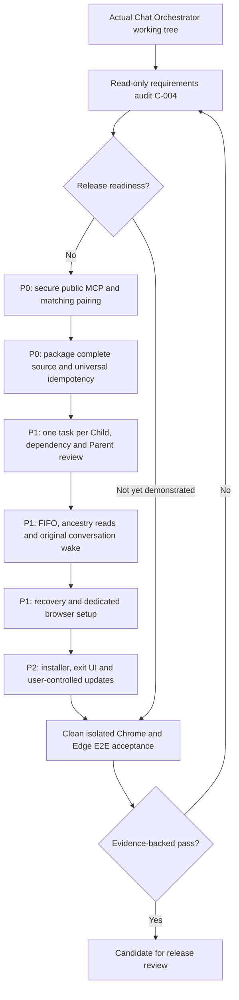

**Note:** This is a suggested **order for a separate, authorized implementation effort**, not code changes or a new user approval. Do not auto-execute any remediations based only on this diagram. The audit treats no real-browser E2E test as complete.

### V-002ax — Minimal stuck-page refresh and recheck [D-076 CONFIRMED]

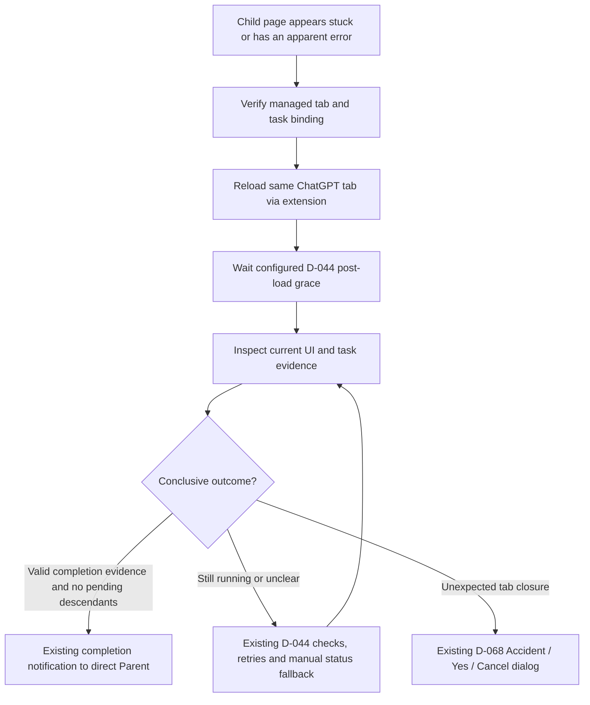

**Only reuse approved flows:** A reload is not a repeat of the assigned task, not proof that ChatGPT generation resumed and not a blanket failure verdict. This diagram is a requirement blueprint, not evidence of implementation or live browser tests.

### V-002aw — Per-Child sequential independent task queue [D-075 CONFIRMED; UI/TOOL CONTRACT DRAFT]

```mermaid
sequenceDiagram
    participant P as Direct Parent A
    participant M as Proxy Task Registry
    participant C as Managed Child B
    P->>M: Assign T1 (code review)
    M->>C: Start T1
    P->>M: Assign T2 (security review)
    M-->>P: QUEUED_TASK (T2 not submitted)
    C-->>M: T1 completion evidence
    M->>M: Verify D-046 descendants resolved
    M-->>P: T1 completion notification
    P->>M: read_chat(B) and review T1
    alt T1 needs correction
        P->>M: send_to_tab(B, T1 correction)
        M->>C: Send correction when safely idle
        C-->>M: T1 corrected completion
        M-->>P: Completion notification for T1
        P->>M: Resolve T1 review
    else T1 approved
        P->>M: Resolve T1 review
    end
    M->>M: T1 review gate cleared; T2 eligible
    M->>C: Start queued T2 in same tab
    C-->>M: Later T2 completion evidence
```

**Rules:** `QUEUED_TASK` is neither dispatched nor completed. Only one independent active task per Child; the Parent's current-task corrections are not mistaken for a distinct T2. Preserve authorized direct Parent ownership, safe FIFO delivery, retry deduplication and no forced browser-tab close. This is a *draft visualization*, not an implemented feature or actual E2E evidence.

### V-002as — Parent-owned Child task context (Q-030 Option A; D-071 CONFIRMED)

```mermaid
sequenceDiagram
    participant P as Parent Agent
    participant M as Chat Orchestrator Proxy
    participant E as Browser Extension
    participant C as Child Agent (ChatGPT)
    P->>M: spawn_agent(task instructions + chosen context)
    Note over P,M: Parent chooses relevant context; no full-chat auto-copy
    M->>M: Validate scoped identity, ownership and idempotency
    M->>E: Spawn/target managed Child and deliver supplied payload
    E->>C: Submit Parent-provided task prompt
    E-->>M: Observed submission outcome
    M-->>P: Actual spawn/delivery result (not task completion)
    Note over M,C: No automatic Parent-chat scraping, summary or archive
    C-->>M: Later completion evidence via existing monitoring
    M-->>P: Notification only under approved completion hierarchy
```

**Draft Proxy settings effect:** None. Q-030 creates no new "auto-context" toggle or transcript storage. Input remains on the existing Parent-owned delegation MCP call. D-072 adds a separately typed clarification-notification path when the Child cannot finish because of missing context; it does **not** change the Parent-chosen-context rule or introduce automatic chat summarization.

### V-002au — Direct Parent–Child messages only [D-073 CONFIRMED; TOOL ROUTE CONTRACT DRAFT]

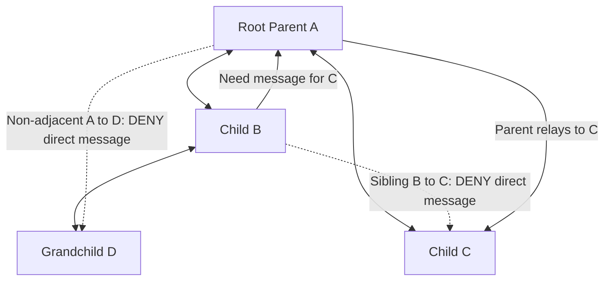

**Routing test / presentation:** Parent–Child arrows are direct authorized message edges; dotted arrows depict forbidden direct messages, **not a browser-tab close rule**. A permitted relay is **two separate** Owner-authorized sends, not an automatic Proxy forwarding service. This chart shows **message** permissions only. D-074 independently permits read-only `read_chat` from any authorized ancestor to its descendant. Extension selection/focus does not grant privileges.

```text
MCP message authorization (illustrative; UI design not approved)
ALLOW: Agent B -> direct Parent A         (active, authorized)
ALLOW: Agent A -> direct Child C          (active, authorized)
ALLOW: Agent B -> direct Child D          (active, authorized)
DENY:  Agent B -> sibling C               (not directly related)
DENY:  Agent A -> non-direct descendant D (not directly related for messaging)
```

### V-002av — Ancestor `read_chat` versus direct-edge messaging [D-073/D-074 CONFIRMED]

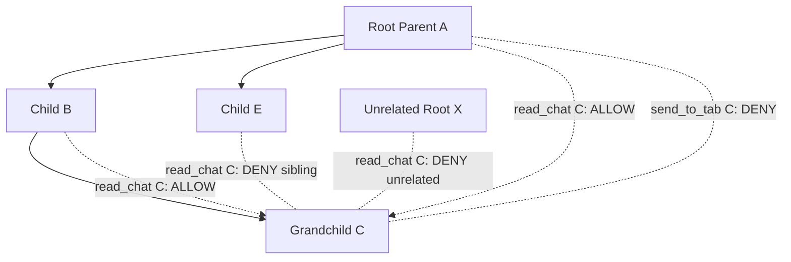

**Authorization note:** Dotted lines with labels are **permission examples**, not actual automatic queued messages or chat transmissions. The Proxy returns an authorized live chat snapshot to the calling ancestor as an MCP result. It never automatically sends the read content to another Agent. Message delivery to C remains limited to direct Parent B. Tab focus is irrelevant. No full-chat persistence feature is added.

```text
Managed Agent tree: A → B → C; A → E; unrelated Root X
ALLOW read_chat: A→B, A→C, A→E, B→C
DENY  read_chat: E→C (sibling/cousin); X→C (other Parent tree)
DENY  send_to_tab: A→C (non-direct), E→C (non-direct)
ALLOW send_to_tab: B→C (direct Parent)
```

### V-002at — Child requests missing context through owning Parent [D-072 CONFIRMED; UI / TOOL CONTRACT DRAFT]

```mermaid
sequenceDiagram
    participant C as Child B
    participant M as Chat Orchestrator Proxy
    participant P as Parent A
    C->>M: Request clarification(task_id, missing information)
    M->>M: Verify identity and ownership, deduplicate request
    M->>M: Mark task WAITING_FOR_PARENT_CONTEXT (not completed)
    M-->>P: Queue/deliver non-terminal clarification notification
    Note over P,M: Parent does not poll; original task remains pending
    P->>M: send_to_tab(B, missing context, new idempotency key)
    alt Child busy
        M-->>P: QUEUED (not delivered yet)
        M->>M: Wait for recipient safe/idle, FIFO
    end
    M-->>C: Deliver supplemental context to same Child
    C->>C: Resume original task; complete only after real finish
    C-->>M: Actual completion evidence later
    M-->>P: Ordinary D-039 completion notice only after D-046 gate
```

**Draft MCP notice copy (engineering presentation, not a new UI requirement):** `CLARIFICATION_REQUESTED | child=B | task=<task_id> | needed=<question> | status=WAITING_FOR_PARENT_CONTEXT`. Parent responds via existing `send_to_tab`. If clarification is still pending, a visible idle page does not imply completion. This flow adds no transcript archive or background automatic context-summarization feature.

### V-001 — Parent closure decision workflow (business flow)

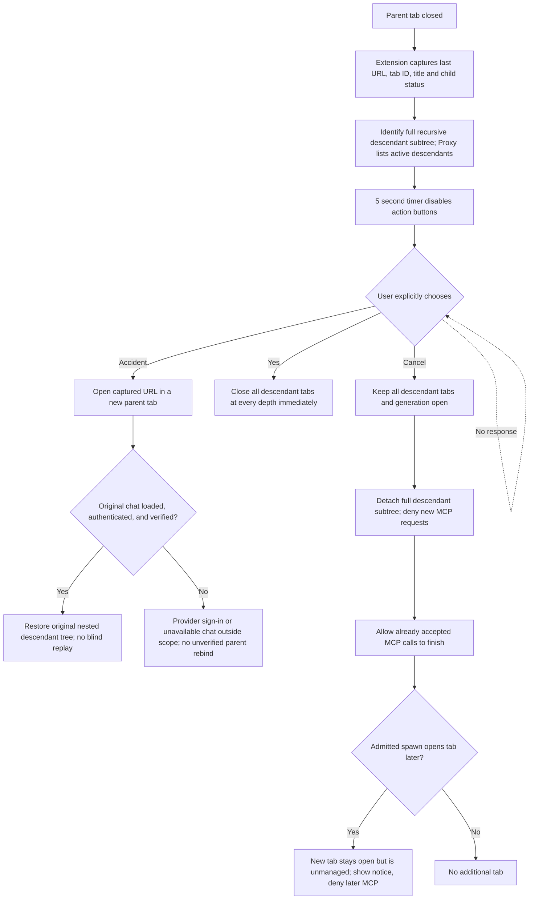

### V-002 — Recursive agent relationship and post-Cancel state (business state)

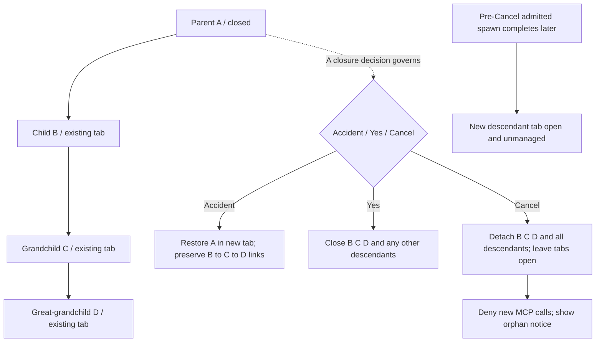

The example shows three descendant levels; the same scope applies recursively to any depth. Unrelated Parent trees are unaffected. This is a **business-level state diagram**, not a promise that failed Parent restoration can always repair all bindings.

### V-002b — Whole-window closure, per-Parent confirmations [CONFIRMED BEHAVIOR, DRAFT PRESENTATION]

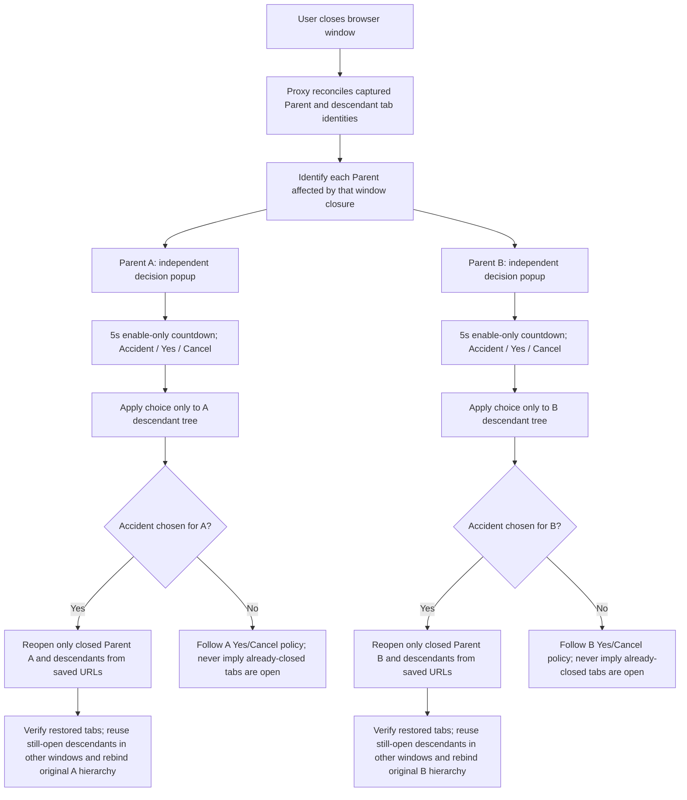

```text
[Proxy UI — DRAFT: two independent Parent decision items]
+----------------------------------------------------+
| Parent A closed | ChatGPT / tab 101                 |
| Descendants: B tab 201 (closed), C tab 202 (closed) |
| Buttons enable after 5 seconds; no default action  |
| [Accident]    [Yes]    [Cancel]                    |
| Accident: reopen closed tabs; keep any live tabs  |
|           and restore original agent relationships |
+----------------------------------------------------+
| Parent D closed | Claude / tab 301                  |
| Descendants: E tab 302 (closed)                     |
| Buttons enable after 5 seconds; no default action  |
| [Accident]    [Yes]    [Cancel]                    |
| Accident: reopen closed tabs; keep any live tabs  |
|           and restore original agent relationships |
+----------------------------------------------------+
```

The two decision items above are illustrative only; whether they appear as separate modal dialogs, queued prompts, or independent UI panels remains **DRAFT / OPEN**. Do not falsely show child tasks as working after their tabs closed. A browser-window close might not deliver every extension close event, so actual live/closed state must be reconciled.

### V-002c — Proxy-controlled Accident restoration [CONFIRMED BEHAVIOR, DRAFT PRESENTATION]

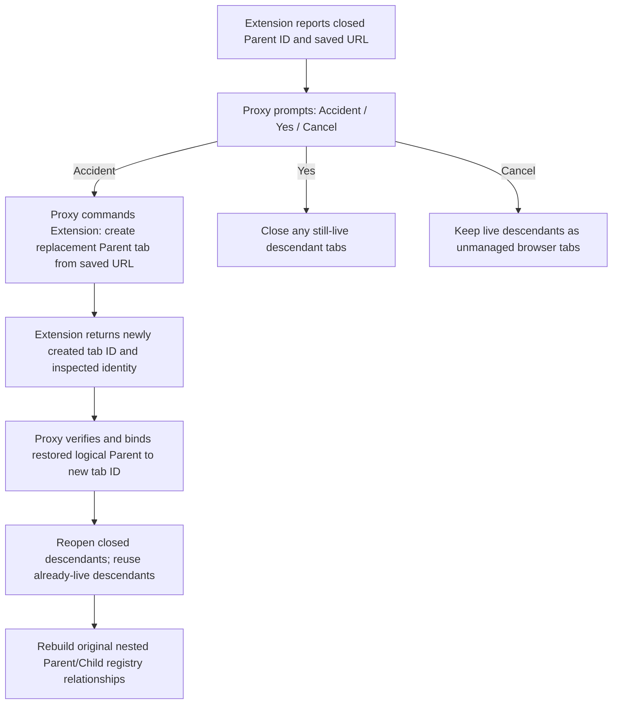

**Design constraint:** Do not introduce a requirement for `Ctrl+Shift+T`, manual URL entry, or automatic adoption of manually reopened Parent tabs. Tab creation is performed through the Proxy → Extension path, without Chrome debugging. The new tab's real ID comes from extension observations/creation responses, not from a guessed old ID.

### V-002d — Proxy restart preserves unresolved Parent-close confirmation [CONFIRMED BEHAVIOR, DRAFT PRESENTATION]

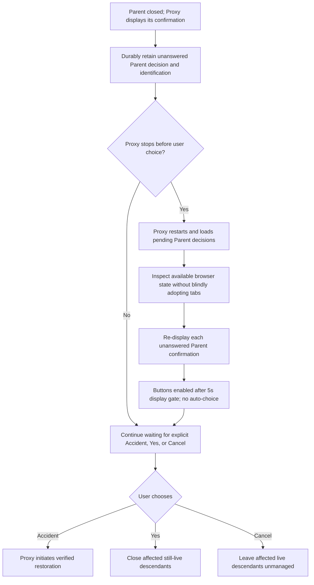

```text
[Proxy UI / DRAFT — restored unanswered decision after restart]
+--------------------------------------------------------------+
| Parent Agent Closed — Action Required                         |
| Pending since before Proxy restart                            |
| Parent: ChatGPT / former Tab 12345 / Project Review           |
| Descendants: verify current live/closed status                |
| No choice was made; do not assume Accident / Yes / Cancel     |
| [Accident]             [Yes]                  [Cancel]         |
| (Buttons have five-second enable-only gate; no auto-action)   |
+--------------------------------------------------------------+
```

### V-002e — Verify and restore already-open Parent identities after Proxy restart [CONFIRMED LIVE-PARENT PATH; MISSING-PARENT PATH RESOLVED BY D-026]

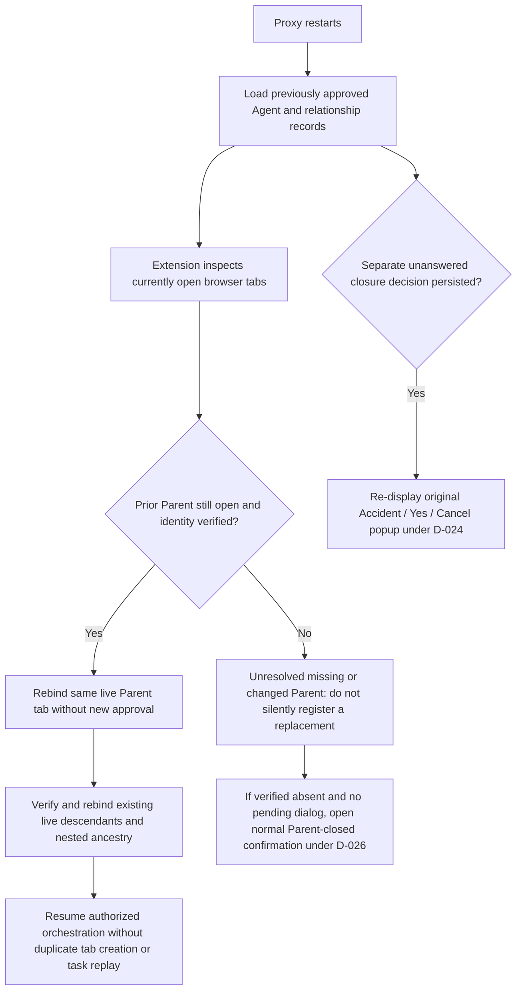

**Mockup — Proxy reconnect status (DRAFT UI, not design approval):**

```text
+------------------------------------------------------------------+
| Chat Orchestrator — Session Recovery                              |
| Previously approved Parent A — Tab 123 — VERIFIED / RESTORED      |
| Child B — Tab 201 — VERIFIED / REBOUND                             |
| Grandchild C — Tab 202 — VERIFIED / REBOUND                        |
| No duplicate tabs or new user approval                            |
| Verified missing Parent — show closure popup under D-026       |
+------------------------------------------------------------------+
```

### V-002f — Parent closure missed while Proxy was offline [CONFIRMED VERIFIED-ABSENCE PATH; DISCONNECTED PATH OPEN]

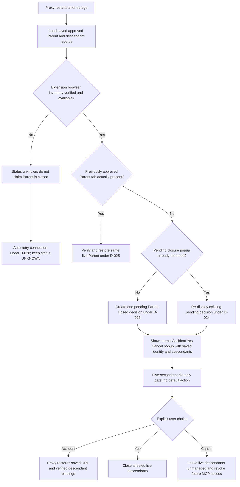

**Draft UI note:** Reuse the same Parent-closed dialog V-003; do **not** invent a different button layout for missed close events. The old tab ID, saved URL, parent description, descendant tree, and any live/closed distinction are populated from persisted state plus verified extension observations. If the browser status is unknown due to disconnect, label that uncertainty instead of misrepresenting a closure; automatic reconnection is required by D-028, while any optional disconnected UI is not yet approved.

### V-002g — Technically feasible Proxy restart reconciliation [ENGINEERING PROPOSAL; IMPLEMENTATION NOT VERIFIED]

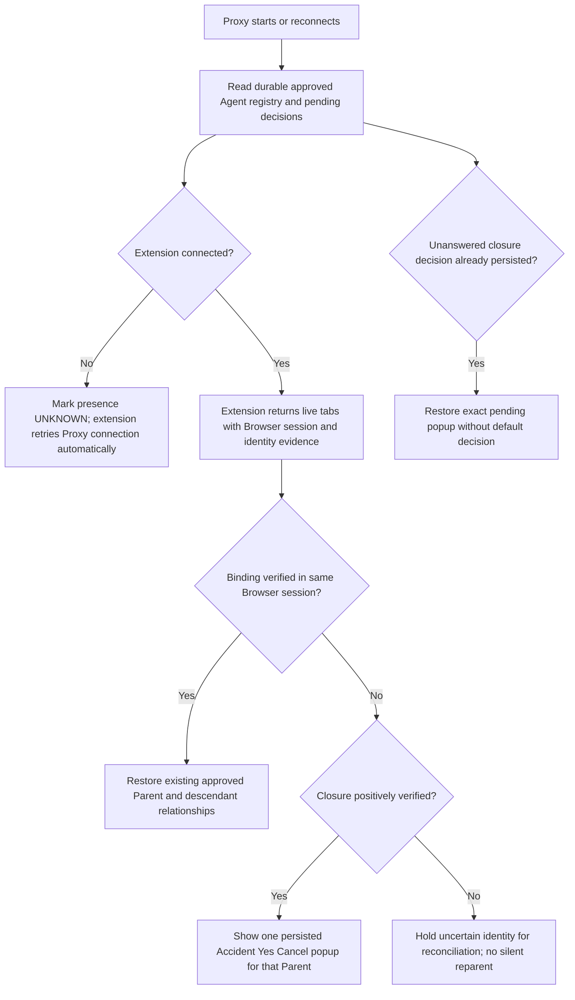

**UI mockup (DRAFT; not approved):**

```text
+-----------------------------------------------------------+
| Orchestrator / Connection and Recovery                    |
| Browser connection: CONNECTED / DISCONNECTED / UNKNOWN    |
| Parent A: VERIFIED LIVE → prior approval restored          |
| Parent B: VERIFIED CLOSED → decision required              |
| Parent C: UNKNOWN → do not label as closed                 |
| Pending confirmations: restored from local records        |
+-----------------------------------------------------------+
```

### V-002i — MCP call during Extension outage [CONFIRMED WAIT AND PRE-DISPATCH TIMEOUT POLICY]

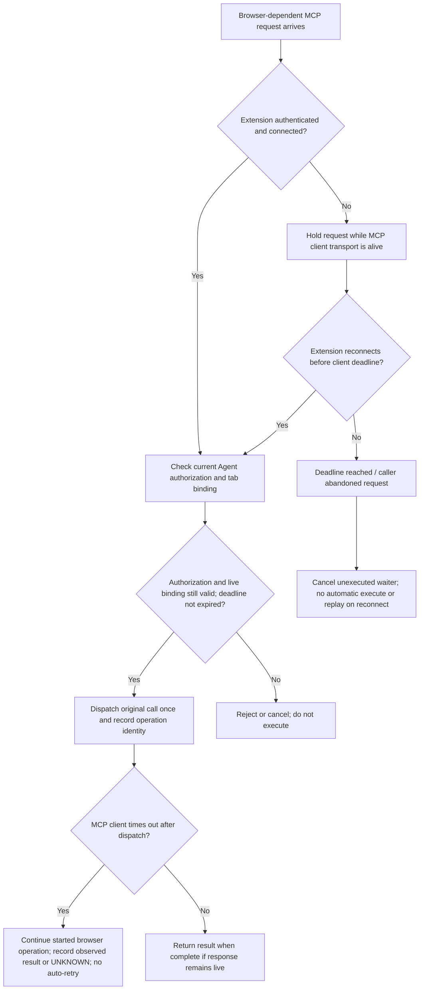

**DRAFT UI / status representation (not approved):**

```text
+--------------------------------------------------------------+
| Connection: RECONNECTING                                     |
| Browser-dependent MCP request: WAITING FOR EXTENSION          |
| Client request deadline: determined by MCP client/transport   |
| If timeout before dispatch: cancel waiter; never auto-run    |
+--------------------------------------------------------------+
```

### V-002j — Reused worker on duplicate `spawn_agent` retry [CONFIRMED OUTCOME; KEY SCHEME DRAFT]

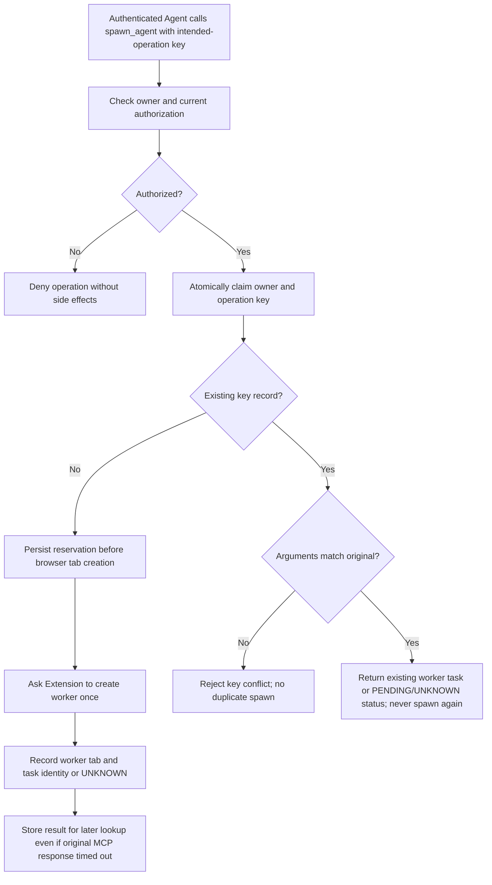

**DRAFT UI / diagnostics example (not approved):**

```text
+------------------------------------------------------------------+
| Worker operation recovery                                        |
| Intended operation: op-7f... | Agent: Parent A                    |
| Existing worker: Tab 204 | State: RUNNING                        |
| Retry received: REUSED existing worker (no new browser tab)     |
| If creation receipt is uncertain: UNKNOWN / inspect, not respawn|
+------------------------------------------------------------------+
```

**Design implementation note (D-035):** Client/caller generates a stable business-operation key before the first `spawn_agent` and reuses it on retries. The key is **not** the MCP JSON-RPC ID or prompt text. Real-host key retention is unverified; the illustration remains proposed implementation, not a finished feature.

### V-002k — Universal idempotency key: retry gate [CONFIRMED FIRST-RESPONSE CACHE FOR EVERY TOOL]

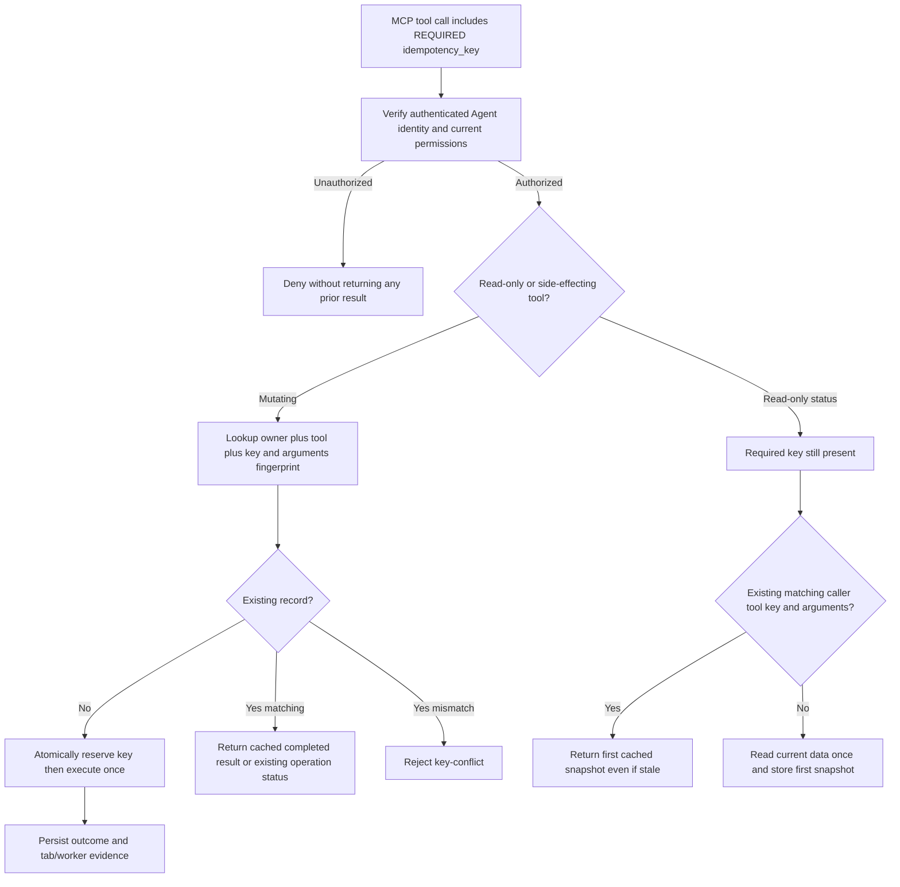

```text
MCP TOOL SCHEMA (DRAFT CONTRACT; not a finished implementation)
  idempotency_key: string  [required on every tool]

MUTATING RETRY:
  same Agent + same tool + same key + same args -> existing result / status
  same key + different arguments               -> key conflict
  different Agent or revoked permissions       -> deny

READ / STATUS RETRY: CONFIRMED FIRST-RESPONSE REPLAY (D-034)
  get_result(key=K1, task=T) -> RUNNING [first snapshot]
  get_result(key=K1, task=T) -> RUNNING [cached; even if current status DONE]
  get_result(key=K2, task=T) -> DONE    [new key for fresh read]
```

**Client-key generation and retry convention (D-035; implementation sketch, not approved UI):**

```text
new logical operation   -> client generates UUIDv4 K1 -> tool(idempotency_key=K1)
retry same operation    -> client reuses K1           -> existing response/operation
fresh status poll       -> client generates UUIDv4 K2 -> new snapshot
intentional new spawn   -> client generates UUIDv4 K3 -> new Worker
```

### V-002l — Parent approval → automatic initialization → verified binding [CONFIRMED UX; IDENTITY METHOD PROPOSED]

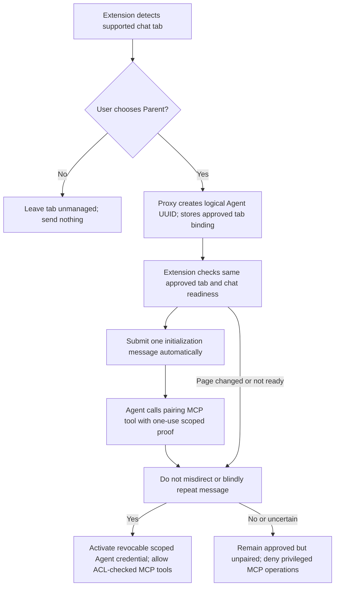

**Draft in-page UI mockup (NOT APPROVED):**

```text
╭─────────────────────────────────────────────────────╮
│ Parent Agent · Approved                           │
│ Identity setup: Initializing / Verification needed │
│ Chat Orchestrator automatically sends one setup   │
│ message in this approved chat.                     │
╰─────────────────────────────────────────────────────╯
```

**Interpretation (D-037 approved security posture):** This depicts automatic onboarding followed by **credential-possession-based logical Agent authorization**. UUID alone is never sufficient. A model-visible pairing proof or later bearer credential **does not prove physical MCP caller-tab origin**; this is an accepted limitation, not a verified security guarantee. On restart, restore approved logical Parents without resending initialization merely because the Proxy restarted (D-025). Do not automatically replay an uncertain initialization or pairing attempt.

### V-002m — Practical Agent Pairing trust boundary [D-037 APPROVED POSTURE; IMPLEMENTATION DRAFT]

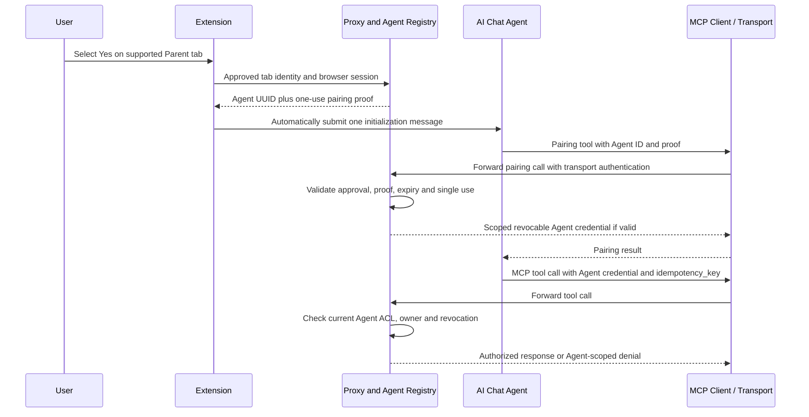

**Trust boundary note:** The browser Extension knows a real approved tab. The hosted MCP client normally does **not** attest which chat tab produced the tool invocation. The proof/credential only links the caller to a logical approved Agent by possession, not cryptographic tab provenance. Never use an `agent_id` or `caller_tab_id` alone as a capability. If host/provider behavior prevents pairing, remain unpaired rather than silently assuming success.

```text
PARENT STATUS (DRAFT / UI NOT APPROVED)
  Chat Orchestrator Parent — Approved
  Pairing: Initializing | Paired | Failed / Unverified
  Logical Agent: <UUID>
  Current permission: Active | Revoked
  Note: Credential pairing is not proof of physical tab origin
```


### V-002n — Local/private versus public MCP access boundaries [D-038 APPROVED POSTURE; IMPLEMENTATION DRAFT]

```mermaid
flowchart TD
    AI[Remote AI MCP client] --> NG[Public ngrok HTTPS gateway]
    NG --> AUTH{Transport client authenticated?}
    AUTH -->|No| DENY[Reject remote request]
    AUTH -->|Yes| MCP[Public MCP-only ingress]
    MCP --> AGENT{Valid scoped Agent credential and current permissions?}
    AGENT -->|No| DENY2[Reject Agent operation]
    AGENT -->|Yes| PROXY[Local Proxy orchestration service]
    subgraph LOCAL[Private loopback control plane — not exposed via ngrok]
      EXT[Approved browser extension] <-->|Local authenticated session| PROXY
      EXT --> TABS[Managed browser tabs]
      PROXY --> REG[Agent identity and ownership registry]
      UI[Local Proxy UI] --> PROXY
    end
```

**Diagram boundary:** The public-facing gateway exposes only the intended MCP route and authenticates the remote client. The private local control plane has a lightweight installation/session trust check, but cannot be accessed through the tunnel. Agent permission checks happen after transport authentication even for a locally hosted single-user application. URL secrecy or localhost bindings alone do not protect a tunnel-forwarded admin route.

```text
SECURITY BOUNDARY CONTRACT (DESIGN DRAFT)
  Public ngrok route:        MCP ingress only; deny unauthenticated callers
  Private localhost route:   Extension WS and admin; loopback + session authentication
  Agent-specific request:    Approved UUID + scoped credential + current ACL required
  Parent Cancel:             New Agent actions denied even on valid tunnel/session
  No enterprise auth:        No per-Worker OAuth/cert issuance or general RBAC platform
```

### V-002o — Child completion notification and Parent-initiated chat read [D-039 CONFIRMED BEHAVIOR; PRESENTATION DRAFT]

```mermaid
sequenceDiagram
    participant C as Child AI tab
    participant X as Browser Extension
    participant P as Local Proxy / Registry
    participant A as Parent AI tab
    C->>P: Optional explicit MCP complete_task(task_id)
    C->>X: Website generation and final-response UI evidence
    X->>P: UI observation if explicit completion absent
    P->>P: Correlate task and validate explicit or conservative inferred completion
    P->>P: Verify managed ancestry, task status and notification state
    alt Parent is idle
        P->>A: Automatic completion notice (Child tab ID, task, status)
    else Parent is busy
        P->>P: Queue completion notice until Parent is idle
        P->>A: Deliver queued notice(s) when safe
    end
    A->>P: MCP read_chat(tab_id, idempotency_key, Agent credential)
    P->>P: Authenticate caller + authorize target Child + validate tab binding
    alt Current permitted Child tab is readable
        P->>X: Read target Child tab conversation
        X-->>P: Retrieved chat contents or explicit partial status
        P-->>A: MCP tool result containing chat text / status
    else Unauthorized, closed or unreadable
        P-->>A: Denial or accurate unavailable/partial outcome
    end
```

```text
PARENT COMPLETION NOTICE (DRAFT wording; not approved visual design)
  Child: Worker B | Tab: 201 | Task: T-123 | Status: Completed
  Review: call read_chat(tab_id=201, idempotency_key=<new key>)
  If fix/new task: delegate to existing Worker B / Tab 201 (no new spawn)
  If finished: Parent explicitly calls close_tab(tab_id=201, idempotency_key=<new key>)
  No entire transcript pushed; no automatic close after review.

READ_CHAT CONTRACT (DRAFT; security/first-response-cache are confirmed)
  Required: approved caller Agent credential + idempotency_key + tab_id
  Authorization: current registry binding + same managed lineage
  Response: retrieved Child conversation or accurate error / partial status
  Same idempotency key: first snapshot replayed; fresh read: new key
```

### V-002p — Recursive spawning and direct-owner result delivery [D-040 CONFIRMED; UI DETAILS DRAFT]

```mermaid
sequenceDiagram
    participant A as Root Parent A
    participant B as Child B
    participant P as Proxy and Agent Registry
    participant X as Browser Extension
    participant C as Grandchild C
    A->>P: spawn_agent(task for B, idempotency_key)
    P->>X: Create managed Child B tab
    X-->>P: Child B current tab identity
    P->>P: Bind B.parent = A and B.root = A
    B->>P: spawn_agent(task for C, idempotency_key)
    P->>P: Verify B paired, managed and authorized
    P->>X: Create Grandchild C tab
    X-->>P: C current tab identity
    P->>P: Bind C.parent = B and C.root = A
    C->>X: Task completion evidence
    X->>P: Completion for C
    P->>B: Notify direct owner B when idle
    B->>P: read_chat(C tab_id, new idempotency_key)
    P-->>B: Authorized C conversation as MCP result
    B->>A: Continue work / report B task when completed
```

```text
APPROVED RELATIONSHIP EXAMPLE (visual draft)
  A  Root Parent     [user approved]
   └── B  Child      [spawned by A]
        └── C        [spawned by B; managed Grandchild]
             └── D   [spawned by C; managed deeper descendant]
  C's task finishes -> notify B (owning parent) -> B can read_chat(C tab ID)
  B finishes own task -> notify A -> A can read_chat(B tab ID)
  A's closure choices affect B, C, D recursively; unrelated roots untouched
  Global concurrent sub-agent limit: configurable (D-041)
  Limit reached: no new tab; MCP explains capacity and recommends inline work
```

### V-002q — Global spawn-capacity gate and actionable MCP reply [D-041 CONFIRMED; CONTRACT DRAFT]

```mermaid
flowchart TD
    A[Authorized Parent or Child invokes spawn_agent] --> B[Check current pairing, ancestry, revocation and idempotency]
    B -->|Unauthorized| U[Return authorization denial, not limit message]
    B -->|Same intended retry| R[Return original recorded spawn outcome]
    B -->|New spawn| C{Global managed sub-agent slot available?}
    C -->|No| D[Return SUB_AGENT_LIMIT_REACHED and spawned false]
    D --> E[Advise caller: complete the task inline]
    C -->|Yes| F[Atomically reserve one global slot]
    F --> G[Create and verify new Child tab]
    G --> H[Bind direct parent and root hierarchy]
    H --> I[Return created Worker identity and tab]
```

```text
DRAFT MCP RESULT (not authorization error):
  status: SUB_AGENT_LIMIT_REACHED
  spawned: false
  message: "Current sub-agent limit reached. No new worker was created.
            Complete the task inline."
```

**Boundary:** On a proven limit hit, no new Worker is created. Agent's inline response is a recommendation, not a guaranteed automatic execution path. Actual concurrent slot reservation and uncertain tab-creation reconciliation are engineering verification requirements. Not a new code implementation request.

### V-002r — Hybrid task-completion evidence and single Parent notification [D-042 CONFIRMED; ADAPTER DETAILS DRAFT]

```mermaid
flowchart TD
    A[Managed Child working on a task] --> B{Explicit complete_task MCP signal?}
    B -->|Yes| C[Verify authorized Agent and task ownership]
    C -->|Valid| D[Record explicit completion evidence]
    C -->|Invalid| E[Reject unauthorized signal]
    B -->|No| F[Extension observes supported website UI]
    F --> G{Final response and strong completion cues?}
    G -->|Yes| H[Record UI-inferred completion evidence]
    G -->|No or uncertain| I[Remain RUNNING or UNKNOWN; never infer from idle alone]
    D --> J[Deduplicate by Agent and task]
    H --> J
    J --> K[Queue or deliver one completion notice to direct Parent]
    K --> L[Parent may call authorized read_chat with Child tab ID]
```

```text
DRAFT TASK STATUS (not a mandatory user-visible layout)
  Child: Agent C | Task: T-125 | Tab: 202
  Completion evidence: EXPLICIT_MCP | UI_INFERRED | INDETERMINATE
  Notification delivery: PENDING | SENT | VERIFIED | UNKNOWN
  On clear completion: notify direct owning Parent once
  On uncertain UI: do not silently announce task completed
```

**Limit:** Browser activity is only evidence about the page; it does not prove the task's requested work is correct. Actual adapter heuristics, transport delivery acknowledgements and notification UI remain subject to testing.

### V-002s — Completion status monitoring, reload and user intervention [D-044 CONFIRMED; SETTINGS UI DRAFT]

```mermaid
flowchart TD
    A[Child task dispatched] --> B[Wait up to configured initial 5 min for complete_task]
    B -->|Valid complete_task arrives| Z[Record explicit completion and notify direct Parent once]
    B -->|No signal by deadline| C[Reload verified Child tab; wait ready plus 4 to 5 seconds]
    C --> D{Strong completion evidence in UI?}
    D -->|Yes| E[Record UI-inferred completion and notify direct Parent once]
    D -->|No or unknown| F{Configured 5m 3m 1m retry steps left?}
    F -->|Yes| G[Wait next decreasing interval]
    G --> C
    F -->|No| H[Show user status review: Completed or In Progress]
    H -->|User marks Completed| I[Record USER_CONFIRMED; notify direct Parent once]
    H -->|No decision or In Progress| J[Continue checking every configured 2 min]
    J --> C
    C -. Late valid complete_task .-> Z
```

```text
PROXY SETTINGS (DRAFT; timing values user-configurable)
  Initial completion-signal wait:    5 minutes
  Post-reload UI hydration grace:   4–5 seconds, after ready/load
  Pre-alert retry intervals:       5 minutes → 3 minutes → 1 minute
  Retry step count:                3 (configurable)
  Post-alert monitoring interval:  2 minutes

USER REVIEW (DRAFT)
  Child: [Agent / Tab / Task]   Status: Not yet verified
  [ Mark Completed ] [ Still In Progress ]
  UI checks continue even after this notice, until a valid terminal/lifecycle state.
```

**Technical limits:** Reload is supported by browser API, but remote task continuity across all providers is **A-002 user assumption**, not verified. Monitoring must never issue duplicate task prompts, send duplicate completion notices, or inspect the wrong tab.

### V-002t — First-time browser extension onboarding [D-043 CONFIRMED UX; VISUAL DRAFT]

```mermaid
flowchart TD
    A[Launch Chat Orchestrator] --> B[Use configured installed browser and dedicated profile]
    B --> C{Extension installed, approved and connected?}
    C -->|Yes| D[Start approved orchestration experience]
    C -->|No| E[Show one-time guided extension setup]
    E --> F[User installs or approves extension using browser-supported path]
    F --> G{Verify extension authentication and profile connection}
    G -->|Verified| D
    G -->|Not ready| E
```

```text
FIRST-RUN SETUP (DRAFT)
  Selected browser: [compatible installed browser]
  Dedicated profile: Chat Orchestrator
  Extension: Installation / Permission / Connection status
  [ Open browser install instructions ] [ Verify connection ]
```

### V-002u — Parent review → reuse or explicit close of completed Child [D-045 CONFIRMED; PRESENTATION DRAFT]

```mermaid
flowchart TD
    A[Child completes assigned task] --> B[Proxy sends direct Parent completion notification]
    B --> C[Parent receives read_chat / reassign / close instructions]
    C --> D[Parent calls read_chat for current Child tab]
    D --> E{Does Parent need more work from this Child?}
    E -->|Correction or new task| F[Send next task to SAME Child tab and Agent UUID]
    F --> G[Track new task ID; Child works; slot remains occupied]
    G --> A
    E -->|No| H[Parent explicitly invokes close_tab]
    H --> I{Caller authorized and target tab verified?}
    I -->|No| J[Reject; do not close a different tab]
    I -->|Yes and no managed descendants| K[Extension closes target Child tab]
    K --> L[Verify closure; update registry and release global slot]
    I -->|Yes, but descendants remain| M[Return DESCENDANTS_STILL_MANAGED and closed false]
    M --> N[Review and close descendant tabs leaf first]
    N --> H
```

```text
PARENT REVIEW INSTRUCTION (DRAFT MESSAGE ATTACHMENT, not real provider system prompt)
  Task completed by: Child B (tab=205)
  1. Call read_chat(tab_id=205) to inspect work
  2. If changes or additional tasks needed, send them to existing Child B
  3. If this Child is no longer needed, call close_tab(tab_id=205)
  Completion/review does NOT close B and does NOT free its worker slot
```

**Nested closure guard (D-047 CONFIRMED):** Even after delegated tasks are completed, still-managed descendant **tabs** block routine `close_tab` of the ancestor. Return `DESCENDANTS_STILL_MANAGED` and advise leaf-to-root close. Do not automatically inherit the distinct root Parent-close popup semantics.

### V-002v — Hierarchical task completion gate (D-046 CONFIRMED INVARIANT; recovery path PROPOSED)

```mermaid
flowchart TD
    A[Agent B owns task T] --> B[Own-work evidence: MCP / UI / user]
    B --> C{Any unfinished tasks delegated under T?}
    C -->|Yes| D[WAITING_FOR_CHILD_TASKS; do not complete B]
    D --> E[Child C eventually completes its task]
    E --> F[Notify B; B reviews with read_chat and may reassign fixes]
    F --> C
    C -->|No| G{Own work and required finalization evidence valid?}
    G -->|No or unclear| H[Keep RUNNING or REVIEW_PENDING; inspect on D-044 schedule]
    G -->|Yes| I[Mark T COMPLETED exactly once]
    I --> J[Notify B direct Parent; B tab remains open]
```

```text
TASK-LEVEL STATE EXAMPLE (not Agent-tab lifecycle)
  C / task T-C: RUNNING
  B / task T-B: own response ended, WAITING_FOR_CHILD_TASKS
  Parent A: receives no B-COMPLETED notification yet

  When C finishes:
    -> B receives C completion notification
    -> B reads/reviews C, may assign corrections
    -> B finalizes T-B when no unfinished delegated tasks remain
    -> A receives B completion notification

  Five-minute timer = next inspection trigger, NOT completion deadline.
  B's browser tab remains open for reuse until explicit close_tab.
```

**Confirmed protective close outcome (D-047; sample response wording only):** `close_tab(B)` while B still owns managed descendants returns `DESCENDANTS_STILL_MANAGED`, `closed: false` and actionable leaf-to-root guidance. The human-driven root Parent `Accident / Yes / Cancel` workflow is separate.

### V-002w — Managed-descendant close guard [D-047 CONFIRMED; RESPONSE MOCKUP DRAFT]

```mermaid
flowchart TD
    A[Authorized Agent invokes close_tab for Child B] --> B[Resolve verified target and recursive managed descendants]
    B --> C{Any managed descendant tabs remain?}
    C -->|Yes: working or completed-but-open| D[Do not close any tab; do not release slot]
    D --> E[Return DESCENDANTS_STILL_MANAGED and leaf-first guidance]
    E --> F[Parent reviews and closes descendant tabs]
    F --> A
    C -->|No| G[Close only verified B tab]
    G --> H[Verify closure and free one global Agent slot]
```

```text
DRAFT MCP RESPONSE — status, not a successful close:
  status: DESCENDANTS_STILL_MANAGED
  closed: false
  reason: Child B still owns Grandchild C (working or completed-but-open)
  next_step: Review/finish C; close C tab first; then retry close_tab(B)
```

**Not equivalent to the human root Parent-close flow:** explicit `Yes` there authorizes recursive child-tab closure under D-009–D-018. This diagram covers ordinary Agent MCP `close_tab` only.

### V-002x — Provider resolution for a newly spawned Child [D-048 CONFIRMED POLICY; UI CONTRACT DRAFT]

```mermaid
flowchart TD
    A[Authorized Agent invokes spawn_agent] --> B{Explicit provider override?}
    B -->|Yes| C[Resolve supplied provider ID]
    B -->|No| D[Read Proxy Settings default provider]
    C --> E{Supported and available?}
    D --> E
    E -->|No| F[Explanatory provider error; spawned false]
    E -->|Yes| G[Enforce D-041 global slot and D-033 idempotency]
    G -->|Limit reached| H[SUB_AGENT_LIMIT_REACHED; work inline]
    G -->|Authorized and capacity available| I[Create Child tab with selected provider adapter]
    I --> J[Bind UUID/tab and immediate-Parent ancestry]
    J --> K[Send initial task; confirm actual observed status]
```

```text
DRAFT PROXY SETTINGS — PROVIDERS
  Default AI Provider: [ChatGPT v]
  Supported adapters: ChatGPT / Claude / ... [only after verified support]

DRAFT spawn_agent PARAMETER BEHAVIOR
  provider omitted          -> currently saved default
  provider: "claude"         -> Claude, if supported/available
  provider unsupported      -> explanatory status; spawned: false
  same idempotency key retry -> original resolved provider and original operation
```

**Clarifications:** Examples do not imply all named sites are already supported. A provider adapter is website-specific implementation, not an unapproved multi-model tool platform. If unavailable, do not silently choose another site or change an existing agent's provider. Parent/Child ownership persists regardless of the AI website. UI appearance remains DRAFT.

### V-002y — Busy Child instruction queue and delivery receipts [D-049 CONFIRMED; PRESENTATION DRAFT]

```mermaid
sequenceDiagram
    participant A as Parent Agent A
    participant P as Local Proxy / FIFO Registry
    participant X as Browser Extension
    participant B as Child Agent B tab
    A->>P: MCP send_to_tab(B, instruction, idempotency_key)
    P->>P: Verify sender, ownership, recipient and key
    P->>X: Inspect Child B readiness
    X-->>P: Busy / generating
    P->>P: Store message under Child B queue in FIFO order
    P-->>A: QUEUED (delivered=false)
    B-->>X: Existing generation eventually becomes idle
    X-->>P: Credible safe-idle observation
    P->>P: Revalidate Agent B and sender/recipient permissions
    alt Still authorized and same live Child
        P->>X: Submit oldest queued instruction once
        X-->>P: Verified send evidence or uncertain result
        P->>P: Record DELIVERED or UNKNOWN, never silently duplicate
    else Child closed/detached/invalid
        P->>P: Record not delivered; no wrong-tab send
    end
```

```text
DRAFT MCP RESPONSE — accepted for later sending (NOT delivered yet)
  status: QUEUED
  delivered: false
  message: "Child Agent is currently busy. Your instruction is queued and will
            be sent when the agent is ready. Its current generation continues."

FOLLOW-UP STATUS (example only):
  QUEUED       -> pending, no browser submission
  DELIVERED    -> browser submission verified, not task completion
  UNKNOWN      -> submission outcome uncertain; never blindly resend
  NOT_DELIVERED -> permission/tab identity changed before dispatch
```

**Scope:** Same-Child task correction/reassignment uses the existing tab (D-045). FIFO ordering is per recipient; Child-to-Parent completion notifications already use their distinct busy-Parent queue under D-039. Actual completion is determined by D-042/D-044/D-046, not by queued or sent messages. UI layout and status names remain DRAFT; business meanings are confirmed.

### V-002z — Proxy dashboard monitoring and essential controls [D-050 CONFIRMED SCOPE; UI DRAFT]

```mermaid
flowchart TD
    A[Proxy dashboard loads authorized Agent and Task Registry view] --> B[Show Parent roots and recursive Child hierarchy]
    B --> C{User selected manual action?}
    C -->|Open existing tab| D[Verify live Agent tab binding and focus it]
    C -->|Update completion review| E[Read task and descendant dependency status]
    E --> F{Any unfinished delegated tasks?}
    F -->|Yes| G[Do not falsely mark task complete; show dependency explanation]
    F -->|No| H[Record explicit user status update with evidence]
    C -->|Close Child tab| I{Any managed descendants?}
    I -->|Yes| J[Block close and explain leaf-to-root cleanup]
    I -->|No| K[Verify binding, close and reconcile slot]
    C -->|Close registered Parent| L[Preserve Parent-close decision workflow]
    C -->|Recovery or settings| M[Use previously approved dedicated UI flows]
```

```text
DRAFT Proxy UI / NOT VISUALLY APPROVED
+---------------------------------------------------------------------+
| Chat Orchestrator — Local Agent Monitor                 [Settings]    |
| Browser: Connected     Extension: Connected      Managed: 5 / 8      |
|                                                                     |
| Parent A · ChatGPT · Working                        [Open Tab]         |
|   + Child B · Claude · Review Pending               [Open] [Close]   |
|       + Grandchild C · Claude · Working             [Open] [Close*]  |
|   + Child D · ChatGPT · Completed                    [Open] [Close]   |
|                                                                     |
| Task monitor: pending manual review   [Review Status]                 |
| Recovery alerts: pending Parent closure decision  [Inspect]         |
|                                                                     |
| * Close respects registered descendant guard; not a force-close     |
+---------------------------------------------------------------------+
```

The dashboard **does not** offer generic task spawning, instruction sending or task reassignment. Its operations reuse the existing Proxy-managed authorization and lifecycle behavior rather than bypassing it. The visual arrangement, labels, numerical examples, and appearance are draft and not separately approved. It is an architecture mockup, not an implemented UI.

### V-002aa — Managed tab role visibility, background actions and manual Focus Tab [D-051/D-053/D-055 CONFIRMED; NAVIGATION TIMING Q-016a CONFIRMED D-056]

```mermaid
flowchart TD
    A[Extension observes a supported tab] --> B{Already managed role?}
    B -->|Child or descendant| C[Keep existing Child role; hide Make Parent]
    B -->|Registered Parent| D[Preserve Parent role without reapproval]
    B -->|Unmanaged| E[May offer explicit user Parent approval per D-005]
    C --> F[Run permitted monitoring and messaging even while tab not focused]
    D --> F
    F --> G{User requests Focus Tab?}
    G -->|Yes| H[Verify current tab plus window; activate tab and focus window]
    G -->|No| I[Do not steal focus]
    D --> J[Same tab navigates: preserve Agent role and hierarchy per D-053]
    J --> K[D-055: restore delegation-origin Parent conversation before notification]
```

```text
DRAFT extension-managed tab status UI (placement not approved)
  Child B · Managed Child                       [Focus Tab]
  Parent A · Managed Parent                    [Focus Tab]
  Unmanaged supported tab     [Make this tab a Parent]
  [Make this tab a Parent] MUST NOT appear on a managed Child/Grandchild tab.
```

**Engineering caution:** `Focus Tab` does not prove the website's reply is finished and does not update its identity. Background operation is the default goal; it is not a promise that an inactive website's page scripts or AI provider always remain responsive. D-053 confirms navigation does not alter the tab ownership hierarchy; D-055 requires returning to the delegation-origin conversation before notification; D-056 immediate navigation while another conversation is busy is confirmed.

### V-002ac — Parent delegates, finishes response, and waits for automatic Child result [D-053/D-054/D-055 CONFIRMED; Q-016a immediate navigation CONFIRMED]

```mermaid
sequenceDiagram
    participant A as Parent Agent tab A
    participant P as Proxy task/notification registry
    participant C as Child Agent tab C
    A->>P: spawn_agent(task, idempotency_key)
    P->>C: Create or reuse managed child, submit task
    P-->>A: Delegation accepted/succeeded (task ID, child ID)
    Note over A: Parent ends chat turn: "Delegated to Child; awaiting result"
    Note over P: Parent TASK remains WAITING_FOR_CHILD_TASKS
    loop Only Proxy-controlled scheduled inspection if needed
        P->>C: D-042/D-044 task completion evidence check
    end
    C-->>P: Task completion evidence / complete_task
    P->>P: D-046 dependency validation; dedupe completion
    P-->>A: Queue one direct-Parent completion notification
    Note over A,P: If navigated elsewhere, D-055 restores origin chat; D-056 immediate busy-page navigation CONFIRMED
    P->>A: Deliver new notification chat message when authorized and idle
    A->>P: read_chat(child_tab_id, new idempotency_key)
    P-->>A: Child conversation for review
    Note over A: Review and fix/reassign/close before own task finalization
```

```text
DRAFT Proxy hierarchy/status (labels/layout not approved)
Parent A — Chat turn: IDLE / completed delegation reply
         — Task: WAITING_FOR_CHILD_TASKS; no Parent polling
  ↳ Child B — RUNNING; Proxy monitoring via D-042/D-044
     On Child completion: queued notification → Parent resumes / reads chat
  [Navigation preserves hierarchy; D-055 restores origin for notice]
```

**Implementation boundary:** `Parent answered` does **not** equal `Parent task completed`. Passive waiting is implemented by persistent task/notification events and a later **new chat message**, not a model request that blocks indefinitely. D-055 resolves notification destination: return to and validate saved original Parent conversation, never submit into unrelated current chat. D-056 requires immediate navigation even if the other conversation is busy. All sequence steps show required behavior, **not** verified actual provider/extension performance.

### V-002ad — Same-tab restore to delegation-origin chat for completion notice [D-055 CONFIRMED; Q-016a immediate navigation CONFIRMED]

```mermaid
sequenceDiagram
    participant C as Child B
    participant P as Proxy task registry
    participant E as Browser Extension
    participant A as Original Parent tab 105
    Note over P: On delegation store task to original Conversation A
    Note over A: User has navigated tab 105 to Conversation B
    C-->>P: Real task completion evidence
    P->>P: Dependency gate and deduplicated notification queue
    P->>E: Route to saved Conversation A in same tab 105
    Note over P,E: D-056 navigate now even if B has active generation or draft
    E->>A: Navigate tab 105 to saved Conversation A
    A-->>E: Navigation committed and page hydrated
    E->>E: Verify actual provider and original conversation identity
    alt Correct original chat verified and composer ready
        E->>A: Submit single completion notification message
        E-->>P: Report observed delivery result
        Note over A: Parent resumes and may call read_chat on Child
    else Missing or unverified original chat
        E-->>P: NOT_DELIVERED / recovery required
        P->>P: Keep notification pending; do not send to B
    end
```

```text
DRAFT completion destination status (UX not approved)
Parent tab 105 — role: Parent A (same role and lineage)
Task from Conversation A — completion notice pending
Currently showing Conversation B
Next: return to Conversation A -> verify chat -> deliver one notice
If A unavailable: pending / manual recovery; never inject into B
If B is generating or has unsent draft: navigate immediately (D-056); work/draft may be lost
```

**Technical boundary:** `tabs.update` enables navigation without setting tab `active`, but not proof that ChatGPT/Claude loaded the correct conversation. Keep notification attempts correlated to task, Parent Agent UUID, original provider/chat and live verified tab. Do not focus the browser window merely to navigate. The user explicitly chose **immediate** automatic return even if the currently displayed conversation is generating or holds an unsent draft (D-056); potential interruption/data loss is accepted, but successful delivery and continued server generation remain unverified. No live E2E claim.

### V-002ae — Immediate Parent conversation switch for Child result [D-055/D-056 CONFIRMED; DELIVERY TESTING PENDING]

```mermaid
sequenceDiagram
    participant C as Child B
    participant P as Proxy
    participant X as Extension
    participant T as Original registered Parent tab
    Note over T: Showing Conversation B, may be generating or contain unsent draft
    C-->>P: Child task completed (D-046 verified)
    P->>P: Record and deduplicate completion notice
    P->>X: Navigate SAME Parent tab immediately to saved Conversation A
    X->>T: tabs.update(tabId, url=Conversation A)
    Note over T: Conversation B local generation/draft may be disrupted or lost
    T-->>X: Original conversation A loaded
    X->>X: Check actual A conversation identity, authorization and composer readiness
    alt A verified and ready
        X->>T: Submit one completion notification
        X-->>P: Report observed send outcome
    else A not verified or not ready
        X-->>P: Pending / recovery needed; never deliver to B
    end
```

```text
DRAFT UI status (no blocking confirmation)
Child result: COMPLETE | Destination: Parent original chat A
Current Parent tab: chat B (possibly busy/draft)
Action: NAVIGATING TO CHAT A NOW
User-facing note: navigating may interrupt the current chat or lose unsent text
After route: VERIFYING ORIGINAL CHAT -> MESSAGE PENDING / DELIVERED / UNCERTAIN
```

### V-002ab — Anti-freeze versus actual browser tab focus [D-052 CONFIRMED GOAL; INJECTION DRAFT]

```mermaid
flowchart TD
    A[Supported managed Parent or Child tab] --> B[Extension checks approved live tab binding]
    B --> C[Inject narrow page-world anti-freeze if supported]
    C --> D[Attempt visible-style UI behavior while background]
    D --> E{Monitor DOM content and completion evidence}
    E -->|Fresh reliable evidence| F[Apply D-042/D-046 completion rules]
    E -->|Stale or uncertain| G[Follow D-044 reload and later manual review]
    G --> H[Reinject on newly loaded document; verify again]
    H --> E
    B --> I{User clicks Focus Tab?}
    I -->|Yes| J[Actually activate verified tab and window]
    I -->|No| K[No forced focus change]
```

```text
PROPOSED AGENT INSPECTOR DISPLAY (NOT APPROVED UI)
  Child B / Tab 205
  Browser focus: Background   [Focus Tab]
  Anti-Freeze: Applied (unverified effect)
  UI observation: Fresh / Stale / Unknown
  Completion evidence: Explicit / UI inferred / Unverified
```

**Important:** `Anti-Freeze: Applied` says only that the page-world hook attempted installation, not that the browser really focused the tab or that UI is accurate. The original `AlwaysFocused.js` is a reference to adapt and test, not automatically deployed source code. D-053 preserves Agent/tab hierarchy on navigation; D-055 now fixes destination to the saved delegation-origin Parent conversation, with D-056 immediate navigation now confirmed.

### V-002af — First-release ChatGPT-only provider resolution [D-057 CONFIRMED SCOPE; UI DRAFT]

```mermaid
flowchart TD
    A[Authorized Parent or Child calls spawn_agent] --> B{Provider explicitly supplied?}
    B -->|No| C[Resolve configured default: ChatGPT in v1]
    B -->|Yes| D{Requested provider supported in v1?}
    D -->|ChatGPT| E[Use ChatGPT adapter]
    D -->|Claude, Gemini, other| F[PROVIDER_NOT_SUPPORTED; spawned false]
    C --> E
    E --> G[Check authorization, idempotency and global capacity]
    G --> H[Create managed ChatGPT Child tab when safe]
    F --> I[No worker created, no fallback]
```

```text
[Proxy Settings / FIRST-RELEASE SCOPE — PRESENTATION DRAFT]
  Default AI provider:  ChatGPT  (the only supported option in v1)
  ChatGPT integration: Not verified until real E2E is passed
  Other AI providers:  Future release, not selectable in v1
```

**Scope guard:** D-048 is a *design policy* for later providers; D-057 limits the first delivered/tested website. Do not promise cross-provider E2E or accidentally register an unsupported root/Child provider in v1. Browser compatibility is now confirmed separately under D-058 (Chrome + Edge); operating-system launch scope remains open (Q-019). See V-002ag for browser onboarding and first-release matrix.

### V-002ag — First-release browser choice, guided onboarding and ChatGPT-only matrix [D-058 CONFIRMED; PRESENTATION DRAFT]

```mermaid
flowchart TD
    A[First run: detect compatible installed browsers] --> B{User selects browser}
    B -->|Chrome| C[Launch Chrome dedicated Orchestrator profile]
    B -->|Edge| D[Launch Edge dedicated Orchestrator profile]
    C --> E[Guided extension install/approval if missing]
    D --> E
    E --> F{Extension connected and verified?}
    F -->|No| G[Show setup/repair action; no Agent registration]
    F -->|Yes| H[User navigates to supported ChatGPT chat]
    H --> I[Extension detects candidate tab; ask Parent Yes/No]
    I --> J[Use existing authenticated lifecycle rules]
```

```text
[Proxy Settings / FIRST-RELEASE BROWSER CHOICE — DRAFT]
  Browser: [ Google Chrome | Microsoft Edge ]
  Install source: user-selected existing browser (not bundled)
  Browser profile: Chat Orchestrator dedicated profile
  Extension: [Connected / Installation required / Repair needed]
  Supported AI site: ChatGPT only
  On startup: Open selected browser automatically
  Other browsers: Not supported in v1
```

**Scope/feasibility note:** Initial platform is Windows-only under D-059, with macOS and Linux deferred; see V-002ah. Browser switching is a settings/onboarding UX concept, **not** authorization to reparent active Agents or seamlessly migrate their live tabs. Unselected browsers need not run. Verify Chrome and Edge extension readiness independently and do not treat the shared Chromium engine as proof of identical permission/installation behavior. User-facing workflow is confirmed; diagram labels/layout are drafts.

### V-002ah — Windows-only initial release and future OS roadmap [D-059 CONFIRMED SCOPE; UI DRAFT]

```mermaid
flowchart TD
    A[Chat Orchestrator first-release launcher] --> B[Microsoft Windows desktop runtime]
    B --> C{User-selected installed browser}
    C -->|Chrome| D[Dedicated Chrome profile + extension]
    C -->|Edge| E[Dedicated Edge profile + extension]
    D --> F[ChatGPT v1 Parent/Child orchestration]
    E --> F
    G[Future roadmap: macOS] -. deferred .-> A
    H[Future roadmap: Linux] -. deferred .-> A
```

```text
[INITIAL RELEASE PLATFORM MATRIX — SCOPE, NOT A TEST PASS]
  OS family:             Windows only                  CONFIRMED
  Windows version/build: To be validated               NOT SPECIFIED
  Supported browsers:   Installed Google Chrome/Edge  CONFIRMED
  AI website:           ChatGPT only                  CONFIRMED
  macOS / Linux:        Deferred to future releases   OUT OF v1 SCOPE
  Windows launcher:     Starts selected browser       CONFIRMED D-003
  Windows sign-in launch: Optional toggle              D-060 CONFIRMED
  Start with Windows:    OFF on fresh install           D-060 CONFIRMED
```

**Technical note:** Windows 10 standard support ended 2025-10-14; any Windows 10 E2E target requires an explicit security/ESU and compatibility assessment. This diagram is a scope sketch and not proof that an installer, native runtime or extension have been built and tested. Future OS support must not be expanded into a premature cross-platform implementation.

### V-002ai — Windows sign-in auto-start preference [D-060 CONFIRMED; UI DRAFT]

```mermaid
flowchart TD
    A[Windows user signs in] --> B{Start with Windows enabled?}
    B -->|OFF by default| C[Do not launch Chat Orchestrator automatically]
    B -->|ON| D[Start Chat Orchestrator Proxy / runtime]
    E[User launches Chat Orchestrator manually] --> D
    D --> F{Existing app instance running?}
    F -->|Yes| G[Reuse active runtime, avoid duplicate instances]
    F -->|No| H[Initialize Proxy / restore validated state]
    H --> I[Launch selected installed Chrome or Edge with dedicated profile]
    I --> J{Extension and browser ready?}
    J -->|Yes| K[Normal authenticated agent session / recovery flow]
    J -->|No| L[Show recoverable setup / extension error]
    G --> K
```

```text
[PROXY SETTINGS — STARTUP]                   [DRAFT UI]
  Start with Windows       [ OFF ]   (default OFF)
  Automatically start at Windows sign-in when enabled.
  When the app starts, launch selected browser: ALWAYS (D-003)
  Selected browser:        Chrome / Edge (D-058)
  On startup:              Existing agent state validation/recovery
  Closing Proxy UI window: Minimize to Tray  D-061 CONFIRMED
```

**Feasibility/guardrail:** Per-user Windows startup mechanisms can launch the existing app, but the setting requires actual OS/packaged-app testing. Do not claim elevated service startup, unconsented Parent creation, guaranteed recovery of running website generations, or completed Windows sign-in E2E. Visible UI labels/placement are a non-approved draft; policy and OFF default are confirmed.

### V-002aj — Proxy UI X → System Tray; Agent work continues [D-061 CONFIRMED; UI DRAFT]

```mermaid
flowchart TD
    A[User clicks X on Proxy UI window] --> B[Hide UI window to Windows System Tray]
    B --> C[Keep existing Proxy/MCP process running]
    C --> D[Extension and managed agents continue normal workflows]
    D --> E[Completion notification, FIFO queues and monitoring remain active]
    B --> F[User clicks tray icon / Open]
    F --> G[Restore same Proxy UI and live Agent registry]
    H[User deliberately selects Exit / Quit] --> I[Show browser-disposition choice D-062]
    I --> J[Do not silently equate Exit with X]
```

```text
[WINDOW CONTROL — CONFIRMED BEHAVIOR; DRAFT VISUAL]
  Proxy main-window [X]     => Hide UI to System Tray (NOT Quit)
  Windows System Tray icon  => Open / Restore existing Proxy window
  Proxy & Agent runtime     => Still running while UI hidden
  Explicit Exit / Quit      => Prompt: Keep Browser Open / Close Managed Browser  D-062
  Reported source state     => Existing according to Product Owner; NOT TESTED
```

**Feasibility/verification:** General Windows tray/window APIs permit this pattern. No current code was inspected or live tray E2E performed. Test X while Child generates, verify Proxy can still deliver notices, restore UI without a second instance, and confirm that parent-tab closure is unaffected. Explicit app Exit is separately decided by D-062.


### V-002ak — Deliberate Exit disposition; selected dedicated browser only [D-062 CONFIRMED; UI DRAFT]

```mermaid
flowchart TD
    A[User selects Exit / Quit from tray] --> B{Choose browser disposition}
    B -->|Dismiss / Cancel dialog| C[Keep Proxy and browser running]
    B -->|Keep Browser Open| D[Stop Proxy and MCP runtime]
    D --> E[Leave selected dedicated browser and tabs open]
    B -->|Close Managed Browser| F[Request closure of dedicated browser session only]
    F --> G[Confirm observed browser close or report failure]
    G --> H[Stop Proxy runtime]
    E --> I[Later restart: verify live tabs and saved identities]
    H --> J[Later restart: honor intentional closure, no automatic accidental recovery]
```

```text
[DRAFT — Windows tray explicit Exit confirmation]
  Exit Chat Orchestrator?
  Managed browser: Selected Chrome / Edge dedicated profile
  Current work:        Show known Parent/Child tasks still active

  [ Keep Browser Open ]       [ Close Managed Browser ]
                         [ Cancel ]

  Keep Browser Open: Orchestrator stops; dedicated browser tabs remain.
  Close Managed Browser: Orchestrator stops; only its managed browser
                         session closes; drafts/active site work may be lost.
  X on Proxy window: hide to tray only; does NOT show this Exit dialog.
```

**Audit boundary:** A Windows/extension implementation still must prove close targets the dedicated profile and avoid unrelated browser windows. No live code or packaged Windows build was tested when documenting this decision. Exact UI layout, fonts, buttons and warning placement remain drafts; user-approved behavior is the explicit keep-or-close choice.

### V-002al — Windows Setup.exe installation and first-run onboarding [D-063 CONFIRMED BEHAVIOR; UI DRAFT]

```mermaid
flowchart TD
    A[User launches Windows Setup.exe] --> B[Install Chat Orchestrator app and normal launch/uninstall entries]
    B --> C[User launches installed app]
    C --> D{First-run configuration complete?}
    D -->|No| E[Select already-installed Chrome or Edge]
    E --> F[Launch selected browser with dedicated Chat Orchestrator profile]
    F --> G[Guide user through extension install and permission approval]
    G --> H{Extension connected and verified?}
    H -->|No| I[Show setup/repair help; do not mark ready]
    I --> G
    H -->|Yes| J[Open normal Proxy monitoring UI]
    D -->|Yes| K[Launch persisted selected browser/profile]
    K --> J
    J --> L[Supported chat page detected; Parent approval still requires Yes]
```

```text
[DRAFT — First-run setup wizard, only when setup incomplete]
  Welcome to Chat Orchestrator
  Step 1: Select installed browser    [ Chrome ] [ Microsoft Edge ]
  Step 2: Open isolated browser profile   [ Open Browser ]
  Step 3: Install/enable extension        [ Guided Setup ]
  Step 4: Check Proxy ↔ extension         [ Check Connection ]

  [ Back ]                                      [ Continue ]
  Start with Windows: OFF by default; can be changed later in Settings.
  Extension installation always follows supported user-consent steps.
  Detected ChatGPT tabs still require explicit Make Parent confirmation.
```

**Feasibility and mockup status:** Installer/wizard flow is confirmed at business level by D-063; visual layout is a draft, not approved UI styling. No built `Setup.exe`, desktop setup, browser-policy bypass, or E2E behavior has been verified. Desktop-app update consent is confirmed by D-064 (Q-024 Option A); D-065 (Q-024a Option A) confirms deferring an approved update until active Agent tasks and Parent review finish.

### V-002am — Consent-first Windows application update with wait-for-work gate [D-064/D-065 CONFIRMED; UI DRAFT]

```mermaid
flowchart TD
    A[Installed application checks trusted release metadata] --> B{Newer application version?}
    B -->|No| C[Continue normal Proxy and Agents]
    B -->|Yes| D[Notify user in Proxy UI]
    D --> E{User chooses Update Now?}
    E -->|No| C
    E -->|Yes| F[Record approved UPDATE_PENDING]
    F --> G{Active Agent work or review unresolved?}
    G -->|Yes or Unknown| H[Keep Proxy and Agent work running; show waiting status]
    H --> I[Wait for task completion and Parent review notification]
    I --> G
    G -->|No, safe boundary verified| J[Quiesce in-flight operations and recheck gate]
    J --> K{Safe handoff confirmed?}
    K -->|No| H
    K -->|Yes| L[Verify trusted update package; install approved update]
    L --> M[Restart and reconcile existing state without duplicate effects]
    M --> N[Report verified success or failure]
```

```text
[DRAFT — Proxy Update Notice and Pending State]
  New Chat Orchestrator version available: vX.Y
  Current installed version: vA.B
  [ View release notes ]                [ Update Now ] [ Not Now ]

  After user selects Update Now while tasks are active:
    Update state: PENDING — Waiting for Agent tasks and reviews
    Active: Child tasks / Parent reviews (actual values from Proxy)
    [ View Agent Status ]

  Parent response "delegated" is NOT Parent task completion.
  Reusable COMPLETED Agent tabs can remain open and do not block updating.
  No forced browser/tab close or interrupted work to accelerate an update.
```

**Diagram/UX status:** D-064 approves update notice and explicit user `Update Now`; D-065 approves waiting until active delegated work/reviews finish. The draft screen's labels/layout are not separately user-approved. Actual updater implementation, atomic no-new-work handoff, task-state accuracy, release feed and Windows/browser E2E remain unverified. Browser extension update behavior is intentionally outside this decision.

### V-002an — Dual extension-distribution paths [D-066 CONFIRMED; UI DRAFT]

```mermaid
flowchart TD
    A[First-run: installed Windows app] --> B[User selects Chrome or Edge dedicated profile]
    B --> C{Install mode?}
    C -->|Regular user| D{Selected browser?}
    D -->|Chrome| E[Open Chrome Web Store listing]
    D -->|Edge| F[Open Microsoft Edge Add-ons listing]
    C -->|Developer / tester| G[Guide Developer Mode and Load unpacked]
    E --> H[User approves install and permissions]
    F --> H
    G --> H
    H --> I[Verify extension installed in dedicated profile]
    I --> J{Proxy extension authenticated and connected?}
    J -->|Yes| K[Orchestrator ready; Parent registration still requires Yes]
    J -->|No| L[Show setup/repair instructions]
    L --> I
```

```text
[DRAFT — Extension Setup / Repair]
  Browser: [Chrome / Edge]             Profile: [Chat Orchestrator]
  Install method: [Official Store] [Developer / Load Unpacked]
  Store path: Chrome Web Store OR Microsoft Edge Add-ons
  Development path: Developer Mode -> Load unpacked folder
  Extension installed: [check]    Proxy connected: [check]
  [ Open matching setup page ] [ Verify Connection ]
```

**Technical boundary:** The store path is a user-consented installation in the dedicated selected profile, not silent forced installation by Setup.exe. Developer Mode/Load unpacked is a supported testing alternative, not a promise that the browser's update handling matches store installations. Real store publication, browser extension IDs, permissions, update behavior and both-browser E2E are not verified. No code changes were made.

### V-002ao — Live `read_chat` without local transcript archiving [D-067 CONFIRMED OUT-OF-SCOPE]

```mermaid
flowchart TD
    A[Parent agent calls authorized read_chat] --> B{Child tab still managed and accessible?}
    B -->|Yes| C[Extension reads live Child chat from browser]
    C --> D[Return current chat snapshot to authorized Parent]
    B -->|No| E[Return unavailable / closed / detached status]
    D --> F[Parent reviews and reassigns or closes Child]
    E --> G[No local transcript archive fallback]
    H[Proxy task registry and essential delivery state] --> I[Operational state only]
    I --> J[No chat-history archive feature]
```

**Scope note:** This diagram confirms **absence** of a conversation-archive product feature. It does not add a new persistent-storage subsystem or alter the pre-existing security, queue and idempotency requirements.

### V-002ap — Unexpected managed Child closure uses existing subtree recovery [D-068 CONFIRMED; UI DRAFT]

```mermaid
flowchart TD
    A[Managed Child B tab disappears unexpectedly] --> B[Proxy identifies original Parent A and B descendant subtree]
    B --> C[Show Child-specific Accident Yes Cancel dialog]
    C --> D[Five seconds enable buttons only; wait indefinitely]
    D --> E{User explicitly chooses}
    E -->|Accident| F[Proxy reopens saved Child B URL in a new tab]
    F --> G{Original Child conversation and identity verified?}
    G -->|Yes| H[Rebind logical B under A and reuse open descendants]
    G -->|No| I[Leave unresolved; report verified failure]
    E -->|Yes| J[Close B descendants recursively; preserve Parent A and siblings]
    E -->|Cancel| K[Leave descendant tabs open; detach B subtree]
    K --> L[Deny new MCP calls to detached descendants]
    H --> M[Parent receives accurate recovery state, not task completed]
    J --> M
    L --> M
    I --> M
    D -. No answer .-> D
```

```text
╭────────────────────────────────────────────────────────────────────╮
│  CHILD AGENT TAB CLOSED                                [DRAFT UI]  │
│  Closed: Child B · former Tab 201 · ChatGPT                          │
│  Parent: A · Tab 101 (still open)                                   │
│  Last Child URL: chatgpt.com/c/…                                    │
│                                                                    │
│  This Child closed while its task may be unfinished.               │
│  Descendants: Grandchild C · Tab 202 — Working                     │
│  Did you close this Child on purpose?                              │
│                                                                    │
│  Buttons become enabled after 5 seconds; no default choice.       │
│  [ Accident: Restore Child ] [ Yes: Close Subtree ] [ Cancel ]      │
╰────────────────────────────────────────────────────────────────────╯
```

**Design constraint:** This mockup only changes the *message and closure scope* of the previously approved dialog. It is not a new agent-management product feature. A direct child without descendants still gets the same dialog; intentional `close_tab` or deliberate managed browser Exit do not.

### V-002aq — Automatic secure ngrok tunnel startup [D-069 CONFIRMED; UI DRAFT]

```mermaid
flowchart TD
    A[Chat Orchestrator Proxy starts] --> B[Start local authenticated MCP ingress]
    B --> C{ngrok configured and credentials valid?}
    C -->|No| D[Show setup required / error in Proxy UI]
    C -->|Yes| E[Start managed ngrok endpoint automatically]
    E --> F{Tunnel established and authenticated MCP route reachable?}
    F -->|No| G[Show disconnected / failed; no false MCP readiness]
    F -->|Yes| H[Show MCP tunnel connected and current endpoint]
    H --> I[ChatGPT MCP connector may call authenticated MCP routes]
    D --> J[Keep local UI available; never expose admin or extension WS]
    G --> J
    K[UI X hides to tray] --> L[Keep Proxy and tunnel running]
    M[Deliberate Proxy Exit] --> N[Stop owned tunnel and Proxy runtime]
```

```text
╭────────────────────── CONNECTIVITY (DRAFT) ──────────────────────╮
│ Proxy: Running                  ChatGPT provider: v1 only        │
│ ngrok tunnel: [Starting / Connected / Setup required / Failed] │
│ Public URL: [connected authenticated MCP endpoint only] [Copy] │
│ Reason / setup action (only if unavailable)                     │
│ Public exposure: MCP only; Local admin and extension WS private │
╰─────────────────────────────────────────────────────────────────╯
```

**Non-goals (D-070 clarification):** This does not add manual startup as the normal flow, guarantee an authenticated ChatGPT connector is configured already, expose local management surfaces, or silently authorize paid ngrok usage. The Product Owner reports that initial ChatGPT MCP setup is already implemented; no new wizard/automation path is approved and the existing code has not been verified. This is an architecture/UX draft rather than an implementation or E2E result.

### V-003 — Draft Proxy confirmation UI

```text
╭─────────────────────────────────────────────────────────╮
│  PARENT AGENT CLOSED                       [DRAFT UI]    │
│  ChatGPT · Tab 12345  |  Project Review                  │
│  Last URL: chatgpt.com/c/…                               │
│                                                         │
│  Descendants still working. Was this an accident?     │
│   ● Child B · Tab 201 — Code Review          Working     │
│     ↳ Grandchild C · Tab 202 — Tests         Working     │
│                                                         │
│  Actions available in 05s (enable only; no auto-action) │
│  [ Accident: Restore ] [ Yes: Close ] [ Cancel: Leave ] │
╰─────────────────────────────────────────────────────────╯
```

### V-004 — Draft orphaned-tab notice

```text
╭───────────────────────────────────────────────────────────────╮
│  ⓘ This tab has no Parent Agent                         [×]   │
│  You chose Cancel after its parent was closed.               │
│  This tab is now unmanaged. You may close it when you want.  │
╰───────────────────────────────────────────────────────────────╯
```

**V-002af update (D-057):** First release officially supports ChatGPT only. The generic provider-selection design D-048 stays future-capable but cannot imply Claude/Gemini support in v1; see V-002af flow and mock settings. Browser selection is independently open (Q-018).

**Future diagram updates:** V-001/V-002 cover recursive descendants (D-018) and late-spawned tabs after Cancel (D-017). V-002b captures D-020 per-Parent whole-window confirmations, D-021 restoration of **closed** descendants and D-022 **reuse of already-live descendants in other windows**. V-002c captures D-023: the Proxy directs the extension to create a new Parent tab and verifies the returned ID. D-023 clarifies that Proxy-created Parent tabs, not manual reopening, are the supported recovery mechanism. V-002d captures D-024: unanswered per-Parent decisions survive Proxy restart and are shown again without a default action. V-002e captures D-025: previously approved *live* Parents and descendants are verified and automatically rebound after Proxy restart. V-002f captures D-026 for verified missing Parents after a missed closure event. Q-003h.7 resolved by D-028: extension retries reconnect automatically; disconnected/unknown browser inventory must never be confused with a verified closed tab. Q-003h.7a is answered B under D-029: wait for reconnection while the MCP request is alive. Q-003h.7b was answered A (D-030): cancel before dispatch on timeout. Q-003h.7c answered A in D-031: dispatched operations continue after client timeout, but original response is gone. Q-003h.7d answered A (D-032): scoped idempotent retries reuse an existing worker rather than create duplicates. V-002j illustrates the proposed reservation/lookup. Q-003h.7e was partially answered by D-033: required `idempotency_key` on every MCP tool; origin/reuse discipline remains open. V-002k captures the gate. Q-003h.7f answered B (D-034): read/status retries return the first cached response, even if stale; new poll needs a new key. Q-003h.7g remains open for the idempotency-key creator and reliable reuse strategy. V-001 shows that provider-side account issues are outside scope while unverified parent rebinds remain prohibited (D-019); do not add login recovery UI. V-002o captures D-039 automatic completion notice followed by authorized Parent `read_chat(tab_id)` retrieval. V-002p adds D-040 recursive spawn and immediate-owner notification. V-002q adds D-041 global cap and explanatory non-spawn outcome with inline-work guidance. V-002r adds D-042 hybrid explicit/UI-inferred task completion, with no false `idle = complete` assumption and single Parent notification. V-002s adds D-044 reload-based completion polls, decreasing retries, manual user review and continuous 2-minute checking; V-002t adds D-043 guided first-time browser setup. V-002u adds D-045 Parent review, same-Child task reassignment, and explicit close with verified slot release. V-002v adds D-046 dependency-aware task completion, separating task states from browser-tab states; V-002w adds the confirmed D-047 `close_tab` guard for all still-managed nested descendants, with leaf-to-root close guidance. V-002x adds D-048 default-provider plus optional per-spawn override selection and cross-provider spawn hierarchy. V-002y adds D-049 per-recipient FIFO for busy Child instructions, distinct `QUEUED`/`DELIVERED` receipts, authorization guards and no generation interruption. The user accepts reload-driven monitoring UX while its remote task-continuity premise remains A-002 (unverified). All visual mockup layouts remain DRAFT.

**V-002ad update (D-056):** Q-016a Option A confirms immediate same-tab return to the original Parent conversation while the unrelated currently displayed conversation is busy or has unsent input; navigation can discard that draft or interrupt local UI. Once original chat A is restored and verified, deliver the notification under unchanged D-055 readiness/authorization/idempotency rules. This is not a guarantee of remote server-side continuity.

**V-002an adds D-066:** Official Chrome/Edge browser store installation for ordinary users plus unpacked developer/testing installation; dedicated-profile verification and extension update/reload behavior require distinct checks. **V-002am updates D-064/D-065:** User consent is required to request update; after Update Now, Proxy keeps UPDATE_PENDING until all active delegated task dependencies and Parent review reach a safe completion point, without treating reusable open tabs as active work. **V-002ai adds D-060:** Optional per-user `Start with Windows` toggle default OFF, Windows sign-in launch of the app and D-003 selected browser when enabled, with startup single-instance/recovery safeguards. **V-002aj adds D-061** Proxy UI X-to-System-Tray flow: window hides while Proxy/extension/Agent work continues; source implementation was user-reported, not tested. **V-002ak adds D-062** explicit Exit choice between keeping the dedicated browser open and closing only the dedicated session; Proxy stops in either case. All UI wireframes are drafts.

**V-002z update:** D-050 confirms the Proxy dashboard has only monitoring and essential manual controls; V-002z is an unapproved UI draft. It explicitly preserves existing close/recovery/completion authority and avoids building a duplicate delegation console. **V-002aa adds D-051** Child-to-Parent enrollment suppression, background-agent operation and explicit Focus Tab; D-053 later confirms navigation preserves hierarchy and D-055 resolves Q-016 notification targeting. **V-002ab adds D-052** page-level Anti-Freeze visibility emulation for background UI freshness, distinct from actual browser tab activation; provider compatibility and completion evidence remain subject to tests. **V-002ac adds D-053/D-054** navigation-stable Parent role and event-driven delegation acknowledgement→Child result→Parent review flow. **V-002ad adds D-055** recorded-origin conversation restore in the same Parent tab before notification; D-056 immediate navigation even during busy/draft state is confirmed. **V-002ah adds D-059** Windows-only v1 OS scope and deferred macOS/Linux roadmap, with exact Windows build support left as a validation detail.

## Change history

| Date | Version | Change |
|---|---|---|
| 2026-11-16 | 1.77 | D-082 — **Observed HTML compatibility correction:** A user-supplied full ChatGPT page contains two `[data-user-message-bubble="true"]` and two `[data-response-body]` elements, with nested `[data-dil-response]` responses but zero legacy `data-message-author-role` and `conversation-turn-` nodes. Add the modern selectors to user-turn submission verification, assistant response detection, and `read_chat` DOM fallback; preserve older markup compatibility. Tests reconstruct this exact semantic hierarchy and ensure the correct ordered User/Assistant extraction without heading text. This is source-based verification, not a claim of live multi-worker E2E. |
| 2026-11-16 | 1.76 | D-081 — **CODE OBSERVATION / correction:** Real worker messages were visibly submitted but the 12-second Extension confirmation still returned UNCERTAIN. Submission text extraction did not use the full `[data-user-message-copy]` projection already used by `read_chat`, and collapsed ChatGPT bubbles can hide task UUIDs. Verify the full user-message-copy first; for a fresh extension-owned UUID-bearing draft, permit a new user turn **plus** cleared composer after one validated Send as independent evidence. Do not treat old turns, spinner, or empty composer alone as success. Emit privacy-safe `submission_confirmation_evidence` diagnostics. Tests simulate collapsed bubbles, copy projections and a false-positive guard; live managed-browser E2E remains pending. |
| 2026-11-16 | 1.75 | D-080 — **CODE OBSERVATION / correction, not a new Product Owner decision:** The reported PM had paired and completed work while its Parent-created task remained submission-unverified. Session-wide spawn FIFO incorrectly rechecked that Parent-owned task under the new Child caller's identity, and a lost startup ACK could leave no task ID while the completed task was excluded from inventory. Preserve original Parent scope, include an unambiguous DONE task in read-only recovery, and accept successful original-tab one-time Child pairing or authenticated same-task completion as evidence of startup delivery. Never replay a browser prompt or infer substantive task completion from pairing. Offline integration tests cover PM→TL delegation while PM remains active; real multi-tab E2E still pending. |
| 2026-11-16 | 1.74 | D-079 — Implementation correction after observed false `spawn_worker` error: browser had submitted the Child prompt, but the exact full-text confirmation timed out and blocked later FIFO spawns. Verify the unique Child task ID inside a genuine user turn; if an ambiguous delivery is later independently verified in the same tab/incarnation, release the FIFO without replay. Keep model completion separate and unverified until supported evidence exists. |
| 2026-11-16 | 1.73 | D-078: `spawn_worker` FIFO must wait for a confirmed Child **user-turn submission**, never merely inserted draft/worker preparation/Extension receipt. Exact per-task submission evidence and active-tab send validation gate success. Failed sends return error; ambiguous sends hold the session's subsequent spawn queue, without replay or focus theft. Newline-to-space React reflow is accepted only on extension-inserted drafts with otherwise identical characters. Model response waits remain independent. |
| 2026-11-16 | 1.72 | D-077 correction: Move connector-name configuration to persistent One-time browser setup, explicitly scope Parent/Child `pair_conversation`, inject name into every Proxy task/queue prompt and migrate legacy delegation defaults. Verify applied name/capability in Extension ACK; block pairing and show reload guidance for old extension builds. No live two-PC E2E claim. |
| 2026-11-16 | 1.71 | D-077: Product Owner requests separately named ChatGPT MCP connectors for PC1/PC2 and local persistence of each name for dynamic Parent/Child and task/queue routing instructions. Implemented profile-local validated name, settings sync and generated guidance; naming is not platform-enforced tool routing or authentication. Offline source verification performed; real two-PC E2E remains unverified. |
| 2026-11-15 | 1.69 | Product Owner-requested implementation continuation. Clarified D-061 to preserve the pre-existing Settings checkbox (default ON; OFF -> explicit Exit confirmation). Source follow-up adds enrollment guard, guided onboarding, and consent-first update preparation. The original 1.67 document was a read-only observation; this row is engineering status, not a new approved business choice. ChatGPT connector OAuth compatibility, live browser/NSIS E2E and signing remain unverified. |
| 2026-11-15 | 1.67 | Q-036 Option A source-code assessment completed read-only against D-001–D-076 in connected `D:\web-chat-automation` working tree. C-004 evidence matrix shows release blockers (public MCP/WS security, mismatched pairing, untracked packaging dependency, missing universal idempotency), task/lifecycle and UI gaps, implemented pieces, maintainability risks, and narrowly scoped remediation order. Verified 11 offline registry/tray tests and 3 syntax checks, but no live browser E2E. Added current-source feasibility note, Q-036 register entry and V-002az Mermaid; project code was not modified. |
| 2026-11-15 | 1.66 | Q-035 user custom D-076: for apparent Child page/task errors, prefer a managed-tab reload and existing D-044 UI recheck/monitoring instead of building a separate failure-retry subsystem. Clarified that reload does not guarantee recovery or authorize prompt replay; existing D-042/D-046, manual fallback, Parent review and D-068 closed-tab recovery remain unchanged. Updated feasibility audit, Q-035 status and V-002ax Mermaid; no source edits/E2E verification. |
| 2026-11-15 | 1.65 | Q-034 Option A confirmed D-075: one active independent task per Child; enqueue T2/T3 for sequential delivery only after the current task's completion and direct Parent review, allowing corrections to T1 before next task. Preserve D-049 FIFO for active-task messages, D-046 hierarchy, D-045 same-tab reuse, D-033 idempotency and D-073 direct Parent-only assignment. Updated audit, question register and V-002aw Mermaid; no code edits or live E2E verification. |
| 2026-11-13 | 1.0 | Created first persistent decision log. Captured current user-confirmed vision and Question 01 custom answer. Recorded earlier choices separately for revalidation. Logged parent-close implementation observation and left Question 02 open. |
| 2026-11-13 | 1.1 | Confirmed Question 02 custom Parent closure workflow: extension captures closed tab ID/description/URL, proxy shows indefinite decision popup with Accident/Yes/Cancel, disabled buttons for first 5 seconds, Accident restores new parent tab and rebinds descendants; Yes closes children; Cancel leaves them untouched. Recorded open detail for child state after Cancel (Question 03). |
| 2026-11-13 | 1.2 | Question 03 answered A: Cancel leaves child tabs and in-progress work untouched, user handles closure; add missing-parent UI notice. Adopt explicit BA clarification-before-next-topic protocol. Flag permission for new automated tasks and UI notice placement as OPEN; next focused clarification is Q-003a. |
| 2026-11-13 | 1.3 | Q-003a answered C: on Cancel, child tabs become user-controlled, unmanaged browser tabs with no further orchestration commands; retain notice and leave tabs open. Flag explicit ambiguity around monitoring/result retention for in-flight requests; next focused clarification Q-003b. |
| 2026-11-13 | 1.4 | Q-003b custom: Parent close with active workers shows a concrete in-progress child-tab list; Accident restores Parent without intentional disruption; Yes closes children immediately; Cancel leaves website tabs active but revokes orphaned agents’ MCP access (forbidden / `403`). Preserved five-second enable-only countdown and no automatic choice. Opened focused Q-003c about calls during the undecided popup, and flagged transport-scope and nested-descendant cases. |
| 2026-11-13 | 1.5 | Q-003c answered A: managed children keep normal MCP access during the undecided Parent-closure popup, even after the five-second button-enable countdown. Only the explicit eventual user decision changes their lifecycle/authorization. Opened focused Q-003d for already-executing MCP calls when Cancel is selected; no presumed cancellation policy. |
| 2026-11-13 | 1.6 | Q-003d answered A: pre-Cancel accepted MCP calls finish naturally; after-Cancel new calls are forbidden. Added D-014 and documented the in-flight spawn side-effect risk and Q-003e. D-015 requires diagrams and UI mockups inside the living document. Created process/relationship diagrams and draft Proxy/child-tab UI mockups; visual DOCX companion added to the same Library folder. |
| 2026-11-13 | 1.7 | User superseded the DOCX companion approach: enforce exactly one living `.md` Library file, embedding all Mermaid diagrams, mockups, decisions and history directly. Remove the redundant DOCX from Library. Q-003e remains OPEN. |
| 2026-11-13 | 1.8 | Q-003e answered A: a new tab created after Cancel by a pre-Cancel admitted spawn remains open but becomes unmanaged, gets an orphan notice, and cannot make new orchestrator MCP calls. Updated parent-close and relationship Mermaid diagrams; opened Q-003f to clarify whether closure actions cover direct children or entire descendant tree. |
| 2026-11-13 | 1.9 | Q-003f answered A: Parent closure popup actions apply recursively to the entire descendant tree; Accident preserves nested ancestry, Yes closes all descendant tabs, Cancel leaves all tabs open but unmanaged and revokes new MCP calls. Updated V-001/V-002 and draft nested worker list in V-003. Opened focused Q-003g on failed Accident restoration. |
| 2026-11-13 | 1.10 | Q-003g user believes saved Parent URL makes recovery infallible. Recorded as A-001 USER ASSUMPTION, not a guaranteed system behavior; preserved Accident restore intent, flagged sign-in / inaccessible chat / verification failure scenarios. Updated V-001 with explicit verification and unresolved outcome; ask one concrete Sign-in scenario question next. Single Markdown Library artifact remains the only maintained document. |
| 2026-11-13 | 1.11 | Q-003g.1 custom: user explicitly excludes provider session expiry/login recovery from Orchestrator scope and expects Parent reopening by captured URL. Keep universal background-work claim marked as assumption, preserve verified rebind constraint. Updated D-019, Q-003g.1, V-001, and opened Q-003h: whole-browser-window closure. Maintained a single Markdown Library document. |
| 2026-11-13 | 1.12 | Q-003h answered B: after an entire browser-window close, show a separate explicit Parent closure prompt for every affected Parent. Reuse five-second enable-only timer and per-tree scope. Added D-020, Q-003h.1 clarification about restoring already-closed descendants after Accident, and V-002b Mermaid flow plus in-file draft UI mockup. Flagged extension-event delivery uncertainty during browser shutdown without inventing a mechanism. Still only one Markdown Library document. |
| 2026-11-13 | 1.13 | Q-003h.1 answered A: whole-window Accident reopens the saved Parent URL and all closed descendant URLs, restoring the complete recursive hierarchy with new live tab bindings. Added D-021 and updated D-020, Q-003h.1, V-002b workflow and embedded UI wireframe. Next clarify still-open descendants in different windows (Q-003h.2). One Markdown Library file only; no other artifact formats. |
| 2026-11-13 | 1.14 | Q-003h.2 answered A: reuse still-open descendant tabs across other browser windows, restore only closed tabs, and rebind the original hierarchy without duplicate tabs or task replay. Added D-022, updated D-020/D-021, V-002b Mermaid and inline mockup, and opened Q-003h.3 regarding manual browser tab restoration while the Proxy confirmation remains pending. One Markdown Library file only. |
| 2026-11-13 | 1.15 | Q-003h.3 custom: clarified that Parent restoration is driven exclusively through the explicit Proxy Accident action, the Proxy commands the extension to open a new Parent tab from the saved URL, and new tab identity is obtained and verified; manual Ctrl+Shift+T is not a supported recovery mechanism. Updated D-021, added D-023 and V-002c; opened Q-003h.4 for pending decision survival across Proxy restart. Single Markdown Library document only. |
| 2026-11-13 | 1.16 | Q-003h.4 answered A: durably retain unanswered Parent-close confirmations across Proxy restart and re-display each pending decision without automatic action. Added D-024 and V-002d workflow plus draft inline UI mockup. Opened focused Q-003h.5: reestablishing previously registered *live* Parents when the Proxy restarts. Maintained the single Markdown Library file. |
| 2026-11-13 | 1.17 | Q-003h.5 answered A: after Proxy restart, automatically verify and restore previously approved Parent tabs still open in the browser, including existing live descendant relationships, without fresh user approval or duplicate tabs. Added D-025 and V-002e Mermaid diagram + inline mockup. Explicitly separate this from D-024 pending Parent-close decisions. Opened Q-003h.6 for a missing Parent when no closure event/popup was captured. Retained the only Library Markdown document. |
| 2026-11-13 | 1.18 | Q-003h.6 answered A: after Proxy restart, confirmed missing previously approved Parent receives standard Accident/Yes/Cancel closure popup, using saved URL/identity and full descendants; do not automatically detach/close/restore or duplicate pending dialogs. Added D-026 and V-002f recovery diagram; revised V-002e missing-Parent branch. Opened Q-003h.7 for unknown presence while extension/browser temporarily disconnected. Single Markdown Library file only. |
| 2026-11-14 | 1.19 | User requires a mandatory technical feasibility gate before accepting each architectural implementation choice. Added D-027, platform/API/code-evidence audit (including persistent registry requirement for D-025/D-026), clarified session-only Tab IDs, extension storage persistence, event/URL pre-cache, MCP trust and extension installation barriers; added V-002g Mermaid architecture and draft UI. AgentBridge live connector unavailable, so no fresh source E2E claim; Q-003h.7 remains OPEN. Single Markdown Library file only. |
| 2026-11-14 | 1.20 | Q-003h.7 custom: approved automatic Extension-to-Proxy reconnect without user action. Added D-028 with verified browser API support but unverified live implementation, service-worker lifetime caveats and reconciliation diagram updates. New Q-003h.7a asks exactly how to treat MCP calls while disconnected. The sole Library artifact remains this .md file. |
| 2026-11-14 | 1.21 | Q-003h.7a answered B: hold browser-dependent MCP calls for extension reconnect only while the caller/transport request is alive. Added D-029 with feasibility verdict FEASIBLE WITH REDESIGN subject to caller deadlines, SDK timeout evidence, authorization revalidation and at-most-once guardrails. Added V-002i Mermaid flow and draft UI. Opened Q-003h.7b for timeout outcome. Updated sole Markdown Library artifact only; no code or live E2E changes. |
| 2026-11-14 | 1.22 | Q-003h.7b answered A: timeout while waiting for Extension reconnect cancels any unexecuted request; no later automatic execution/replay. Added D-030, feasibility and protocol cancellation evidence, updated V-002i Mermaid and inline mockup. Clarified no guaranteed server error after client has timed out. Opened one BA question Q-003h.7c on already-dispatched operations; single Markdown Library file maintained. |
| 2026-11-14 | 1.23 | Q-003h.7c answered A: let an already-dispatched browser operation finish despite MCP client timeout; record result/status where possible and never auto-retry. Added D-031, protocol cancellation and feasibility caveat, updated V-002i Mermaid and technical audit; opened Q-003h.7d for explicit manually retried duplicate spawn. This is only a documentation change; single Library Markdown document, no code changes or live E2E verification. |
| 2026-11-14 | 1.24 | Q-003h.7d answered A: if the same intended spawn is retried, reuse its existing worker instead of duplicate tab creation. Added D-032, feasibility and MCP request-ID caveat, stable key/atomic reservation requirements, V-002j Mermaid and draft status UI. Next focused BA choice Q-003h.7e selects stable idempotency-key origin. Single Library Markdown file; no source changes or live E2E claim. |\n| 2026-11-14 | 1.25 | Q-003h.7e custom: require `idempotency_key` on every MCP tool; prevent duplicate side effects and return saved outcomes for authorized exact retries. Added D-033, feasibility audit, per-tool JSON Schema and security/ID constraints, V-002k Mermaid and inline contract mockup. Opened focused Q-003h.7f for stale read/status polling semantics. Key creation/reuse still open. One Library Markdown file only; no source changes/live E2E claim. |\n
| 2026-11-14 | 1.26 | Q-003h.7f answered B: first recorded result replayed for same authorized Agent/tool/key/arguments, including read-only/status tools; new key is needed for fresh polling. Added D-034, feasibility verdict, stale snapshot example, scope/security/retention caveats; updated V-002k Mermaid and inline UI contract. Next BA question Q-003h.7g asks how idempotency keys are generated and retained. Sole Library `.md` file updated; no code changes/live E2E claim. |
| 2026-11-14 | 1.27 | Q-003h.7g answered custom: client/caller generates unique idempotency key per intended MCP operation and reuses it on retry; new poll/new operation gets fresh key. Resolved ordinary technical mechanics without further BA questioning; added high-impact-question threshold, D-035, audit row, Mermaid-associated usage examples, and closed key-origin questions. Generic hosted MCP caller behavior remains an E2E implementation risk, not a new product-choice question. Updated the same single Library Markdown file. |
| 2026-11-14 | 1.28 | Q-004a answered A: after explicit Yes for a Parent tab, the extension automatically submits one initialization/pairing message to that approved conversation, without manual copy/paste. Added D-036 and V-002l Mermaid/mockup, amended technical feasibility audit and active-question register. Logical Agent UUID/tab association remains PROPOSED as identity context, **not** proof of originating MCP caller; D-008 secure binding remains OPEN. Single existing Library Markdown file updated; no code changes or live provider E2E claims. |
| 2026-11-14 | 1.29 | Q-004b answered **A**: approved Practical Agent Pairing with logical UUID, scoped bearer credential and current ACL/role checks; accepted inability to cryptographically prove originating physical tab. Added D-037; qualified D-008 strict physical-tab proof without weakening explicit Parent approval or revocation; updated feasibility audit, active questions, Parent binding diagram, and added V-002m trust-boundary sequence. Technical integration and live E2E not verified; no code changed. |
| 2026-11-14 | 1.30 | Q-004c answered **A**: approved Minimal Local Security + Secure ngrok for single-user local-first Chat Orchestrator. Recorded D-038: private loopback extension/Proxy control plane with lightweight authenticated session; public tunnel exposes authenticated MCP routes only, with separate Agent-level D-037 ACL and Cancel revocation. Added D-038 audit row, V-002n Mermaid trust-boundary diagram and draft route contract; resolved security posture without overengineering, noted real MCP host/ngrok E2E still unverified. Next pending material question is Q-005 Child completion/result delivery. Single existing Markdown Library file only; no code changes. |
| 2026-11-14 | 1.31 | Q-005 answered CUSTOM/A: Child task completion triggers automatic Parent notification (queue while Parent busy); notification identifies Child tab/task/status, while Parent explicitly uses authorized `read_chat(tab_id)` MCP tool to retrieve chat as a tool result. Added D-039, feasibility audit row, updated H-001/H-003 alignment, active-question register, V-002o Mermaid/contract, and D-034 new-key snapshot caveat. Security ownership, current tab binding, true completion detection and host E2E remain constraints. Next high-impact discovery topic: Child-initiated nested delegation. One Library Markdown document only; no code changes. |
| 2026-11-14 | 1.32 | Q-006 Option A: authorized managed Child Agents may spawn their own Child Agents recursively, keeping original approved Root Parent ownership and full immediate-parent ancestry. Added D-040, feasibility audit, Q-006 close and Q-007 resource-policy opening, V-002p sequence/relationship visual, confirmed D-039 direct-owning-parent notification and inherited D-018 closure rules. Resource limits are not inferred; code and live E2E remain unverified. Updated the same authoritative Markdown Library document only. |
| 2026-11-14 | 1.33 | Q-007 CUSTOM/A: approved a configurable global concurrent managed sub-agent limit across all Parent trees and nested descendants; capacity exhaustion returns an explanatory `SUB_AGENT_LIMIT_REACHED` MCP result with `spawned: false` and advice to complete work inline, rather than harsh generic denial or silent tab creation. Added D-041, audit row, V-002q diagram and example result; updated D-040 resource note and question register. Counting/concurrent reservations and model reaction remain engineering/E2E verification, not confirmed runtime. Updated same sole Library Markdown artifact; no code change. |
| 2026-11-14 | 1.34 | Q-008 Option B confirmed hybrid Child task-completion detection (explicit MCP `complete_task` preferred; conservative website UI final-response fallback). Added D-042, feasibility audit and V-002r flow/mockup, updated D-039 and earlier H-004 alignment, active decision register, and V-002o result-notification sequence. UI idle alone is not completion and uncertain cases cannot trigger false success; provider/host E2E remains unverified. Updated same sole Library Markdown artifact; no code changes. |
| 2026-11-14 | 1.35 | Q-009 CUSTOM/A: confirmed one-time guided extension installation for an existing installed browser's dedicated profile (D-043), without assuming universal silent force-install. Additional Product Owner workflow D-044: configurable 5-minute initial complete_task wait, browser reload + 4–5s UI grace, 5m/3m/1m decreasing retry gaps, manual Completed/In Progress review after unresolved attempts, then continued reload-based checks every 2 minutes; explicit/user/UI completion must be deduplicated. User expressly asks not to block on browser-refresh risk; captured server-background-work claim as unverified A-002 instead of universal technical guarantee. Updated D-042 compatibility, feasibility audit, active register, V-002s/V-002t diagrams/mockups. Same sole Markdown Library file only; no source changes or live E2E claim. |
| 2026-11-14 | 1.36 | Q-010 CUSTOM/B: clarified that Child task completion and Parent review do not auto-close the browser tab. Parent receives review/reassign/explicit-close instructions along with automatic completion notification; `read_chat(tab_id)` permits review, the same Child tab/Agent may receive corrections or new tasks, and Parent calls `close_tab` only when no longer needed. The global sub-agent slot is released only after verified close. Added D-045, feasibility audit row, V-002u flow and notification mockup, clarified D-039 and active question Q-011 for nested-child direct-close behavior. Updated only authoritative Markdown Library document; no code changes or live E2E claims. |
| 2026-11-14 | 1.37 | Q-011 user correction: clarified the major invariant D-046 that a Parent/Child task cannot be marked COMPLETED while its delegated descendants are still working. Distinguished Agent/tab lifecycle, own-work evidence, task dependency status and D-044 monitoring timer (inspection only). Updated D-042/D-044/D-045 conditions, technical audit, active register, V-002u and new V-002v Mermaid flow. Proposed but DID NOT CONFIRM protective `close_tab` block for still-managed descendants; next Q-011a asks one material approval. No source code edits or runtime/E2E claims; same Library Markdown artifact only. |
| 2026-11-14 | 1.38 | Q-011a Option A: confirmed defensive nested `close_tab` guard D-047. An Agent cannot close a managed Child while any recursive managed descendant tabs remain, including completed-but-open tabs. Return non-hostile `DESCENDANTS_STILL_MANAGED` with `closed: false` and actionable review/leaf-to-root close guidance; do not cascade, reparent or release capacity. Preserve distinct human root Parent-close policy. Updated D-045/D-046, audit rows, question register, V-002u/V-002v and added V-002w Mermaid diagram + draft MCP response. No source implementation or live E2E was performed; one authoritative Markdown Library file only. |
| 2026-11-14 | 1.39 | Q-012 Option A: confirmed configurable global default AI provider and optional explicit per-spawn provider override, permitting cross-provider Child/Grandchild agents within original ownership hierarchy. Added D-048, technical feasibility audit row, active-question register and V-002x Mermaid flow/Settings mockup. No silent fallback, no provider migration of existing tabs, preserve resolved provider across retries; real provider adapter/host E2E not yet verified. Single authoritative Library Markdown document updated; no code changes. |
| 2026-11-14 | 1.40 | Q-013 Option A: approved D-049, Parent-to-existing-busy-Child `send_to_tab` messages queue without interrupting current generation and are delivered FIFO per recipient when credibly idle. MCP returns actionable `QUEUED` receipt without falsely claiming delivery/processing/completion. Added distinct admission/dispatch security and idempotency guardrails, D-049 feasibility audit row, V-002y Mermaid sequence/status mockup, updated Q-013 register and diagram index. No live E2E or code changes; same single Library Markdown file only. |
| 2026-11-14 | 1.41 | Q-014 Option A confirmed D-050: Proxy UI is Monitoring + Essential Manual Controls (Agent/task status, hierarchy, open existing tab, constrained close, manual completion review, existing recovery prompts/settings); normal spawn/delegation/messaging stays in MCP Agents. Added D-050 feasibility and scope, audit row, active register answer and V-002z Mermaid/dashboard draft; all manual controls reuse D-009/D-044/D-046/D-047 safeguards. Next open high-impact topic: Parent tab navigation while remaining open. No source-code change or live E2E claim; same single Library Markdown file only. |
| 2026-11-14 | 1.42 | Q-015 custom response partially confirmed as D-051: managed Child/Grandchild tabs cannot be promoted to Parent and must hide the Parent enrollment option; existing independent Parent Agents operate without focus; extension supports background actions when browser/provider allows and exposes manual Focus Tab (tab activation + window focus). Verified official browser APIs, not live E2E. Preserved D-006 role and flagged Q-015a: navigation in the *same* approved Parent tab to an entirely new unregistered conversation is not answered. Added feasibility audit, active register, V-002aa diagram and UI mockup; updated only the existing sole Library Markdown file. |
| 2026-11-14 | 1.43 | User supplied `AlwaysFocused.js` and clarified that the requested out-of-focus support is page-level visibility/focus/RAF anti-freeze to keep the managed website UI observably updating in background, not just manual foreground tab activation. Added D-052 source-file behavior/limitations and MAIN-world early injection proposal, feasibility audit row and V-002ab diagram/status mockup; amended D-051 and Q-015 clarification, preserving manual Focus Tab and keeping Q-015a conversation-navigation policy OPEN. Provider effect and live code E2E remain unverified; no code implementation. Updated same authoritative Library Markdown only. |
| 2026-11-14 | 1.44 | Q-015a USER CUSTOM: confirmed D-053 that user tab switching/navigation must never mutate approved Parent/Child roles, ancestry or running delegated work; existing scoped MCP authorization still applies regardless of displayed page. Additional USER CUSTOM D-054: after a successful Child delegation the Parent finishes its ordinary response with an acknowledgement, waits passively instead of polling, and receives one Proxy-driven Child completion notification before review/reassignment/close; Parent task remains WAITING_FOR_CHILD_TASKS under D-046 even though its chat turn ended. Captured material Q-016: if Parent tab displays a different conversation at Child completion, where should notice be delivered? Added technical feasibility, V-002ac sequence, updated D-006/D-039/D-051 and Q register; no code change or live E2E. Updated only existing Library Markdown file. |
| 2026-11-14 | 1.45 | Q-016 Option C confirmed D-055: Child-completion notification automatically navigates the **same original registered Parent tab** back to its **delegation-origin Parent conversation**, validates actual provider/chat readiness, then sends one safe notification; no forced focus, role change, new Parent tab or injection into unrelated currently visible chat. Added task-scoped origin routing/recovery defaults, Chrome tabs/webNavigation feasibility evidence, audit row and V-002ad sequence/mockup; updated D-006/D-053/D-054, Q register and diagram index. Q-016a OPEN for automatic-navigation timing when different conversation has active generation/unsent draft. Browser URL restoration and real provider E2E unverified; one authoritative Markdown Library document only, no code changes. |
| 2026-11-14 | 1.46 | Q-016a Option A confirmed D-056: Child completion notification returns the same Parent tab immediately to its saved delegation-origin conversation, **even when a different current chat is generating or contains an unsent draft**. User accepts interruption / unsent-draft loss risk; do not wait for idle, ask permission or silently save drafts. Keep D-055 original-chat verification, identity/ACL, readiness-before-submit, deduplication and honest delivery outcomes. Updated D-006/D-053/D-054/D-055 wording, technical audit, question register, V-002ad and new V-002ae sequence/mockup; no live E2E, no code changes, same single authoritative Library Markdown file. Next product question: initial AI website compatibility scope. |
| 2026-11-15 | 1.47 | Q-017 Option A confirmed D-057: first officially supported/tested AI website is ChatGPT only. Claude, Gemini and other website adapters excluded from initial release; D-048 default-provider plus optional override policy remains a future extension point, but v1 only resolves ChatGPT and rejects unsupported overrides before spawn. Added technical feasibility audit, answered-question register, V-002af Mermaid/settings draft, implementation and E2E boundaries. Initial supported installed-browser list Q-018 remains OPEN. No codebase changes, current provider E2E still unverified; updated existing single Library Markdown file only. |
| 2026-11-15 | 1.48 | Q-018 Option B confirmed D-058: first officially supported installed browsers are Google Chrome and Microsoft Edge; user selects one already-installed browser, launches dedicated profile, and follows D-043 one-time guided extension setup. No requirement to install/run both simultaneously, no other browsers approved. D-057 ChatGPT-only first release remains intact; must independently E2E test ChatGPT workflows on Chrome and Edge, with browser-specific extension onboarding constraints (Chrome 137 branded `--load-extension` removed). Updated D-002/D-004/D-057 scope, feasibility matrix, answered-question register and new V-002ag Mermaid/settings mockup. First-release OS scope Q-019 remains open. No source changes or live E2E claims; updated only the authoritative Markdown Library file. |
| 2026-11-15 | 1.49 | Q-019 USER CUSTOM confirmed D-059: first release Windows-only; macOS and Linux explicitly deferred to future roadmap, retaining D-057 ChatGPT-only and D-058 Chrome + Edge boundaries. Did not invent approval of Windows 10/11 versions or CPU architecture. Documented Microsoft Windows 10 EOL/ESU caveat, Windows packaging/test feasibility, audit row, answered-question register, V-002ah platform scope Mermaid/mockup, and Q-020 app sign-in launch policy as next high-impact question. No code changes or Windows E2E claimed. Updated same single authoritative Library Markdown document. |
| 2026-11-15 | 1.50 | Q-020 Option B confirmed D-060: `Start with Windows` optional Proxy Settings toggle default OFF; on user sign-in with ON, launch local Proxy/app then chosen installed Chrome/Edge with dedicated profile; with OFF no sign-in auto-start, and manual app startup still launches browser under D-003. Added platform feasibility audit row, startup/duplicate-instance/extension readiness guardrails and V-002ai Mermaid/settings draft; marked Q-020 answered and Q-021 Proxy UI close-button behavior open. No code modifications, installer build or live Windows E2E. Updated authoritative single Library Markdown file only. |
| 2026-11-15 | 1.51 | Q-021 Option A confirmed D-061: Proxy window X hides/minimizes to Windows System Tray while Proxy/MCP runtime and browser Agent workflows continue, and tray restores the existing UI. Product Owner reports existing implementation, but source/runtime behavior was not independently verified. Updated D-060 cross-reference, technical feasibility row, active-question register and V-002aj Mermaid/tray mockup. Next material open Q-022: deliberate Exit/Quit handling of managed browser/Agent tabs. No code changes, no E2E pass claimed; updated single authoritative Library Markdown file only. |
| 2026-11-15 | 1.52 | Q-022 Option C confirmed D-062: intentional `Exit/Quit` displays **Keep Browser Open** or **Close Managed Browser** for the user-selected dedicated Chrome/Edge profile. Proxy shuts down after either explicit disposition; keep-open preserves browser and disables live orchestration until restart, close-browser targets only dedicated session, and Cancel aborts Exit. Distinguished deliberate shutdown from accidental Parent close dialogs; recorded partial-close failures, restart/reconciliation guards, feasibility audit, V-002ak flow/mockup and updated question register. No source edits or live Windows E2E performed; only original authoritative Library Markdown file updated. |
| 2026-11-15 | 1.53 | Q-023 Option A confirmed D-063: initial Windows release is a Setup.exe-installed desktop app with conventional Start Menu/uninstall and first-run selection of an already installed Chrome/Edge browser plus user-consented extension onboarding in a dedicated profile. Preserve D-003 automatic browser launch, D-005 Parent approval, D-060 optional Windows startup default OFF and D-061/D-062 tray/Exit behavior. Added technical feasibility row, V-002al Mermaid and draft first-run wizard. Do not infer forced extension installation, admin privilege, portable build or auto-update policy. No installer build, source verification or live Windows E2E. Updated one authoritative Library Markdown document only. |
| 2026-11-15 | 1.54 | Q-024 Option A confirmed D-064: Windows app checks for new versions and notifies through Proxy UI; only explicit user `Update Now` starts consent-driven update, not automatic install/restart. Active Agent workloads must be considered; how to handle an Update Now during active work is intentionally OPEN Q-024a. Preserved D-063 Setup.exe path, existing settings/profile and restart reconciliation safeguards; browser extension update policy is separate. Updated technical feasibility audit row, question register, V-002am Mermaid and draft UI. No updater build, app source verification, or Windows E2E claimed. Updated only original authoritative Library Markdown document. |
| 2026-11-15 | 1.55 | Q-024a Option A (user wrote Q-024 but selected the latest follow-up Option A) confirmed D-065: a user-approved Windows application Update Now waits in PENDING state until active Parent/Child work and Parent review/finalization have finished. Parent chat-turn completion and open reusable Child tabs are not task-activity blockers. Updated D-064, feasibility audit, answered-question register and V-002am diagram/mockup; app updater and live Windows E2E not inspected or verified. Single original authoritative Library Markdown file only. |
| 2026-11-15 | 1.56 | Q-025 Option C confirmed D-066: production extension distribution through Chrome Web Store for Chrome and Microsoft Edge Add-ons for Edge, with Developer Mode / Load unpacked also supported for developers/testers. D-043 one-time guided install into selected dedicated profile remains required; stores and unpacked setups have distinct update/reload behavior. Added technical feasibility and live-store/E2E caveats, audit matrix row, answered-question register, V-002an Mermaid + draft setup UI, and updated D-004/D-043/D-058 cross-references. No source code, store submission or live installation performed. Updated sole authoritative Library Markdown file. |
| 2026-11-15 | 1.57 | Q-026 USER CUSTOM: user explicitly rejects local Agent conversation archiving as an unplanned, unnecessary feature (D-067, CONFIRMED OUT OF SCOPE). No automatic/optional transcript storage, archive toggle or post-close transcript viewer. Preserve previously approved live read_chat and only necessary operational Agent/task/queue/idempotency state. Updated active-question register, feasibility audit and V-002ao Mermaid scope diagram; no code changes or live inspection. |
| 2026-11-15 | 1.58 | Q-027 USER CUSTOM confirmed D-068: managed Child tab unexpectedly closing reuses original Proxy Accident/Yes/Cancel closure dialog with Child-specific message, five-second enable-only gate, recursive descendant scope and exact Accident restore / Yes close-subtree / Cancel keep-open-detach behaviors. Original Parent/siblings remain managed. Updated D-009/D-047 compatibility, feasibility audit, answered-question register and V-002ap Mermaid/mockup. No actual code or browser E2E verified; existing Library Markdown document updated in place. |
| 2026-11-15 | 1.59 | Q-028 Option A confirmed D-069: configured ngrok tunnel auto-starts whenever Windows Chat Orchestrator/Proxy starts, without routine manual connect button; Proxy UI reports real connection/configuration failure and preserves D-038 public authenticated MCP-only boundary. Not a claim that ChatGPT connector registration is automatic. Added engineering feasibility (ngrok account stable dev domain where available), technical audit row, Q-028 register resolution, V-002aq Mermaid/startup UI draft. No code/tunnel E2E performed; updated single authoritative Library Markdown file only. |
| 2026-11-15 | 1.60 | Q-029 USER CUSTOM: ChatGPT MCP connector initial setup is reported by Product Owner as already in code; no new setup feature, wizard or automated/manual design decision is requested. Added D-070 with explicit user-reported/unverified evidence status; closed Q-029, preserved D-069 ngrok auto-start as separate from provider-side connector registration, updated feasibility audit and existing ngrok diagram note. No code changes, connector setup or live E2E verification. |
| 2026-11-15 | 1.61 | Q-030 Option A confirmed D-071: Parent supplies task instructions and relevant context with spawn_agent; no automatic Parent conversation transfer, scraping, Proxy summary or local transcript archive. Preserved recursive child delegation, existing Child reuse/send_to_tab, authorized read_chat for reviews, idempotent delivery and ChatGPT-only v1 scope. Added feasibility matrix row, Q-030 resolution with Q-031 consequential insufficient-context behavior OPEN, and V-002as sequence diagram in the same file. No code changes or actual Chrome/Edge E2E verified. |
| 2026-11-15 | 1.62 | Q-031 Option A confirmed D-072: Child can request missing context from direct Parent through event-driven Proxy clarification notification; original task stays pending and does not trigger completion. Parent does not poll, replies via existing send_to_tab/FIFO to same Child; completion later uses existing D-039/D-046 review and dependency gate. Updated D-071, technical feasibility matrix, Q-031 register, and V-002at Mermaid. No actual implementation or Chrome/Edge E2E verified; only existing authoritative Library Markdown file updated. |
| 2026-11-15 | 1.63 | Q-032 Option A confirmed D-073: Agent-to-Agent direct messaging permitted only along current direct Parent–Child edges; siblings and non-adjacent agents cannot message directly, while Parent-coordinated relay remains available via two authorized sends. Preserved event-driven owner notifications/clarifications and existing FIFO/idempotency, added Proxy authorization feasibility/test matrix and V-002au Mermaid. Kept distinct Q-033 ancestor read-only `read_chat` scope OPEN rather than silently changing existing ancestry-read rules. No source-code change or live E2E. |

| 2026-11-15 | 1.64 | Q-033 Option B confirmed D-074: allow read-only live `read_chat` from any authorized ancestor to its own managed descendants at arbitrary depth; no sibling/cross-root access and no change to D-073 direct Parent–Child-only messaging. Added transitive-ancestry authorization/identity feasibility checklist, audit row, V-002av Mermaid, updated Q-033 register and D-073 scope wording. No source edits or live E2E verification; one authoritative Library Markdown file updated. |
